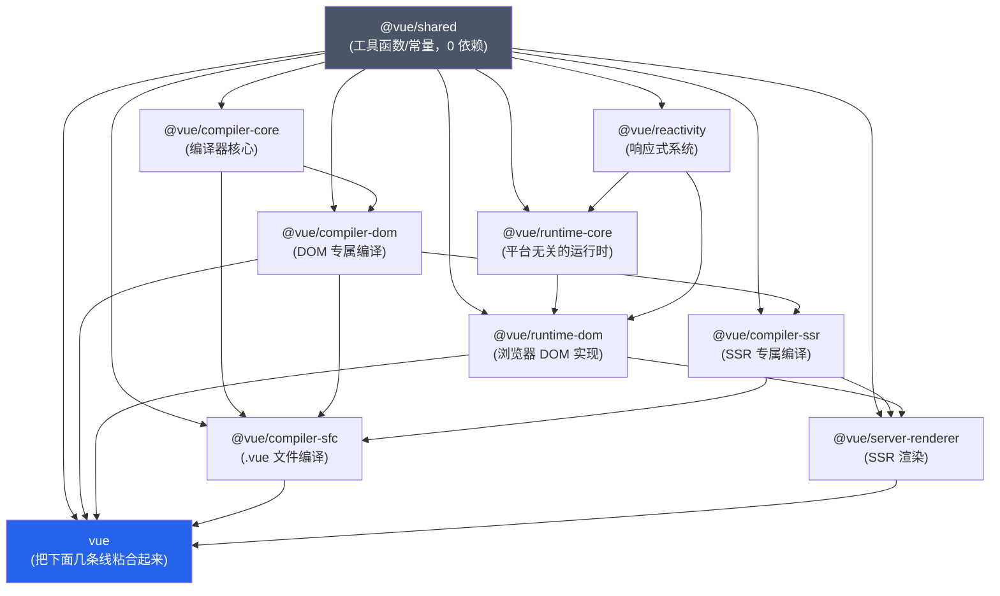

# 01. 整体架构

> Vue 3 不是一个文件，是十几个互相依赖的包拼出来的一棵树。搞清楚这棵树的形状，后面每一章讲的东西应该挂在哪一层、为什么能独立测试、为什么能按需引入，都会顺理成章。

## 本章导读

学完本章能回答：

- `vuejs/core` 这个 monorepo 里有哪些包，谁依赖谁？
- 为什么 `@vue/reactivity` 能单独发布、单独使用，和 Vue 组件系统完全无关？
- `import { createApp } from 'vue'` 这一行代码，实际加载的是哪个文件？为什么 Vite 项目和直接用 Node 跑的结果不一样？
- `vue` 和 `vue.runtime`、`esm-bundler` 和 `esm-browser`、`global` 这些构建产物到底有什么区别，该在什么场景用哪个？
- Vue 2 的"一个大 `src/core` 目录"和 Vue 3 的"monorepo + 包边界"相比，换来了什么、付出了什么代价？

前置章节：无（这是整条路径的起点）。预计阅读时间：20-30 分钟。

涉及源码文件：

| 文件 | 作用 |
|---|---|
| `packages/*/package.json` | 每个包的依赖声明，monorepo 的真实依赖图就藏在这里 |
| `rollup.config.js` | 定义 7 种构建产物格式（`esm-bundler`/`esm-browser`/`cjs`/`global` 及其 `-runtime` 变体） |
| `scripts/build.js` | 按包、按格式跑 rollup 打包的调度脚本 |
| `packages/vue/package.json` | 顶层 `vue` 包的 `exports` 字段，决定不同加载方式命中哪个文件 |
| `packages/vue/index.js` / `index.mjs` | 运行时按 `NODE_ENV` 转发到具体 dist 文件的"糖衣" |
| `packages/runtime-core/src/featureFlags.ts` | `__VUE_OPTIONS_API__` 等编译时特性开关的运行时兜底逻辑 |

## 先跑起来

```bash
pnpm ex chapters/01-architecture/examples/01-package-dependency-graph.ts
pnpm ex chapters/01-architecture/examples/02-module-resolution-which-build.ts
pnpm ex chapters/01-architecture/examples/03-layering-in-practice.ts
```

第一个示例会读取本仓库真实安装的每个 `@vue/*` 包的 `package.json`，拼出一张依赖图，结果长这样（节选）：

```
第 0 层
    @vue/shared
第 1 层
    @vue/compiler-core、@vue/reactivity
第 2 层
    @vue/compiler-dom、@vue/runtime-core
第 3 层
    @vue/compiler-ssr、@vue/runtime-dom
第 4 层
    @vue/compiler-sfc、@vue/server-renderer
第 5 层
    vue
```

看点：`@vue/shared` 在最底层，所有包都直接或间接依赖它；`reactivity` 和 `compiler-core` 各自是两条线（响应式、编译器）的起点，互相不依赖；顶层的 `vue` 包反而在最后一层——它自己不产生任何新能力，只是把下面几条线粘合在一起。

## 整体图



这张图里有两条几乎独立的竖线：**响应式/运行时**（reactivity → runtime-core → runtime-dom）和**编译器**（compiler-core → compiler-dom → compiler-sfc）。两条线只在 `shared` 这一层汇合，中间完全不互相依赖——这不是巧合，是故意设计成这样的：一个只想用响应式系统做状态管理的项目（比如把 `@vue/reactivity` 用在非 Vue 的框架里），完全不需要拉进编译器和 DOM 的代码。

## 源码精读

### 1.1 为什么要拆成这么多包

Vue 2 的源码是单仓库、单构建产物（`src/core` 下一个大目录，最终打包成几个 `vue.js`/`vue.runtime.js`/`vue.common.js`）。Vue 3 从一开始就是 **monorepo + 多包**，每个包是一个独立的 npm 包，有自己的 `package.json`、自己的单元测试、自己的构建产物。好处直接对应到三件事：

- **按需使用**：只要响应式系统，`npm i @vue/reactivity` 就够了，不会把编译器、DOM 操作的代码一起打进 bundle。第二个示例会证明 `@vue/reactivity` 完全不认识 VNode、组件这些概念。
- **跨平台复用**：`@vue/runtime-core` 不知道"DOM"是什么，它只认一组叫 `RendererOptions` 的接口（`createElement`/`insert`/`patchProp`/...）。`@vue/runtime-dom` 实现这组接口去操作浏览器 DOM；如果有人要做小程序渲染器、Canvas 渲染器，只需要实现同一组接口，`runtime-core` 的 diff 算法、组件系统、调度器全部可以直接复用——这正是 `shared/logging-renderer.ts`（本仓库自己的示例工具）在做的事。
- **独立版本/独立测试**：每个包可以单独写单测、单独发版本号（虽然 Vue 3 实践中选择了"锁步发版"，所有包版本号永远一致，但边界依然是清晰的）。

### 1.2 两条主线：响应式/运行时 vs 编译器

**响应式/运行时这条线**（`reactivity` → `runtime-core` → `runtime-dom`）解决"状态变了之后，界面怎么自动更新"：

- `@vue/reactivity`：`reactive`/`ref`/`effect`/`computed`/`watch` 这些 API，纯 JavaScript 对象层面的依赖追踪，见第 02-04 章。
- `@vue/runtime-core`：VNode、组件实例、渲染器（patch/diff）、调度器，但**所有和真实 DOM 打交道的操作都通过 `RendererOptions` 这组接口转发出去**，自己完全不 `import` 任何浏览器 API。见第 05-10 章。
- `@vue/runtime-dom`：实现 `RendererOptions`，真正调用 `document.createElement`、处理 `class`/`style`/事件、v-model/v-show 指令。见第 14 章。

**编译器这条线**（`compiler-core` → `compiler-dom` → `compiler-sfc`）解决"模板字符串怎么变成一个 render 函数"：

- `@vue/compiler-core`：parse（把字符串变 AST）→ transform（AST 变换 + 收集 patchFlag）→ codegen（AST 生成 JS 代码字符串）。但它不知道"HTML"长什么样，不内置任何 DOM 专属指令的语义。见第 11-12 章。
- `@vue/compiler-dom`：在 `compiler-core` 的 parserOptions/nodeTransforms/directiveTransforms 基础上叠加 DOM 专属的部分——哪些标签是"原生标签"（`isNativeTag`）、v-model 在原生 `<input>` 上要生成什么、`<style>`/`<script>` 怎么处理、静态内容字符串化等。
- `@vue/compiler-sfc`：编译 `.vue` 单文件组件，内部按 `<template>`/`<script>`/`<style>` 分别调用 `compiler-dom` 和自己的 `compileScript`/`compileStyle`。见第 13 章。

第三个示例用 `baseCompile`（不带任何 DOM 相关配置）编译 `<input v-model="text" v-show="visible" />`，能直接看到这层边界：

```ts
// baseCompile：<input> 仍是元素（createElementBlock），但 compiler-core 的通用 v-model
// transform 不区分元素/组件，一律生成 modelValue / onUpdate:modelValue 两个 props（组件协议）；
// v-show 没有对应 transform，被静默丢弃
return (_openBlock(), _createElementBlock("input", {
  modelValue: text,
  "onUpdate:modelValue": $event => ((text) = $event)
}, null, 8 /* PROPS */, ["modelValue", "onUpdate:modelValue"]))
```

```ts
// compiler-dom：认出 <input> 是原生元素，换成真正的 DOM 指令
// （能处理 lazy/trim/number 修饰符、composition 事件，这是 vModelText 做的事）
return _withDirectives((_openBlock(), _createElementBlock("input", {
  "onUpdate:modelValue": $event => ((text) = $event)
}, null, 8 /* PROPS */, ["onUpdate:modelValue"])), [
  [_vModelText, text],
  [_vShow, visible]
])
```

v-model 在两边都"编译成功"了，只是语义完全不同；v-show 在 `compiler-core` 里则是彻底的"未知指令，静默跳过"——因为它整个指令的语义（`display: none` 怎么设置、怎么和 `transition` 配合）都写在 `compiler-dom/src/transforms/vShow.ts` 里，`compiler-core` 从未听说过这个名字。

### 1.3 顶层 `vue` 包：粘合层，不是实现层

打开 `packages/vue/package.json` 会发现它的 `dependencies` 是：

```json
{
  "@vue/shared": "workspace:*",
  "@vue/compiler-dom": "workspace:*",
  "@vue/runtime-dom": "workspace:*",
  "@vue/compiler-sfc": "workspace:*",
  "@vue/server-renderer": "workspace:*"
}
```

`packages/vue/src` 目录本身只有几十行代码：注册一个 `compileToFunction`，把 `@vue/compiler-dom` 的 `compile()` 包成"运行时模板编译"能力（给 `<div id="app">{{ msg }}</div>` 这种 in-DOM 模板用），然后把 `@vue/runtime-dom` 的全部导出原样转发出去。真正的组件系统、diff 算法、DOM 操作全都不在这个包里——`vue` 只是一个"预设好的组合"。

### 1.4 构建产物：同一份源码，七种打包格式

`rollup.config.js` 里定义了这张格式表：

```js
const outputConfigs = {
  'esm-bundler': { file: `dist/${name}.esm-bundler.js`, format: 'es' },
  'esm-browser': { file: `dist/${name}.esm-browser.js`, format: 'es' },
  cjs: { file: `dist/${name}.cjs.js`, format: 'cjs' },
  global: { file: `dist/${name}.global.js`, format: 'iife' },
  // 以下三种是"运行时专用"格式，只给顶层 vue 包用
  'esm-bundler-runtime': { file: `dist/${name}.runtime.esm-bundler.js`, format: 'es' },
  'esm-browser-runtime': { file: `dist/${name}.runtime.esm-browser.js`, format: 'es' },
  'global-runtime': { file: `dist/${name}.runtime.global.js`, format: 'iife' },
}
```

两个维度在交叉：

- **模块格式**：`cjs`（Node `require`）、`esm-bundler`（给 Vite/webpack 这类打包器用，保留 `process.env.NODE_ENV` 等待打包器替换）、`esm-browser`（可以直接被浏览器当 `<script type="module">` 加载，已经把环境变量替换成字面量）、`global`（IIFE，挂一个全局变量，给 `<script src="...">` 直接用）。
- **是否含编译器**：默认格式含运行时模板编译器（`compileToFunction`，依赖 `@vue/compiler-dom`）；带 `-runtime` 后缀的格式不含编译器，体积更小，前提是模板已经在构建时被 `@vue/compiler-sfc`（或 vue-loader）编译成了 render 函数。

第二个示例验证了一个容易被忽略的细节：**本仓库所有 `import ... from 'vue'` 的示例，在 Node/tsx 环境下实际加载的是 `dist/vue.cjs.js`**（完整版，2.2 KB 的转发层 + 实际实现在它 `require` 的内容里），这是因为 `package.json#exports` 里 `import` 条件下还细分了 `node` 子条件，Node 的模块解析器天然带着 `node` 这个条件，会优先命中它，最终落到 `index.mjs` → `index.js`，这个文件又按 `NODE_ENV` 决定 `require('./dist/vue.cjs.js')` 还是 `.cjs.prod.js`。这也是第 14 章"容器 `innerHTML` 当 template 用"那个例子能直接跑通的原因——换成 Vite 项目，默认会命中 `module` 字段指向的 `vue.runtime.esm-bundler.js`（不含编译器），同样的写法会在控制台打印警告而不是真的编译。

### 1.5 特性开关（Feature Flags）

`packages/runtime-core/src/featureFlags.ts` 里定义了几个编译时常量：`__VUE_OPTIONS_API__`（是否打包 Options API 支持）、`__VUE_PROD_DEVTOOLS__`（生产环境是否启用 devtools 钩子）、`__VUE_PROD_HYDRATION_MISMATCH_DETAILS__`（3.4+ 新增，生产环境 hydration 报错是否带详细信息）。这些不是运行时 `if`，而是打包时由 `@rollup/plugin-replace`（或 Vite 的 `define` 配置）整体替换成字面量 `true`/`false`，配合 tree-shaking 把用不到的分支直接删掉——这就是为什么 `vite.config.ts` 里经常能看到：

```ts
define: {
  __VUE_OPTIONS_API__: true,
  __VUE_PROD_DEVTOOLS__: false,
}
```

如果打包器没有定义这些常量，`featureFlags.ts` 里有一段兜底逻辑：开发环境下打印警告，提醒开发者配置它们，同时给一个默认值，避免直接报 `ReferenceError`。

### 1.6 `@vue/compat`：面向 Vue 2 用户的"兼容运行时"

还有一个没在上面的依赖图里出现的包：`@vue/compat`，`package.json` 里写着 `"description": "Vue 3 compatibility build for Vue 2"`。它本质上还是 Vue 3 的运行时，但在 `runtime-core/src/compat/` 目录下实现了一整套"行为开关"（`compatConfig.ts`），可以单独打开/关闭某个 Vue 2 行为（比如 `$children`、`$listeners`、全局 `Vue.filter`、数组变更的侦测方式等），用于渐进式迁移。这不是本仓库的重点，提一句是为了让你知道"Vue 2 迁移到 Vue 3"这件事在官方工具链里是有专门支持的，不是只能一次性重写。

## 与 Vue 2 对比

| 维度 | Vue 2 | Vue 3 | 为什么改 |
|---|---|---|---|
| 代码组织 | 单仓库单目录：`src/core`（平台无关核心）+ `src/platforms/web`（DOM 实现）+ `src/compiler`，但最终只发布一个 `vue` npm 包 | monorepo + 10+ 个独立 npm 包，每个包可以单独安装、单独测试 | 响应式系统、编译器这些模块在 Vue 2 里虽然也有内部边界，但对外是不可见的——用户没法"只要响应式系统"；拆包让边界变成契约，也让每个模块可以独立演进 |
| 平台抽象 | `src/platforms/web/runtime/` 通过模块路径分离 DOM 实现，但 `core` 和 `platforms` 之间的接口不是一份显式声明的 TS 接口 | `RendererOptions` 是一份显式的 TS 接口，`createRenderer(options)` 是唯一的桥接点 | 显式接口让"自定义渲染器"这件事从"理论可行"变成"文档化的能力"（`@vue/runtime-core` 的 `createRenderer` 导出本身就是公开 API） |
| 构建产物 | `vue.js`（完整版 UMD）、`vue.min.js`、`vue.common.js`（CJS）、`vue.runtime.common.js`（运行时版 CJS）、`vue.esm.js` 等，按文件名手写区分 | `rollup.config.js` 里统一声明 7 种 `PackageFormat`，每个包按 `buildOptions.formats` 声明自己要出哪几种，`scripts/build.js` 统一调度 | 包的数量从 1 个变成 10+ 个之后，手工维护每个包的产物文件名/格式组合会迅速失控，需要一份声明式的配置 |
| 响应式系统独立性 | `src/core/observer` 深度依赖 `Vue` 构造函数的一些全局状态（比如 `Dep.target` 是模块级变量，和 `Watcher`/组件强耦合），从未作为独立包发布 | `@vue/reactivity` 从 3.0 起就是独立发布的 npm 包，被 Vuex 4、Pinia、甚至一些非 Vue 项目直接拿去用 | 这是 Vue 3 架构改动里对外影响最大的一条：响应式系统不再是"Vue 的内部实现细节"，而是一等公民的通用能力 |
| 特性裁剪 | 没有编译时特性开关的概念，`Vue.config.*` 都是运行时配置 | `__VUE_OPTIONS_API__` 等编译时常量 + tree-shaking，能在构建阶段整体删掉用不到的代码 | Vue 3 的体积优化很大一部分来自"构建时确定要不要某个子系统"，而不是运行时判断 |

## 动手：mini 实现 / 实验

本章没有独立的 `mini-vue` 子目录（架构层面的东西不适合"重新实现一遍"），但建议做这几件事巩固理解：

1. 跑 `pnpm ex chapters/01-architecture/examples/01-package-dependency-graph.ts`，把输出的依赖图和上面的 Mermaid 图对照，确认自己能解释每一条依赖线的理由。
2. 把示例二里的 `NODE_ENV` 改一下再跑（比如 `NODE_ENV=production pnpm ex chapters/01-architecture/examples/02-module-resolution-which-build.ts`），确认它会换成加载 `vue.cjs.prod.js`。
3. 在示例三的基础上，试着给 `baseCompile` 传入 `isNativeTag: () => false`（强制一切都不是原生标签）和 `() => true`（强制一切都是原生标签），分别编译一次，对比产物：`() => true` 和不传完全一样；`() => false` 会变成 `resolveComponent("input")` + `createBlock`，但 v-model 生成的 props 三者都不变——这能帮你确认 `isNativeTag` 只决定"元素还是组件"，而"原生 `<input>` 用 vModelText 指令"是 compiler-dom 的 transform 决定的。

## 常见疑问

**Q: 为什么不直接 `import { reactive } from 'vue'`，非要强调 `@vue/reactivity`？**
两者运行时是同一份代码（`vue` 包本身依赖并转发了 `@vue/runtime-dom`，而 `runtime-dom` 又转发了 `runtime-core`，`runtime-core` 又转发了 `reactivity` 的大部分 API）。强调 `@vue/reactivity` 是因为它能脱离其余所有包独立运行——这是一个架构事实，不是一个"应该怎么写代码"的建议。实际项目里直接从 `vue` 导入就行。

**Q: `esm-bundler` 和 `esm-browser` 不是都是 ES Module 吗，有什么区别？**
区别在 `process.env.NODE_ENV` 这类表达式有没有被替换成字面量。`esm-bundler` 格式保留 `process.env.NODE_ENV !== 'production'` 这样的表达式，指望 Vite/webpack 在打包时替换并 tree-shake 掉开发分支；`esm-browser` 已经在构建时把这些替换成了 `true`/`false`，可以直接丢给浏览器跑，不需要任何打包步骤。

**Q: `vue.global.js` 587 KB，是不是很大？**
它是未压缩、开发模式（含完整警告信息、devtools 钩子）的 IIFE 版本，`vue.global.prod.js` 只有 171 KB 左右（压缩前），实际生产环境用这个，gzip 之后会再小很多。本章示例二打印过这两个文件的真实大小，可以自己再跑一遍确认。

**Q: 这套包结构会不会在 3.6（Vapor 模式）里变化？**
会新增 `@vue/runtime-vapor`、`@vue/compiler-vapor` 两个包，依赖关系上 `runtime-vapor` 依赖 `reactivity`（但不依赖 `runtime-core`，因为 Vapor 不用 VNode），具体见第 16 章。

## 小结

- Vue 3 是 monorepo，`@vue/shared` 在最底层，往上分成"响应式/运行时"和"编译器"两条基本独立的线，只在编译 SFC（`compiler-sfc`）和 SSR（`server-renderer`）时才汇合。
- `@vue/reactivity` 可以完全脱离组件系统独立使用，这是刻意设计的结果，不是巧合。
- `@vue/runtime-core` 通过 `RendererOptions` 这组接口和平台解耦，真正的 DOM 操作在 `@vue/runtime-dom` 里。
- `@vue/compiler-core` 同理通过 `isNativeTag`/`nodeTransforms`/`directiveTransforms` 等可配置项和 DOM 解耦，`@vue/compiler-dom` 叠加 DOM 专属能力。
- 顶层 `vue` 包是粘合层，自己几乎不包含实现。
- 同一份源码会打包成 7 种格式，核心差异是"模块系统"（cjs/esm/iife）和"是否含运行时编译器"两个维度的组合；`package.json#exports` 的条件分支决定了不同加载方式命中哪个产物。
- `__VUE_OPTIONS_API__` 等特性开关是编译时常量，配合 tree-shaking 做体积裁剪，不是运行时 if。

## 延伸阅读

- Vue 3 源码仓库：<https://github.com/vuejs/core>
- Node.js 的 `exports` 字段文档（理解条件导出的匹配顺序）：<https://nodejs.org/api/packages.html#conditional-exports>
- Evan You 在 Vue 3 RFC 仓库里关于 monorepo 拆分动机的讨论：<https://github.com/vuejs/rfcs>
- `@vue/compat` 迁移构建说明：<https://v3-migration.vuejs.org/breaking-changes/migration-build.html>

## 思考题

<details>
<summary>1. 如果要新增一个"渲染到 Canvas"的渲染器，需要实现哪个包的哪个接口？不需要动哪些包？</summary>

只需要实现 `@vue/runtime-core` 的 `createRenderer(options)` 所需的 `RendererOptions` 接口（`createElement`/`insert`/`patchProp`/...），针对 Canvas API 写一套实现，类似 `@vue/runtime-dom` 对浏览器 DOM 做的事。完全不需要动 `@vue/reactivity`（状态管理逻辑无关平台）、`@vue/compiler-core`/`compiler-dom`（如果不需要模板语法，可以直接手写 `h()` 调用；如果需要类模板语法，还需要一套"Canvas 专属"的编译器后端，但那已经超出"渲染器"这一层的职责）。
</details>

<details>
<summary>2. 为什么 `@vue/compiler-core` 的 `directiveTransforms` 要内置一个通用的 v-model，而不是把 v-model 完全留给 compiler-dom？</summary>

因为 v-model 在"组件"上的语义（生成 `modelValue` prop + 监听 `update:modelValue` 事件）是平台无关的——无论渲染到 DOM 还是其他平台，组件间的双向绑定协议都是一样的。只有"v-model 用在原生表单元素上该怎么操作"（`<input>` 要处理 composition 事件，`<select>` 要处理 `multiple`，等等）才是 DOM 专属的，所以这部分被 `compiler-dom` 覆盖（override）而不是新增。
</details>

<details>
<summary>3. 第二个示例里，`vue.esm-bundler.js` 和 `vue.cjs.js` 都约 2 KB 却都"含编译器"，这怎么可能？编译器代码去哪了？</summary>

这两个文件本身只是"胶水代码"——注册 `compileToFunction`、转发 `runtime-dom` 的导出，它们各自 `import`/`require` 了 `@vue/compiler-dom` 和 `@vue/runtime-dom`，真正的编译器代码在那两个包各自的 dist 文件里。"含编译器"说的是最终加载完整依赖链之后的能力，不是这一个文件自身的体积。
</details>
