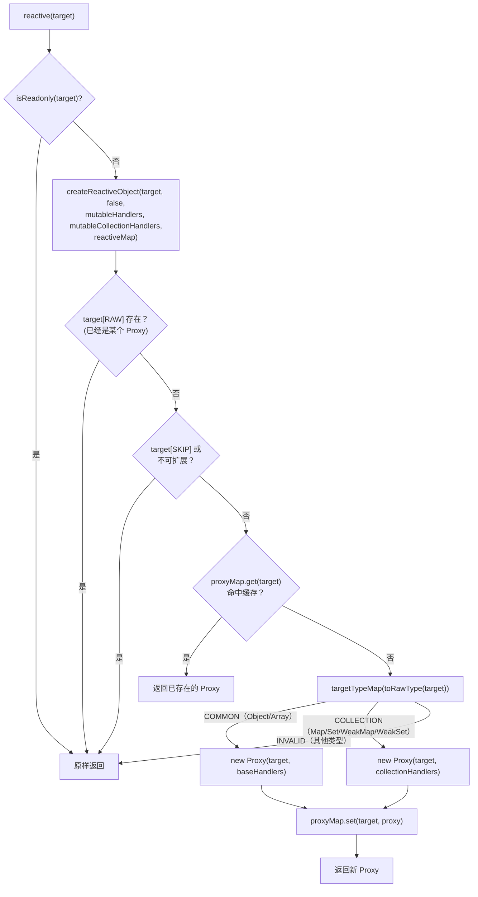
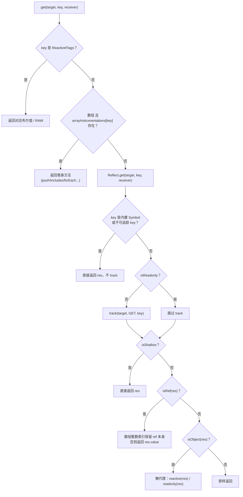
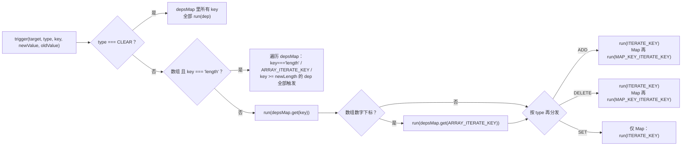

# 02. reactive 与 Proxy handlers

> `reactive()` 怎么把一个普通对象变成能被追踪、能触发更新的响应式对象——以及这背后的 Proxy handlers 具体拦截了哪些操作。

## 本章导读

学完这一章，你应该能回答：

- `reactive(obj)` 调用之后，`obj` 到底发生了什么？什么时候真正创建 Proxy，什么时候只是查缓存？
- 为什么同一个对象 `reactive()` 两次还是同一个结果？`readonly(reactive(x))` 和 `reactive(readonly(x))` 为什么不一样？
- 数组的 `push/pop/includes` 等方法为什么要单独写一套 `arrayInstrumentations`？在 `effect` 里调用 `push` 为什么不会死循环？
- Map/Set 为什么不能复用 `baseHandlers`，`collectionHandlers` 另起炉灶在拦截什么？
- 一次 `obj.a = 1` 或 `delete obj.a` 之后，`trigger()` 到底会通知哪些 key 上的依赖？`ITERATE_KEY`/`ARRAY_ITERATE_KEY`/`MAP_KEY_ITERATE_KEY` 分别在什么时候登场？

前置章节：建议先浏览 `chapters/01-architecture`（了解 monorepo 结构）。预计阅读时间：50-70 分钟（含跑示例）。

本章只讲"哪些 key 被 track、哪些 key 被 trigger"；`Dep`/`Link`/版本号的内部实现、`ReactiveEffect` 的调度细节留给第 03 章。

涉及源码文件：

| 文件 | 作用 | 行数量级 |
|---|---|---|
| `packages/reactivity/src/reactive.ts` | `reactive/readonly/shallow*`、`createReactiveObject`、四张 proxyMap、`ReactiveFlags` 相关判断函数 | ~445 行 |
| `packages/reactivity/src/constants.ts` | `TrackOpTypes`/`TriggerOpTypes`/`ReactiveFlags` 枚举 | ~24 行 |
| `packages/reactivity/src/baseHandlers.ts` | 普通对象/数组的 Proxy handlers（get/set/deleteProperty/has/ownKeys） | ~264 行 |
| `packages/reactivity/src/arrayInstrumentations.ts` | 数组方法的特殊拦截（3.5 新拆出的文件） | ~412 行 |
| `packages/reactivity/src/collectionHandlers.ts` | Map/Set/WeakMap/WeakSet 的 handlers | ~331 行 |
| `packages/reactivity/src/dep.ts`（本章只看 `track`/`trigger` 两个函数） | 依赖收集与触发的总入口 | 本章相关 ~130 行 |

## 先跑起来

```bash
pnpm ex chapters/02-reactive/examples/01-proxy-vs-defineProperty.ts
pnpm ex chapters/02-reactive/examples/02-lazy-nested-and-cache.ts
pnpm ex chapters/02-reactive/examples/03-array-instrumentations.ts
pnpm ex chapters/02-reactive/examples/04-collections.ts
pnpm ex chapters/02-reactive/examples/05-track-trigger-keys.ts
```

跑第一个示例，关键输出截取（完整版见示例文件注释里的三种场景）：

```
┌───────────── 1. 新增属性：Vue 2 defineProperty 版 vs Vue 3 Proxy 版
│      defineProperty 版本收到的通知： []
│      v2.b 的值： 2 （属性确实加上了，只是不是响应式的）
│      Proxy 版本：b 被访问 + 修改后，"手写 effect"运行次数 = 2 （新增属性一样能被追踪到）
┌────────────────────────────────────── 2. 数组索引赋值：arr[idx] = x
│      defineProperty 版本收到的通知： [] -> list[1] 现在是 100
│      这正是 Vue 2 文档里「不能检测到以下数组变动」的第一条：arr[index] = value
```

一句话点出看到了什么：**同样是"新增属性/改数组下标/delete"，`Object.defineProperty` 版本完全没反应（因为属性要在初始化时就存在才有 getter/setter），`Proxy` 版本全部正常响应**——这是本章要解释的核心机制差异。

再跑第 5 个示例（`onTrack`/`onTrigger` 直接打印内部事件）：

```
┌──────── 2. ownKeys 触发的 ITERATE_KEY：Object.keys / for...in / JSON.stringify 都会走到它
│      [onTrack]  type=iterate  key=Symbol(Object iterate)
│  1. 新增属性 c：ADD 操作，会额外触发 ITERATE_KEY（因为 key 的集合变了）
│      [onTrigger] type=add  key=c
│  2. 修改已有属性 a 的值：SET 操作，不影响 key 集合，不会触发 ITERATE_KEY（上面不应该再打印 onTrigger）
│  3. delete 属性 b：DELETE 操作，key 集合又变了，触发 ITERATE_KEY
│      [onTrigger] type=delete  key=b
```

看到了什么：`onTrigger` 打印的 `key` 是**触发这次变更的原始 key**（`c`/`b`），不是被牵连触发的 `ITERATE_KEY` 本身——因为 `trigger()` 内部对多个 dep 的 `run()` 调用共享同一份 `debugInfo`。这是一个容易被忽略但看一眼输出就能明白的细节。

## 整体图



四张 `proxyMap`（`reactiveMap`/`shallowReactiveMap`/`readonlyMap`/`shallowReadonlyMap`，都是 `WeakMap<Target, any>`）互相独立：同一个原始对象可以同时存在于多张表里（比如既被 `reactive()` 过，又被 `readonly()` 过），但在**同一张表**里只会有一个 Proxy。这就是"懒代理 + 幂等"的全部秘密。

## 源码精读

### 2.1 `createReactiveObject`：五道判断，决定要不要真的 new 一个 Proxy

```ts
// packages/reactivity/src/reactive.ts#L262-L306
function createReactiveObject(
  target: Target,
  isReadonly: boolean,
  baseHandlers: ProxyHandler<any>,
  collectionHandlers: ProxyHandler<any>,
  proxyMap: WeakMap<Target, any>,
) {
  if (!isObject(target)) { /* ... 开发环境 warn，返回原值 */ }
  // target is already a Proxy, return it.
  // exception: calling readonly() on a reactive object
  if (
    target[ReactiveFlags.RAW] &&
    !(isReadonly && target[ReactiveFlags.IS_REACTIVE])
  ) {
    return target
  }
  // only specific value types can be observed.
  if (target[ReactiveFlags.SKIP] || !Object.isExtensible(target)) {
    return target
  }
  // target already has corresponding Proxy
  const existingProxy = proxyMap.get(target)
  if (existingProxy) {
    return existingProxy
  }
  const targetType = targetTypeMap(toRawType(target))
  if (targetType === TargetType.INVALID) {
    return target
  }
  const proxy = new Proxy(
    target,
    targetType === TargetType.COLLECTION ? collectionHandlers : baseHandlers,
  )
  proxyMap.set(target, proxy)
  return proxy
}
```

五道判断按顺序分别拦住五种"不应该/不需要再包一层"的情况：

1. **不是对象**：`reactive(1)` 这种直接原样返回（开发环境有警告）。
2. **已经是个 Proxy**（`target[RAW]` 存在）：直接返回自己。例外是"对一个 reactive 对象调用 readonly()"——这时 `isReadonly` 为真但 `target` 还不是 readonly 身份，要继续往下走，重新包一层 readonly Proxy（这就是 `readonly(reactive(x))` 为什么会产生一个新对象）。
3. **`markRaw` 标记过，或对象已被 `Object.freeze`/不可扩展**：直接返回，不代理。
4. **命中 `proxyMap` 缓存**：同一个原始对象第二次 `reactive()`，直接复用第一次创建的 Proxy——这是"懒代理"里"幂等"的那一半。
5. **类型判断**（`targetTypeMap`）：只有 `Object`/`Array` 走 `baseHandlers`，`Map`/`Set`/`WeakMap`/`WeakSet` 走 `collectionHandlers`，其他类型（比如 `Date`、`RegExp`、函数）直接返回原值——这也是为什么 `reactive(new Date())` 不会报错但也完全没有响应式效果。

```ts
// packages/reactivity/src/reactive.ts#L37-L56
enum TargetType {
  INVALID = 0,
  COMMON = 1,
  COLLECTION = 2,
}
function targetTypeMap(rawType: string) {
  switch (rawType) {
    case 'Object':
    case 'Array':
      return TargetType.COMMON
    case 'Map':
    case 'Set':
    case 'WeakMap':
    case 'WeakSet':
      return TargetType.COLLECTION
    default:
      return TargetType.INVALID
  }
}
```

### 2.2 `ReactiveFlags`：挂在 target 上的暗号

```ts
// packages/reactivity/src/constants.ts#L17-L24
export enum ReactiveFlags {
  SKIP = '__v_skip',
  IS_REACTIVE = '__v_isReactive',
  IS_READONLY = '__v_isReadonly',
  IS_SHALLOW = '__v_isShallow',
  RAW = '__v_raw',
  IS_REF = '__v_isRef',
}
```

这几个字符串本身不是真实存在于对象上的属性——它们是 `BaseReactiveHandler.get` 专门拦截的"魔法 key"：`obj.__v_isReactive` 这种访问会被 `get` 陷阱识别出来，直接返回计算结果（`!isReadonly`），根本不会走到 `Reflect.get` 那一步。`isReactive/isReadonly/isShallow/isProxy/toRaw` 全部是靠"读这几个 key"实现的：

```ts
// packages/reactivity/src/reactive.ts#L326-L394（节选）
export function isReactive(value: unknown): boolean {
  if (isReadonly(value)) {
    return isReactive((value as Target)[ReactiveFlags.RAW])
  }
  return !!(value && (value as Target)[ReactiveFlags.IS_REACTIVE])
}
export function isReadonly(value: unknown): boolean {
  return !!(value && (value as Target)[ReactiveFlags.IS_READONLY])
}
export function toRaw<T>(observed: T): T {
  const raw = observed && (observed as Target)[ReactiveFlags.RAW]
  return raw ? toRaw(raw) : observed
}
```

`isReactive` 对 `readonly(reactive(x))` 的处理很值得注意：它先判断 `isReadonly`，如果是只读的，就**顺着 `RAW` 往下再判断一次**——因为 `readonly(reactive(x))` 的 `target` 就是 `reactive(x)` 这个 Proxy 本身（不是最底层的原始对象），所以 `ro[RAW]` 拿到的是 `reactive(x)`，再对它判断 `isReactive` 就能拿到 `true`。对照示例 02 第 5 组。

### 2.3 `BaseReactiveHandler.get`：一次属性读取要经过的判断链

```ts
// packages/reactivity/src/baseHandlers.ts#L55-L134（节选，省略 RAW 分支细节）
get(target: Target, key: string | symbol, receiver: object): any {
  if (key === ReactiveFlags.SKIP) return target[ReactiveFlags.SKIP]
  // ... IS_REACTIVE / IS_READONLY / IS_SHALLOW / RAW 几个 ReactiveFlags 分支
  const targetIsArray = isArray(target)
  if (!isReadonly) {
    let fn: Function | undefined
    if (targetIsArray && (fn = arrayInstrumentations[key])) {
      return fn
    }
    if (key === 'hasOwnProperty') {
      return hasOwnProperty
    }
  }
  const res = Reflect.get(target, key, isRef(target) ? target : receiver)
  if (isSymbol(key) ? builtInSymbols.has(key) : isNonTrackableKeys(key)) {
    return res
  }
  if (!isReadonly) {
    track(target, TrackOpTypes.GET, key)
  }
  if (isShallow) {
    return res
  }
  if (isRef(res)) {
    const value = targetIsArray && isIntegerKey(key) ? res : res.value
    return isReadonly && isObject(value) ? readonly(value) : value
  }
  if (isObject(res)) {
    return isReadonly ? readonly(res) : reactive(res)
  }
  return res
}
```



这条判断链的顺序本身就是设计：

1. **ReactiveFlags 几个暗号最先判断**——性能上最常访问，优先短路。
2. **数组方法拦截**在 `Reflect.get` **之前**：`arr.push` 要返回的是 `arrayInstrumentations.push`，而不是原生 `Array.prototype.push`。
3. **`Reflect.get` 之后**才判断"这个 key 要不要 track"——`Symbol.iterator`、`__proto__`、`__v_isRef` 这些不可追踪的 key 会在这里被过滤掉（`builtInSymbols`/`isNonTrackableKeys`）。
4. **`track()` 在 shallow 判断之前**：哪怕是 `shallowReactive`，根层属性照样被追踪，只是不会继续把嵌套对象包一层代理。
5. **ref 自动解包**：数组的整数索引除外（数组里存 `ref` 本身，语义上是"这一项是个 ref"，不应该自动拆开）。
6. **嵌套对象懒代理**：只有真正被 `get` 到的嵌套对象才会 `reactive(res)`/`readonly(res)`——这正是第二个示例要证明的"懒"。

### 2.4 `MutableReactiveHandler.set`：ADD 还是 SET，怎么判断

```ts
// packages/reactivity/src/baseHandlers.ts#L142-L192（节选）
set(target, key, value, receiver): boolean {
  let oldValue = target[key]
  const isArrayWithIntegerKey = isArray(target) && isIntegerKey(key)
  if (!this._isShallow) {
    const isOldValueReadonly = isReadonly(oldValue)
    if (!isShallow(value) && !isReadonly(value)) {
      oldValue = toRaw(oldValue)
      value = toRaw(value)
    }
    if (!isArrayWithIntegerKey && isRef(oldValue) && !isRef(value)) {
      if (isOldValueReadonly) { /* 警告：readonly ref 不能被覆盖 */ return true }
      oldValue.value = value // 写到 ref.value 上，而不是替换这个属性本身
      return true
    }
  }
  const hadKey = isArrayWithIntegerKey
    ? Number(key) < target.length
    : hasOwn(target, key)
  const result = Reflect.set(target, key, value, isRef(target) ? target : receiver)
  if (target === toRaw(receiver) && result) {
    if (!hadKey) {
      trigger(target, TriggerOpTypes.ADD, key, value)
    } else if (hasChanged(value, oldValue)) {
      trigger(target, TriggerOpTypes.SET, key, value, oldValue)
    }
  }
  return result
}
```

几个关键点：

- **`hadKey` 的判断**：数组走"下标是否小于当前 length"，普通对象走 `hasOwn`。这就是为什么 `arr[arr.length] = x`（相当于在末尾追加）会被判定成 `ADD`（会牵动 `length` 依赖），而 `arr[0] = x` 是 `SET`。
- **`hasChanged` 才触发 SET**：值没变不会无意义地通知下游——`Object.is` 级别的比较，`NaN === NaN` 场景也处理对了。
- **写入一个 reactive 对象里的 ref 属性**：`state.a = newVal`（`state.a` 原本是个 `ref`，`newVal` 不是 `ref`）时，不是替换掉这个属性，而是写到 `oldValue.value` 上——这是 `reactive()` 深层解包 ref 的另一半（读的时候自动 `.value`，写的时候也自动写回 `.value`）。
- **`target === toRaw(receiver)` 才 trigger**：防止通过原型链继承过来的 setter 误触发（比如 `Object.create(reactiveObj)` 场景）。

### 2.5 `ownKeys`：数组 track 的是 `"length"`，对象 track 的是 `ITERATE_KEY`

```ts
// packages/reactivity/src/baseHandlers.ts#L215-L222
ownKeys(target): (string | symbol)[] {
  track(target, TrackOpTypes.ITERATE, isArray(target) ? 'length' : ITERATE_KEY)
  return Reflect.ownKeys(target)
}
```

`Object.keys()`/`for...in`/`JSON.stringify()`/扩展运算符都会触发 `ownKeys` 陷阱。对普通对象，这里用一个专门的 `ITERATE_KEY`（一个模块级单例 `Symbol`）作为依赖的 key——因为"迭代"这个操作不属于任何一个具体属性。对数组则直接复用 `"length"`：因为数组的 key 集合变化本质上就是 `length` 变化（示例 05 第 3 组验证了这一点）。

### 2.6 `arrayInstrumentations.ts`：数组方法为什么要单独处理

这是 3.5 从 `baseHandlers.ts` 里拆出来的独立文件（412 行），解决三类问题：

**(1) 身份敏感方法**（`includes`/`indexOf`/`lastIndexOf`）：数组里存的元素是 `reactive()` 包过的 Proxy，用户传进来的参数却经常是原始对象，`===` 比较会失败。

```ts
// packages/reactivity/src/arrayInstrumentations.ts#L380-L397
function searchProxy(self, method, args) {
  const arr = toRaw(self) as any
  track(arr, TrackOpTypes.ITERATE, ARRAY_ITERATE_KEY)
  const res = arr[method](...args)
  if ((res === -1 || res === false) && isProxy(args[0])) {
    args[0] = toRaw(args[0])
    return arr[method](...args)
  }
  return res
}
```

先按用户传的参数原样查一次，查不到（且参数本身是个 Proxy）就把参数转成 `toRaw` 再查一次——两次尝试，保证无论用户传的是原始对象还是代理对象都能找到。

**(2) 读取型方法**（`map`/`filter`/`forEach`/`find`/`every`/`some`/`reduce`...）：这些方法会访问数组的"全部元素"，但没必要给每个索引单独建一个依赖——那样数组一大，依赖数量就爆炸。源码的做法是只 track 一次 `ARRAY_ITERATE_KEY`：

```ts
// packages/reactivity/src/arrayInstrumentations.ts#L40-L43
export function shallowReadArray<T>(arr: T[]): T[] {
  track((arr = toRaw(arr)), TrackOpTypes.ITERATE, ARRAY_ITERATE_KEY)
  return arr
}
```

`apply()`/`reduce()` 内部都是拿 `shallowReadArray(self)` 返回的**原始数组**去调用原生方法（不是代理数组），这样遍历元素本身不会额外触发逐个 `get` 陷阱，只在一开始记一次 `ARRAY_ITERATE_KEY`。

**(3) 会改变 length 的方法**（`push`/`pop`/`shift`/`unshift`/`splice`）：

```ts
// packages/reactivity/src/arrayInstrumentations.ts#L399-L412
function noTracking(self, method, args = []) {
  pauseTracking()
  startBatch()
  const res = (toRaw(self) as any)[method].apply(self, args)
  endBatch()
  resetTracking()
  return res
}
```

`pauseTracking()` 关掉这期间的依赖收集（原生 `push` 算法内部会读 `length`、写索引，这些读写都经过 Proxy 陷阱，但不应该产生新依赖），`startBatch/endBatch` 把一次调用牵出的多个 `trigger`（新索引的 `ADD` + `length` 的变化）合并成一次通知。示例 03 详细验证了"为什么在 `effect` 里 `push` 不会死循环"——这里有**两道独立的保险**：`pauseTracking` 避免产生不必要的新依赖，`ReactiveEffect.notify()` 里的 `RUNNING` 标记（第 03 章细讲）从根本上拒绝"自己触发自己"。

### 2.7 `collectionHandlers.ts`：Map/Set 为什么不能复用 baseHandlers

`Map.prototype.get`/`.set` 内部用的是 V8 的私有内部槽存数据，不经过 `this.xxx` 这种可被 Proxy 拦截的属性访问——所以 Proxy 的 `get`/`set` 陷阱对 `map.get('a')` 这种调用完全无效（`get` 陷阱只能拦住"访问 `get` 这个属性"，拿到的是函数本身，拦不住**调用**这个函数之后它内部做了什么）。`collectionHandlers` 的做法是：所有方法全部手写，在方法体内部显式调用 `track`/`trigger`。

```ts
// packages/reactivity/src/collectionHandlers.ts#L270-L296（节选）
function createInstrumentationGetter(isReadonly, shallow) {
  const instrumentations = createInstrumentations(isReadonly, shallow)
  return (target, key, receiver) => {
    // ReactiveFlags 几个分支 ...
    return Reflect.get(
      hasOwn(instrumentations, key) && key in target ? instrumentations : target,
      key,
      receiver,
    )
  }
}
```

关键的三条追踪线：

| 操作 | track 的 key | 谁会用到 |
|---|---|---|
| `map.get(k)` / `map.has(k)` | 具体的 `key`（和 `rawKey` 各 track 一次，如果不同的话） | 精确到某个 key 的依赖 |
| `map.size` / `map.forEach()` / `map.values()` / `map.entries()` | `ITERATE_KEY` | 关心"有哪些值"的场景 |
| `map.keys()` | `MAP_KEY_ITERATE_KEY`（Map 独有，Set 没有这个区分） | 只关心"键集合"的场景 |

```ts
// packages/reactivity/src/collectionHandlers.ts#L46-L55
const isKeyOnly = method === 'keys' && targetIsMap
!isReadonly &&
  track(rawTarget, TrackOpTypes.ITERATE, isKeyOnly ? MAP_KEY_ITERATE_KEY : ITERATE_KEY)
```

`trigger` 这一侧（在 `dep.ts`）对应的分发规则：

```ts
// packages/reactivity/src/dep.ts#L359-L384（节选）
case TriggerOpTypes.ADD:
  if (!targetIsArray) {
    run(depsMap.get(ITERATE_KEY))
    if (isMap(target)) run(depsMap.get(MAP_KEY_ITERATE_KEY))
  }
  break
case TriggerOpTypes.DELETE:
  if (!targetIsArray) {
    run(depsMap.get(ITERATE_KEY))
    if (isMap(target)) run(depsMap.get(MAP_KEY_ITERATE_KEY))
  }
  break
case TriggerOpTypes.SET:
  if (isMap(target)) {
    run(depsMap.get(ITERATE_KEY))
  }
  break
```

**最容易让人意外的一条**：Map 的 `SET`（改已有 key 的 value，key 集合没变）也会触发 `ITERATE_KEY`，但**不会**触发 `MAP_KEY_ITERATE_KEY`。原因是 `forEach(cb)` 的回调拿到的是 `(value, key, map)`，value 变了意味着 `forEach`/`values()`/`entries()` 产出的内容也变了，必须通知；但 `keys()` 只关心键集合，value 变化跟它无关。示例 04 第 4、5 组完整验证了这张表。

### 2.8 `track`/`trigger`：依赖收集与触发的总入口

```ts
// packages/reactivity/src/dep.ts#L262-L284
export function track(target: object, type: TrackOpTypes, key: unknown): void {
  if (shouldTrack && activeSub) {
    let depsMap = targetMap.get(target)
    if (!depsMap) targetMap.set(target, (depsMap = new Map()))
    let dep = depsMap.get(key)
    if (!dep) {
      depsMap.set(key, (dep = new Dep()))
      dep.map = depsMap
      dep.key = key
    }
    dep.track({ target, type, key }) // __DEV__ 带上 debugInfo，生产环境不带
  }
}
```

`targetMap: WeakMap<target, Map<key, Dep>>` 是整个响应式系统唯一的全局依赖表——每个 `(target, key)` 二元组对应一个 `Dep` 实例。注意这里 `depsMap` 是用 `key` 做索引，**不区分 `TrackOpTypes`**：`GET('a')` 和 `HAS('a')` 共用同一个 `Dep`（示例 04 第 3 组验证过）。`Dep`/`Link` 的内部结构是第 03 章的主角，这里只需要知道"一个 key 对应一个 Dep，谁 track 了它，谁就会在 trigger 时被通知"。

```ts
// packages/reactivity/src/dep.ts#L294-L389（节选，完整分发规则）
export function trigger(target, type, key?, newValue?, oldValue?, oldTarget?): void {
  const depsMap = targetMap.get(target)
  if (!depsMap) { globalVersion++; return } // 从没被 track 过，直接返回（但全局版本号还是要涨）

  const run = (dep) => dep && dep.trigger({ target, type, key, newValue, oldValue, oldTarget })
  startBatch()
  if (type === TriggerOpTypes.CLEAR) {
    depsMap.forEach(run) // 清空集合：所有 key 全部通知
  } else {
    const targetIsArray = isArray(target)
    const isArrayIndex = targetIsArray && isIntegerKey(key)
    if (targetIsArray && key === 'length') {
      const newLength = Number(newValue)
      depsMap.forEach((dep, key) => {
        if (key === 'length' || key === ARRAY_ITERATE_KEY || (!isSymbol(key) && key >= newLength)) run(dep)
      })
    } else {
      if (key !== void 0 || depsMap.has(void 0)) run(depsMap.get(key))
      if (isArrayIndex) run(depsMap.get(ARRAY_ITERATE_KEY)) // 任何数字下标变化都牵动 ARRAY_ITERATE_KEY
      switch (type) {
        case TriggerOpTypes.ADD: /* 见上文 */ break
        case TriggerOpTypes.DELETE: /* 见上文 */ break
        case TriggerOpTypes.SET: /* 见上文 */ break
      }
    }
  }
  endBatch()
}
```



完整的分发规则表（本章最该背熟的一张表）：

| 操作 | 直接触发 | 额外触发 |
|---|---|---|
| 普通对象 `SET` | `depsMap.get(key)` | 无 |
| 普通对象 `ADD` | `depsMap.get(key)` | `ITERATE_KEY` |
| 普通对象 `DELETE` | `depsMap.get(key)` | `ITERATE_KEY` |
| 数组 `arr[i] = x`（`i` 在范围内，`SET`） | `depsMap.get(i)` | `ARRAY_ITERATE_KEY`（因为 `isArrayIndex`） |
| 数组 `arr[i] = x`（`i` 超出范围，`ADD`） | `depsMap.get(i)` | `ARRAY_ITERATE_KEY` + `depsMap.get('length')` |
| 数组 `arr.length = n` | 遍历 `depsMap`：`key==='length' \|\| key===ARRAY_ITERATE_KEY \|\| key>=n` 的全部触发 | — |
| Map `SET`（key 已存在） | `depsMap.get(key)` | `ITERATE_KEY` |
| Map/Set `ADD`（新 key/新元素） | `depsMap.get(key)` | `ITERATE_KEY` + `MAP_KEY_ITERATE_KEY`（仅 Map） |
| Map/Set `DELETE` | `depsMap.get(key)` | `ITERATE_KEY` + `MAP_KEY_ITERATE_KEY`（仅 Map） |
| Map/Set `CLEAR` | `depsMap` 里**所有** key 全部触发 | — |

`startBatch()/endBatch()` 包住整个 `trigger()`，这样一次操作牵出的多次 `dep.trigger()` 调用，哪怕影响到同一个 effect 好几次，最终也只会让它重跑一次——这是第 03 章 `batch` 机制的入口，本章先知道"有这么一层"即可。

## 与 Vue 2 对比

| 维度 | Vue 2 | Vue 3 | 为什么这么改 |
|---|---|---|---|
| 响应式原理 | `Object.defineProperty`（`src/core/observer/index.ts` 的 `defineReactive`），初始化时递归 `observe()` 遍历所有属性 | `Proxy`，`baseHandlers`/`collectionHandlers` 拦截操作本身 | `defineProperty` 必须预先知道所有 key；`Proxy` 拦截的是"get/set/delete/has/ownKeys"这些操作，天然覆盖未来才出现的 key |
| 新增属性 | 不是响应式的，必须用 `Vue.set(obj, key, val)`（`observer/index.ts` 的 `set()` 函数，内部调用 `defineReactive`） | `set` 陷阱里 `hadKey` 为 false 时走 `ADD` 分支，天然响应式 | `Vue.set/Vue.delete` 在 Vue 3 里彻底消失 |
| 数组索引赋值 `arr[i]=x` | 不是响应式的（除非用 `Vue.set`），因为数组走的是 `arrayMethods`（`observer/array.ts`）重写的 7 个方法，不涉及 `defineProperty` | `set` 陷阱天然拦截，`isArrayWithIntegerKey` 专门判断 | 不需要为数组单独维护一份"重写方法" |
| 数组变异方法 | 重写 `push/pop/shift/unshift/splice/sort/reverse` 这 7 个（`observer/array.ts` 的 `methodsToPatch`），`notify()` 时只知道"数组变了"，不知道具体哪个索引 | `arrayInstrumentations.ts` 对 `push/pop/shift/unshift/splice` 做 `pauseTracking+batch`，对 `map/filter/forEach`等做 `ARRAY_ITERATE_KEY` 懒追踪 | Vue 2 的方案更简单但粒度粗（整个数组的 `Observer.dep` 一次性 notify）；Vue 3 能精确到具体是 `length` 变化还是某个索引变化 |
| 数组 length / 删除中间元素 | 完全无法检测（Vue 2 文档明确列出的限制） | `ownKeys` track `'length'`；`trigger` 对 `length` 变化有专门分支，覆盖所有 `>= newLength` 的索引依赖 | Proxy 能拦截 `length` 的读写，不需要用户手动 `$set` |
| Map/Set 支持 | 不支持（`Vue.observable` 对 Map/Set 无效） | `collectionHandlers.ts` 完整支持，含 `MAP_KEY_ITERATE_KEY` 这种精细区分 | `defineProperty` 对 Map/Set 内部槽完全无能为力，只有 Proxy 能做到 |
| 依赖存储结构 | 每个属性一个 `Dep`（闭包变量，`defineReactive` 函数体内部），`dep.subs: Array<Watcher>` | `targetMap: WeakMap<target, Map<key, Dep>>` 集中存储 | 集中存储让 `trigger()` 能一次性查到某个 target 下所有相关 key 的 Dep（比如数组 length 变化要联动一大片索引） |
| 懒 vs 急 | `observe()` 在创建响应式对象时**立刻**递归遍历所有嵌套属性，挂好 getter/setter | `reactive()` 创建时只代理根层，嵌套对象在被**访问到**时才现场 `new Proxy` | 大对象/深层嵌套对象不会在初始化阶段付出遍历成本；代价是每次访问嵌套属性都要过一遍 `get` 陷阱的判断链 |
| 内存特征 | 每个响应式对象自带一个隐藏的 `__ob__`（`Observer` 实例），每个属性自带一个闭包 `Dep` | Proxy 本身不额外占用太多内存，但 `targetMap`/`proxyMap` 是全局 `WeakMap`，GC 友好（target 失去引用后整条链自动可回收） | `WeakMap` 是关键：不会因为"记录了谁的依赖"而阻止对象被垃圾回收 |

## 动手：mini 实现 / 实验

对应文件：`mini-vue/reactivity/reactive.ts`、`baseHandlers.ts`、`arrayInstrumentations.ts`、`constants.ts`。

mini 版本做了这些简化（都在文件头注释里写明了）：

- **省略了 `collectionHandlers`**：`mini-vue/reactivity/reactive.ts` 的 `targetTypeMap` 仍然保留 `COLLECTION` 分支的判断逻辑，但 `createReactiveObject` 遇到 `COLLECTION` 类型直接原样返回（不代理）。想完整实现的话，照着源码的三条追踪线（具体 key / `ITERATE_KEY` / `MAP_KEY_ITERATE_KEY`）加一个 `collectionHandlers.ts` 即可，`dep.ts` 的 `trigger()` 已经按真实源码实现了 Map 的分发规则。
- **`arrayInstrumentations.ts` 只实现了 `includes/indexOf/lastIndexOf`（身份敏感查找）和 `push/pop/shift/unshift/splice`（`pauseTracking+batch`）**，没有实现 `map/filter/forEach/reduce` 等的 `ARRAY_ITERATE_KEY` 懒追踪，也没有实现 `toReversed/toSorted/toSpliced` 等 ES2023 新方法和原生迭代器包装。
- **`builtInSymbols` 白名单简化成了"所有 symbol 都不 track"**，不影响行为正确性，只是少了源码里对 `Symbol.hasInstance` 等极端情况的精确处理。

运行测试：

```bash
pnpm vitest run mini-vue/reactivity/reactive.test.ts
```

建议自己改一改的实验点：

1. 给 mini 版的 `arrayInstrumentations.ts` 补上 `forEach`/`map` 的 `ARRAY_ITERATE_KEY` 追踪（参考源码的 `apply()` 函数），然后写一个测试验证"遍历数组后，修改某个不存在的索引不会触发，但 `push` 新元素会触发"。
2. 尝试去掉 `createReactiveObject` 里的 `proxyMap` 缓存判断，观察 `reactive(x) === reactive(x)` 会变成 `false`，并思考这会给 `watch(reactive(x), cb)` 这类依赖"引用相等"的 API 带来什么问题。
3. 给 mini 版加一个最简化的 `collectionHandlers`（只支持 `Map` 的 `get/set/has`），体会"方法内部手写 track/trigger"和"Proxy 陷阱自动拦截"这两种模式的代码量差异。

## 常见疑问

**Q: `reactive(arr)` 之后，`arr.length` 算不算"被 track 了"？**
A: 算。`ownKeys` 陷阱对数组专门 track `'length'`（而不是 `ITERATE_KEY`），直接访问 `arr.length` 则是走 `get` 陷阱 track `'length'` 这个具体 key——两条路径最终落在同一个 Dep 上。见 `baseHandlers.ts#L215-L222` 和示例 05 第 3 组。

**Q: 为什么 `markRaw` 标记的对象嵌套在 `reactive` 对象里还能生效？**
A: 因为懒代理发生在 `get` 陷阱里：每次访问嵌套属性都会重新判断"要不要 `reactive(res)`"，而 `reactive()` 入口会检查 `target[ReactiveFlags.SKIP]`，`markRaw` 正是把这个标记挂到了对象自己身上（`reactive.ts#L420-L425`），所以无论嵌套多少层都躲得掉。

**Q: `toRaw(reactive(obj)) === obj` 一定成立吗？**
A: 成立，除非 `obj` 本身已经是某种 Proxy（比如 `obj` 是别处创建的 `reactive` 结果）。`toRaw` 是递归解包的（`reactive.ts#L390-L394`），会一直剥到最底层那个"不再有 `RAW` 标记"的对象。

**Q: `shallowReactive` 和 `markRaw` 看起来都是"不继续代理"，有什么区别？**
A: `shallowReactive` 是"这个对象的根层响应式，但根层属性值不再继续代理"，作用范围是一整个对象；`markRaw` 是"这个具体的对象永远不会被代理"，作用范围跟着这个对象走，不管它被嵌到哪个 `reactive` 对象里。两者经常搭配使用：`shallowReactive` 存放大对象的壳，内部塞 `markRaw` 过的第三方实例。

**Q: 在 `effect` 里调用 `arr.push()` 为什么不会死循环？**
A: 两道独立的保险：① `arrayInstrumentations` 的 `push` 用 `pauseTracking` 包住原生调用，不会为内部的 `length` 读取产生新依赖；② 即使已有依赖被自己的写操作触发，`ReactiveEffect.notify()` 发现自己正处于 `RUNNING` 状态且没开 `ALLOW_RECURSE`，会直接丢弃这次通知（不是延后，是彻底忽略）。第二条机制在第 03 章细讲。

**Q: `Map.prototype.get.call(reactiveMap, key)`（脱离 Proxy 直接调用原型方法）还有响应式吗？**
A: 没有。`collectionHandlers` 的所有追踪逻辑都写在 `createInstrumentations()` 返回的那组"替身方法"里，只有通过 `reactiveMap.get(key)`（经过 `get` 陷阱分流到替身方法）才会触发 `track`。脱离 Proxy 直接拿原型方法调用，`this` 虽然是 reactive 对象，但执行的是原生 `Map.prototype.get`，不会调用到替身逻辑。

## 小结

- `reactive()` 的核心是 `createReactiveObject`：五道判断（非对象/已是代理/SKIP 或不可扩展/缓存命中/类型分流）决定要不要真的 `new Proxy`。
- 懒代理：嵌套对象只有被 `get` 到时才现场转换；幂等：同一个原始对象永远只对应同一张 `proxyMap` 里的同一个 Proxy。
- `ReactiveFlags`（`__v_isReactive` 等）是挂在 Proxy 上的"暗号"，`isReactive/isReadonly/toRaw/markRaw` 全部基于它们实现。
- `baseHandlers` 的 `get` 判断链顺序本身就是设计：Flags 短路 → 数组方法拦截 → `Reflect.get` → 不可追踪 key 过滤 → `track` → shallow 短路 → ref 解包 → 嵌套懒代理。
- `arrayInstrumentations.ts` 用三种不同手法应对数组：身份敏感方法二次查找、读取型方法只认 `ARRAY_ITERATE_KEY`、变异方法 `pauseTracking+batch`。
- `collectionHandlers.ts` 必须手写所有方法，因为 Map/Set 的内部存储不经过可被 Proxy 拦截的属性访问；`ITERATE_KEY`/`MAP_KEY_ITERATE_KEY` 是区分"关心值"还是"只关心键集合"的关键。
- `trigger()` 的分发规则因 target 类型（对象/数组/Map/Set）和操作类型（SET/ADD/DELETE/CLEAR）而完全不同，本章整理的那张表值得记住。
- 和 Vue 2 比：`defineProperty` 的"预先知道所有 key"被 Proxy 的"拦截操作本身"取代，`Vue.set/Vue.delete` 因此消失，Map/Set 第一次被官方支持。

## 延伸阅读

- Vue 3 官方文档 - Reactivity in Depth：https://vuejs.org/guide/extras/reactivity-in-depth.html
- Vue 3 官方文档 - Reactivity Fundamentals：https://vuejs.org/guide/essentials/reactivity-fundamentals.html
- RFC: Reactivity API：https://github.com/vuejs/rfcs/blob/master/active-rfcs/0013-composition-api.md
- MDN Proxy handler 完整列表：https://developer.mozilla.org/en-US/docs/Web/JavaScript/Reference/Global_Objects/Proxy

## 思考题

1. `reactive()` 对 `class` 实例（比如 `new Map()` 之外的自定义 class）会怎么处理？结合 `targetTypeMap` 和 `toRawType` 的实现想一想，`toRawType(new (class Foo {})())` 返回什么，`targetTypeMap` 会判给哪个分支。

   <details><summary>答案</summary>

   `toRawType` 是 `Object.prototype.toString.call(value).slice(8, -1)`，对自定义 class 实例返回的是 `"Object"`（除非显式实现了 `Symbol.toStringTag`），所以会被 `targetTypeMap` 判成 `COMMON`，走 `baseHandlers`——也就是说普通 class 实例是可以被 `reactive()` 的，属性访问和 Vue 2 时代的 `Object.defineProperty` 并无本质差异，只是私有字段（`#field`）和 getter/setter 访问器需要额外小心（`this` 绑定问题，这也是 `baseHandlers.get` 里 `Reflect.get(target, key, receiver)` 要传 `receiver` 的原因之一）。

   </details>

2. 如果 `arrayInstrumentations.ts` 里的 `push`/`splice` 不做 `pauseTracking`，只做 `startBatch/endBatch`，在 `effect` 里调用 `push` 会不会死循环？为什么？

   <details><summary>答案</summary>

   不会死循环，但会有一个隐藏问题：`push` 内部读 `length`、写索引这些操作会被正常 `track`，相当于给这个 effect 新增了对"数组每一个被读到的索引"和 `length` 的依赖。由于 `ReactiveEffect.notify()` 的 `RUNNING` 标记会拦住"自己触发自己"，不会无限递归，但会导致该 effect 的依赖列表无谓膨胀（每次 `push` 都新增几条用不上的依赖），这正是源码注释里提到的 `#2137`问题的另一面——`pauseTracking` 解决的其实是"依赖膨胀"而不是"死循环"本身，死循环是靠 `EffectFlags.RUNNING` 防住的。

   </details>

3. `shallowReadonly` 在源码里的注释写着"Props handlers are special"，结合它"根层只读、嵌套对象可写"的行为，想一想为什么组件的 `props` 要用这个而不是普通的 `readonly`。

   <details><summary>答案</summary>

   组件不应该直接给自己的 `props` 赋值（破坏单向数据流），所以根层要 `readonly`；但 `props` 里如果传的是一个 `ref`（比如 `<Child :foo="someRef" />` 这种通过 `v-bind` 透传 ref 的场景——配合 `defineModel`等），子组件需要能继续正常读写这个 ref 的 `.value`（由父组件负责真正的修改），如果用深度 `readonly`，`ref.value` 也会被转成只读，父子之间传 ref 的机制就失效了。这部分在第 09 章 `componentProps.ts` 会深入。

   </details>
