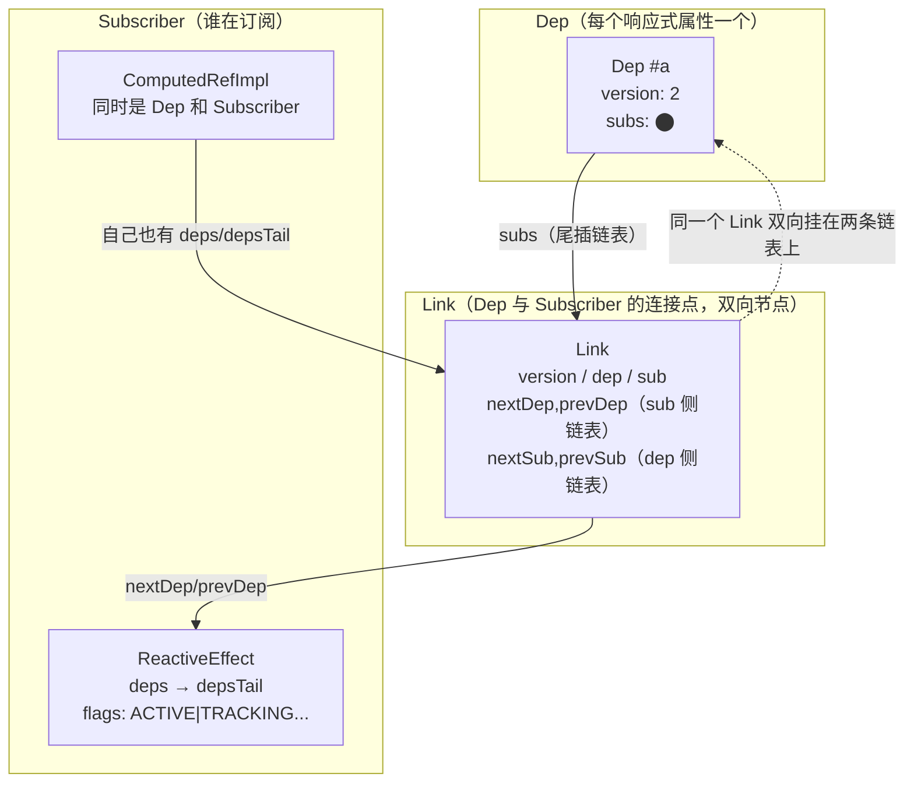
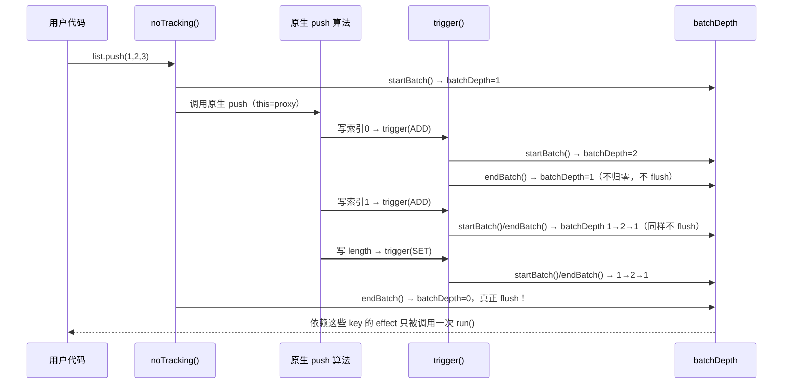
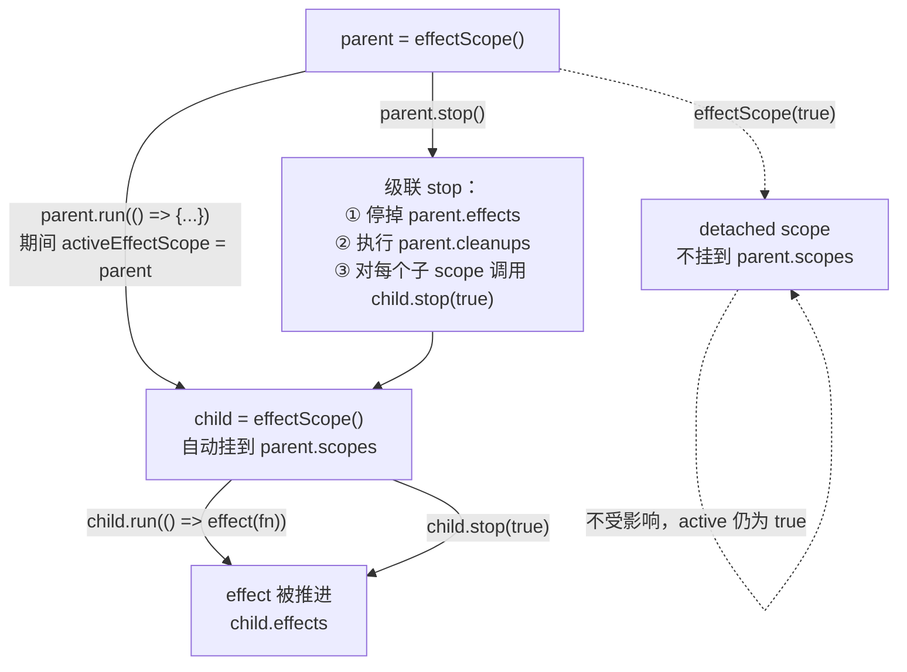

# 03. ReactiveEffect、Dep/Link 双向链表、版本号

> 整个响应式系统最核心的一章：`effect` 怎么知道自己依赖了谁，`trigger` 之后怎么知道该通知谁，以及 3.5 用双向链表 + 版本号重写这套机制之后，到底换来了什么。

## 本章导读

学完这一章，你应该能回答：

- 一个 `effect(fn)` 内部到底是怎么"收集依赖"的？`activeSub` 是什么时候被设置、什么时候被还原的？
- 条件分支导致某个属性这一轮不再被访问，它的旧依赖是"逻辑上失效"还是被"物理删除"的？怎么删的？
- 为什么 3.5 要把 `Dep.subs: Set<ReactiveEffect>` 换成双向链表 `Link`？`Watcher.deps/newDeps/depIds/newDepIds` 这两套 Set 的旧方案错在哪？
- 一次 `trigger` 牵出好几个 key 的变化，依赖它们的同一个 effect 为什么只会重跑一次？`startBatch/endBatch` 具体做了什么？
- `computed` 为什么要实现一个独立于 `ReactiveEffect` 的 `Subscriber` 接口，而不是直接复用 `ReactiveEffect`？

前置章节：第 02 章（`reactive`/`track`/`trigger` 的入口）。预计阅读时间：70-90 分钟。

涉及源码文件：

| 文件 | 作用 | 行数量级 |
|---|---|---|
| `packages/reactivity/src/effect.ts` | `ReactiveEffect`、`EffectFlags`、`activeSub`、批处理、`prepareDeps/cleanupDeps`、`refreshComputed` | ~582 行 |
| `packages/reactivity/src/dep.ts` | `Link`、`Dep`、`track`/`trigger` 全局入口、`targetMap` | ~397 行 |
| `packages/reactivity/src/effectScope.ts` | `EffectScope`，批量管理一组 effect 的生命周期 | ~236 行 |

## 先跑起来

```bash
pnpm ex chapters/03-effect-dep/examples/01-effect-basics-and-dynamic-deps.ts
pnpm ex chapters/03-effect-dep/examples/04-batch.ts
pnpm ex chapters/03-effect-dep/examples/05-link-list-inspect.ts
```

示例 01（条件分支切换依赖）的关键输出：

```
┌───────────────────────────── 3. 条件分支切换依赖：旧分支被 cleanupDeps 摘除
│  1. 初次运行：依赖应该是 [cond, a]
│      ✓ 初次依赖链表: [ 'cond', 'a' ]
│  2. 切换 cond，effect 重新运行，这次读的是 b
│      ✓ 切换后依赖链表变成 [cond, b]: [ 'cond', 'b' ]
│  4. 而原来的 runner 不会因为 a 变化而重跑：清空 trackLog，改 a，看 onTrack 还会不会触发
│      改 a 后，runner 的 onTrack 触发次数： 0 （期望 0，因为 a 已经不在它的依赖里）
```

示例 04（batch）跑出了一个容易被误解的反例——**同一条语句不等于同一次 batch**：

```
┌──────── 4. 反例：Object.assign 批量赋值——同一条语句，但效果是 3 次独立 trigger，不会合并
│      Object.assign 修改 3 个属性后，effect 运行次数： 4
│      ✓ 运行了 3 次，而不是 1 次——这正是 batch 没有自动生效的证据: 4
```

而 `list.push(1,2,3,4,5)`（示例 04 第 2 组）只会让同一个 effect 运行 1 次。两者的区别是本章 2.4 节要讲透的：`batch` 合并的前提不是"同一条 JS 语句"，而是"多个 `trigger()` 调用发生在同一次 `startBatch/endBatch` 嵌套范围内"——`arrayInstrumentations.ts` 的 `push/splice` 显式地多包了一层，`Object.assign` 没有。

示例 05（链表复用）展示了"改变访问顺序，链表节点顺序跟着变，但是同一批 Link 对象被复用"：

```
┌─────────────────────── 2. 改变访问顺序：链表节点顺序跟着变，但是是同一批 Link 对象被复用
│      第一次运行后的顺序： [ 'a', 'b', 'c' ]
│      第二次运行后的顺序： [ 'c', 'a', 'b' ]
│      key=a 的 Link 对象，两次运行是否是同一个引用（复用）： true
```

## 整体图



一个 `Link` 同时是**两条链表**的节点：dep 侧的 `subs` 链表（这个属性被谁订阅了）和 sub 侧的 `deps` 链表（这个 effect 依赖了哪些属性）。`ReactiveEffect` 和 `ComputedRefImpl` 都实现 `Subscriber` 接口，这是 3.5 把"订阅者"抽象出来的关键一步——`computed` 不再需要内部偷偷维护一个 `ReactiveEffect` 实例，它自己就是订阅者。

## 源码精读

### 3.1 `ReactiveEffect.run()`：prepareDeps → fn() → cleanupDeps 三段式

```ts
// packages/reactivity/src/effect.ts#L162-L192
run(): T {
  if (!(this.flags & EffectFlags.ACTIVE)) {
    return this.fn() // 已经 stop 的 effect，手动调用 runner() 仍然执行 fn 本体，但不再收集依赖
  }
  this.flags |= EffectFlags.RUNNING
  cleanupEffect(this)   // 跑上一轮注册的 onEffectCleanup 回调
  prepareDeps(this)     // 把所有旧 link 的 version 标成 -1
  const prevEffect = activeSub
  const prevShouldTrack = shouldTrack
  activeSub = this
  shouldTrack = true
  try {
    return this.fn()
  } finally {
    cleanupDeps(this)          // 清掉这轮没用到的 link（version 仍是 -1 的）
    activeSub = prevEffect     // 用 try/finally 保证嵌套/异常场景下也能正确恢复
    shouldTrack = prevShouldTrack
    this.flags &= ~EffectFlags.RUNNING
  }
}
```

`activeSub`/`shouldTrack` 用"保存旧值 → 设置新值 → finally 里恢复旧值"的模式，这正是示例 02 验证的"嵌套 effect 互不干扰"的来源——哪怕 `fn()` 内部抛异常，`finally` 也保证外层的 `activeSub` 不会被污染。

### 3.2 `Link` 与 `Dep.track()`：依赖是怎么被记下来的

```ts
// packages/reactivity/src/dep.ts#L32-L62
export class Link {
  version: number
  nextDep?: Link; prevDep?: Link   // sub 侧链表（这个 effect 的依赖顺序）
  nextSub?: Link; prevSub?: Link   // dep 侧链表（这个属性的订阅者顺序）
  prevActiveLink?: Link
  constructor(public sub: Subscriber, public dep: Dep) {
    this.version = dep.version
  }
}
```

```ts
// packages/reactivity/src/dep.ts#L108-L165（节选）
track(debugInfo?): Link | undefined {
  if (!activeSub || !shouldTrack || activeSub === this.computed) return

  let link = this.activeLink
  if (link === undefined || link.sub !== activeSub) {
    // 第一次见面：new 一个 Link，尾插进 activeSub.deps，再挂到 dep 的 subs 链表上
    link = this.activeLink = new Link(activeSub, this)
    if (!activeSub.deps) {
      activeSub.deps = activeSub.depsTail = link
    } else {
      link.prevDep = activeSub.depsTail
      activeSub.depsTail!.nextDep = link
      activeSub.depsTail = link
    }
    addSub(link)
  } else if (link.version === -1) {
    // 本轮之前已经用过（link 还在，只是被 prepareDeps 标成了 -1）：同步 version，挪到尾部
    link.version = this.version
    if (link.nextDep) { /* 从中间摘出，接到 depsTail 后面，见 3.4 节 ASCII 图 */ }
  }
  // 如果 link.version !== -1 且 link.sub === activeSub：本轮已经访问过这个 key 了，
  // 直接复用 activeLink，什么都不用做——这就是"同一个 effect 里重复读同一个 key 只产生一个 Link"
  return link
}
```

三种情况对应三种处理方式：**全新依赖**（new Link）、**本轮首次复用上一轮的依赖**（同步 version + 挪到尾部）、**本轮已经读过**（什么都不做，直接返回已有 link）。第三种情况是最容易被忽视的性能点：`state.a + state.a + state.a` 这种重复读取不会线性增长依赖数量。

### 3.3 `EffectFlags`：一个 8 位掩码替代了好几个布尔字段

```ts
// packages/reactivity/src/effect.ts#L41-L53
export enum EffectFlags {
  ACTIVE = 1 << 0,         // 还没被 stop()
  RUNNING = 1 << 1,        // 正在 run() 内部（防止自己触发自己）
  TRACKING = 1 << 2,       // 是否应该把自己加入 dep 的 subs（computed 懒订阅要用到）
  NOTIFIED = 1 << 3,       // 已经进了本轮 batch 队列，避免重复入队
  DIRTY = 1 << 4,          // computed 专用：值需要重新计算
  ALLOW_RECURSE = 1 << 5,  // 允许自己触发自己（watch 的 cb 场景需要，见第 04 章）
  PAUSED = 1 << 6,         // pause() 冻结通知
  EVALUATED = 1 << 7,      // computed 专用：是否已经计算过至少一次
}
```

`notify()` 这个函数只有 7 行，但读懂它就读懂了"effect 里 push 不死循环"背后真正起作用的那道保险：

```ts
// packages/reactivity/src/effect.ts#L150-L160
notify(): void {
  if (this.flags & EffectFlags.RUNNING && !(this.flags & EffectFlags.ALLOW_RECURSE)) {
    return // 正在跑的时候自己触发自己：直接丢弃这次通知，不是延后，是彻底忽略
  }
  if (!(this.flags & EffectFlags.NOTIFIED)) {
    batch(this) // 还没进批处理队列的话，登记进去
  }
}
```

### 3.4 `prepareDeps`/`cleanupDeps`：用"标记 -1 再清理"代替 Vue 2 的双 Set 方案

```ts
// packages/reactivity/src/effect.ts#L312-L351
function prepareDeps(sub: Subscriber) {
  for (let link = sub.deps; link; link = link.nextDep) {
    link.version = -1                       // 假装这一轮还没用过
    link.prevActiveLink = link.dep.activeLink
    link.dep.activeLink = link              // 让 dep.track() 第一时间能找到"我已经有这个 effect 的 link 了"
  }
}
function cleanupDeps(sub: Subscriber) {
  let head, tail = sub.depsTail, link = tail
  while (link) {
    const prev = link.prevDep
    if (link.version === -1) {              // 这一轮真的没再用到：物理删除
      if (link === tail) tail = prev
      removeSub(link)   // 从 dep 的 subs 链表里摘除
      removeDep(link)   // 从 sub 的 deps 链表里摘除
    } else {
      head = link
    }
    link.dep.activeLink = link.prevActiveLink
    link.prevActiveLink = undefined
    link = prev
  }
  sub.deps = head
  sub.depsTail = tail
}
```

一次 `effect` 运行前后，依赖链表的变化（对应示例 01 第 3 组：`cond ? a : b`，从读 `a` 切到读 `b`）：

```
运行前（读 a 分支）：
  effect.deps ──► [cond]⇄[a] ◄── effect.depsTail
                   ↑dep.subs    ↑dep.subs
                  (cond的Dep)   (a的Dep)

prepareDeps：把 cond、a 两个 link 的 version 都标成 -1

fn() 执行，这次走 b 分支：
  - 读 cond：命中 activeLink，version===-1，同步 version，无需移动（已经是正确位置）
  - 读 b：这是全新依赖，new Link，尾插到 depsTail 后面
  运行中：effect.deps ──► [cond]⇄[a(version=-1)]⇄[b] ◄── effect.depsTail

cleanupDeps：从 depsTail 往回扫，发现 a 的 version 还是 -1 → removeSub(a) + removeDep(a)

运行后：
  effect.deps ──► [cond]⇄[b] ◄── effect.depsTail
                            ↑dep.subs
                           (b的Dep，新建的 Link)
```

`a` 的 `Dep` 对象本身并没有被销毁（它可能还有别的 effect 订阅着，示例 01 第 3 组用 `probe` effect 验证了这一点），销毁的只是"这个 effect 和这个 Dep 之间的那条 Link"。`removeSub` 最后还会检查 `dep.sc`（订阅者计数）是否归零，归零且这个 Dep 挂在某个 `Map` 上（`dep.map`）就会把自己从 `targetMap` 的内层 `Map` 里也删掉，避免只有「不再被任何 effect 订阅」的属性依赖对象永久占用内存。

### 3.5 `Dep.notify()` + `startBatch/endBatch`：倒序通知、合并多次触发

```ts
// packages/reactivity/src/dep.ts#L173-L204
notify(debugInfo?): void {
  startBatch()
  try {
    for (let link = this.subs; link; link = link.prevSub) {   // 注意：从 subs（尾）往 prevSub 走，是倒序
      if (link.sub.notify()) {
        (link.sub as ComputedRefImpl).dep.notify() // 是 computed 的话，顺带通知它对外暴露的 dep
      }
    }
  } finally {
    endBatch()
  }
}
```

```ts
// packages/reactivity/src/effect.ts#L251-L310（节选）
export function batch(sub: Subscriber, isComputed = false): void {
  sub.flags |= EffectFlags.NOTIFIED
  if (isComputed) { sub.next = batchedComputed; batchedComputed = sub; return }
  sub.next = batchedSub
  batchedSub = sub
}
export function startBatch(): void { batchDepth++ }
export function endBatch(): void {
  if (--batchDepth > 0) return   // 还在嵌套的 batch 里，先不 flush
  // 1. 先把所有排队的 computed 的 NOTIFIED 标记清掉（它们已经被标脏，等被读到时惰性重算即可）
  // 2. 再按入队顺序（链表，不是真正倒序）依次调用 (e as ReactiveEffect).trigger()
  ...
}
```

`batch()` 只是把 `sub` 挂到一条借用 `next` 字段的单链表上，**不立刻执行**。`batchDepth` 是个计数器：只有归零时才真正 flush。这就是为什么 `push`/`splice` 内部多次写操作只会让依赖它们的 effect 运行一次——关键在于 `arrayInstrumentations.ts` 的 `noTracking()` **显式地在整个操作外面多包了一层** `startBatch()/endBatch()`：



而 `Object.assign(state, {a,b,c})` 这种每个属性独立 `Reflect.set` 的场景，每次 `trigger()` 自己的 `startBatch()/endBatch()` 都是独立的一对（`batchDepth` 在处理下一个属性之前就已经归零并 flush 过一次了），所以会看到 effect 运行 3 次而不是 1 次——这正是示例 04 第 4 组刻意设计的反例。

### 3.6 `isDirty` / `refreshComputed`：版本号怎么替代"脏"布尔值

```ts
// packages/reactivity/src/effect.ts#L353-L370
function isDirty(sub: Subscriber): boolean {
  for (let link = sub.deps; link; link = link.nextDep) {
    if (
      link.dep.version !== link.version ||
      (link.dep.computed && (refreshComputed(link.dep.computed) || link.dep.version !== link.version))
    ) {
      return true
    }
  }
  return false
}
```

普通依赖只需要比较 `link.dep.version !== link.version`——这是一个 O(1) 的数字比较，不需要像 Vue 2 那样重新跑一遍 getter 比较新旧值。如果这个依赖本身是个 `computed`（`link.dep.computed` 存在），还需要先 `refreshComputed` 它（可能触发链式重算），再比较一次版本号。`computed` 的 `get value()`、`notify()`、三层快速路径留给第 04 章详细展开，这里只需要知道：**`ReactiveEffect` 的脏检查完全基于版本号比较，不基于值比较**。

### 3.7 `effectScope`：批量管理一组 effect 的生命周期

```ts
// packages/reactivity/src/effectScope.ts#L162-L195（节选）
stop(fromParent?: boolean): void {
  if (!this._active) return
  this._active = false
  for (const e of this.effects) e.stop()      // 停掉所有直接持有的 effect
  this.effects.length = 0
  for (const fn of this.cleanups) fn()        // 跑所有 onScopeDispose 回调
  this.cleanups.length = 0
  if (this.scopes) {                          // 级联停掉所有子 scope
    for (const child of this.scopes) child.stop(true)
    this.scopes.length = 0
  }
  if (!this.detached && this.parent && !fromParent) {
    // 把自己从父 scope 的 scopes 数组里摘掉，避免内存泄漏
  }
}
```



`new EffectScope()` 时如果当前有 `activeEffectScope` 且不是 `detached`，会自动把自己挂到父 scope 的 `scopes` 数组下面——这就是示例 06 第 3 组看到的"子 scope 自动被父 scope 收录"。组件卸载时之所以能一次性清理掉这个组件创建的所有 `effect`/`watch`/`computed`，靠的就是每个组件实例自带一个 `EffectScope`（第 06 章细讲），`unmount` 时调用它的 `stop()`。

## 与 Vue 2 对比

| 维度 | Vue 2 | Vue 3.5 | 为什么这么改 |
|---|---|---|---|
| 依赖的存储结构 | `Dep.subs: Array<Watcher>`（`observer/dep.ts`），线性数组，`removeSub` 用 `indexOf` + splice | `Dep.subs: Link`（双向链表的尾节点），`removeSub` O(1) | 数组删除中间元素是 O(n)，链表删除已知节点是 O(1) |
| 谁在订阅（反向） | `Watcher.deps: Array<Dep>` + `Watcher.newDeps: Array<Dep>` 两份数组，外加 `depIds`/`newDepIds` 两个 `Set` 做去重 | `Subscriber.deps/depsTail`：一条双向链表，`Link.version` 字段代替"是否已存在"的 Set 判断 | Vue 2 每次重新收集依赖要维护 4 个容器（2 数组 2 Set），内存分配和 GC 压力明显；3.5 只需要一条链表 + 一个数字字段 |
| 依赖去重/清理 | `cleanupDeps()`：对比 `depIds`/`newDepIds`，不在新集合里的调用 `dep.removeSub(this)`；再把 `deps`/`newDeps` 相互交换（减少一次数组分配） | `prepareDeps` 把 version 标 -1，运行时命中则同步，`cleanupDeps` 把仍是 -1 的摘除 | 版本号标记法不需要维护"旧集合 vs 新集合"两份数据结构，一次遍历链表即可同时完成"判断是否还在用"和"物理清理" |
| 脏检查 | `Watcher.run()` 直接重新执行 `get()` 跑一遍 getter，用返回值 `value !== this.value` 判断要不要触发 `cb`（有计算成本） | `isDirty()` 比较 `link.dep.version !== link.version`，是否要重跑由版本号先行判断（computed 的 `refreshComputed` 还有 `globalVersion` 快速路径） | 版本号比较是 O(1) 的整数比较；Vue 2 的"先跑 getter 再比较值"对 `computed` 这种场景意味着没法在"确定没变化"之前就跳过重算 |
| 批处理 | 没有真正的"批处理原语"，靠 `scheduler.ts` 的 `queueWatcher`（`has[id]` 做去重）把本轮触发的 Watcher 去重后统一 `nextTick` 刷新 | `startBatch()/endBatch()` + `EffectFlags.NOTIFIED`：同步阶段就能把"一次操作牵出的多次 trigger"合并，不需要等到 `nextTick` | 3.5 的 batch 是同步完成的（在当前宏任务内，`trigger()` 返回前就 flush 完），Vue 2 的去重依赖异步队列，两者解决的问题层次不同（3.5 这层去重的是"同一次 DOM 操作触发的多个属性变化"，第 08 章的调度器去重的是"同一个 tick 内多次触发同一个组件更新"） |
| Watcher 的身份 | 一个 `Watcher` 类身兼三职：render watcher（`isRenderWatcher`）、computed watcher（`lazy: true`）、user watcher（`user: true`，`$watch`/`watch` 选项），靠几个布尔字段区分行为 | `Subscriber` 接口统一抽象，`ReactiveEffect`（渲染/普通 effect）、`ComputedRefImpl`（computed）各自独立实现，`watch()`（第 04 章）内部也是组合一个 `ReactiveEffect` | 拆分之后每个类职责更单一：`ComputedRefImpl` 不再需要伪装成一个"懒执行的 Watcher"，而是直接把 `Dep`/`Subscriber` 两种角色都实现在自己身上 |
| `Dep.target` 的管理 | 模块级可变单例 `Dep.target` + `targetStack` 数组，`pushTarget`/`popTarget` 手动管理栈 | `activeSub` 模块级变量，在 `run()`/`refreshComputed()` 里用局部变量保存前值、`finally` 恢复 | 语义等价（都是"当前正在求值的订阅者"），3.5 改用 try/finally 代替显式的 push/pop 数组操作，少一次数组分配 |
| 调试钩子 | `onTrack`/`onTrigger` 同样存在（Vue 2.7 引入），挂在 `Dep.depend()`/`notify()` 里 | `onTrack`/`onTrigger` 挂在 `Dep.track()`/`notify()` 里，语义基本一致，但 3.5 的 `notify()` 做了"只对尚未 NOTIFIED 的 sub 调用一次 onTrigger"的去重 | 批处理机制引入后，不加这层去重的话同一个 effect 可能在一次 trigger 里被打印多次 onTrigger 日志 |

## 动手：mini 实现 / 实验

对应文件：`mini-vue/reactivity/effect.ts`、`dep.ts`、`effectScope.ts`。mini 版本完整实现了 `Link` 双向链表、`version`/`globalVersion`、`prepareDeps`/`cleanupDeps`、简化版 `batch`，函数名和字段名与源码保持一致。裁剪的部分：

- `removeSub`/`notify` 里 `__DEV__` 专属的 `subsHead`（用来保证 `onTrigger` 按"原始触发顺序"而不是"订阅顺序倒序"调用，不影响核心机制）。
- `EffectScope` 的 `pause()`/`resume()`、`on()`/`off()`（配合 `withAsyncContext` 手动进出栈，组件异步 `setup` 场景才用得到，详见第 06 章）。

运行测试：

```bash
pnpm vitest run mini-vue/reactivity/effect.test.ts mini-vue/reactivity/dep.test.ts mini-vue/reactivity/effectScope.test.ts
```

建议自己改一改的实验点：

1. 在 `mini-vue/reactivity/effect.ts` 的 `ReactiveEffect.notify()` 里临时注释掉 `RUNNING` 判断，写一个"effect 内部 `state.a++`"的测试，观察调用栈会不会爆（`Maximum call stack size exceeded`）——亲眼验证这道保险的必要性。
2. 把 `cleanupDeps` 改成"遍历一遍先收集要删的 link，再统一删除"（而不是边遍历边删），对比实现复杂度，想一想源码为什么选择"倒序遍历、就地判断"这种写法（提示：`tail`/`head` 两个局部变量在循环过程中的作用）。
3. 给 mini 版的 `batch` 加一个计数器，统计"一次 `trigger` 调用期间，`batch()` 函数总共被调用了多少次" vs "最终真正执行 `run()` 的次数"，验证 `NOTIFIED` 标记确实把重复登记去重了。

## 常见疑问

**Q: `activeSub` 是全局唯一的变量，多个组件/多个 effect 同时存在时会不会互相干扰？**
A: 不会。JS 是单线程的，任意时刻只有一个 effect 真正在执行 `fn()`，`activeSub` 在那一刻唯一对应"正在跑的那个"。嵌套/异步场景靠 `run()` 里"保存旧值→设置新值→`finally` 恢复旧值"的模式保证正确切换，示例 02 完整验证了这一点。

**Q: `Dep.sc`（订阅者计数）和 `removeSub` 里"归零删除"的逻辑，删除的是什么？会不会把还在用的 Dep 删掉？**
A: 删除的是 `targetMap` 里 `(target, key)` 对应的那个 `Dep` 条目（`dep.map.delete(dep.key)`），前提是 `dep.sc` 归零（没有任何活跃订阅者）。下次再有人访问这个属性，`track()` 会发现 `depsMap.get(key)` 不存在，重新 `new Dep()`——不影响正确性，只是"没人关心的属性不占内存"。见 `effect.ts#L463-L469`。

**Q: 为什么 `Dep.notify()` 要倒序遍历 `subs`（从尾部 `prevSub` 往前走）？**
A: 这样最后被添加的订阅者最先进入 `batch` 队列（`batch()` 是头插法，`sub.next = batchedSub; batchedSub = sub`），两次反转之后，`endBatch()` 实际 flush 的顺序又变回了"最早订阅的最先执行"——这个顺序对于保证父子组件更新顺序（父先于子）之类的场景是有意义的，具体在第 08 章调度器部分会再提到。

**Q: `link.version === -1` 这个"哨兵值"安全吗？真实的 version 会不会恰好也是 -1？**
A: `Dep.version` 只会在 `trigger()` 里自增（从 0 开始），永远不会是负数，所以 -1 作为"本轮还没用到"的哨兵值是安全的，不会和任何真实版本号冲突。

**Q: `globalVersion` 是干什么的，这一章好像只是提了一句？**
A: 它是"自上次有任何响应式变更以来，全局发生过多少次 `trigger`"的计数器，每次 `Dep.trigger()` 都会 `globalVersion++`。`computed` 用它做第一层快速路径：如果自己上次求值以来 `globalVersion` 根本没变过，说明全局没有任何响应式数据变化，直接跳过所有依赖检查——这是第 04 章 `refreshComputed` 的重点，本章只需要知道它在哪定义（`dep.ts#L19`）。

## 小结

- `ReactiveEffect.run()` 是 prepareDeps → fn() → cleanupDeps 三段式；`activeSub`/`shouldTrack` 用 try/finally 保存恢复，天然支持嵌套。
- `Link` 是双向链表的节点，同时挂在 dep 侧的 `subs` 链表和 sub 侧的 `deps` 链表上；`Dep.track()` 区分"全新依赖/本轮首次复用/本轮已读过"三种情况。
- 依赖清理不靠"新旧 Set 对比"，靠给每个 link 打 `version = -1` 的标记，运行时命中就同步，运行后仍是 -1 的就物理删除——`removeSub`/`removeDep` 做的事。
- `effect` 里调用 `push` 不会死循环，靠两道独立保险：`arrayInstrumentations` 的 `pauseTracking` 避免依赖膨胀；`ReactiveEffect.notify()` 的 `RUNNING` 标记彻底拒绝自己触发自己。
- `startBatch()/endBatch()` 配合 `EffectFlags.NOTIFIED` 把同一批 `trigger()` 调用合并成一次 `run()`；合并的前提是这些 `trigger()` 调用发生在**同一次嵌套的 batch 范围**内，不是"同一条语句"就自动合并（`Object.assign` 反例）。
- `isDirty` 完全基于版本号比较（O(1)），不像 Vue 2 那样靠重新执行 getter 比较值；`computed` 额外有 `globalVersion` 快速路径，第 04 章细讲。
- `Subscriber` 接口统一了 `ReactiveEffect` 和 `ComputedRefImpl`，取代了 Vue 2 里一个 `Watcher` 类身兼 render/computed/user 三职的设计。
- `EffectScope` 把一组 effect 打包管理，支持嵌套、级联 stop、`onScopeDispose`——组件卸载时清理所有 effect/watcher 的机制基础。

## 延伸阅读

- PR #10397 *refactor(reactivity): optimize reactivity system*（3.5 这次重构的主 PR）：https://github.com/vuejs/core/pull/10397
- Evan You 在 Vue 3.5 发布说明里对响应式性能优化的说明：https://blog.vuejs.org/posts/vue-3-5
- RFC: Reactivity Effect Scope：https://github.com/vuejs/rfcs/blob/master/active-rfcs/0041-reactivity-effect-scope.md
- Vue 3 官方文档 - `effectScope()`：https://vuejs.org/api/reactivity-advanced.html#effectscope

## 思考题

1. 如果一个 `effect` 的 `fn()` 里，某个依赖只在"奇数次运行"时被访问（比如用一个外部计数器控制分支），`cleanupDeps` 每次都会摘掉它吗？下次又被访问时，是 `new Link` 还是复用？

   <details><summary>答案</summary>

   每次没被访问到的那一轮，`cleanupDeps` 都会把它摘除（`removeSub`+`removeDep`），因为它的 `Link.version` 在那一轮运行结束时仍然是 -1。但 `Dep` 对象本身只要还在 `targetMap` 里（没有归零到被删除），下次再被访问时，`Dep.track()` 走的是`this.activeLink`为 undefined 或 `link.sub !== activeSub` 的分支——由于上一次这个 effect 的 link 已经被摘除，`this.activeLink`（dep 自己持有的"当前活跃 link"）在 `removeSub` 时并不会被清空（`removeSub` 清理的是 subs 链表指针，不是 `activeLink`），所以下一次 `prepareDeps` 都没机会把它标 -1（因为它已经不在 `sub.deps` 链表里了），`track()` 会发现 `link.sub !== activeSub` 或版本对不上，直接 `new Link()` 创建一条全新的。

   </details>

2. `batch()` 函数对 `computed`（`isComputed: true`）和普通 effect 用了两条不同的链表（`batchedComputed`/`batchedSub`），`endBatch()` 里为什么要先 flush 完所有 `computed` 的 NOTIFIED 标记，再去 flush 普通 effect？

   <details><summary>答案</summary>

   `computed` 被 `notify()` 时只是打上 `DIRTY`+`NOTIFIED` 标记，并不会在 `endBatch` 里被"执行"（它没有 `scheduler`、也不会主动 `run()`，值是惰性的，等外部读 `.value` 时才会 `refreshComputed`）。`endBatch` 对 `batchedComputed` 链表的处理只是清除 `NOTIFIED` 标记（见 `effect.ts#L278-L287`），不调用 `trigger()`。这样做是为了让 `computed` 保持"懒"的语义：批处理阶段只负责"标脏+去重通知下游"，真正的重新计算推迟到被访问的那一刻，而不是在 `endBatch` 里抢先算一遍。

   </details>

3. 把示例 04 的 `Object.assign` 反例反过来想：如果你想让"修改 state 的多个属性"也享受 batch 合并的效果（哪怕它们是普通对象，不是数组），有什么办法？（提示：`@vue/reactivity` 没有公开导出 `startBatch`/`endBatch`，但 `pauseTracking`/`resetTracking` 以及 `effect.scheduler` 是公开的）

   <details><summary>答案</summary>

   没有公开 API 能让"修改多个普通属性"真正共享同一个 `startBatch/endBatch` 窗口（这两个函数确实没有从 `@vue/reactivity` 导出，查过 `dist/reactivity.d.ts` 确认过）。实践中的变通方案是**换一个角度**：不追求"写操作本身合并"，而是让"effect 多次被标脏后只执行一次"——这正是 `scheduler` 选项的用途：给 effect 配一个 `scheduler`，多次 `trigger` 只会让 `scheduler` 被调用多次（`NOTIFIED` 去重只在同一个 batch 窗口内有效），但 `scheduler` 内部可以自己做"下一帧/下一个微任务只跑一次"的去重（第 08 章的调度队列正是这么做的）。

   </details>
