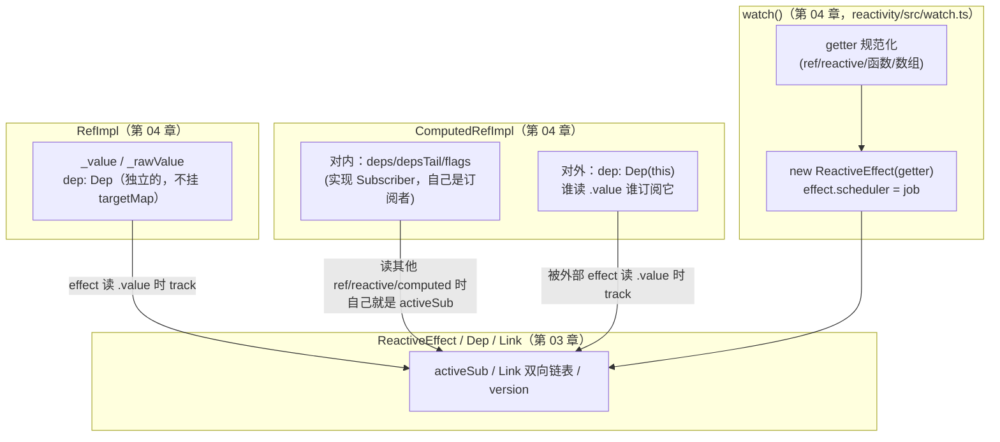
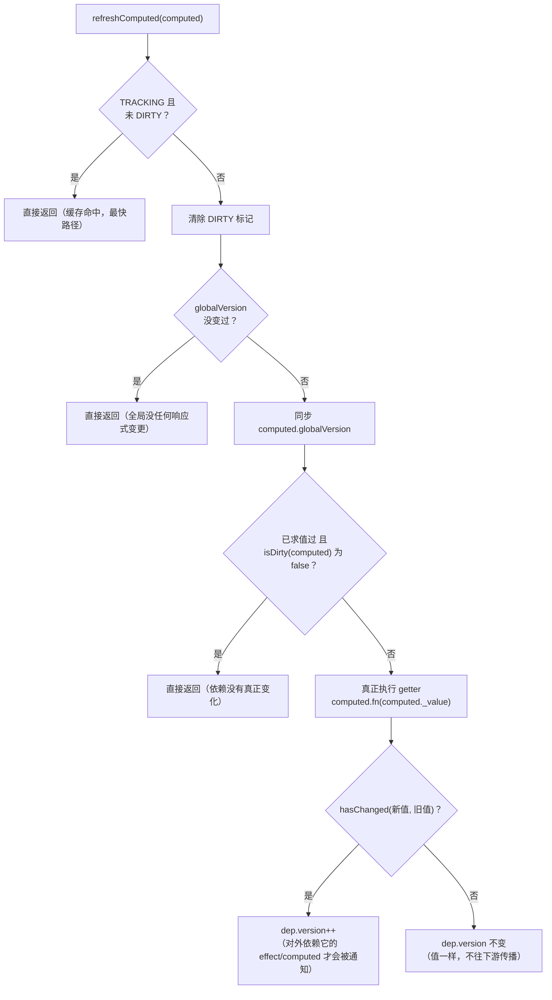
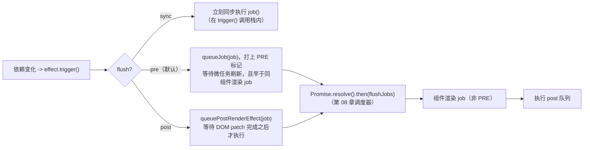

# 04. ref 家族、computed、watch/watchEffect

> `ref` 怎么把一个基本类型值变成响应式的；`computed` 怎么同时扮演"订阅者"和"被订阅者"两个角色；`watch` 怎么把 `reactive`/`ref`/`getter` 统一规范化，再接上组件的调度时机。

## 本章导读

学完这一章，你应该能回答：

- `ref(1)` 和 `reactive({ value: 1 })` 本质上有什么区别？为什么 `ref` 包对象时内部会自动变成 `reactive`？
- `shallowRef` + `triggerRef` 要解决什么问题？`customRef` 的 `track`/`trigger` 回调为什么要交给用户自己调用？
- `computed` 的 `ComputedRefImpl` 为什么要同时实现 `Dep` 和 `Subscriber` 两个角色？它的"懒"具体懒到什么程度——链条中间有 effect 在场和没有 effect 在场，行为真的一样吗？
- `watch()` 怎么把 `ref`/`reactive`/`getter`/数组统一规范化成同一个内部 `getter` 函数？`deep` 的默认值为什么因 source 类型而不同？
- `flush: 'pre' | 'post' | 'sync'` 到底是在时间线的哪个位置执行，和组件渲染的先后关系是什么？

前置章节：第 02 章（`reactive`/`track`/`trigger`）、第 03 章（`ReactiveEffect`/`Dep`/`Link`/版本号/`batch`）——本章大量复用第 03 章的机制，没看过建议先补上。预计阅读时间：80-100 分钟。

涉及源码文件：

| 文件 | 作用 | 行数量级 |
|---|---|---|
| `packages/reactivity/src/ref.ts` | `RefImpl`、`shallowRef`、`triggerRef`、`customRef`、`toRef(s)`、`proxyRefs` | ~578 行 |
| `packages/reactivity/src/computed.ts` | `ComputedRefImpl`（同时是 `Dep` 和 `Subscriber`）、`computed()` | ~221 行 |
| `packages/reactivity/src/watch.ts` | `baseWatch`（3.5 从 runtime-core 下沉过来的核心实现）、`traverse` | ~373 行 |
| `packages/runtime-core/src/apiWatch.ts` | `doWatch`：接上组件调度（`flush` 选项）、SSR 处理、`watchEffect` 系列 | ~285 行 |

## 先跑起来

```bash
pnpm ex chapters/04-ref-computed-watch/examples/02-computed-lazy-cache.ts
pnpm ex chapters/04-ref-computed-watch/examples/03-computed-chain.ts
pnpm ex chapters/04-ref-computed-watch/examples/05-watch-flush-timing.ts
```

示例 03（computed 链）跑出了一个本章最值得精读的细节——**"懒"不是绝对的，取决于链条顶端有没有一个没有 scheduler 的 effect 在场**：

```
┌───────────────────────── 1. a -> b -> c 链式依赖，奇数变奇数时在 c 这一层剪枝
│  1. a: 1 -> 3（奇数变奇数，b 的结果不变）—— 注意：这里还没有读任何 .value
│      a.value=3 这条语句执行完之后，立刻看 bCalls/cCalls（还没有手动读过 c.value！）：
│      bCalls= 2 cCalls= 1
│      ✓ b 已经被重算了——因为链条顶端有个没有 scheduler 的 effect，trigger 阶段会同步级联检查: 2
│      ✓ 但 c 没有被重算：refreshComputed(b) 发现值没变，isDirty(c) 判定为不脏，提前返回: 1
┌────────────────── 2. 对比组：链条顶端没有任何 effect，computed 才是真正"完全懒"的
│  1. 改 a，但完全不访问 b.value / c.value
│      a.value=3 之后，没有任何代码读 b/c：bCalls= 1 cCalls= 1
│      ✓ 没有 effect 在场，b 完全不会被提前计算——这才是"纯粹的懒": 1
```

一句话点出看到了什么：**只要有一个没有 `scheduler` 的 `effect`（比如直接用 `effect()`，或者组件的 render effect 在 `sync` 刷新下）订阅了链条顶端，`trigger` 阶段就会同步递归调用 `isDirty → refreshComputed`，中间层 `computed` 会被"顺带"提前算一遍**——这不是 bug，是"判断是否要重跑下游"这件事本身必须知道中间值是否真的变了。

示例 05（flush 时序）用假 DOM 渲染器跑出的真实顺序：

```
nextTick 之后的完整 order： [ 'watch(sync)', 'watch(pre)', 'render(count=1)', 'watch(post)' ]
```

看到了什么：`sync` 最先（和状态变化同步）、`pre` 在渲染之前但要等微任务、`post` 在渲染完成之后——这条顺序决定了"想在 DOM 更新前后做什么"该选哪个 `flush`。

## 整体图



`ref` 是"叶子"（只被别人订阅，自己不订阅任何东西）；`computed` 是"中间节点"（既被订阅也订阅别人，`Dep` 和 `Subscriber` 两个角色都要实现）；`watch` 本质上是"包了一层业务逻辑（新旧值对比、cleanup、deep 遍历）的 `ReactiveEffect`"。

## 源码精读

### 4.1 `RefImpl`：最小的响应式单元

```ts
// packages/reactivity/src/ref.ts#L114-L165（节选）
class RefImpl<T = any> {
  _value: T
  private _rawValue: T
  dep: Dep = new Dep()           // 每个 ref 自带一个独立的 Dep，不挂在任何 targetMap 上
  public readonly [ReactiveFlags.IS_REF] = true
  public readonly [ReactiveFlags.IS_SHALLOW]: boolean = false

  constructor(value: T, isShallow: boolean) {
    this._rawValue = isShallow ? value : toRaw(value)
    this._value = isShallow ? value : toReactive(value)   // 包对象时自动变成 reactive
    this[ReactiveFlags.IS_SHALLOW] = isShallow
  }

  get value() {
    this.dep.track({ target: this, type: TrackOpTypes.GET, key: 'value' })
    return this._value
  }

  set value(newValue) {
    const oldValue = this._rawValue
    const useDirectValue = this[ReactiveFlags.IS_SHALLOW] || isShallow(newValue) || isReadonly(newValue)
    newValue = useDirectValue ? newValue : toRaw(newValue)
    if (hasChanged(newValue, oldValue)) {
      this._rawValue = newValue
      this._value = useDirectValue ? newValue : toReactive(newValue)
      this.dep.trigger({ target: this, type: TriggerOpTypes.SET, key: 'value', newValue, oldValue })
    }
  }
}
```

`ref` 本质上就是"把 `reactive` 对象 get/set 陷阱里对单个 key 的 track/trigger，抽成一个独立的、只服务一个值的 `Dep` 对象"。`_rawValue`/`_value` 两份存储是为了让"比较是否变化"用原始值（`hasChanged` 不该因为代理身份不同就判定"变了"），"暴露给外部"用 reactive 包装后的值。示例 01 第 2 组验证了"包对象时 `.value` 自动是 reactive，整体替换 `.value` 触发的是 ref 自己的 dep，不是内部 reactive 对象的 dep"这个区分。

### 4.2 `shallowRef` + `triggerRef`：主动放弃深度响应，换取性能

`shallowRef({ count: 0 })` 的 `.value` 不会被 `toReactive`，内部属性变化完全不可见——这是故意的：大对象（比如一次性从后端拉回来的列表）如果不需要细粒度响应，用 `shallowRef` 能避免为每一层都建立代理和依赖。`triggerRef` 就是在这种场景下的手动逃生舱：

```ts
// packages/reactivity/src/ref.ts#L192-L206
export function triggerRef(ref: Ref): void {
  if ((ref as unknown as RefImpl).dep) {
    (ref as unknown as RefImpl).dep.trigger({ target: ref, type: TriggerOpTypes.SET, key: 'value', newValue: (ref as unknown as RefImpl)._value })
  }
}
```

直接调用 `dep.trigger()`，不经过 `hasChanged` 判断（因为调用者明确知道"我改了内部的东西，哪怕引用没变也要通知"）。示例 01 第 3 组完整验证。

### 4.3 `customRef`：把 track/trigger 的决定权交给用户

```ts
// packages/reactivity/src/ref.ts#L293-L330（节选）
class CustomRefImpl<T, S = T> {
  public dep: Dep
  constructor(factory: CustomRefFactory<T, S>) {
    const dep = (this.dep = new Dep())
    const { get, set } = factory(dep.track.bind(dep), dep.trigger.bind(dep))
    this._get = get
    this._set = set
  }
  get value(): T { return (this._value = this._get()) }
  set value(newVal: S) { this._set(newVal) }
}
```

普通 `ref` 的 `track`/`trigger` 时机是固定的（读的时候 track，写且值变化时 trigger）；`customRef` 把这两个动作做成回调函数交给工厂函数，由用户决定"什么时候算读到了""什么时候算变化了"——典型场景是防抖输入框：`set` 里不立刻 `trigger`，而是 `setTimeout` 延迟一段时间再 `trigger`。

### 4.4 `proxyRefs`：setup() 返回值为什么不用写 `.value`

```ts
// packages/reactivity/src/ref.ts#L253-L283（节选）
const shallowUnwrapHandlers: ProxyHandler<any> = {
  get: (target, key, receiver) => (key === ReactiveFlags.RAW ? target : unref(Reflect.get(target, key, receiver))),
  set: (target, key, value, receiver) => {
    const oldValue = target[key]
    if (isRef(oldValue) && !isRef(value)) {
      oldValue.value = value
      return true
    }
    return Reflect.set(target, key, value, receiver)
  },
}
export function proxyRefs<T extends object>(objectWithRefs: T): ShallowUnwrapRef<T> {
  return isReactive(objectWithRefs) ? (objectWithRefs as ShallowUnwrapRef<T>) : new Proxy(objectWithRefs, shallowUnwrapHandlers)
}
```

组件的 `setup()` 返回一个包含若干 `ref` 的普通对象时，运行时（第 06 章细讲）会用 `proxyRefs` 包一层，模板里 `{{ count }}` 才不需要写成 `{{ count.value }}`。注意判断顺序：**只有读写 `.value` 是自动的，赋值一个新的 ref 替换旧 ref 的情况不受影响**（因为 `isRef(oldValue) && !isRef(value)` 的判断要求 `value` 本身不是 ref）。

### 4.5 `ComputedRefImpl`：对外是 Dep，对内是 Subscriber

```ts
// packages/reactivity/src/computed.ts#L47-L97（节选字段）
export class ComputedRefImpl<T = any> implements Subscriber {
  _value: any = undefined
  readonly dep: Dep = new Dep(this)          // 对外：外部 effect 读 .value 订阅这个
  readonly __v_isRef = true
  deps?: Link = undefined                     // 对内：自己依赖了哪些 dep（和 ReactiveEffect 一样的字段）
  depsTail?: Link = undefined
  flags: EffectFlags = EffectFlags.DIRTY     // 初始就是脏的，等第一次访问才会算
  globalVersion = globalVersion - 1          // 故意比当前 globalVersion 小 1，保证第一次访问一定会重算
  ...
}
```

`new Dep(this)`——把自己传给 `Dep` 的构造函数，这样这个 `Dep` 的 `.computed` 字段就指回 `ComputedRefImpl` 自己。第 03 章讲过，`isDirty()` 发现某个依赖的 `link.dep.computed` 存在时，会调用 `refreshComputed(link.dep.computed)`，这正是靠这个反向引用做到的。

### 4.6 `get value()`：track → refreshComputed → 同步 link.version

```ts
// packages/reactivity/src/computed.ts#L131-L145
get value(): T {
  const link = this.dep.track({ target: this, type: TrackOpTypes.GET, key: 'value' })
  refreshComputed(this)
  if (link) link.version = this.dep.version   // 同步，保证外部 effect 下次 isDirty 判断时拿到准确的 version
  return this._value
}
```

注意顺序：**先 `track()` 再 `refreshComputed()`**。这个顺序本身是有讲究的——`track()` 会在"这是第一个订阅者"的情况下，把 `computed.flags` 打上 `TRACKING`（通过 `addSub` 的级联，详见第 03 章 `removeSub`/`addSub` 和下面的 4.7 节），而这个标记会影响 `refreshComputed` 内部 `isDirty` 判断时，这次重算的值变化要不要继续往更下游传播。如果顺序反过来（先 `refreshComputed` 再 `track`），"第一次访问就建立订阅关系"这件事会被推迟，可能导致某些边界场景下的级联判断不准确。

### 4.7 `refreshComputed`：三层快速路径

```ts
// packages/reactivity/src/effect.ts#L376-L430（节选，完整版见第 03 章引用）
export function refreshComputed(computed: ComputedRefImpl): undefined {
  // 第一层：已经在 TRACKING 状态、且没有被标记 DIRTY —— 上次算完之后压根没人通知过它，直接复用缓存
  if (computed.flags & EffectFlags.TRACKING && !(computed.flags & EffectFlags.DIRTY)) {
    return
  }
  computed.flags &= ~EffectFlags.DIRTY

  // 第二层：globalVersion 没变过 —— 从上次算完到现在，全局压根没发生任何响应式变更
  if (computed.globalVersion === globalVersion) {
    return
  }
  computed.globalVersion = globalVersion

  // 第三层：已经算过至少一次，且依赖列表里没有任何一条真正变化（isDirty 为 false）
  if (!computed.isSSR && computed.flags & EffectFlags.EVALUATED &&
      ((!computed.deps && !(computed as any)._dirty) || !isDirty(computed))) {
    return
  }

  // 前面三层都没能提前退出，才真正重新执行 getter
  computed.flags |= EffectFlags.RUNNING
  const dep = computed.dep
  const prevSub = activeSub, prevShouldTrack = shouldTrack
  activeSub = computed; shouldTrack = true
  try {
    prepareDeps(computed)
    const value = computed.fn(computed._value)
    if (dep.version === 0 || hasChanged(value, computed._value)) {
      computed.flags |= EffectFlags.EVALUATED
      computed._value = value
      dep.version++              // 只有真正算出不同的值，这个 computed 对外的 dep 版本号才会变
    }
  } finally {
    activeSub = prevSub; shouldTrack = prevShouldTrack
    cleanupDeps(computed)
    computed.flags &= ~EffectFlags.RUNNING
  }
}
```



三层快速路径对应三种不同粒度的"省事"：**这个 computed 自己知道没人通知过它**（第一层，O(1) 位运算）→ **全局都没发生过任何变化**（第二层，O(1) 整数比较，对没有被频繁访问的 computed 尤其有效）→ **依赖确实被通知过，但递归检查下来发现值没真的变**（第三层，递归 `isDirty`，可能触发链式 `refreshComputed`，就是示例 03 展示的"被迫提前计算但发现没变化"）。

### 4.8 `computed` 的"懒"在链式依赖里的真相

示例 03 验证了一个重要细节：`computed` 的惰性是"没人真正需要这个值时才不算"，但"需不需要"这件事本身的判断依赖于 `addSub` 级联设置的 `TRACKING` 标志。关键在 `addSub`（第 03 章 `dep.ts#L207-L232`）：

```ts
function addSub(link: Link) {
  link.dep.sc++
  if (link.sub.flags & EffectFlags.TRACKING) {   // 只有订阅者自己也是"活跃"的，这条订阅才会被记进 subs 链表
    const computed = link.dep.computed
    if (computed && !link.dep.subs) {
      computed.flags |= EffectFlags.TRACKING | EffectFlags.DIRTY   // 级联：这个 computed 也变成"活跃"的了
      for (let l = computed.deps; l; l = l.nextDep) addSub(l)      // 继续往它自己依赖的东西级联下去
    }
    ...
  }
}
```

一个 `effect`（天生带 `TRACKING` 标志）订阅 `c.value` 时，这个级联会一路把 `c`、`b` 都标记成"活跃"（`TRACKING`），于是 `a` 发生变化时，`notify()` 能一路同步通知到 `b`（`b` 是 `a.dep.subs` 链表里真实存在的节点）。而如果只是在顶层脚本里直接 `c.value`（没有任何 `effect`），`track()` 在 `!activeSub` 时直接返回 `undefined`，压根不会创建/激活订阅链路，`a`、`b`、`c` 之间虽然有 `Link` 记录"曾经读过"（供下次 `refreshComputed` 时递归判断用），但都不是"活跃订阅者"，`a` 变化时没有谁会被同步 `notify()`，必须等下次真正访问 `.value` 才会级联重算。**示例 03 第 2 组就是故意不接 `effect`，用来对比出这个差异。**

### 4.9 `watch()`：source 规范化

```ts
// packages/reactivity/src/watch.ts#L153-L205（节选）
if (isRef(source)) {
  getter = () => source.value
  forceTrigger = isShallow(source)
} else if (isReactive(source)) {
  getter = () => reactiveGetter(source)
  forceTrigger = true
} else if (isArray(source)) {
  isMultiSource = true
  forceTrigger = source.some(s => isReactive(s) || isShallow(s))
  getter = () => source.map(s => isRef(s) ? s.value : isReactive(s) ? reactiveGetter(s) : isFunction(s) ? s() : void warnInvalidSource(s))
} else if (isFunction(source)) {
  getter = cb ? source : /* watchEffect 场景，见下方 */
}
```

`reactiveGetter` 是 `deep` 默认值差异的核心：

```ts
// packages/reactivity/src/watch.ts#L136-L144
const reactiveGetter = (source: object) => {
  if (deep) return source                                            // deep 为真：交给下面的 wrappedGetter 做完整 traverse
  if (isShallow(source) || deep === false || deep === 0) return traverse(source, 1)  // 显式关闭深度，或本来就是 shallow：只走 1 层
  return traverse(source)                                             // deep 是 undefined：直接 watch 一个 reactive 对象，默认深度遍历！
}
```

**这是最容易被忽视的一条规则**：`watch(reactiveObj, cb)`（直接传一个 `reactive` 对象，不传 `deep`）默认就是深度的；但 `watch(() => state.nested, cb)`（传一个 getter）不传 `deep` 则完全不深度遍历，只认返回值的引用是否变化。示例 04 第 4、5 组完整对照了这个差异。

### 4.10 `deep` 支持数字层级（3.5 新特性）

```ts
// packages/reactivity/src/watch.ts#L207-L211
if (cb && deep) {
  const baseGetter = getter
  const depth = deep === true ? Infinity : deep
  getter = () => traverse(baseGetter(), depth)
}
```

```ts
// packages/reactivity/src/watch.ts#L337-L373（节选）
export function traverse(value, depth = Infinity, seen = new Map()): unknown {
  if (depth <= 0 || !isObject(value) || value[ReactiveFlags.SKIP]) return value
  if ((seen.get(value) || 0) >= depth) return value   // 循环引用检测 + 避免同一对象在同一深度被重复遍历
  seen.set(value, depth)
  depth--
  if (isRef(value)) traverse(value.value, depth, seen)
  else if (isArray(value)) { for (const v of value) traverse(v, depth, seen) }
  else if (isSet(value) || isMap(value)) value.forEach(v => traverse(v, depth, seen))
  else if (isPlainObject(value)) { for (const key in value) traverse(value[key], depth, seen) }
  return value
}
```

`traverse` 本身不做任何转换，纯粹是"把每一层都访问一遍"，靠的是访问行为本身触发 `track`——这是和 Vue 2 的 `_traverse`（递归遍历调用 getter）完全一样的思路，只是 3.5 多了一个 `depth` 参数支持限定层级。`seen` 用 `Map<value, depth>` 而不是 `Set<value>`，是为了支持"同一个对象在更深的 `depth` 下可能需要再遍历一次"（比如循环引用中不同路径到达同一个对象，但剩余深度不同）。示例 04 第 6 组验证了 `deep: 1` 只能发现第一层变化。

### 4.11 `job`：新旧值对比、cleanup、`hasChanged`/`forceTrigger`

```ts
// packages/reactivity/src/watch.ts#L236-L286（节选）
const job = (immediateFirstRun?: boolean) => {
  if (!(effect.flags & EffectFlags.ACTIVE) || (!effect.dirty && !immediateFirstRun)) return
  if (cb) {
    const newValue = effect.run()
    if (immediateFirstRun || deep || forceTrigger ||
        (isMultiSource ? newValue.some((v, i) => hasChanged(v, oldValue[i])) : hasChanged(newValue, oldValue))) {
      pauseTracking()
      try {
        if (cleanup) cleanup()              // 先跑上一次注册的 onCleanup
        activeWatcher = effect
        const args = [newValue, oldValue === INITIAL_WATCHER_VALUE ? undefined : oldValue, boundCleanup]
        oldValue = newValue
        cb(...args)
      } finally { activeWatcher = currentWatcher; resetTracking() }
    }
  } else {
    effect.run()                             // watchEffect：没有 cb，getter 本身就是副作用
  }
}
```

`forceTrigger`（`watch` 一个 `ref`/`reactive` source 时为真）存在的原因：`reactive` 对象每次 `getter()` 返回的都是**同一个引用**（`traverse` 不克隆），`hasChanged(newValue, oldValue)` 永远是 `false`，如果不强制触发，`watch(reactiveObj, cb)` 将永远不会调用 `cb`。

### 4.12 `doWatch`：接上组件调度（`apiWatch.ts`）

```ts
// packages/runtime-core/src/apiWatch.ts#L198-L232（节选）
let isPre = false
if (flush === 'post') {
  baseWatchOptions.scheduler = (job) => {
    job.i = instance
    queuePostRenderEffect(job, instance && instance.suspense)
  }
} else if (flush !== 'sync') {
  // 默认：'pre'
  isPre = true
  baseWatchOptions.scheduler = (job, isFirstRun) => {
    if (isFirstRun) job()
    else queueJob(job)
  }
}
baseWatchOptions.augmentJob = (job) => {
  if (cb) job.flags! |= SchedulerJobFlags.ALLOW_RECURSE
  if (isPre) {
    job.flags! |= SchedulerJobFlags.PRE
    if (instance) { job.id = instance.uid; job.i = instance }
  }
}
```

`@vue/reactivity` 的 `watch()`（本章示例 04/06 用的那个）本身不关心"调度"这件事——如果不传 `scheduler` 选项，它的 `effect.scheduler` 就直接是 `job` 本身，`trigger` 时同步执行。`runtime-core` 的 `doWatch` 才是真正"接上时间线"的地方：

- **`flush: 'sync'`**：完全不设置 `scheduler` 包装（直接用 `baseWatch` 默认的同步 `job` 调用），依赖变化立刻执行。
- **`flush: 'pre'`（默认）**：`scheduler` 调用 `queueJob(job)`，并且 `augmentJob` 给这个 job 打上 `SchedulerJobFlags.PRE` 标记——调度器（第 08 章细讲）会保证带 `PRE` 标记的 job 在同一个组件的渲染 job 之前执行，这样 `watch` 里修改的状态能在这一轮渲染里生效，不用等到下一轮。
- **`flush: 'post'`**：`scheduler` 调用 `queuePostRenderEffect`，排进"DOM 更新完成之后"才执行的队列——这是你想读取/操作已经更新完的真实 DOM 时该用的选项。



这正是示例 05 实际跑出的顺序 `sync -> pre -> render -> post` 的来源。`watchEffect`/`watchPostEffect`/`watchSyncEffect` 只是 `doWatch(effect, null, { flush })` 的语法糖（`apiWatch.ts#L56-L87`）。

## 与 Vue 2 对比

| 维度 | Vue 2 | Vue 3.5 | 为什么这么改 |
|---|---|---|---|
| 响应式值的三种角色 | 一个 `Watcher` 类（`core/observer/watcher.ts`）身兼 render watcher、computed watcher（`lazy: true`）、user watcher（`user: true`，对应 `watch` 选项/`$watch`），靠布尔字段区分行为 | `RefImpl`（叶子）、`ComputedRefImpl`（中间节点，`Subscriber` + `Dep` 双实现）、`watch()` 内部组合一个 `ReactiveEffect`，三者独立 | 职责拆分之后，`computed` 不用再伪装成"一个不会自动重跑、需要外部 `dirty` 查询的特殊 Watcher" |
| computed 的懒计算 | `dirty` 布尔字段 + `evaluate()`/`depend()`：`initComputed` 里访问 computed 属性会调用 `createComputedGetter` 返回的 getter，检查 `watcher.dirty` 为真才 `evaluate()`，然后手动 `watcher.depend()` 把自己的依赖"过继"给外层正在收集依赖的 Watcher | `isDirty`/`refreshComputed`：版本号比较 + 三层快速路径（`TRACKING`+`DIRTY` 位运算 → `globalVersion` → 递归 `isDirty`） | Vue 2 的 `depend()` 本质上是把 computed 内部收集到的 `Dep` 数组，逐个 `dep.depend()` 一遍，让外层 Watcher 也订阅上；3.5 用 `addSub` 的级联在"第一次有真正的订阅者"时就完成这件事，不需要每次访问都重新 `depend()` 一遍 |
| computed 的值比较 | `Watcher.run()` 用 `value !== this.value` 比较（严格不等） | `hasChanged`（基于 `Object.is`，正确处理 `NaN`） | `NaN !== NaN` 为 `true` 会导致 Vue 2 认为"NaN 变成 NaN 也算变化"，`Object.is(NaN, NaN)` 为 `true`，3.5 修正了这个边界情况 |
| `watch` 的 `deep` | `$watch`/`watch` 选项的 `deep: true` 调用 `traverse(val)`（`core/observer/traverse.ts`），默认不开启深度（不管 source 是什么形式，统一靠 `deep` 选项显式开启） | `deep` 的默认值因 source 类型而不同：直接 `watch(reactiveObj, cb)` 默认深度，`watch(getter, cb)` 默认不深度；`deep` 额外支持传数字限定层级 | 3.5 认为"直接 watch 一个 reactive 对象"这个动作本身就暗示了"我想要深度监听"，减少用户必须手动加 `{ deep: true }` 的心智负担；数字层级是应对"深度监听但只关心前几层，避免大对象全量遍历的性能开销"的新增能力 |
| `watch` 的 flush 时机 | 没有 `flush` 概念：`user watcher` 默认异步（进 `scheduler` 队列），`sync: true` 可以同步执行；没有"post"（DOM 更新后）这个独立时机，需要手动配合 `vm.$nextTick` | `flush: 'pre' | 'post' | 'sync'` 三态，`pre`（默认）靠 `SchedulerJobFlags.PRE` 保证先于同组件渲染 job；`post` 对接 `queuePostRenderEffect` | 把"状态变化 → 希望在渲染前处理 → 渲染 → 希望在渲染后处理（操作真实 DOM）"这条时间线显式建模成三个选项，不再需要手动 `nextTick` 拼接 |
| `onCleanup` | `user watcher` 没有内建的 cleanup 机制，取消上一次异步操作通常要手动维护一个标志位 | `onWatcherCleanup`/`onCleanup` 参数：`cleanupMap: WeakMap<ReactiveEffect, Function[]>` 统一管理，下次回调前或 `stop()` 时自动执行 | 把"取消上一次还没完成的副作用"这个常见模式标准化，不需要用户每次手写标志位 |
| 依赖去重（deep watch 内部） | `_traverse` 用 `val.__ob__.dep.id` 存进一个 `Set<number>` 做循环引用检测 | `traverse` 用 `Map<value, depth>`，既检测循环引用，也处理"同一对象在不同调用路径下剩余深度不同"的情况 | 3.5 引入 `deep: number` 之后，单纯的 `Set` 不够用了（需要记录"这个对象在哪个深度已经被访问过"） |
| ref 包对象 | Vue 2.7 才引入 `ref()`（`v3/reactivity/ref.ts`），实现思路和 3.x 基本一致（内部用 `reactive` 包对象），属于向 Composition API 看齐的移植 | `RefImpl` 独立维护 `_rawValue`/`_value`，`.value` 的 get/set 走 `Dep.track/trigger`（第 03 章机制） | 概念上两者几乎一致，3.5 的差异主要来自底层 `Dep`/`Link` 的重构，而不是 `ref` 本身的设计变化 |

## 动手：mini 实现 / 实验

对应文件：`mini-vue/reactivity/ref.ts`、`computed.ts`、`watch.ts`。`computed.ts` 完整实现了 `version`/`globalVersion` 的判断方式（和真实源码一致，`dep.version++` 只在 `hasChanged` 为真时发生）。裁剪的部分：

- `ref.ts` 省略了 `toRef`/`toRefs`/`ObjectRefImpl`/`GetterRefImpl`（把 reactive 对象的某个属性转成独立 ref 的工具函数，和响应式追踪机制关系不大，内部也是复用 `Dep.track`/`trigger`，为了控制篇幅没有照抄，源码位置 `ref.ts#L372-L522`）。
- `watch.ts` 省略了 `runtime-core/src/apiWatch.ts` 的 `flush` 调度分层（`pre`/`post`/`sync` 对接组件调度器）、SSR 分支、`call` 选项的统一错误处理包装（mini 版直接让异常冒泡）。

运行测试：

```bash
pnpm vitest run mini-vue/reactivity/ref.test.ts mini-vue/reactivity/computed.test.ts mini-vue/reactivity/watch.test.ts
```

建议自己改一改的实验点：

1. 在 `mini-vue/reactivity/ref.ts` 里补一个简化版 `toRef(reactiveObj, key)`（不需要完整的 `ObjectRefImpl` 复杂度，一个 `get value()`/`set value()` 直接读写 `reactiveObj[key]` 即可），验证"改 ref 影响原对象，改原对象影响 ref"的双向同步。
2. 复现本章 4.8 节的"链条顶端有没有 effect，决定中间 computed 是否被提前计算"这个现象：给 `mini-vue` 写一个 `a -> b -> c` 三层 computed 的测试，分别在"有 effect 订阅 c"和"没有任何订阅，直接访问 c.value"两种情况下断言 `bCalls` 的值。
3. 给 `mini-vue/reactivity/watch.ts` 的 `traverse` 加一个计数器，统计"访问了多少个节点"，对比 `deep: true` 和 `deep: 2` 在一个 4 层嵌套对象上的访问节点数差异。

## 常见疑问

**Q: `ref(1)` 为什么不直接用 `reactive({ value: 1 })` 实现，非要单独写一个 `RefImpl`？**
A: 两个原因：① `reactive` 只能代理对象，基本类型值没法被 `Proxy` 包裹，`ref` 必须自己用 class 包一层 `.value` 访问器；② `ref` 需要在"任意地方"被创建和传递（函数参数、返回值），不依赖 `Proxy` 能让它的行为更可预测（比如 `toRaw`/`markRaw` 这些跟 `Proxy` 强绑定的机制不需要对 `ref` 另外处理一遍）。

**Q: 示例里 "a->b->c 链条顶端有 effect 时，b 会被提前计算" 是不是意味着 computed 其实没那么懒？**
A: 严格来说，**只有"没人用它"的 computed 才是完全懒的**；一旦有一条从它到某个真正活跃的订阅者（`TRACKING` 标志为真）的链路，"判断要不要通知下游"这个动作本身就需要知道中间值是否真的变了，所以会被提前算。这不是性能缺陷——对比"完全不提前算、只打一个全局脏标记"的方案，提前算能保证更精确的"值真的变了才继续往下通知"，省下的是下游更大范围的重新渲染开销。

**Q: `watch(source, cb, { immediate: true })` 的 `oldValue` 是 `undefined`，为什么不是 `source` 的初始值？**
A: 源码里 `oldValue` 初始化成一个内部专用的哨兵对象 `INITIAL_WATCHER_VALUE`，`job()` 组装回调参数时特判 `oldValue === INITIAL_WATCHER_VALUE ? undefined : oldValue`（`watch.ts#L264-L266`）。这样设计是为了让用户在回调里能区分"这是第一次触发（没有真正的旧值）"和"这是因为值变化触发（旧值就是某个具体值）"。

**Q: 为什么 `flush: 'pre'` 的 watcher 需要 `SchedulerJobFlags.PRE` 这个标记，不能直接让它和渲染 job 一样普通排队？**
A: 因为 `pre` watcher 存在的典型场景就是"在渲染之前，根据某个状态变化去修改另一个会影响渲染的状态"（比如根据 props 变化重新计算要显示的本地 state）。如果不保证它先于同一个组件的渲染 job 执行，可能出现"渲染用的是修改前的中间状态，下一帧才用上新值"的一帧延迟，`PRE` 标记就是用来保证调度器给它更高优先级（第 08 章细讲排序规则）。

**Q: `watchEffect` 和 `computed` 看起来都是"依赖变化自动重新执行"，什么时候该用哪个？**
A: `computed` 是"有返回值、会被缓存、给别处读取"的派生状态（本质是个 `Ref`）；`watchEffect` 是"执行副作用"（发请求、操作 DOM、打日志），没有返回值概念，也不支持被别的 `computed`/`effect` 当作依赖来读取缓存值。能用 `computed` 表达的"计算一个值"场景，不要用 `watchEffect` 硬套。

## 小结

- `RefImpl` 是最小的响应式单元：独立的 `Dep`，`.value` 的 get/set 对应 `track`/`trigger`；包对象时自动 `toReactive`。
- `shallowRef`+`triggerRef`、`customRef` 都是在"标准 track/trigger 时机"之外提供的手动控制逃生舱。
- `ComputedRefImpl` 同时实现 `Dep`（对外）和 `Subscriber`（对内），`refreshComputed` 的三层快速路径（`TRACKING+DIRTY` 位运算 → `globalVersion` → 递归 `isDirty`）是性能优化的核心。
- computed 的"懒"取决于链条上是否存在活跃订阅者（`TRACKING` 标志通过 `addSub` 级联传播）；完全没有订阅者时才是彻底懒惰的。
- `watch()` 把 `ref`/`reactive`/`getter`/数组统一规范化成内部 `getter`；`deep` 的默认值因 source 类型而不同（直接 watch reactive 对象默认深度，watch getter 默认不深度）；`deep` 支持数字层级。
- `forceTrigger` 解决了"reactive 对象每次返回同一个引用，`hasChanged` 永远是 false"的问题。
- `doWatch`（`apiWatch.ts`）把 `flush` 选项翻译成三种调度策略：`sync` 立即执行、`pre`（默认）靠 `PRE` 标记抢在渲染 job 之前、`post` 排进渲染完成后的队列。
- 和 Vue 2 比：一个 `Watcher` 类的三职分离成 `RefImpl`/`ComputedRefImpl`/`watch()` 内部的 `ReactiveEffect`；`dirty`+`evaluate`+`depend` 的手动依赖过继被 `addSub` 级联和版本号取代。

## 延伸阅读

- Vue 3 官方文档 - Computed Properties：https://vuejs.org/guide/essentials/computed.html
- Vue 3 官方文档 - Watchers（含 flush 时机说明）：https://vuejs.org/guide/essentials/watchers.html
- Vue 3 官方文档 - `customRef()`：https://vuejs.org/api/reactivity-advanced.html#customref
- PR: 将 watch 从 runtime-core 下沉到 reactivity（3.5）：https://github.com/vuejs/core/pull/10397

## 思考题

1. 如果给一个 `computed` 的 getter 里塞一段 `console.log`，在"链条顶端有 effect"和"没有任何订阅"两种场景下，分别运行 `a.value = x`（结果不变的那种改法），`console.log` 各会打印几次？结合 4.8 节的 `addSub` 级联机制说明原因。

   <details><summary>答案</summary>

   有 `effect` 在场：中间层 `computed` 会被打印一次（`refreshComputed` 被迫提前执行一次 getter，哪怕最终发现值没变）。没有任何订阅：`console.log` 完全不会打印，直到有代码真正访问这个 `computed.value` 才会执行一次。本质原因是"活跃订阅"（`TRACKING` 标志）决定了 `trigger()` 的 `notify()` 链路能不能一路同步传播下去；没有活跃订阅时，`a.dep.subs` 链表里根本没有指向中间 computed 的节点，`notify()` 自然无从谈起。

   </details>

2. `watch([a, b], cb)`（数组多源）和 `watch(() => [a.value, b.value], cb)`（手写 getter 返回数组）效果一样吗？`forceTrigger`/`isMultiSource` 在这两种写法里分别是什么值？

   <details><summary>答案</summary>

   不完全一样。`watch([a, b], cb)` 走 `isArray(source)` 分支：`isMultiSource = true`，`forceTrigger` 取决于数组里是否有 `reactive`/`shallow` 元素（这里 a/b 是 ref，所以是 `false`）；回调的新旧值是"数组"形式（`[newA, newB]`/`[oldA, oldB]`）。`watch(() => [a.value, b.value], cb)` 走 `isFunction(source)` 分支：`isMultiSource` 不会被设置为 `true`（它只在显式传数组时才为真），`hasChanged` 直接比较两次返回的**数组整体**（每次调用 getter 都 `return [a.value, b.value]`，是全新数组，引用总是不同，`hasChanged` 基于 `Object.is` 对数组总是判定"变了"）——所以后一种写法实际上会在 `a`/`b` 任意一个变化时都触发回调，且回调参数 `newValue`/`oldValue` 是普通值而不是被 `isMultiSource` 特殊处理过的数组。

   </details>

3. 把 `customRef` 的 `track`/`trigger` 回调故意调反（`get` 里调用 `trigger`，`set` 里调用 `track`）会发生什么？

   <details><summary>答案</summary>

   依赖收集和触发完全错位：`get value()` 本该在被 `effect` 读取时 `track()`，但如果写成 `trigger()`，意味着"每次读取都会尝试通知依赖"——但这时候通常没有任何变化真正发生，`dep.trigger()` 本身不检查"值是否真的变了"（这个检查是 `RefImpl.set` 自己做的，`customRef` 用户要自己负责），所以会导致"读取时莫名其妙触发下游重新执行"，如果下游的重新执行里又读了这个 `customRef`，很容易造成同步递归/死循环（不会被 `EffectFlags.RUNNING` 完全兜底，因为那只防"effect 自己触发自己"，不防"两个不同 effect 互相级联"）。`set` 里本该 `trigger()` 却写成 `track()`，则会导致"赋值时错误地把当前 `activeSub`（如果有的话）订阅到这个 ref 上"，污染依赖关系。

   </details>
