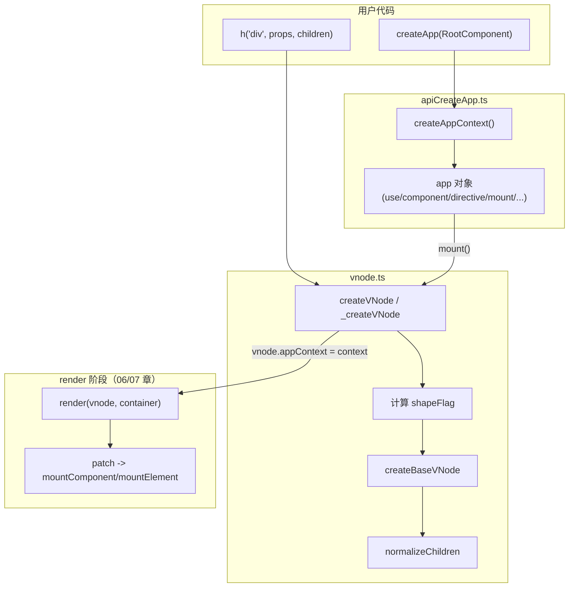

# 05. VNode 与 createApp

> Vue 3 用什么数据结构描述"要渲染什么"，又用什么流程把这个描述第一次"种"进真实 DOM。

## 本章导读

学完本章能回答：

- `h('div', { id: 'a' }, 'hi')` 到底产出了一个什么样的对象？`shapeFlag`/`patchFlag` 这两个数字各自编码了什么信息？
- 为什么 Vue 3 要用 `Symbol` 表示 `Text`/`Comment`/`Fragment`/`Static`，而不是像 Vue 2 那样用字符串标记位？
- 编译器生成的 `(openBlock(), createElementBlock(...))` 到底在做什么？`dynamicChildren` 里收集的是什么？
- `createApp(App)` 返回的 `app` 对象内部状态是什么，`use/component/directive/provide` 各自改了哪个字段？
- `app.mount(container)` 从调用到 DOM 出现经历了哪几步？

前置章节：建议先看过 02~04 章（reactive / effect / ref-computed-watch），本章开始进入 runtime-core。预计阅读时间 50~70 分钟。

涉及源码文件：

| 文件 | 作用 | 行数量级 |
|---|---|---|
| `packages/runtime-core/src/vnode.ts` | VNode 接口、createVNode、Block 收集、normalizeVNode/Children、cloneVNode、mergeProps | ~950 行 |
| `packages/runtime-core/src/h.ts` | `h()` 的参数重载解析 | ~230 行（大部分是类型重载声明） |
| `packages/runtime-core/src/apiCreateApp.ts` | `createAppContext`/`createAppAPI`，app 对象与 mount 流程 | ~490 行 |
| `packages/shared/src/shapeFlags.ts` | ShapeFlags 位掩码定义 | 13 行 |
| `packages/shared/src/patchFlags.ts` | PatchFlags 位掩码定义 | ~145 行（含大段注释） |
| `packages/runtime-dom/src/index.ts` | `createApp` 对 `mount` 的平台层包装（容器解析、清空、`data-v-app`） | 仅简述，详见第 14 章 |

## 先跑起来

```bash
pnpm ex chapters/05-vnode-createapp/examples/01-vnode-anatomy.ts
```

关键输出（节选）：

```
┌────────────────────────────────────────── 1. 元素 vnode：带文本子节点
│  1. h("div", { id: "app" }, "hello")
│      shapeFlag     = 9 -> ELEMENT | TEXT_CHILDREN
│      patchFlag     = 0 -> (无，手写 h() 的默认值)

┌────────────────────────────────────── 3. 组件 vnode：默认插槽（函数形式）
│  1. h(MyComp, null, () => h("span", "slot"))
│      shapeFlag     = 36 -> STATEFUL_COMPONENT | SLOTS_CHILDREN | COMPONENT

┌─────────────────────────── 5. 特殊类型：Text / Comment / Fragment
│  3. h(Fragment, null, [...]) —— 多根节点 / v-for 产物
│      shapeFlag = 16 -> 注意 Fragment 没有 ELEMENT 位（源码里 shapeFlag 初始为 0）
```

一句话点出看到了什么：一个 vnode 的"类型信息"全部压缩进了 `shapeFlag` 这一个整数里，`9 = ELEMENT(1) | TEXT_CHILDREN(8)`，判断时只需要一次按位与，不需要字符串比较或 `instanceof`。

再跑一下 `createApp` 流程：

```bash
pnpm ex chapters/05-vnode-createapp/examples/04-createApp-flow.ts
```

```
│  5. 本次挂载触发的宿主操作（printOps 会清空 ops，方便下一步观察增量）
│      [mount] 9 次宿主操作
│         1. createElement(div) -> <div#2>
│         ...
│         9. insert(<div#2> -> <root#1>)
```

看到的是：`app.mount()` 最终落到 renderer 的一串 `createElement/insert/patchProp` 操作上——`createApp` 这层只负责"组装一个 vnode 并调用 render"，真正的 DOM 操作完全在 renderer 内部（第 06、07 章细讲）。

## 整体图



一句话解说：`h()` 只是 `createVNode` 的语法糖；`createApp()` 把一堆注册信息（插件/组件/指令/provide）攒进 `AppContext`，`mount()` 时把这个 context 挂到根 vnode 上，再丢给 renderer 的 `render()` 入口，之后的事就跟"app"这层无关了。

## 源码精读

### 5.1 VNode 接口：一个对象描述一切

```ts
// packages/runtime-core/src/vnode.ts#L148-L245
export interface VNode<...> {
  __v_isVNode: true
  [ReactiveFlags.SKIP]: true     // 告诉 reactive() 不要把 vnode 代理成响应式对象

  type: VNodeTypes               // 字符串(元素tag) | 组件对象/函数 | Text/Comment/Fragment/Static
  props: (VNodeProps & ExtraProps) | null
  key: PropertyKey | null
  ref: VNodeNormalizedRef | null
  children: VNodeNormalizedChildren
  component: ComponentInternalInstance | null   // 如果 type 是组件，挂载后指向组件实例
  dirs: DirectiveBinding[] | null
  transition: TransitionHooks<HostElement> | null

  // DOM
  el: HostNode | null            // 挂载后指向真实宿主节点（或子树根节点）
  anchor: HostNode | null        // Fragment 专用：标记结束位置
  target: HostElement | null     // Teleport 专用：传送目标容器
  targetStart/targetAnchor: HostNode | null

  // optimization only
  shapeFlag: number
  patchFlag: number
  dynamicProps: string[] | null
  dynamicChildren: (VNode[] & { hasOnce?: boolean }) | null

  appContext: AppContext | null  // 只有应用根 vnode 才会被赋值
  ctx: ComponentInternalInstance | null  // @internal lexical scope owner，用于 scopeId 解析

  memo?: any[]        // v-memo 的依赖数组
  cacheIndex?: number // 3.5 新增：v-once/v-memo 缓存的 vnode 在 renderCache 中的下标，用于更新时清理缓存
}
```

几个容易忽略但很关键的字段：

- **`ctx`**：不是组件实例本身的渲染结果，而是"创建这个 vnode 时，当前正在渲染的组件实例"（`currentRenderingInstance`）。它决定了 `resolveComponent`/`resolveDirective` 这类"按名字查资源"的 API 该从哪个组件的 `components`/`directives` 选项里找。
- **`cacheIndex`**：3.5 才加入的字段。之前版本的 v-once/v-memo 缓存节点没有这个索引，更新时无法精确清理 `renderCache` 里对应的槽位；3.5 把"缓存在哪个位置"也记在 vnode 上，配合 `cacheIndex` 可以在数据变化时把失效的缓存项置空，这是针对动态 v-for + v-memo 场景的一处内存修复。
- **`[ReactiveFlags.SKIP]`**：如果不设这个标记，`reactive(state)` 里如果 `state` 恰好嵌套了一个 vnode 对象（比如存到 data 里），Vue 会尝试把 vnode 也代理成响应式对象，这既浪费性能又会破坏 vnode 身份比较（`===`）。

### 5.2 ShapeFlags：用位掩码回答"这是什么"

```ts
// packages/shared/src/shapeFlags.ts
export enum ShapeFlags {
  ELEMENT = 1,
  FUNCTIONAL_COMPONENT = 1 << 1,
  STATEFUL_COMPONENT = 1 << 2,
  TEXT_CHILDREN = 1 << 3,
  ARRAY_CHILDREN = 1 << 4,
  SLOTS_CHILDREN = 1 << 5,
  TELEPORT = 1 << 6,
  SUSPENSE = 1 << 7,
  COMPONENT_SHOULD_KEEP_ALIVE = 1 << 8,
  COMPONENT_KEPT_ALIVE = 1 << 9,
  COMPONENT = ShapeFlags.STATEFUL_COMPONENT | ShapeFlags.FUNCTIONAL_COMPONENT,
}
```

为什么用位掩码而不是枚举字符串或者多个布尔字段：

1. **可以"同时是好几种东西"**。一个组件 vnode 既要表达"这是个有状态组件"（`STATEFUL_COMPONENT`），又要表达"它的 children 是插槽对象"（`SLOTS_CHILDREN`），两件事互不冲突，用 `|=` 累加即可，不需要在 VNode 上开两个独立字段再分别判断。
2. **判断是一次整数按位与**：`shapeFlag & ShapeFlags.ELEMENT`，比 `typeof type === 'string'` 或者维护一个 `isElement` 布尔字段都快，而且不需要在多个地方重复判断逻辑——`shapeFlag` 在创建时算一次，后面全程复用。
3. **`COMPONENT` 是个组合值**：`STATEFUL_COMPONENT | FUNCTIONAL_COMPONENT`。要判断"不管是不是函数式，这是不是个组件"时，直接 `shapeFlag & ShapeFlags.COMPONENT` 即可，不用写 `=== A || === B`。

`shapeFlag` 的计算分两步（对应 `_createVNode` 和 `normalizeChildren`）：

```ts
// packages/runtime-core/src/vnode.ts#L628-L639（第一步：根据 type 定主类型）
const shapeFlag = isString(type)
  ? ShapeFlags.ELEMENT
  : __FEATURE_SUSPENSE__ && isSuspense(type)
    ? ShapeFlags.SUSPENSE
    : isTeleport(type)
      ? ShapeFlags.TELEPORT
      : isObject(type)
        ? ShapeFlags.STATEFUL_COMPONENT
        : isFunction(type)
          ? ShapeFlags.FUNCTIONAL_COMPONENT
          : 0
```

```ts
// packages/runtime-core/src/vnode.ts#L837-L894（第二步：根据 children 运行时类型再 |= 一次）
export function normalizeChildren(vnode: VNode, children: unknown): void {
  let type = 0
  const { shapeFlag } = vnode
  if (children == null) {
    children = null
  } else if (isArray(children)) {
    type = ShapeFlags.ARRAY_CHILDREN
  } else if (typeof children === 'object') {
    if (shapeFlag & (ShapeFlags.ELEMENT | ShapeFlags.TELEPORT)) {
      // 元素/Teleport 的"插槽对象"只是语法糖，取 default 执行后按普通 children 处理
      const slot = (children as any).default
      if (slot) { /* ... */ normalizeChildren(vnode, slot()); return }
      return
    } else {
      type = ShapeFlags.SLOTS_CHILDREN
      // ... 标记 SlotFlags（09 章细讲）
    }
  } else if (isFunction(children)) {
    // 函数 children：组件场景下是"默认插槽函数"
    children = { default: children, _ctx: currentRenderingInstance }
    type = ShapeFlags.SLOTS_CHILDREN
  } else {
    children = String(children)
    type = shapeFlag & ShapeFlags.TELEPORT ? ((children = [createTextVNode(children as string)]), ShapeFlags.ARRAY_CHILDREN) : ShapeFlags.TEXT_CHILDREN
  }
  vnode.children = children as VNodeNormalizedChildren
  vnode.shapeFlag |= type
}
```

`h('div', null, 'hello')` 最终 `shapeFlag = ELEMENT(1) | TEXT_CHILDREN(8) = 9`，正是示例 01 里看到的数字。

### 5.3 PatchFlags：编译器给运行时的"更新提示"

```ts
// packages/shared/src/patchFlags.ts#L19-L124（节选）
export enum PatchFlags {
  TEXT = 1,              // 动态文本内容
  CLASS = 1 << 1,        // 动态 class
  STYLE = 1 << 2,        // 动态 style
  PROPS = 1 << 3,        // 除 class/style 外的动态属性，配合 dynamicProps 数组
  FULL_PROPS = 1 << 4,   // 有动态 key 的属性，必须全量 diff（删旧 key）
  NEED_HYDRATION = 1 << 5,
  STABLE_FRAGMENT = 1 << 6,
  KEYED_FRAGMENT = 1 << 7,
  UNKEYED_FRAGMENT = 1 << 8,
  NEED_PATCH = 1 << 9,   // 只有 ref/onVnodeXxx 需要处理，但仍要让父 block 追踪到它
  DYNAMIC_SLOTS = 1 << 10,
  DEV_ROOT_FRAGMENT = 1 << 11,

  // 特殊标记：负数，永远不能用按位与判断，只能 === 比较
  CACHED = -1,  // v-once / 静态提升缓存的节点
  BAIL = -2,    // 放弃优化，强制走全量 diff（手写 render fn、cloneVNode 等场景）
}
```

`PatchFlags` 和 `ShapeFlags` 的关键区别：**正值可以组合（`|`），负值互斥且表示"特殊状态"**，源码注释里专门强调了这一点——判断负值不能写 `patchFlag & PatchFlags.CACHED`，必须 `patchFlag === PatchFlags.CACHED`。这是因为 `-1`/`-2` 的二进制按位表示是全 1（补码），和任何正数做 `&` 都可能非零，位运算在这里会直接出错。

`CACHED` 对应 v-once 和静态提升：这个节点被确认"再也不会变"，diff 时整棵子树都可以跳过（对 hydration 也是如此——`CACHED` 同时提示"hydrate 这棵子树时可以跳过挂载事件监听器等工作"）。`BAIL` 用在"编译器之外产生的 vnode"——比如手写 render 函数、`renderSlot()` 遇到非编译产物插槽、`cloneVNode()` 产生的新 vnode——这些场景 Vue 不能信任 patchFlag 的语义，只能老老实实全量 diff。

### 5.4 createVNode → createBaseVNode

```ts
// packages/runtime-core/src/vnode.ts#L562-L663（节选，_createVNode）
function _createVNode(type, props = null, children = null, patchFlag = 0, dynamicProps = null, isBlockNode = false): VNode {
  if (!type || type === NULL_DYNAMIC_COMPONENT) {
    type = Comment   // <component :is="undefined"/> 之类，退化成注释节点
  }
  if (isVNode(type)) {
    // <component :is="someVNode"/>：克隆已有 vnode 而不是新建
    const cloned = cloneVNode(type, props, true)
    if (children) normalizeChildren(cloned, children)
    cloned.patchFlag = PatchFlags.BAIL   // 不再信任原来的 patchFlag
    return cloned
  }
  if (isClassComponent(type)) type = type.__vccOpts  // 类组件 unwrap

  if (props) {
    props = guardReactiveProps(props)!   // reactive 对象做 props 要先拷贝一份（见下）
    let { class: klass, style } = props
    if (klass && !isString(klass)) props.class = normalizeClass(klass)
    if (isObject(style)) {
      if (isProxy(style) && !isArray(style)) style = extend({}, style)
      props.style = normalizeStyle(style)
    }
  }
  const shapeFlag = /* 见 5.2 */
  if (__DEV__ && shapeFlag & ShapeFlags.STATEFUL_COMPONENT && isProxy(type)) {
    type = toRaw(type)
    warn(`Vue received a Component that was made a reactive object...`)
  }
  return createBaseVNode(type, props, children, patchFlag, dynamicProps, shapeFlag, isBlockNode, true)
}
```

几个设计细节：

- **`guardReactiveProps`**：如果 `props` 本身是一个 reactive 对象（比如 `h('div', reactiveObj)`），Vue 会 `extend({}, props)` 拷贝一份普通对象再用，防止后续对 `props.class` 等字段的赋值触发响应式更新——vnode 的 props 对象语义上应该是"这一帧的快照"，不该是响应式数据源。
- **class/style 的规范化发生在 `createVNode` 这一层，不是渲染阶段**：`normalizeClass`/`normalizeStyle` 把数组/对象形式统一转成字符串或规范化对象，这样 renderer 的 `patchProp` 拿到的永远是统一格式，不用在"打补丁"的热路径上反复判断输入形态。
- **reactive 对象当组件使用会警告**：如果开发者写了 `const Comp = reactive({ render: ... })` 然后 `h(Comp)`，Vue 会警告并 `toRaw(type)`——组件选项对象被代理成响应式毫无必要，还会带来额外的 Proxy 开销。

```ts
// packages/runtime-core/src/vnode.ts#L443-L546（createBaseVNode 主体，节选）
function createBaseVNode(type, props = null, children = null, patchFlag = 0, dynamicProps = null,
  shapeFlag = type === Fragment ? 0 : ShapeFlags.ELEMENT, isBlockNode = false, needFullChildrenNormalization = false): VNode {
  const vnode = {
    __v_isVNode: true, __v_skip: true,
    type, props, key: props && normalizeKey(props), ref: props && normalizeRef(props),
    scopeId: currentScopeId, slotScopeIds: null,
    children, component: null, suspense: null, ssContent: null, ssFallback: null,
    dirs: null, transition: null,
    el: null, anchor: null, target: null, targetStart: null, targetAnchor: null, staticCount: 0,
    shapeFlag, patchFlag, dynamicProps, dynamicChildren: null,
    appContext: null, ctx: currentRenderingInstance,
  } as VNode

  if (needFullChildrenNormalization) {
    normalizeChildren(vnode, children)
  } else if (children) {
    // 编译产物：children 只可能是 string 或 Array，直接判断类型，跳过 normalizeChildren 的完整逻辑
    vnode.shapeFlag |= isString(children) ? ShapeFlags.TEXT_CHILDREN : ShapeFlags.ARRAY_CHILDREN
  }

  // 收集进当前 block（见 5.6）
  if (isBlockTreeEnabled > 0 && !isBlockNode && currentBlock &&
      (vnode.patchFlag > 0 || shapeFlag & ShapeFlags.COMPONENT) &&
      vnode.patchFlag !== PatchFlags.NEED_HYDRATION) {
    currentBlock.push(vnode)
  }
  return vnode
}
```

`needFullChildrenNormalization` 这个参数是个性能分支：手写 `h()` 调用的是走完整 `normalizeChildren` 的 `createVNode`（因为用户输入形态不可控，可能是插槽对象/函数/数组/字符串任意一种）；而**编译器生成的 `createElementVNode` 调用**（源码里 `createElementVNode` 就是 `createBaseVNode` 的别名）明确知道 children 只会是 string 或数组，直接判断类型即可，省掉一次函数调用和若干分支判断——这是编译器"知道更多信息"换来的运行时优化。

### 5.5 Text / Comment / Static / Fragment 四个特殊类型

```ts
// packages/runtime-core/src/vnode.ts#L64-L73
export const Fragment = Symbol.for('v-fgt') as any as { __isFragment: true; new (): {...} }
export const Text: unique symbol = Symbol.for('v-txt')
export const Comment: unique symbol = Symbol.for('v-cmt')
export const Static: unique symbol = Symbol.for('v-stc')
```

用 `Symbol.for(...)`（全局 symbol 注册表）而不是普通 `Symbol()` 的原因：避免同一个页面里存在多份 Vue 运行时副本（比如微前端场景）时，`vnode.type === Fragment` 的比较因为两份代码里的 `Symbol()` 不是同一个引用而失败——`Symbol.for('v-fgt')` 保证只要字符串 key 相同，不同模块实例拿到的就是同一个 symbol。

四个类型各自的语义：

| 类型 | 用途 | 对应编译产物场景 |
|---|---|---|
| `Text` | 纯文本节点 | `{{ msg }}` 单独作为子节点 |
| `Comment` | 占位注释节点 | `v-if` 为 false、空 slot fallback、`normalizeVNode(null)` |
| `Static` | 一整段静态 HTML 字符串（`staticCount` 记录包含几个顶层节点） | 编译器 `hoistStatic` 把连续静态内容序列化成一个字符串，跳过逐节点 vnode 创建，`#staticCount` 用于 hydration 时知道要跳过几个真实 DOM 节点 |
| `Fragment` | 多根节点容器 / v-for 的产物 | `<template>` 多根、`v-for` 循环、`<slot>` 内容包装 |

### 5.6 Block Tree：openBlock/closeBlock/createElementBlock

```ts
// packages/runtime-core/src/vnode.ts#L252-L347
export const blockStack: VNode['dynamicChildren'][] = []
export let currentBlock: VNode['dynamicChildren'] = null

export function openBlock(disableTracking = false): void {
  blockStack.push((currentBlock = disableTracking ? null : []))
}
export function closeBlock(): void {
  blockStack.pop()
  currentBlock = blockStack[blockStack.length - 1] || null
}

export let isBlockTreeEnabled = 1
export function setBlockTracking(value: number, inVOnce = false): void {
  isBlockTreeEnabled += value
  if (value < 0 && currentBlock && inVOnce) currentBlock.hasOnce = true
}

function setupBlock(vnode: VNode) {
  vnode.dynamicChildren = isBlockTreeEnabled > 0 ? currentBlock || (EMPTY_ARR as any) : null
  closeBlock()
  // block 本身也要被"父 block"追踪到，因为它永远需要被 patch
  if (isBlockTreeEnabled > 0 && currentBlock) currentBlock.push(vnode)
  return vnode
}

export function createElementBlock(type, props?, children?, patchFlag?, dynamicProps?, shapeFlag?): VNode {
  return setupBlock(createBaseVNode(type, props, children, patchFlag, dynamicProps, shapeFlag, true /* isBlock */))
}
```

数据结构上，`blockStack` 是一个"数组的数组"，`currentBlock` 永远指向栈顶那个数组：

```
blockStack: [ [outerDyn...], [innerDyn...] ]
                  ^ 外层 block        ^ currentBlock 指向这里（最新 openBlock 的结果）
```

编译产物的典型形态（示例 03 手写模拟的就是这个）：

```js
(openBlock(), createElementBlock('div', null, [
  createElementVNode('p', null, toDisplayString(msg), 1 /* TEXT */),  // 有 patchFlag，被收集
  staticSpan,                                                         // 没有 patchFlag，不收集
]))
```

一个 vnode 会被"父 block 收集"的条件（`createBaseVNode` 末尾那段 if，见 5.4）：**`patchFlag > 0`，或者是组件 / Teleport / Suspense**，并且排除掉 `patchFlag === NEED_HYDRATION`（它只影响 hydration，不代表运行时需要 diff）。组件无论有没有 patchFlag 都必须被收集，因为就算它自己"不需要重新渲染"，也需要把组件实例从旧 vnode 传递到新 vnode 上（否则卸载时找不到实例）。

示例 03 的实测输出验证了"嵌套 block"的关系：

```
root（外层 block）: dynamicChildren = [ 'p(patchFlag=1)', 'div(patchFlag=1)' ]
ifBranch（v-if 分支自己的 block）: dynamicChildren = [ 'div(patchFlag=1)' ]
```

外层 block 只收集到 `ifBranch` **整体**（当作一个不透明的节点），`ifBranch` 内部的动态节点被它自己的 `dynamicChildren` 收集。**为什么 v-if/v-for 要开新 block**：这两种指令会导致"结构不稳定"——v-if 的分支随时可能整体换成另一个分支（甚至换成注释占位），v-for 的列表长度和内容随时可能变化。如果不单独开 block，外层 block 的 `dynamicChildren` 数组在每次渲染时条目数量和顺序都可能不一致，而 Block 优化的前提恰恰是"同一个 block 内，动态节点的数量和顺序是稳定的"（这样才能用下标直接对位 patch，不需要 key 对比）。把不稳定区域单独封装成一个 block，外层就只需要面对"这个位置整体是否要替换"这一个问题，内部结构变化交给内层 block 自己处理——这是第 07/12 章 diff 优化的前提，这里先建立结构认知。

### 5.7 normalizeVNode / cloneVNode / mergeProps

```ts
// packages/runtime-core/src/vnode.ts#L807-L835
export function normalizeVNode(child: VNodeChild): VNode {
  if (child == null || typeof child === 'boolean') {
    return createVNode(Comment)                 // 空位占位
  } else if (isArray(child)) {
    return createVNode(Fragment, null, child.slice())  // 多根 -> Fragment（slice 避免引用污染）
  } else if (isVNode(child)) {
    return cloneIfMounted(child)
  } else {
    return createVNode(Text, null, String(child))
  }
}
export function cloneIfMounted(child: VNode): VNode {
  return (child.el === null && child.patchFlag !== PatchFlags.CACHED) || child.memo ? child : cloneVNode(child)
}
```

`normalizeVNode` 是 **patch 前的统一收口**：render 函数可能返回任何合法的 `VNodeChild`（`null`/布尔/数组/字符串/vnode），renderer 内部只想面对"一个合法的 VNode"，所有分歧都在这里被抹平。`cloneIfMounted` 的判断条件很微妙：`el === null`（没挂载过）或者带 `memo`（v-memo 缓存）才会原样返回，否则克隆——这是为了防止同一个 vnode 对象在多个位置被复用（例如 v-for 遍历同一个响应式数组项生成了引用相同的 vnode），导致 `el` 等挂载态字段被不同位置的 patch 互相覆盖。

```ts
// packages/runtime-core/src/vnode.ts#L672-L758（cloneVNode 节选）
export function cloneVNode(vnode, extraProps?, mergeRef = false, cloneTransition = false): VNode {
  const { props, ref, patchFlag, children, transition } = vnode
  const mergedProps = extraProps ? mergeProps(props || {}, extraProps) : props
  const cloned = {
    ...  // 大部分字段直接复制
    props: mergedProps,
    key: mergedProps && normalizeKey(mergedProps),
    ref: extraProps && extraProps.ref
      ? (mergeRef && ref ? (isArray(ref) ? ref.concat(normalizeRef(extraProps)!) : [ref, normalizeRef(extraProps)!]) : normalizeRef(extraProps))
      : ref,
    patchFlag: extraProps && vnode.type !== Fragment
      ? (patchFlag === PatchFlags.CACHED ? PatchFlags.FULL_PROPS : patchFlag | PatchFlags.FULL_PROPS)
      : patchFlag,
    ...
  }
  return cloned
}
```

`cloneVNode` 带 `extraProps` 时**必定给 `patchFlag` 加上 `FULL_PROPS`**（除非是 Fragment——Fragment 的 patchFlag 只用来描述 children 的稳定性，跟 props 无关）：因为"额外合并了一些 props"这件事编译器并不知情，运行时不能继续信任原来那个 patchFlag 所描述的"只有这几个 key 会变"，必须退回全量 props diff。这正是示例 02 里验证的行为：`TEXT(1) | FULL_PROPS(16) = 17`。

```ts
// packages/runtime-core/src/vnode.ts#L896-L933（mergeProps）
export function mergeProps(...args: Data[]): Data {
  const ret: Data = {}
  for (const toMerge of args) {
    for (const key in toMerge) {
      if (key === 'class') {
        ret.class = normalizeClass([ret.class, toMerge.class])      // 拼接
      } else if (key === 'style') {
        ret.style = normalizeStyle([ret.style, toMerge.style])      // 合并
      } else if (isOn(key)) {
        const existing = ret[key], incoming = toMerge[key]
        if (incoming && existing !== incoming && !(isArray(existing) && existing.includes(incoming))) {
          ret[key] = existing ? [].concat(existing, incoming) : incoming  // 事件处理函数合并成数组
        }
      } else if (key !== '') {
        ret[key] = toMerge[key]   // 普通属性：后者覆盖前者
      }
    }
  }
  return ret
}
```

`class`/`style` 合并而不是覆盖，是因为它们语义上是"可叠加"的（比如组件自身的 class 加上父组件透传的 class 应该共存，这也是第 09 章 attrs fallthrough 的底层依据）；`on*` 事件处理函数合并成数组，是因为两个来源的监听器都需要被调用，renderer 的 `patchProp` 在遇到数组形式的事件处理函数时会依次调用每一个。

### 5.8 h.ts：参数重载的运行时解析

```ts
// packages/runtime-core/src/h.ts#L198-L227
export function h(type: any, propsOrChildren?: any, children?: any): VNode {
  try {
    setBlockTracking(-1)   // #6913：h() 内部临时关闭 block 收集（见下方疑问）
    const l = arguments.length
    if (l === 2) {
      if (isObject(propsOrChildren) && !isArray(propsOrChildren)) {
        if (isVNode(propsOrChildren)) {
          return createVNode(type, null, [propsOrChildren])   // 第二参是单个 vnode -> 包成数组当 children
        }
        return createVNode(type, propsOrChildren)              // 第二参是对象 -> 当 props
      } else {
        return createVNode(type, null, propsOrChildren)        // 第二参是数组/字符串等 -> 当 children，省略 props
      }
    } else {
      if (l > 3) {
        children = Array.prototype.slice.call(arguments, 2)    // 超过 3 个参数，从第三个开始都是 children
      } else if (l === 3 && isVNode(children)) {
        children = [children]
      }
      return createVNode(type, propsOrChildren, children)
    }
  } finally {
    setBlockTracking(1)
  }
}
```

TS 侧写了十几个重载签名（`h.ts` 文件一半以上的行数），但那些重载只在编译期生效，运行时走的是这同一段 `if (l === 2) {...} else {...}` 判断逻辑——这是"类型安全"和"运行时简单"两种诉求分层解决的典型例子：复杂的判断留给类型系统帮用户做提示，运行时实现保持尽量朴素。

### 5.9 createAppContext / createAppAPI：app 的内部状态

```ts
// packages/runtime-core/src/apiCreateApp.ts#L224-L244
export function createAppContext(): AppContext {
  return {
    app: null as any,
    config: {
      isNativeTag: NO, performance: false, globalProperties: {},
      optionMergeStrategies: {}, errorHandler: undefined, warnHandler: undefined, compilerOptions: {},
    },
    mixins: [], components: {}, directives: {}, provides: Object.create(null),
    optionsCache: new WeakMap(),  // 合并后的组件选项缓存（mixins/extends 的解析结果）
    propsCache: new WeakMap(),    // 规范化后的 props 选项缓存
    emitsCache: new WeakMap(),    // 规范化后的 emits 选项缓存
  }
}
```

三个 `WeakMap` 缓存都**挂在 app 级别而不是全局**，原因写在源码注释里：不同 app 实例可能有不同的全局 mixin 或 `optionMergeStrategies`，同一个组件选项对象在两个 app 下合并出来的结果可能不同，所以缓存键是"组件定义对象"，缓存表要按 app 隔离，不能用一个全局单例缓存。

```ts
// packages/runtime-core/src/apiCreateApp.ts#L253-L486（节选，只保留关键方法体）
export function createAppAPI<HostElement>(render, hydrate?): CreateAppFunction<HostElement> {
  return function createApp(rootComponent, rootProps = null) {
    const context = createAppContext()
    const installedPlugins = new WeakSet()
    let isMounted = false

    const app: App = (context.app = {
      _uid: uid++, _component: rootComponent, _props: rootProps,
      _container: null, _context: context, _instance: null,
      version,
      get config() { return context.config },

      use(plugin, ...options) {
        if (isFunction(plugin.install)) plugin.install(app, ...options)
        else if (isFunction(plugin)) plugin(app, ...options)
        return app
      },
      mixin(mixin) { context.mixins.push(mixin); return app },
      component(name, component?) {
        if (!component) return context.components[name]
        context.components[name] = component
        return app
      },
      directive(name, directive?) {
        if (!directive) return context.directives[name]
        context.directives[name] = directive
        return app
      },
      mount(rootContainer, isHydrate?, namespace?) {
        if (!isMounted) {
          const vnode = app._ceVNode || createVNode(rootComponent, rootProps)
          vnode.appContext = context                 // 根 vnode 携带 app 的 context
          if (isHydrate && hydrate) hydrate(vnode, rootContainer)
          else render(vnode, rootContainer, namespace)
          isMounted = true
          app._container = rootContainer
          ;(rootContainer as any).__vue_app__ = app
          app._instance = vnode.component
          return getComponentPublicInstance(vnode.component!)
        }
      },
      unmount() {
        if (isMounted) {
          render(null, app._container)
          app._instance = null
          delete app._container.__vue_app__
        }
      },
      provide(key, value) { context.provides[key as string] = value; return app },
      runWithContext(fn) {
        const lastApp = currentApp
        currentApp = app
        try { return fn() } finally { currentApp = lastApp }
      },
    })
    return app
  }
}

export let currentApp: App<unknown> | null = null
```

对照示例 04 的输出，可以验证每个方法改的是哪个字段：

```
app._context.config.globalProperties = { '$prefix': 'ns:' }   // use() 的效果
app._context.components 里是否有 Child: true                    // component() 的效果
app._context.directives 里是否有 my-dir: true                   // directive() 的效果
app._context.provides = [Object: null prototype] { theme: 'dark' }  // provide() 的效果
```

`mount()` 的核心三步：`createVNode(rootComponent, rootProps)` 生成根 vnode → `vnode.appContext = context` 把注册信息"挂"到根 vnode 上（这样 `createComponentInstance` 时才能通过 `vnode.appContext` 拿到这份 context，06 章细讲）→ `render(vnode, rootContainer)` 真正触发挂载。`getComponentPublicInstance(vnode.component!)` 说明 **`app.mount()` 的返回值是根组件实例的 public proxy，不是 app 本身**，这也是为什么 `createApp(App).mount('#app')` 可以直接拿到返回值当作"vm"使用（Vue 2 的 `new Vue().$mount()` 也是类似语义）。

有一个容易被忽略的细节（示例 04 实测验证）：`unmount()` 成功执行后**并没有把 `isMounted` 重新置为 `false`**。这意味着同一个 app 对象调用两次 `unmount()`，第二次仍会进入 `if (isMounted)` 分支尝试 `render(null, app._container)`，只是这时候 `container._vnode` 已经是 `null`，renderer 的 `render()` 函数里 `if (container._vnode)` 判断为假，什么也不会做——行为上无害，但如果你指望"调用两次 unmount 第二次报错提醒"，源码并不会给你这个保证。

`currentApp` 是一个模块级变量，`runWithContext(fn)` 执行期间把它设置成当前 app，这样 `inject()` 在没有组件实例的上下文里（比如 app 创建阶段的插件安装代码）也能 fallback 读到 `app.provide()` 注册的值（见第 09 章 apiInject.ts 细节）。

### 5.10 runtime-dom 对 mount 的平台层包装（简述）

```ts
// packages/runtime-dom/src/index.ts#L104-L149（节选）
export const createApp = ((...args) => {
  const app = ensureRenderer().createApp(...args)
  const { mount } = app
  app.mount = (containerOrSelector): any => {
    const container = normalizeContainer(containerOrSelector)   // 支持传选择器字符串
    if (!container) return
    const component = app._component
    if (!isFunction(component) && !component.render && !component.template) {
      component.template = container.innerHTML   // in-DOM template：用容器内已有内容当模板
    }
    if (container.nodeType === 1) container.textContent = ''   // 挂载前清空容器
    const proxy = mount(container, false, resolveRootNamespace(container))
    if (container instanceof Element) container.setAttribute('data-v-app', '')  // devtools/测试识别标记
    return proxy
  }
  return app
}) as CreateAppFunction<Element>
```

`runtime-core` 的 `createAppAPI` 本身是平台无关的（`mount` 接收的是泛型 `HostElement`）；`runtime-dom` 只是在外面包了一层，把"字符串选择器 → 真实 DOM 元素"的解析、"用容器内已有 HTML 当模板"的 in-DOM-template 能力、挂载前清空容器这几件 DOM 特有的事补上，再调用被包装前的原始 `mount`。这正是 runtime-core / runtime-dom 分层设计的意义——本章示例用的 `shared/logging-renderer.ts` 之所以能直接拿到不带这层包装的 `createApp`，是因为它用 `createRenderer()` 自己创建了一套面向"假 DOM"的渲染器，天然跳过了 runtime-dom 这层。详细的 nodeOps/patchProp 留给第 14 章。

## 与 Vue 2 对比

| 维度 | Vue 2 | Vue 3 | 为什么这么改 / 代价 |
|---|---|---|---|
| 应用入口 | `new Vue({ ... }).$mount('#app')`，这个 Vue 实例本身既是"应用"又是"根组件" | `createApp(RootComponent).mount('#app')`，`app` 与根组件实例是两个不同的对象 | Vue 2 的 `Vue.prototype`/`Vue.component`/`Vue.use` 等全局 API 是进程级单例，一个页面多个 Vue 应用会互相污染（例如一个库给 `Vue.component` 注册了全局组件，所有 `new Vue()` 实例都会受影响）。`createApp()` 把这些注册信息放进每个 app 自己的 `AppContext`，多个应用（或测试用例之间）完全隔离 |
| VNode 字段 | `src/core/vdom/vnode.js`：`tag/data/children/text/elm/context/componentOptions/isStatic/isComment/isCloned/isOnce` 等，**字段语义靠布尔值组合**（`isComment && !text` 表示空节点等） | `type/props/children/shapeFlag/patchFlag/dynamicChildren` 等，**类型信息压缩进位掩码** | Vue 2 一个 vnode 要判断"是不是注释/是不是静态/是不是克隆的"要查好几个独立布尔字段；Vue 3 统一成 `shapeFlag`/`patchFlag` 两个数字，既省内存又方便按位组合判断，还为编译期优化（Block/PatchFlag）提供了统一的数据载体 |
| createElement 的子节点处理 | `src/core/vdom/create-element.ts` 的 `normalizationType` 分三档：`ALWAYS_NORMALIZE`（用户手写 render）/`SIMPLE_NORMALIZE`（`_c` 编译产物，只拍平一层数组）/不处理（函数式组件场景） | `normalizeChildren` 统一处理，配合 `shapeFlag` 标记 children 形态；编译产物额外有 `needFullChildrenNormalization = false` 的快速路径跳过复杂判断 | 思路相似（都区分"手写"与"编译产物"两条路径做性能优化），但 Vue 3 用 `shapeFlag` 把"子节点是什么形态"这件事变成了运行时可查询的状态，而不仅仅是一次性展开逻辑 |
| render helper | `_c`（createElement）、`_v`（createTextVNode）、`_e`（createEmptyVNode）、`_s`（toString）等一组简写函数名，助记性弱 | `createVNode`/`createElementVNode`/`createElementBlock`/`createTextVNode`/`toDisplayString` 等语义化命名，并且编译产物会用到额外的 `openBlock()+createElementBlock()` 组合 | Vue 3 的命名更强调"这是给谁用的"（Block 系列专供编译器），同时编译产物多出的 Block 调用本身就是运行时性能优化（Block Tree），Vue 2 的编译产物没有对应机制，只能在 patch 阶段做全量递归 diff |
| 应用级依赖注入 | 没有"app 级" provide，`provide`/`inject` 只能在组件选项里声明，根组件的 provide 需要手写在根组件的 `provide` 选项上 | `app.provide(key, value)`，不依赖任何组件，任何子组件都能 `inject` 到 | app 级 provide 让插件/库可以在"组件树之外"就完成依赖注册（例如 `app.provide(routerKey, router)`），不需要强迫用户把这些值塞进根组件的选项里 |

## 动手：mini 实现 / 实验

对应文件：`mini-vue/runtime-core/vnode.ts`、`mini-vue/runtime-core/h.ts`，测试：

```bash
pnpm vitest run mini-vue/runtime-core/vnode.test.ts
```

mini 版保留了源码的主干：`ShapeFlags` 枚举、`Text`/`Comment`/`Fragment` 三个特殊类型、`createVNode → createBaseVNode` 的 shapeFlag 计算、`normalizeChildren`、`normalizeVNode`（含 `cloneIfMounted`）、`isSameVNodeType`，以及 `h()` 的参数重载解析。去掉的部分：Block 收集（`openBlock`/`currentBlock`）、`Static`/`Teleport`/`Suspense`、`cloneVNode`/`mergeProps` 的复杂合并规则、开发期警告、兼容层。

建议自己动手的实验点：

1. **给 mini 版加上 `patchFlag` 收集机制**：参照源码 5.6 节，给 `mini-vue/runtime-core/vnode.ts` 加一个全局 `currentBlock` 数组和 `openBlock()`/`closeBlock()`，让 `createBaseVNode` 在满足条件时把自己塞进 `currentBlock`。写一个测试验证"嵌套结构里只有带 `patchFlag` 的节点被收集"。
2. **给 `ShapeFlags` 加上 `TELEPORT`**：参照真实源码的 `isTeleport(type)` 分支，在 mini 版里定义一个"假 Teleport 标记对象"，让 `createVNode` 识别它并打上对应的 shapeFlag，再观察 `normalizeChildren` 对 Teleport 的 children 做了什么特殊处理（强制转成数组）。
3. **对比 `cloneIfMounted` 和"总是克隆"两种实现的差异**：故意去掉 `child.el === null` 判断、改成无条件 `cloneVNode`，写一个测试证明"v-for 里多次引用同一个 vnode 对象"在这种改动下会不会出现预期之外的行为差异（提示：关注 `el` 字段是否被意外复用）。

## 常见疑问

**Q: `shapeFlag` 为什么不直接用字符串枚举比如 `'ELEMENT' | 'COMPONENT'`，可读性不是更好吗？**
A: 字符串比较和存储都比整数位运算慢，而且一个 vnode 经常需要同时表达多个事实（类型 + children 形态），字符串枚举做不到"组合"，只能用多个字段，这正是 Vue 2 vnode 字段膨胀的原因之一。参见 5.2 节。

**Q: `PatchFlags.CACHED` 为什么是 `-1` 而不是用一个新的正数位？**
A: 正数位掩码的语义是"可以叠加的提示"（这个节点同时需要更新 TEXT 和 CLASS），但 `CACHED`/`BAIL` 表达的是互斥的"特殊状态"（要么被缓存跳过，要么放弃优化全量 diff），用负数可以在类型层面和"可组合的正数标记"区分开，强制只能用 `===` 判断，避免被误用成位运算。源码 `patchFlags.ts` 注释里专门标注了 `SPECIAL FLAGS` 这一段。

**Q: 为什么 v-if 和 v-for 一定要开新 block，直接把条件节点和循环节点放进父 block 的 `dynamicChildren` 不行吗？**
A: Block 优化的前提是"同一个 block 的动态节点数量和顺序在多次渲染之间保持稳定"，这样才能按下标直接对位 patch。v-if 分支切换、v-for 列表变化都会破坏这个稳定性，所以必须把这些"结构不稳定区域"封装成独立 block，外层只需要知道"这整块可能要换"，内部结构变化在内层 block 自己处理。详见 5.6 节。

**Q: `h()` 开头为什么要调用 `setBlockTracking(-1)`？**
A: 这是 #6913 修复的问题：如果用户在编译产物的 render 函数里手写了一次 `h()` 调用（比如在 `<script setup>` 里混用 `h()` 和模板），这次 `h()` 内部创建的子 vnode 不应该被外层正在收集的 block 追踪到——因为 `h()` 产出的 vnode 没有编译期保证的 patchFlag 语义，混进 block 的 `dynamicChildren` 会破坏"同一 block 内动态节点数量/顺序稳定"的假设。`h()` 执行期间临时关闭 block 收集，执行完再恢复。

**Q: `cloneVNode` 为什么要把 `patchFlag` 改成 `FULL_PROPS`，而不是保留原来的 `patchFlag` 再追加收到的 extraProps？**
A: 原来的 `patchFlag`（比如 `PROPS`）配合 `dynamicProps` 数组，意味着"只有这几个 key 可能变"；但 `cloneVNode(vnode, extraProps)` 引入了编译器完全不知道的新 key，运行时没有办法确认这些新 key 要不要进 `dynamicProps`，只能放弃这个优化承诺，退回到"全量比较所有 props"的 `FULL_PROPS` 路径。详见 5.7 节。

**Q: app 级的 `provides`、组件级的 `provides` 和 `inject()` 的查找链是什么关系？**
A: 本章只涉及 app 级（`app.provide` 写入 `context.provides`，根组件创建时 `provides: Object.create(appContext.provides)`）。组件之间通过原型链逐层 `Object.create` 实现"子组件能读到祖先的 provide"，完整链路和 `inject()` 的读取顺序在第 09 章详细展开。

## 小结

- VNode 是一个普通对象，`type/props/children` 描述内容，`shapeFlag/patchFlag` 描述"如何被运行时高效处理"。
- `ShapeFlags`/`PatchFlags` 都是位掩码：正数可以用 `|` 组合、`&` 判断；`PatchFlags` 的负数（`CACHED`/`BAIL`）是互斥的特殊状态，只能 `===` 比较。
- `createVNode` 的 shapeFlag 计算分两步：先根据 `type`（元素/组件/Teleport/Suspense）定主类型，再根据 `children` 的运行时形态 `|=` 一次。
- Block Tree 用一个"数组的数组"（`blockStack`/`currentBlock`）收集每个 block 内"确定需要 patch"的节点（`patchFlag > 0` 或组件/Teleport/Suspense），diff 时可以跳过静态子树，只处理收集到的这些节点。
- v-if / v-for 对应的分支必须单独开 block，因为它们的子树结构不稳定，不能和稳定区域共用同一份 `dynamicChildren`。
- `normalizeVNode` 是 patch 前的统一收口，把 render 函数任意合法返回值转成标准 VNode；`cloneVNode` 带 extraProps 时必定打上 `FULL_PROPS`。
- `createApp()` 返回的 `app` 对象是一堆方法 + 对 `AppContext` 的闭包引用，`use/component/directive/provide` 本质都是写 context 上的某个字段；`mount()` 做的事是 `createVNode` → 挂 `appContext` → `render()`。
- runtime-core 的 `createAppAPI` 是平台无关的，runtime-dom 的 `createApp` 只是包了一层 DOM 特有的容器解析/清空逻辑。

## 延伸阅读

- VNode 设计相关讨论：<https://github.com/vuejs/core/blob/main/packages/runtime-core/src/vnode.ts>
- Block Tree / PatchFlags 设计的早期 RFC 讨论串：<https://github.com/vuejs/rfcs/discussions> 中搜索 "block tree"
- Evan You 关于编译时优化的演讲（Vue Conf "Vue 3 Reactivity" / "Vapor Mode" 系列视频中有提及 Block Tree 的来源）
- `h()` 的 `setBlockTracking(-1)` 修复：<https://github.com/vuejs/core/pull/6913>

## 思考题

1. 如果一个组件的 render 函数手写（没有经过编译器），它的根 vnode 不会有 `openBlock()/createElementBlock()` 包装，这会对 diff 性能产生什么影响？运行时是怎么处理"没有 Block 信息"这种情况的（提示：`patch` 函数里对 `dynamicChildren` 是否存在的判断）？

   <details><summary>答案</summary>

   没有 Block 信息时，`patch` 无法走"只比较 `dynamicChildren` 里的节点"这条快速路径，只能对整棵子树做全量递归 diff（逐个比较每个子节点、处理 key 排序等），退化到接近 Vue 2 的 diff 方式。这也是为什么官方文档建议尽量用 `<template>` 而不是手写 render 函数——手写 render 拿不到编译期优化。细节见第 07 章 `patch`/`patchBlockChildren` 的实现。
   </details>

2. `h(Fragment, null, [...])` 产出的 vnode，`shapeFlag` 不会包含 `ShapeFlags.ELEMENT`。如果后续代码对这个 vnode 做 `shapeFlag & ShapeFlags.ELEMENT` 判断，会得到什么结果？这对 renderer 处理 Fragment 的 patch 逻辑有什么含义？

   <details><summary>答案</summary>

   结果是 `0`（false）。Fragment 不是元素，renderer 的 `patch` 函数会专门用 `n2.type === Fragment` 做类型分支（而不是查 shapeFlag），走 `processFragment` 单独的挂载/更新逻辑——它没有自己的宿主节点，只用 `anchor` 标记结束位置，子节点直接插入到父容器里。
   </details>

3. `app.provide('theme', 'dark')` 和在根组件的 `setup()` 里调用 `provide('theme', 'dark')`，最终对子组件 `inject('theme')` 的效果看起来一样，两者在实现上有什么本质区别？如果两处都调用了 `provide('theme', ...)`，哪个会生效？

   <details><summary>答案</summary>

   `app.provide` 写入 `AppContext.provides`；组件内的 `provide()` 写入 `currentInstance.provides`（创建组件实例时 `provides: parent ? parent.provides : Object.create(appContext.provides)`，根组件会以 `appContext.provides` 为原型）。如果根组件的 `setup()` 里也调用了 `provide('theme', ...)`，会命中 `apiInject.ts` 里"第一次 provide 时用 `Object.create(parentProvides)` 创建自己的 provides"的逻辑，在根实例自己的 provides 对象上覆盖同名 key，组件内的 `provide` 优先级更高（更接近注入点）。完整链路见第 09 章。
   </details>
