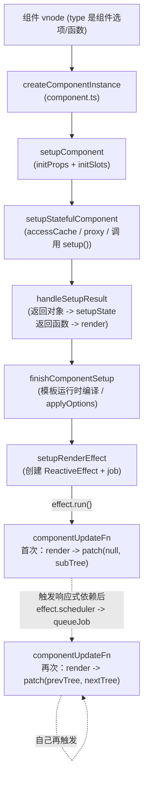

# 06. 组件实例、setup、生命周期与更新

> 一个组件从"一个选项对象/函数"变成"一棵可以持续更新的渲染树"，中间经历了哪些步骤。

## 本章导读

学完本章能回答：

- `ComponentInternalInstance` 上几十个字段分别是干什么的？`uid/proxy/ctx/setupState/subTree/effect/job` 这些字段什么时候被赋值？
- `setup()` 内部发生了什么：`props`/`attrs`/`slots`/`emit` 是怎么准备好的，返回对象和返回函数分别走什么路径？
- `this.xxx` 在模板/渲染函数里访问一个属性时，到底是按什么顺序去找的？为什么会有 `accessCache` 这个东西？
- Options API 的 `data/computed/watch/methods/provide/created` 最终是怎么"摊"到组件实例上的？和 `setup()` 同时存在时谁优先？
- 组件更新的两条路径（自己触发 vs 父组件带着新 vnode 触发）分别长什么样？`instance.next` 是干什么用的？

前置章节：第 05 章（VNode/createApp）。预计阅读时间 70~90 分钟（本章是运行时核心，源码量最大）。

涉及源码文件：

| 文件 | 作用 | 行数量级 |
|---|---|---|
| `packages/runtime-core/src/component.ts` | `ComponentInternalInstance` 定义、`createComponentInstance`/`setupComponent`/`setupStatefulComponent`/`finishComponentSetup` | ~1310 行 |
| `packages/runtime-core/src/componentPublicInstance.ts` | `PublicInstanceProxyHandlers`、`publicPropertiesMap`、`AccessTypes` | ~760 行 |
| `packages/runtime-core/src/componentOptions.ts` | `applyOptions`、`mergeOptions`、`resolveMergedOptions` | ~1330 行 |
| `packages/runtime-core/src/apiLifecycle.ts` | `injectHook`/`createHook`/各 `onXxx` | ~116 行 |
| `packages/runtime-core/src/componentRenderUtils.ts` | `renderComponentRoot`、`shouldUpdateComponent` | ~500 行 |
| `packages/runtime-core/src/renderer.ts` | `mountComponent`/`updateComponent`/`setupRenderEffect`（本章只看组件相关部分，diff 留给第 07 章） | ~2680 行（整个文件） |

## 先跑起来

```bash
pnpm ex chapters/06-component/examples/01-instance-anatomy.ts
```

关键输出（节选）：

```
│  1. setup() 内部抓到的 instance（挂载前）
│      subTree        = null (还没 render，自然是 null)
│      effect         = null (setupRenderEffect 还没执行，是 null)
│      isMounted      = false
│      provides === parent.provides ? true (还没调用过 provide()，共享父级对象)
│      调用 provide() 之后：provides === parent.provides ? false
│  2. onMounted() 里再抓一次同一个 instance（挂载后）
│      instance 是不是同一个对象 ? true
│      subTree.type   = div (已经渲染出真正的子树)
│      effect 是否存在 = true
```

一句话点出看到了什么：**同一个组件实例对象**在 `setup()` 执行时和 `onMounted()` 执行时是同一个引用，但字段是逐步被填充的——`subTree`/`effect`/`update`/`job` 这些跟"渲染"相关的字段要等 `setupComponent` 完成之后、`setupRenderEffect` 被调用时才会有值。

再看更新流程：

```bash
pnpm ex chapters/06-component/examples/04-update-flow.ts
```

```
│  1. 修改 unrelated.value（Root 需要重新渲染，Child 的 props.label 不变）
│      [Root 更新后的宿主操作] 1 次宿主操作
│         1. setElementText(<p#3>, "unrelated=1")
│      childRenderCount = 1 (应该还是 1 —— shouldUpdateComponent 判定 false，Child 完全没有重新 render)
...
│  1. 【猴子补丁】即将调用 componentUpdateFn 之前，instance.next 的实际值
│      instance.next.props = { label: 'Y' } (非 null，说明这是一次"父组件带着新 vnode 触发"的更新)
```

看到的是：父组件重新渲染不等于子组件一定重新渲染——`shouldUpdateComponent` 会先比较新旧 props，判定"不需要更新"时子组件的 `render()` 完全不会被调用，宿主操作列表里也完全看不到子组件的痕迹。

## 整体图



一句话解说：组件从 vnode 到"可渲染"要走一条长流水线，但一旦 `setupRenderEffect` 创建好 `ReactiveEffect`，之后的更新就是这个 effect 自己反复 `run()` 的过程——`mountComponent` 只会发生一次，`updateComponent`/`componentUpdateFn` 的 update 分支才是组件生命周期里真正"反复横跳"的部分。

## 源码精读

### 6.1 ComponentInternalInstance：组件实例的全部状态

```ts
// packages/runtime-core/src/component.ts#L326-L608（节选，按用途分组）
export interface ComponentInternalInstance {
  uid: number
  type: ConcreteComponent          // 组件选项对象 / 函数式组件函数
  parent: ComponentInternalInstance | null
  root: ComponentInternalInstance  // 整棵树的根实例（不是 app 根，是离自己最近的"根"，通常就是应用根组件）
  appContext: AppContext
  vnode: VNode                     // 这个实例对应父树里的哪个 vnode
  next: VNode | null               // 父组件带来的、待生效的新 vnode（见 6.6）
  subTree: VNode                   // 自己 render() 出来的子树根
  effect: ReactiveEffect           // 渲染副作用
  update: () => void               // = effect.run.bind(effect)
  job: SchedulerJob                // = effect.runIfDirty.bind(effect)，真正交给调度器的是它
  scope: EffectScope               // 组件内所有 watch/computed 的容器，卸载时 scope.stop() 一键清理
  provides: Data
  ids: [string, number, number]    // useId() 用，3.5 之前就有雏形，这里是最终形态

  accessCache: Data | null         // PublicInstanceProxyHandlers 的查找路径缓存
  renderCache: (Function | VNode | undefined)[]  // v-once/内联事件缓存槽位

  propsOptions: NormalizedPropsOptions
  emitsOptions: ObjectEmitsOptions | null
  inheritAttrs?: boolean

  proxy: ComponentPublicInstance | null   // this 访问到的就是它
  exposed: Record<string, any> | null
  exposeProxy: Record<string, any> | null
  withProxy: ComponentPublicInstance | null // 仅供 runtime-compiled render 用（with 语句模式）
  ctx: Data                               // proxy 的"目标对象"，真正存数据的地方（dev 下还挂了很多 _ 开头内部字段）

  data: Data
  props: Data
  attrs: Data
  slots: InternalSlots
  refs: Data
  emit: EmitFn
  emitted: Record<string, boolean> | null  // once 事件去重用
  propsDefaults: Data                      // props default 工厂函数的缓存结果

  setupState: Data
  setupContext: SetupContext | null

  suspense: SuspenseBoundary | null
  asyncDep: Promise<any> | null
  asyncResolved: boolean

  isMounted: boolean
  isUnmounted: boolean
  isDeactivated: boolean
  bc/c/bm/m/bu/u/um/bum/da/a/rtg/rtc/ec/sp: LifecycleHook  // 见 LifecycleHooks 枚举，6.5 节
}
```

字段虽多，但可以归成几组：**身份信息**（uid/type/parent/root/appContext）、**渲染相关**（vnode/next/subTree/effect/update/job/scope）、**状态存储**（data/props/attrs/slots/setupState/ctx）、**公共 API 载体**（proxy/exposed/emit）、**生命周期钩子数组**（一组单字母/双字母缩写字段，对应 `enums.ts` 的 `LifecycleHooks`）。记住这个分组，后面每一节都是在讲"某一组字段是怎么被填充的"。

`scope: EffectScope` 这个设计值得单独一提：组件 `setup()` 里创建的每一个 `watch`/`computed` 本质上都是一个 `ReactiveEffect`，如果不集中管理，组件卸载时要一个个找出来 `stop()`。`EffectScope` 提供了"运行期间创建的 effect 自动归属到当前 scope"的机制（`instance.scope.on()`/`off()` 包裹 `setup()` 调用），卸载时只需要 `scope.stop()` 一次就能级联停止所有子 effect（细节见第 03 章 effectScope.ts）。

### 6.2 createComponentInstance：实例的诞生

```ts
// packages/runtime-core/src/component.ts#L618-L719（节选）
export function createComponentInstance(vnode, parent, suspense): ComponentInternalInstance {
  const type = vnode.type as ConcreteComponent
  const appContext = (parent ? parent.appContext : vnode.appContext) || emptyAppContext

  const instance: ComponentInternalInstance = {
    uid: uid++, vnode, type, parent, appContext,
    root: null!, next: null, subTree: null!, effect: null!, update: null!, job: null!,
    scope: new EffectScope(true /* detached */),
    render: null, proxy: null, exposed: null, exposeProxy: null, withProxy: null,

    provides: parent ? parent.provides : Object.create(appContext.provides),
    ids: parent ? parent.ids : ['', 0, 0],
    accessCache: null!, renderCache: [],

    components: null, directives: null,
    propsOptions: normalizePropsOptions(type, appContext),
    emitsOptions: normalizeEmitsOptions(type, appContext),

    emit: null!, emitted: null,
    propsDefaults: EMPTY_OBJ,
    inheritAttrs: type.inheritAttrs,

    ctx: EMPTY_OBJ, data: EMPTY_OBJ, props: EMPTY_OBJ, attrs: EMPTY_OBJ,
    slots: EMPTY_OBJ, refs: EMPTY_OBJ, setupState: EMPTY_OBJ, setupContext: null,

    suspense, suspenseId: suspense ? suspense.pendingId : 0, asyncDep: null, asyncResolved: false,

    isMounted: false, isUnmounted: false, isDeactivated: false,
    bc: null, c: null, bm: null, m: null, bu: null, u: null, um: null, bum: null,
    da: null, a: null, rtg: null, rtc: null, ec: null, sp: null,
  }
  instance.ctx = __DEV__ ? createDevRenderContext(instance) : { _: instance }
  instance.root = parent ? parent.root : instance
  instance.emit = emit.bind(null, instance)
  if (vnode.ce) vnode.ce(instance)   // 自定义元素特殊处理
  return instance
}
```

几个关键的"继承"关系：

- **`provides: parent ? parent.provides : Object.create(appContext.provides)`**：子组件默认和父组件**共享同一个 provides 对象**（不是新建一份），只有调用 `provide()` 时才会分裂（见第 09 章）。这正是示例 01 里观察到的 `instance.provides === parent.provides` 初始为 `true`。
- **`root: parent ? parent.root : instance`**：整棵组件树共用"最近的根实例"引用，不是每次都要 `while (parent.parent)` 往上找。
- **`propsOptions`/`emitsOptions` 在实例创建时就计算好**：`normalizePropsOptions`/`normalizeEmitsOptions` 带缓存（`appContext.propsCache`/`emitsCache`），同一个组件定义被多次实例化时不会重复解析 props/emits 声明。
- **`instance.ctx` 在开发环境走 `createDevRenderContext`**：生产环境只是 `{ _: instance }` 这样一个精简对象，开发环境会额外挂一些调试用的字段（`exposePropsOnRenderContext` 等）。

### 6.3 setupComponent → setupStatefulComponent：setup() 是怎么被调用的

```ts
// packages/runtime-core/src/component.ts#L813-L831
export function setupComponent(instance, isSSR = false, optimized = false) {
  const { props, children } = instance.vnode
  const isStateful = isStatefulComponent(instance)  // shapeFlag & STATEFUL_COMPONENT
  initProps(instance, props, isStateful, isSSR)     // 见第 09 章
  initSlots(instance, children, optimized || isSSR) // 见第 09 章
  const setupResult = isStateful ? setupStatefulComponent(instance, isSSR) : undefined
  return setupResult
}
```

**先 initProps/initSlots，后调用 setup()**——这是个强约束：`setup(props, { slots })` 的第一个参数和 `setupContext.slots` 必须在调用前就准备好。

```ts
// packages/runtime-core/src/component.ts#L833-L936（setupStatefulComponent 节选）
function setupStatefulComponent(instance, isSSR: boolean) {
  const Component = instance.type as ComponentOptions

  // 0. create render proxy property access cache
  instance.accessCache = Object.create(null)
  // 1. create public instance / render proxy
  instance.proxy = new Proxy(instance.ctx, PublicInstanceProxyHandlers)
  if (__DEV__) exposePropsOnRenderContext(instance)

  // 2. call setup()
  const { setup } = Component
  if (setup) {
    pauseTracking()  // setup() 期间的属性访问不应该被当作依赖收集（它不在某个 effect 里跑）
    const setupContext = (instance.setupContext = setup.length > 1 ? createSetupContext(instance) : null)
    const reset = setCurrentInstance(instance)   // currentInstance = instance，instance.scope.on()
    const setupResult = callWithErrorHandling(setup, instance, ErrorCodes.SETUP_FUNCTION, [
      __DEV__ ? shallowReadonly(instance.props) : instance.props,
      setupContext,
    ])
    const isAsyncSetup = isPromise(setupResult)
    resetTracking()
    reset()   // instance.scope.off()，currentInstance 还原

    if (isAsyncSetup) {
      setupResult.then(unsetCurrentInstance, unsetCurrentInstance)
      if (isSSR) { /* 返回 Promise 给 server-renderer 等待 */ }
      else if (__FEATURE_SUSPENSE__) { instance.asyncDep = setupResult /* 交给 Suspense */ }
    } else {
      handleSetupResult(instance, setupResult, isSSR)
    }
  } else {
    finishComponentSetup(instance, isSSR)
  }
}
```

几个值得注意的设计：

- **`setup.length > 1` 才创建 `setupContext`**：如果用户写的是 `setup(props)`（只接收一个参数），Vue 直接跳过创建 `{ attrs, slots, emit, expose }` 这个对象，省一次分配——这是个基于"函数声明的形参个数"做的运行时优化（`Function.prototype.length`）。
- **`pauseTracking()` 包住整个 `setup()` 调用**：`setup()` 函数体本身不是一个响应式 effect 的执行上下文，如果不暂停依赖收集，`setup()` 里对 `props.xxx` 的读取会被意外地收集进"当前正在跑的某个外层 effect"（比如父组件的渲染 effect），造成错误的依赖关系。
- **`setCurrentInstance(instance)` 同时做了两件事**：`currentInstance = instance` 让 `getCurrentInstance()` 能读到；`instance.scope.on()` 让 `setup()` 内部创建的 `ref`/`computed`/`watch` 自动挂到这个组件的 `EffectScope` 下。
- **`instance.props` 在开发环境传入 `setup()` 时是 `shallowReadonly` 包装的**：防止用户在 `setup()` 里直接 `props.xxx = yyy`（props 应该总是只读，第 09 章细讲）。

### 6.4 handleSetupResult / finishComponentSetup

```ts
// packages/runtime-core/src/component.ts#L938-L976
export function handleSetupResult(instance, setupResult, isSSR: boolean): void {
  if (isFunction(setupResult)) {
    instance.render = setupResult as InternalRenderFunction   // 返回函数 -> 直接当 render
  } else if (isObject(setupResult)) {
    instance.setupState = proxyRefs(setupResult)   // 返回对象 -> setupState，ref 自动解包
    if (__DEV__) exposeSetupStateOnRenderContext(instance)
  }
  finishComponentSetup(instance, isSSR)
}
```

`proxyRefs(setupResult)` 是 `setup()` 返回对象里的 ref 能在模板/this 上"免 `.value`"访问的根本原因——它用一层 Proxy 包装返回对象，`get` 时如果命中的值是 `ref`，自动 `.value` 解包；`set` 时如果原值是 ref 而新值不是，自动写入 `.value`（否则直接替换）。

```ts
// packages/runtime-core/src/component.ts#L1002-L1104（finishComponentSetup 节选）
export function finishComponentSetup(instance, isSSR: boolean, skipOptions?: boolean): void {
  const Component = instance.type as ComponentOptions

  if (!instance.render) {
    if (!isSSR && compile && !Component.render) {
      // 运行时编译分支：Component.template 存在 + 当前构建包含编译器 + 还没有 render
      const template = Component.template || resolveMergedOptions(instance).template
      if (template) {
        Component.render = compile(template, finalCompilerOptions) // registerRuntimeCompiler 注册进来的 compile
      }
    }
    instance.render = (Component.render || NOOP) as InternalRenderFunction
    if (installWithProxy) installWithProxy(instance)  // with 语句渲染需要 withProxy
  }

  // 兼容 Options API
  if (__FEATURE_OPTIONS_API__ && !(__COMPAT__ && skipOptions)) {
    const reset = setCurrentInstance(instance)
    pauseTracking()
    try { applyOptions(instance) } finally { resetTracking(); reset() }
  }
}
```

**运行时编译分支**只在"完整版 Vue"（`vue/dist/vue.esm-bundler.js` 这类，而不是 `runtime-only` 构建）里才会生效——`compile` 变量由 `registerRuntimeCompiler(_compile)` 从 runtime-dom（或完整版打包入口）注入，**普通 `@vue/runtime-core` 单独使用时 `compile` 是 `undefined`**，`Component.template` 字符串不会被编译，只能靠显式写 `render`。这也是本章/第 05 章示例全程用 `h()` 手写 render、而不是写 `template` 的原因——示例依赖 `@vue/runtime-core` 而不是完整版 `vue`，本来就没有运行时编译能力（即使从 `vue` 导入也一样，示例为了保持两者等价，统一不使用 `template` 字符串）。

**Options API 永远在 `setup()`/`render` 都确定之后才执行**（`finishComponentSetup` 的最后一步），这保证了 `applyOptions` 里访问 `instance.render`、判断 `render && instance.render === NOOP` 时能拿到准确信息（如果 `setup()` 返回了一个函数，`applyOptions` 时 `instance.render` 已经不是 `NOOP`，选项里的 `render` 字段就不会覆盖它）。

### 6.5 PublicInstanceProxyHandlers：this.xxx 的查找顺序

```ts
// packages/runtime-core/src/componentPublicInstance.ts#L401-L423
export const publicPropertiesMap: PublicPropertiesMap = extend(Object.create(null), {
  $: i => i,
  $el: i => (__DEV__ ? getDevRootFragmentEl(i) : i.vnode.el),
  $data: i => i.data,
  $props: i => (__DEV__ ? shallowReadonly(i.props) : i.props),
  $attrs: i => (__DEV__ ? shallowReadonly(i.attrs) : i.attrs),
  $slots: i => (__DEV__ ? shallowReadonly(i.slots) : i.slots),
  $refs: i => (__DEV__ ? shallowReadonly(i.refs) : i.refs),
  $parent: i => getPublicInstance(i.parent),
  $root: i => getPublicInstance(i.root),
  $host: i => i.ce,                       // 3.5：自定义元素场景下访问宿主元素
  $emit: i => i.emit,
  $options: i => (__FEATURE_OPTIONS_API__ ? resolveMergedOptions(i) : i.type),
  $forceUpdate: i => i.f || (i.f = () => queueJob(i.update)),
  $nextTick: i => i.n || (i.n = nextTick.bind(i.proxy!)),
  $watch: i => (__FEATURE_OPTIONS_API__ ? instanceWatch.bind(i) : NOOP),
})

enum AccessTypes { OTHER, SETUP, DATA, PROPS, CONTEXT }
```

`$forceUpdate`/`$nextTick` 用 `i.f`/`i.n` 这两个实例字段做了一次性缓存（第一次访问才创建闭包，之后复用同一个函数引用）——`$forceUpdate()` 的实现极其直接：`queueJob(i.update)`，直接把渲染 effect 的 `update` 函数塞进调度队列，跳过"是否有依赖变化"的判断，强制下一轮 flush 时重新渲染。

```ts
// packages/runtime-core/src/componentPublicInstance.ts#L449-L507（get 陷阱核心逻辑）
export const PublicInstanceProxyHandlers: ProxyHandler<any> = {
  get({ _: instance }, key: string) {
    const { ctx, setupState, data, props, accessCache, type, appContext } = instance

    if (key[0] !== '$') {
      const n = accessCache![key]
      if (n !== undefined) {
        switch (n) {
          case AccessTypes.SETUP: return setupState[key]
          case AccessTypes.DATA: return data[key]
          case AccessTypes.CONTEXT: return ctx[key]
          case AccessTypes.PROPS: return props![key]
        }
      } else if (hasSetupBinding(setupState, key)) {
        accessCache![key] = AccessTypes.SETUP
        return setupState[key]
      } else if (data !== EMPTY_OBJ && hasOwn(data, key)) {
        accessCache![key] = AccessTypes.DATA
        return data[key]
      } else if (hasOwn(props, key)) {
        accessCache![key] = AccessTypes.PROPS
        return props![key]
      } else if (ctx !== EMPTY_OBJ && hasOwn(ctx, key)) {
        accessCache![key] = AccessTypes.CONTEXT
        return ctx[key]
      } else if (!__FEATURE_OPTIONS_API__ || shouldCacheAccess) {
        accessCache![key] = AccessTypes.OTHER
      }
    }

    const publicGetter = publicPropertiesMap[key]
    if (publicGetter) {
      if (key === '$attrs') { track(instance.attrs, TrackOpTypes.GET, ''); markAttrsAccessed() }
      return publicGetter(instance)
    } else if (/* cssModule */) { ... }
    else if (ctx !== EMPTY_OBJ && hasOwn(ctx, key)) { accessCache![key] = AccessTypes.CONTEXT; return ctx[key] }
    else if (hasOwn(appContext.config.globalProperties, key)) { return appContext.config.globalProperties[key] }
    // 否则：开发期警告"访问了未定义的属性"
  },
}
```

查找顺序总结（`$` 开头的 key 跳过前半段，直接走 `publicPropertiesMap`）：

1. **`accessCache` 命中** → 直接按缓存的类型取值，这是热路径优化，跳过后面所有 `hasOwn` 判断。
2. **`setupState`**（`hasSetupBinding` 排除了 `__isScriptSetup` 标记的纯类型占位对象）
3. **`data`**
4. **`props`**
5. **`ctx`**（methods、inject 产生的绑定、用户 `this.xxx = yyy` 写入的自定义属性都在这里）
6. **`publicPropertiesMap`**（`$xxx` 系列）
7. **cssModule / globalProperties**（`app.config.globalProperties` 挂载的全局属性，比如插件注入的 `$router`）

这个顺序决定了示例 02 里 `setupState` 和 `props` 同名时 **setupState 赢**。`accessCache` 的设计动机写在源码注释里：**这个 getter 在渲染时是热点路径，多次 `hasOwn` 调用比一次对象属性访问（走 accessCache）慢得多**，所以用一个 `key -> AccessTypes` 的无原型对象（`Object.create(null)`）记住"第一次查到的结果在哪一层"，后续同 key 访问直接查表。

`set` 陷阱的限制（示例 02 验证过）：

```ts
// packages/runtime-core/src/componentPublicInstance.ts#L569-L600（节选）
set({ _: instance }, key, value): boolean {
  const { data, setupState, ctx } = instance
  if (hasSetupBinding(setupState, key)) { setupState[key] = value; return true }
  else if (setupState.__isScriptSetup && hasOwn(setupState, key)) {
    warn(`Cannot mutate <script setup> binding "${key}" from Options API.`); return false
  } else if (data !== EMPTY_OBJ && hasOwn(data, key)) { data[key] = value; return true }
  else if (hasOwn(instance.props, key)) {
    warn(`Attempting to mutate prop "${key}". Props are readonly.`); return false
  }
  if (key[0] === '$' && key.slice(1) in instance) {
    warn(`Attempting to mutate public property "${key}"...`); return false
  } else {
    ctx[key] = value   // 兜底：写入 ctx，相当于给实例挂了个自定义属性
  }
  return true
}
```

props 赋值、`$` 开头保留字段赋值，陷阱都返回 `false`——在严格模式（ESM 模块天然是严格模式）下，Proxy 规范要求 `set` 陷阱返回 `false` 时外层赋值表达式必须抛 `TypeError`（示例 02 实测验证了这一点）。

### 6.6 applyOptions：Options API 的执行顺序

```ts
// packages/runtime-core/src/componentOptions.ts#L520-L531
export function applyOptions(instance: ComponentInternalInstance): void {
  const options = resolveMergedOptions(instance)
  const publicThis = instance.proxy! as any
  const ctx = instance.ctx
  shouldCacheAccess = false   // 状态初始化期间不缓存 accessCache，避免缓存到"还没赋值"的错误状态

  if (options.beforeCreate) callHook(options.beforeCreate, instance, LifecycleHooks.BEFORE_CREATE)
  const { data, computed, methods, watch, provide: provideOptions, inject, created, ... } = options
  // ...
```

```ts
// packages/runtime-core/src/componentOptions.ts#L586-L593（源码注释原文）
// options initialization order (to be consistent with Vue 2):
// - props (already done outside of this function)
// - inject
// - methods
// - data (deferred since it relies on `this` access)
// - computed
// - watch (deferred since it relies on `this` access)
```

实际顺序（含生命周期钩子）：**`beforeCreate` → `inject` → `methods` → `data` → `computed` → `watch` → `provide` → `created` → 注册 `beforeMount/mounted/...` 等生命周期钩子 → `expose`/`render`/`components`/`directives`**。

为什么 `inject` 必须在 `data`/`methods` 之前：因为 `data()` 函数体里经常要用到注入的值（`data() { return { x: this.injectedFoo } }`），`inject` 不依赖 `this`（直接调用 `inject(key)` 函数），可以先算好塞进 `ctx`；而 `data`/`watch` 的工厂函数要用 `this` 访问其他已经初始化的状态，所以要等 `methods` 先挂好、`publicThis` 可用之后才能调用。

```ts
// packages/runtime-core/src/componentOptions.ts#L664-L692（methods 挂载 + data 转 reactive，节选）
if (methods) {
  for (const key in methods) {
    ctx[key] = methods[key].bind(publicThis)   // bind 到 publicThis，所以 this.xxx() 里的 this 永远是 proxy
  }
}
if (dataOptions) {
  const data = dataOptions.call(publicThis, publicThis)
  instance.data = reactive(data)               // data() 返回值变成 reactive 对象
}
shouldCacheAccess = true   // 状态初始化完成，重新允许 accessCache 缓存

if (computedOptions) {
  for (const key in computedOptions) {
    const c = computed({ get: opt.get?.bind(publicThis, publicThis), set: ... })
    Object.defineProperty(ctx, key, { get: () => c.value, set: v => (c.value = v) })  // computed() 包装
  }
}
if (watchOptions) {
  for (const key in watchOptions) createWatcher(watchOptions[key], ctx, publicThis, key)  // 走 createWatcher
}
if (provideOptions) {
  const provides = isFunction(provideOptions) ? provideOptions.call(publicThis) : provideOptions
  Reflect.ownKeys(provides).forEach(key => provide(key, provides[key]))   // 复用 apiInject.ts 的 provide()
}
if (created) callHook(created, instance, LifecycleHooks.CREATED)

registerLifecycleHook(onBeforeMount, beforeMount)
registerLifecycleHook(onMounted, mounted)
// ... 其余生命周期钩子同理，全部走 injectHook 追加进实例的钩子数组
```

**`computed` 选项最终还是用 `computed()` 这个响应式 API 实现的**，`watch` 选项用 `createWatcher` 包装后调用的也是 `watch()`，`provide` 选项调用的就是 `apiInject.ts` 的 `provide()` 函数——Options API 不是另一套独立机制，而是"把选项对象翻译成一连串 Composition API 调用"，这也是为什么两者能在同一个组件里混用而不冲突（示例 05 验证）。

`registerLifecycleHook(onMounted, mounted)` 这一行是本节最关键的一句：选项式的 `mounted` 钩子，底层调用的就是 `onMounted()`（6.7 节的 `injectHook`），和 `setup()` 里手写 `onMounted(fn)` 走的是**同一个 `injectHook` 调用，只是注册时机更晚**（`applyOptions` 在 `setup()` 返回之后才执行）。所以两者都存在时，**`setup()` 里的钩子一定先于 Options API 的同名钩子执行**（数组里谁先 `push` 谁先跑）——示例 03 第 3 节验证了这个顺序。

```ts
// packages/runtime-core/src/componentOptions.ts#L927-L1004（resolveMergedOptions / mergeOptions）
export function resolveMergedOptions(instance): MergedComponentOptions {
  const base = instance.type as ComponentOptions
  const { mixins, extends: extendsOptions } = base
  const { mixins: globalMixins, optionsCache: cache, config: { optionMergeStrategies } } = instance.appContext
  const cached = cache.get(base)
  if (cached) return cached
  if (!globalMixins.length && !mixins && !extendsOptions) return base   // 没有合并需求，直接用原对象（+缓存）
  let resolved: MergedComponentOptions = {}
  if (globalMixins.length) globalMixins.forEach(m => mergeOptions(resolved, m, optionMergeStrategies, true))
  mergeOptions(resolved, base, optionMergeStrategies)
  cache.set(base, resolved)
  return resolved
}

export function mergeOptions(to, from, strats, asMixin = false): any {
  const { mixins, extends: extendsOptions } = from
  if (extendsOptions) mergeOptions(to, extendsOptions, strats, true)
  if (mixins) mixins.forEach(m => mergeOptions(to, m, strats, true))
  for (const key in from) {
    const strat = internalOptionMergeStrats[key] || (strats && strats[key])
    to[key] = strat ? strat(to[key], from[key]) : from[key]   // 没有专门策略就是"后者覆盖前者"
  }
  return to
}
```

**mixins 的合并顺序是"mixin 先写入 `to`，组件自身的选项后写入"**（`mergeOptions(resolved, base, ...)` 在 mixin 遍历之后调用），所以没有专门合并策略的字段（比如 `methods` 里的同名方法）组件自身会覆盖 mixin；而 `data`/生命周期钩子等字段在 `internalOptionMergeStrats` 里有专门的合并函数（`mergeDataFn` 递归合并对象、生命周期钩子用 `mergeAsArray` 拼接成数组而不是覆盖）——这正是示例 05 里 `created` 钩子 mixin 和组件自身都执行、而 `methods.sayShared` 被组件覆盖的原因。`optionsCache` 这个 `WeakMap` 保证同一个组件定义对象只合并一次。

### 6.7 apiLifecycle.ts：injectHook

```ts
// packages/runtime-core/src/apiLifecycle.ts#L20-L64
export function injectHook(type: LifecycleHooks, hook, target = currentInstance, prepend = false) {
  if (target) {
    const hooks = target[type] || (target[type] = [])
    const wrappedHook = hook.__weh || (hook.__weh = (...args) => {
      pauseTracking()                           // 钩子执行期间禁止依赖收集
      const reset = setCurrentInstance(target)   // 钩子内部能继续访问 getCurrentInstance()
      const res = callWithAsyncErrorHandling(hook, target, type, args)
      reset()
      resetTracking()
      return res
    })
    prepend ? hooks.unshift(wrappedHook) : hooks.push(wrappedHook)
    return wrappedHook
  } else if (__DEV__) {
    warn(`${apiName} is called when there is no active component instance...`)
  }
}

export const onMounted: CreateHook = createHook(LifecycleHooks.MOUNTED)
// onBeforeMount/onBeforeUpdate/onUpdated/onBeforeUnmount/onUnmounted/onServerPrefetch 同理
```

`hook.__weh` 这个缓存字段（"with error handling"）是为了**同一个 hook 函数被多次调用 `injectHook` 时去重**（比如 `<script setup>` 里的一些场景，或者 `createHook` 内部 `(...args) => hook(...args)` 包了一层导致每次调用 `onMounted` 产生新函数——但 `createHook` 返回的闭包每次都重新创建一个包装函数，所以这里的去重主要是给"直接传同一个已包装函数" 的场景用，比如 KeepAlive 内部重新派发 `onActivated`）。调度器需要能通过引用相等判断"这是不是同一个任务"来去重，`__weh` 保证多次 `injectHook(type, hook)` 若 `hook` 引用相同，产出的 `wrappedHook` 也相同。

**注册时机限制**："必须在 setup 中同步调用"——因为 `injectHook` 依赖 `currentInstance`（或显式传入 `target`），`setup()` 执行完毕后 `currentInstance` 就被还原成 `null`（`unsetCurrentInstance`），如果在 `setTimeout`/`then()` 回调里异步调用 `onMounted()`，这时候已经没有"当前实例"上下文，会命中 `else if (__DEV__) warn(...)` 分支。`KeepAlive` 的 `onActivated`/`onDeactivated` 是特例，在 `components/KeepAlive.ts` 里重新导出（本章只提一句，详见第 10 章）。SSR 下 `createHook` 会跳过除 `onServerPrefetch` 外的所有钩子注册（纯客户端生命周期在服务端渲染时没有意义）。

### 6.8 setupRenderEffect：组件更新的发动机

```ts
// packages/runtime-core/src/renderer.ts#L1343-L1352, 1630-1652（节选，effect 创建部分）
const setupRenderEffect: SetupRenderEffectFn = (instance, initialVNode, container, anchor, parentSuspense, namespace, optimized) => {
  const componentUpdateFn = () => { /* 见下方 mount/update 两个分支 */ }

  instance.scope.on()
  const effect = (instance.effect = new ReactiveEffect(componentUpdateFn))
  instance.scope.off()

  const update = (instance.update = effect.run.bind(effect))
  const job: SchedulerJob = (instance.job = effect.runIfDirty.bind(effect))
  job.i = instance
  job.id = instance.uid
  effect.scheduler = () => queueJob(job)

  toggleRecurse(instance, true)   // 允许组件渲染 effect 递归触发自己（例如渲染过程中又改了自己依赖的状态）
  if (__DEV__) {
    effect.onTrack = instance.rtc ? e => invokeArrayFns(instance.rtc!, e) : void 0
    effect.onTrigger = instance.rtg ? e => invokeArrayFns(instance.rtg!, e) : void 0
  }
  update()   // 首次调用，触发 mount 分支
}
```

3.5 的一个关键变化（相对更早版本）：**`job` 不再是单独写的一个函数，而是 `effect.runIfDirty.bind(effect)`**——`runIfDirty` 是 `ReactiveEffect` 自己提供的方法：只有当这个 effect 真的处于"脏"（依赖确实变化过）状态时才会 `run()`，否则直接跳过。把"要不要真的重新渲染"的判断下放到 `ReactiveEffect` 内部（依赖版本号机制，详见第 03 章），调度器只管"把 job 塞进队列"，不需要关心具体的脏检查逻辑。`job.i = instance; job.id = instance.uid` 是给调度器用的元信息（`job.i` 在开发工具里能从 job 反查组件，`job.id` 用于调度队列按 id 排序，保证父组件先于子组件更新，见第 08 章）。

```ts
// packages/runtime-core/src/renderer.ts#L1353-L1451（componentUpdateFn 的 mount 分支，节选）
if (!instance.isMounted) {
  const { bm, m, parent, root, type } = instance
  toggleRecurse(instance, false)         // 挂载钩子执行期间临时禁止递归（防止 beforeMount 里又触发更新）
  if (bm) invokeArrayFns(bm)
  if ((vnodeHook = props && props.onVnodeBeforeMount)) invokeVNodeHook(vnodeHook, parent, initialVNode)
  toggleRecurse(instance, true)

  const subTree = (instance.subTree = renderComponentRoot(instance))
  patch(null, subTree, container, anchor, instance, parentSuspense, namespace)
  initialVNode.el = subTree.el

  if (m) queuePostRenderEffect(m, parentSuspense)                               // mounted 钩子，post flush
  if ((vnodeHook = props && props.onVnodeMounted)) queuePostRenderEffect(() => invokeVNodeHook(...), parentSuspense)
  if (KeepAlive 相关 shapeFlag) instance.a && queuePostRenderEffect(instance.a, parentSuspense)  // activated
  instance.isMounted = true
}
```

`bm`（beforeMount）是**同步**调用的，`m`（mounted）是用 `queuePostRenderEffect` **排进 post-flush 队列**的——这保证了 `mounted` 钩子执行时，真实 DOM 已经完全 patch 完毕（`patch(null, subTree, ...)` 已经跑完），而不是"刚插入一个节点就立刻通知"。`toggleRecurse(instance, false)` 包住 `beforeMount` 钩子执行：如果用户在 `beforeMount` 里又触发了导致自己重新渲染的操作，这期间必须临时禁止递归，否则会在还没完成第一次挂载时就尝试第二次渲染。

```ts
// packages/runtime-core/src/renderer.ts#L1460-L1630（update 分支，节选）
} else {
  let { next, bu, u, parent, vnode } = instance
  let originNext = next
  toggleRecurse(instance, false)
  if (next) {
    next.el = vnode.el
    updateComponentPreRender(instance, next, optimized)   // 见 6.9
  } else {
    next = vnode
  }
  if (bu) invokeArrayFns(bu)
  if ((vnodeHook = next.props && next.props.onVnodeBeforeUpdate)) invokeVNodeHook(vnodeHook, parent, next, vnode)
  toggleRecurse(instance, true)

  const nextTree = renderComponentRoot(instance)
  const prevTree = instance.subTree
  instance.subTree = nextTree
  patch(prevTree, nextTree, hostParentNode(prevTree.el!)!, getNextHostNode(prevTree), instance, parentSuspense, namespace)
  next.el = nextTree.el
  if (originNext === null) updateHOCHostEl(instance, nextTree.el)   // 处理高阶组件场景下父 vnode.el 的联动更新
  if (u) queuePostRenderEffect(u, parentSuspense)
}
```

`originNext === null` 分支专门处理"自己触发更新"（而不是父组件带来 `next`）且**自己是某个高阶组件（HOC）内部实际渲染节点**的场景——`updateHOCHostEl` 会沿着 `parent` 链一直往上找，把每一层"实际指向这个节点"的父 vnode 的 `el` 都同步更新，这是因为 HOC 场景下父组件的 `subTree` 可能直接就是子组件的 vnode（没有额外包装元素），子组件的 DOM 节点变了，父 vnode 的 `el` 引用也要跟着变。

### 6.9 updateComponent / updateComponentPreRender / shouldUpdateComponent

```ts
// packages/runtime-core/src/renderer.ts#L1307-L1341
const updateComponent = (n1: VNode, n2: VNode, optimized: boolean) => {
  const instance = (n2.component = n1.component)!
  if (shouldUpdateComponent(n1, n2, optimized)) {
    if (instance.asyncDep && !instance.asyncResolved) {
      // 异步组件还没 resolve，只更新 props/slots，渲染 effect 还没建立
      n2.el = n1.el; updateComponentPreRender(instance, n2, optimized); return
    }
    instance.next = n2
    instance.update()        // 同步调用，立刻触发 componentUpdateFn 的 update 分支
  } else {
    n2.el = n1.el
    instance.vnode = n2       // 不需要更新，仅仅替换 vnode 引用（保留实例、el 等挂载信息）
  }
}
```

```ts
// packages/runtime-core/src/renderer.ts#L1653-L1669
const updateComponentPreRender = (instance, nextVNode, optimized) => {
  nextVNode.component = instance
  const prevProps = instance.vnode.props
  instance.vnode = nextVNode
  instance.next = null                                  // <-- next 在这里被清空
  updateProps(instance, nextVNode.props, prevProps, optimized)
  updateSlots(instance, nextVNode.children, optimized)
  pauseTracking()
  flushPreFlushCbs(instance)   // props 更新可能触发了 pre-flush watcher，这里先 flush 掉
  resetTracking()
}
```

```ts
// packages/runtime-core/src/componentRenderUtils.ts#L374-L440（shouldUpdateComponent 节选）
export function shouldUpdateComponent(prevVNode, nextVNode, optimized?: boolean): boolean {
  const { props: prevProps, children: prevChildren, component } = prevVNode
  const { props: nextProps, children: nextChildren, patchFlag } = nextVNode
  const emits = component!.emitsOptions

  if (nextVNode.dirs || nextVNode.transition) return true   // 指令/Transition 强制更新

  if (optimized && patchFlag >= 0) {
    if (patchFlag & PatchFlags.DYNAMIC_SLOTS) return true
    if (patchFlag & PatchFlags.FULL_PROPS) {
      return !prevProps ? !!nextProps : hasPropsChanged(prevProps, nextProps!, emits)
    } else if (patchFlag & PatchFlags.PROPS) {
      // 编译期优化：只比较 dynamicProps 列出的那几个 key
      for (const key of nextVNode.dynamicProps!) {
        if (hasPropValueChanged(nextProps!, prevProps!, key) && !isEmitListener(emits, key)) return true
      }
    }
  } else {
    // 手写 render 函数走这里：只要有 children 且不是 $stable 插槽，强制更新；否则逐 key 比较 props
    if (prevChildren || nextChildren) {
      if (!nextChildren || !(nextChildren as any).$stable) return true
    }
    if (prevProps === nextProps) return false
    if (!prevProps) return !!nextProps
    if (!nextProps) return true
    return hasPropsChanged(prevProps, nextProps, emits)
  }
  return false
}
```

这是整章最能体现"编译期信息如何换取运行时性能"的一段代码：**`optimized && patchFlag >= 0` 时走编译器优化路径**——`PatchFlags.PROPS` 配合 `dynamicProps` 数组，只需要比较"编译器明确标记会变"的那几个 key，不用 `Object.keys` 遍历整个 props 对象；**没有编译优化信息时**（`optimized` 为 false，典型场景就是手写 `render()` 函数，示例 04 就是这种情况），只能退回到 `hasPropsChanged` 的全量 key 比较（先比较 key 数量，再逐个比较值，`style` 对象用 `looseEqual` 深比较，其余用 `!==`）。`isEmitListener(emits, key)` 排除掉声明过的事件监听器 prop（`onXxx` 变化不应该触发重新渲染，因为它只是个函数引用，内容变了不代表"状态"变了）。

### 6.10 renderComponentRoot：render() 到底是怎么被调用的

```ts
// packages/runtime-core/src/componentRenderUtils.ts#L54-L113（节选）
export function renderComponentRoot(instance): VNode {
  const { type: Component, vnode, proxy, withProxy, propsOptions: [propsOptions],
          slots, attrs, emit, render, renderCache, props, data, setupState, ctx, inheritAttrs } = instance
  const prev = setCurrentRenderingInstance(instance)
  let result, fallthroughAttrs

  try {
    if (vnode.shapeFlag & ShapeFlags.STATEFUL_COMPONENT) {
      const proxyToUse = withProxy || proxy
      result = normalizeVNode(
        render!.call(proxyToUse, proxyToUse, renderCache,
          __DEV__ ? shallowReadonly(props) : props, setupState, data, ctx),
      )
      fallthroughAttrs = attrs
    } else {
      // 函数式组件分支：render(props, { attrs, slots, emit })
      const render = Component as FunctionalComponent
      result = normalizeVNode(render.length > 1 ? render(props, { attrs, slots, emit }) : render(props, null as any))
      fallthroughAttrs = Component.props ? attrs : getFunctionalFallthrough(attrs)
    }
  } catch (err) {
    blockStack.length = 0
    handleError(err, instance, ErrorCodes.RENDER_FUNCTION)
    result = createVNode(Comment)   // render 抛错时，渲染出一个注释节点兜底，不让整个应用崩溃
  }

  let root = result
  if (fallthroughAttrs && inheritAttrs !== false) {
    // attrs 透传逻辑，详见第 09 章
  }
  if (vnode.dirs) root = cloneVNode(root, null, false, true), (root.dirs = ...)   // 指令继承到根节点
  if (vnode.transition) setTransitionHooks(child, vnode.transition)               // Transition 继承到根节点

  setCurrentRenderingInstance(prev)
  return result
}
```

`render!.call(proxyToUse, proxyToUse, renderCache, props, setupState, data, ctx)`：注意**编译产物的 render 函数签名**是 `(_ctx, _cache, $props, $setup, $data, $options)`，这几个参数直接对应这里传入的 `proxyToUse/renderCache/props/setupState/data/ctx`——这是为了让编译器生成的代码可以直接用 `$setup.xxx`/`$props.xxx` 这种形式访问状态（跳过 Proxy 的 `get` 陷阱查找链，见第 12/13 章的编译优化）。`setCurrentRenderingInstance(instance)` 在渲染期间设置"当前渲染实例"，这样渲染过程中创建的每一个子 vnode 的 `ctx` 字段、`ref` 的 `i` 字段才知道自己属于哪个组件。

渲染出错时用 `createVNode(Comment)` 兜底，这是 Vue 3 "尽量不让一个组件的渲染错误导致整个应用崩溃"策略的一部分（`handleError` 内部还会调用 `errorCaptured` 钩子链，详见错误处理相关章节）。

## 与 Vue 2 对比

| 维度 | Vue 2 | Vue 3 | 为什么这么改 / 代价 |
|---|---|---|---|
| 初始化流程 | `_init()`（`src/core/instance/init.ts`）：`initLifecycle → initEvents → initRender → callHook('beforeCreate') → initInjections → initState(initProps/initMethods/initData/initComputed/initWatch) → initProvide → callHook('created')` | `createComponentInstance → setupComponent(initProps/initSlots) → setupStatefulComponent(调用 setup()) → finishComponentSetup(applyOptions)` | Vue 2 把 Composition 能力"伪装"成生命周期钩子的一部分（`beforeCreate`/`created` 之间塞初始化逻辑），Vue 3 把 `setup()` 变成一个独立、更早执行的阶段，Composition API 不再依赖"在某个生命周期钩子里才能访问状态"这种隐式时机 |
| `this` 的本质 | `vm` 本身就是暴露给用户的对象：`_data`/`_props` 上的字段通过 `Object.defineProperty` 代理到 `vm` 上（`initState` 里的 `proxy(vm, '_data', key)`） | `this` 是 `new Proxy(instance.ctx, PublicInstanceProxyHandlers)`，`instance`（内部状态的真正载体）对用户不可见，只能通过 `getCurrentInstance()`（非公开 API）拿到 | Vue 2 的"字段代理"是在初始化时对每个 key 单独调用 `Object.defineProperty`，字段数量多时有一次性开销；Vue 3 用一个 Proxy + `accessCache` 做运行时按需查找，同时把"内部实现细节"（`instance`）和"用户可见的 this"彻底分离，减少了用户误用内部字段的可能性 |
| 生命周期命名 | `beforeDestroy`/`destroyed` | `beforeUnmount`/`unmounted`（Vue 3 仍兼容旧名，`internalOptionMergeStrats`/`DeprecationTypes.OPTIONS_BEFORE_DESTROY` 等做兼容映射） | 新名称和"unmount"（而不是"destroy"）这个动词统一（`app.unmount()`/`unmountComponent`），避免"destroy"暗示"对象被销毁"（实际上组件实例对象在 JS 层面还在，只是从 DOM 和响应式系统里摘除） |
| 等价于 `beforeCreate`/`created` 的时机 | 两个独立的生命周期钩子 | 没有对应钩子，直接写在 `setup()` 函数体顶部（`setup()` 执行时机早于 `beforeCreate` 调用点，覆盖了两者的语义） | `setup()` 在 `props` 初始化之后立刻执行，此时 `data`/`computed` 等还未初始化（因为它们在 Vue 3 里本来就是 `setup()` 返回值或 Options API 的一部分），不需要再区分"创建前"和"创建后"两个阶段 |
| `$forceUpdate` | `vm._watcher.update()`：直接调用关联的 `Watcher` 实例的 `update` 方法 | `queueJob(i.update)`：把组件更新函数塞进调度队列 | 语义相同（强制重新渲染，跳过依赖检查），实现细节随底层响应式系统的变化而变化（Vue 2 是单一全局的 `Watcher` 类，Vue 3 是 `ReactiveEffect` + 独立调度队列） |
| mixin 合并 | `src/core/util/options.ts` 的 `mergeOptions`，策略表 `strats` 针对 `data/el/props/methods/watch/...` 等分别定义 | `componentOptions.ts` 的 `mergeOptions` + `internalOptionMergeStrats`，逻辑结构高度相似 | 两者思路几乎一致（Vue 3 这部分基本是对 Vue 2 对应逻辑的平移），因为"多个来源的选项对象如何合并"这个问题本身和响应式系统的实现无关 |

## 动手：mini 实现 / 实验

本章不单独提供新的 mini 实现——组件实例/setup/生命周期涉及的内部状态非常多，拆出一个"忠实缩小版"容易变成对源码的逐行翻译，收益有限。建议读者：

1. 复用第 05 章 `mini-vue/runtime-core/vnode.ts` 里的 `createVNode`/`ShapeFlags`，自己尝试写一个极简的 `createComponentInstance(vnode)`，只保留 `uid/type/props/setupState/subTree/isMounted` 几个字段，体会"实例对象是怎么从 vnode 派生出来的"。
2. 等到第 07 章的 mini 实现（`mini-vue/runtime-core/diff.ts`/`scheduler.ts`）写完后，回头把一个最简 `mountComponent`/`updateComponent` 接上去，串联出一个能跑通"响应式数据变化 -> 组件自动重新渲染"的最小闭环——这比在本章单独实现更有意义，因为组件更新离不开调度器。
3. 自己动手实验：在 `chapters/06-component/examples/04-update-flow.ts` 的基础上，把 `Child` 的 `render` 函数签名改成读取 `this.$attrs`，观察父组件传入一个未声明的 prop 时，`shouldUpdateComponent` 的非 optimized 分支是否依然能正确识别出"props 变了"（提示：`attrs` 变化不会让 `instance.props` 引用变化，但会不会影响 `nextProps`/`prevProps` 的比较？对照 09 章的 attrs 实现）。

## 常见疑问

**Q: `setup()` 里可以用 `this` 吗？**
A: 不可以，也没有意义。`setup()` 调用时 `instance.proxy` 虽然已经创建（`setupStatefulComponent` 第 1 步），但 `setup(props, context)` 的两个参数已经把常用的东西都给你了，Vue 刻意不把 `this` 绑定给 `setup()` 函数（调用方式是 `callWithErrorHandling(setup, instance, ..., [props, setupContext])`，没有指定 `this`），避免用户在这个阶段心智上继续套用 Options API 的 `this.xxx`。

**Q: `accessCache` 会不会缓存出错——比如一个属性先在 data 里后来被删除了？**
A: 正常使用下不会，因为 `data` 对象本身是 `reactive()` 包的，字段增删会触发响应式系统的 `has`/`ownKeys` 相关处理，但 `accessCache` 只是缓存"曾经查到这个 key 属于哪一层"，如果业务代码动态 `delete this.someData`，下次访问仍然会先走 `accessCache[key] = AccessTypes.DATA` 的分支直接返回 `data[key]`（此时是 `undefined`），不会重新查找——这也是为什么 Vue 一直不建议运行时动态增删 `data` 的字段。

**Q: `instance.next` 和 `instance.vnode` 有什么区别，是不是重复了？**
A: `instance.vnode` 永远代表"当前已经生效的那个 vnode"，`instance.next` 是"父组件刚传进来、还没应用"的新 vnode，只在 `updateComponent → updateComponentPreRender` 这一小段时间窗口内存在（见 6.9 节源码）。自己触发的更新（`$forceUpdate`/响应式依赖变化）完全不涉及 `instance.next`，因为没有新 vnode 需要应用，只是重新执行同一个 `render()`。

**Q: 为什么 `effect.scheduler` 要包一层 `queueJob(job)` 而不是直接 `update()`？**
A: 如果响应式依赖触发时立刻同步 `update()`，同一个 tick 内对多个响应式字段的连续修改会导致组件被渲染很多次。`queueJob` 把更新函数塞进一个去重队列，在微任务里统一 flush 一次，这是第 08 章的核心内容，这里先知道"组件更新不是同步发生的"这件事。

**Q: Vue 3.5 之前版本里好像有个 `invalidateJob` 函数，现在哪去了？**
A: 在当前（3.5.44）的 `runtime-core` 源码里全局搜索 `invalidateJob` 已经没有结果——这个职责被 `job.flags`（`SchedulerJobFlags`）和 `effect.runIfDirty()` 的脏检查机制取代了：不需要再有一个专门的"使任务失效"的函数，调度器在 flush 时直接看 `job` 是不是还处于有效状态（细节留给第 08 章调度器源码）。

## 小结

- `ComponentInternalInstance` 的几十个字段可以按"身份/渲染/状态/公共API/生命周期钩子"五组理解，不用死记硬背。
- `createComponentInstance` 只是分配好所有字段的"空位"；`setupComponent`（initProps/initSlots）→ `setupStatefulComponent`（调用 setup()）→ `finishComponentSetup`（确定 render，跑 Options API）是组件"从 vnode 到可渲染状态"的完整流水线。
- `setup()` 调用期间：`pauseTracking` 禁止意外依赖收集，`setCurrentInstance` 让 `getCurrentInstance()`/`provide()`/`inject()` 能工作，`instance.scope.on()` 让新建的响应式 effect 归属到组件自己的 EffectScope。
- `this.xxx` 的查找顺序是 `accessCache 命中 → setupState → data → props → ctx → $xxx → globalProperties`，`accessCache` 是为了避免每次渲染都重新做好几次 `hasOwn` 判断。
- Options API 的每一项最终都落到 Composition API 的调用上（`data` → `reactive()`、`computed` 选项 → `computed()`、`watch` 选项 → `watch()`、`provide` 选项 → `provide()`），`applyOptions` 只是按固定顺序帮你调用它们。
- `setupRenderEffect` 创建的 `ReactiveEffect` 是组件更新的发动机：`job = effect.runIfDirty.bind(effect)` 把"是否真的需要重新渲染"的判断下沉到响应式系统内部。
- `shouldUpdateComponent` 的 optimized/非 optimized 两条路径体现了"编译期信息换运行时性能"：有 `PatchFlags.PROPS + dynamicProps` 时只比较明确标记的 key，否则全量比较。
- `instance.next` 只在"父组件带着新 vnode 触发更新"这个窄窗口内存在，`updateComponentPreRender` 用完立刻清空。

## 延伸阅读

- `setup()` 的 RFC：<https://github.com/vuejs/rfcs/blob/master/active-rfcs/0013-composition-api.md>
- `effect.runIfDirty` / 版本号机制相关讨论见第 03 章延伸阅读
- Evan You 关于 `accessCache` 性能优化的提交历史可在 `git log -p -- packages/runtime-core/src/componentPublicInstance.ts` 中查到（本地已 clone 的 vue-core 仓库可直接查）
- Vue 3 迁移指南中关于生命周期钩子改名的部分：<https://v3-migration.vuejs.org/breaking-changes/#removed-apis>（对照 `destroyed`/`beforeDestroy`）

## 思考题

1. 如果一个组件既写了 `setup()` 返回一个对象，又写了 Options API 的 `data()` 返回了同名字段，`applyOptions` 执行时会不会报错或警告？结合 6.6 节的执行顺序和 6.5 节的查找顺序，说明最终 `this.xxx` 读到的是谁、`data` 里那份"看起来被覆盖"的值还在不在内存里。

   <details><summary>答案</summary>

   不会报错。`setup()` 先执行，结果存进 `instance.setupState`；`applyOptions`（在 `finishComponentSetup` 里）后执行，`data()` 的结果存进 `instance.data`，两者是不同的对象，互不覆盖存储空间。只是 `PublicInstanceProxyHandlers.get` 查找时 `setupState` 优先级更高，所以 `this.xxx` 读到的是 `setup()` 返回的值；`data` 里那份值仍然存在于 `instance.data` 里，可以通过 `this.$data.xxx` 显式访问到。
   </details>

2. `componentUpdateFn` 的 mount 分支里，`toggleRecurse(instance, false)` 包住了 `beforeMount` 钩子的调用，但没有包住 `renderComponentRoot`/`patch` 这一段。如果用户在 `render()` 函数执行过程中读取并修改了自己依赖的一个 `ref`，会发生什么？

   <details><summary>答案</summary>

   `render()` 执行期间，`setCurrentRenderingInstance(instance)` 使得读取 `ref.value` 会给"当前的渲染 effect"建立依赖关系（track）；如果同一次 render 内又同步 `ref.value = x` 修改它，会触发该 effect 的 `trigger`，但因为这期间 `toggleRecurse` 已经在 `renderComponentRoot` 调用前被重新设为 `true`（紧跟在 beforeMount 钩子之后），加上 `ReactiveEffect` 自身有"正在执行时不重入"的保护（除非显式允许递归），通常表现为这次修改被记录为"脏"，下一轮调度 flush 时该组件会再被渲染一次，而不是在当前同步调用栈里立刻递归重渲染。这是源码里反复出现 `toggleRecurse` 的原因——精确控制"这一小段时间内，这个组件的渲染 effect 允不允许重入"。
   </details>

3. `shouldUpdateComponent` 在 `optimized` 为 `true` 且 `patchFlag & PatchFlags.PROPS` 时，只遍历 `nextVNode.dynamicProps` 这几个 key，并没有检查"有没有 key 被整个删除"。这是否意味着编译器优化路径下"删除一个动态 prop"这种情况无法被正确处理？

   <details><summary>答案</summary>

   不会出问题，因为这种场景根本不会被编译器标记成 `PatchFlags.PROPS`——`PROPS` 标记的前提是"props 的 key 集合是固定的，只有值会变"（源码注释：`Mutually exclusive with FULL_PROPS`）。如果模板里 `v-bind` 的是一个动态对象（key 可能增删），编译器会标记成 `FULL_PROPS`，走的是 `hasPropsChanged` 的全量比较分支，天然能发现 key 被删除的情况。`PROPS` 和 `FULL_PROPS` 互斥正是为了保证这一点。
   </details>
