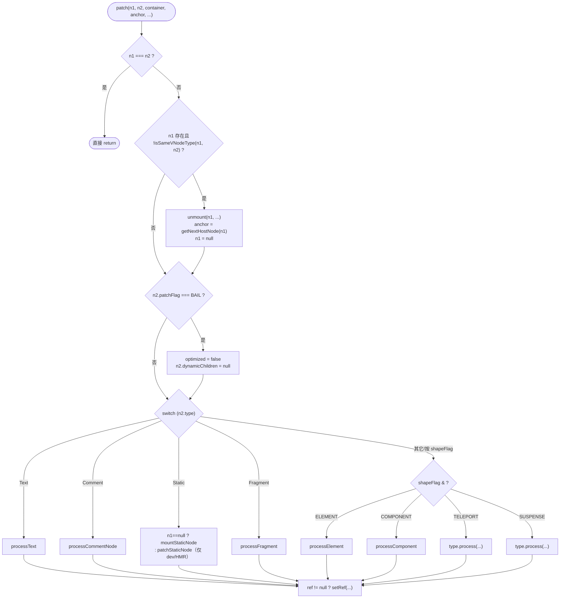
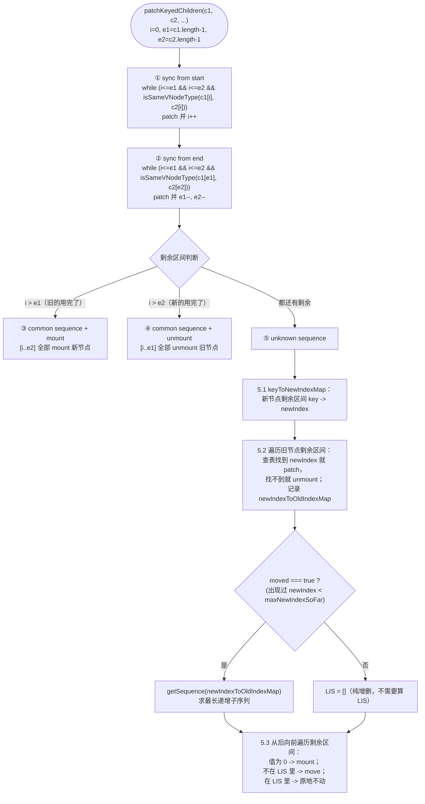

# 07. 渲染器与 diff：patch、patchKeyedChildren、Block 快速路径

> `patch()` 是 Vue 3 运行时唯一的"更新入口"：无论是初次挂载还是后续更新，无论是元素、组件还是 Fragment，所有变化最终都收敛到这一个函数的分派逻辑里；而 `patchKeyedChildren` 的五步法 + 最长递增子序列，决定了一个列表重新排序时，浏览器要做的 DOM 操作是不是"最少的"。

## 本章导读

学完本章能回答：

- `createRenderer(options)` 为什么要用一个 2000+ 行的闭包实现？这个设计换来了什么？
- 两个 vnode 被判定为"同一个节点"（可以复用 DOM）的标准是什么？为什么只看 `type` 和 `key`？
- 一个 `<li v-for>` 列表重新排序后，Vue 怎么知道哪些节点要移动、哪些不用动，并且移动次数最少？
- 为什么同样一次"改了一个 class"，有的更新只触发 1 次 `patchProp`，有的触发 3 次？
- Block tree 为什么能跳过整棵静态子树，而不需要真的去比较它？
- 组件卸载时，钩子的执行顺序是怎样的？模板 ref 什么时候被设置、什么时候被置空？

**前置章节**：05（VNode/ShapeFlags/PatchFlags）、06（组件实例与 `setupRenderEffect`）。建议先读完这两章再看本章，因为 `patch()` 的很多分支（`processComponent`、`setupRenderEffect`）在第 06 章已经展开过，本章只讲 diff 相关的部分。

预计阅读时间：70-90 分钟（含动手跑示例）。

**涉及源码文件清单**：

| 文件 | 作用 | 行数量级 |
|---|---|---|
| `packages/runtime-core/src/renderer.ts` | `createRenderer`/`baseCreateRenderer`，patch 分派、mount/patch/unmount 全家桶 | 2681 行 |
| `packages/runtime-core/src/vnode.ts` | `isSameVNodeType`、Block 相关的 `openBlock`/`createElementBlock` | 节选 |
| `packages/runtime-core/src/rendererTemplateRef.ts` | `setRef`：模板 ref 的设置时机与置空 | 215 行 |
| `packages/shared/src/patchFlags.ts` / `shapeFlags.ts` | PatchFlags / ShapeFlags 位标志定义 | 节选 |

## 先跑起来

```bash
pnpm ex chapters/07-renderer-diff/examples/01-patch-dispatch.ts
```

节选真实输出（Element → Fragment 切换）：

```
│  4. 换成 Fragment（type 从 "div" 变成 Fragment）
│      html = <root><span>a</span><span>b</span></root>
│      [Element -> Fragment] 11 次宿主操作
│         1. remove(<div#4>)
│         2. createText("") -> ""#6
│         3. createText("") -> ""#7
│         4. insert(""#6 -> <root#1>)
│         5. insert(""#7 -> <root#1>)
│         6. createElement(span) -> <span#8>
│         ...
```

看到了什么：`type` 从 `"div"` 变成 `Fragment`，`isSameVNodeType` 直接判否，整棵旧树被 `remove`，新树从零 `createElement`/`insert`——没有任何"尝试复用"的中间状态。再往下翻示例 1 的第 2 组，`<li key="a">` 换成 `<li key="b">` 同样触发整节点重建，而 key 不变只改文本时只有 1 次 `setElementText`——`isSameVNodeType` 的判断依据是 `type === type && key === key`，两者缺一都不行。

再跑一个看 diff 核心算法的：

```bash
pnpm ex chapters/07-renderer-diff/examples/03-keyed-diff-step-by-step.ts
```

```
│  4. 经典乱序：头尾都无法同步，落入 step 5，只移动 1 个节点
│      [a,b,c,d,e] -> [a,c,d,b,e,f]
│      html = <root><ul><li>a</li><li>c</li><li>d</li><li>b</li><li>e</li><li>f</li></ul></root>
│      [patch] 4 次宿主操作
│         1. createElement(li) -> <li#49>
│         2. setElementText(<li#49>, "f")
│         3. insert(<li#49> -> <ul#38>)
│         4. insert(<li#41> -> <ul#38>, before <li#47>)
```

5 个节点里，真正发生位置变化的只有 `b`（对应 `insert(<li#41>...)`），其余 4 个原地不动——这就是本章要讲透的"最长递增子序列最少移动"。

## 整体图

### 图 1：`baseCreateRenderer` 闭包与 patch 家族

```mermaid
graph TB
    subgraph closure["baseCreateRenderer(options) 闭包"]
        direction TB
        patch["patch(n1, n2, ...)<br/>唯一的更新入口"]
        patch --> processText
        patch --> processCommentNode
        patch --> mountStaticNode/patchStaticNode
        patch --> processFragment
        patch --> processElement --> mountElement & patchElement
        patch --> processComponent --> mountComponent & updateComponent
        patch -.Teleport/Suspense<br/>type.process.-> teleportOrSuspense["内置组件自己的 process()"]

        patchElement --> patchBlockChildren
        patchElement --> patchChildren
        processFragment --> patchBlockChildren
        processFragment --> patchChildren
        patchChildren --> patchKeyedChildren
        patchChildren --> patchUnkeyedChildren
        patchChildren --> mountChildren
        patchChildren --> unmountChildren

        unmount["unmount(vnode, ...)"] --> remove
        unmount --> unmountComponent
        unmount --> unmountChildren
        move["move(vnode, ...)"]

        internals["internals = { p, um, r, m, mt, mc, pc, pbc, n, o }<br/>（给 Teleport/Suspense/hydration 用的瘦身接口）"]
    end
    options["RendererOptions<br/>createElement/insert/remove/<br/>setElementText/patchProp/...<br/>（平台相关，外部传入）"] --> closure
    closure --> render["render(vnode, container)<br/>对外暴露的入口"]
    closure --> createApp["createApp()<br/>（apiCreateApp.ts）"]
```

**为什么是一个大闭包**：所有这些函数都要共享 `options` 解构出来的 `hostInsert`/`hostCreateElement`/`hostPatchProp` 等等。如果不放在闭包里，每个函数都要多传七八个参数，或者把 `options` 作为模块级单例——但 Vue 支持同时创建多个 renderer（`runtime-dom` 和自定义渲染器、测试用的 `runtime-test`），所以必须是"调一次 `createRenderer` 生成一整套互相闭包引用的函数"。闭包内部函数全部用 `const xxx = () => {}` 的写法而不是具名函数声明——源码注释原话："in order to prevent being inlined by minifiers"，保证每个函数在压缩后仍然是独立的可识别单元，避免内联后代码体积暴涨。

### 图 2：`patch()` 的分派流程



### 图 3：`patchKeyedChildren` 五步法



## 源码精读

### 2.1 `createRenderer` / `baseCreateRenderer`：为什么要用闭包

```ts
// packages/runtime-core/src/renderer.ts#L323-337
export function createRenderer<
  HostNode = RendererNode,
  HostElement = RendererElement,
>(options: RendererOptions<HostNode, HostElement>): Renderer<HostElement> {
  return baseCreateRenderer<HostNode, HostElement>(options)
}

export function createHydrationRenderer(
  options: RendererOptions<Node, Element>,
): HydrationRenderer {
  return baseCreateRenderer(options, createHydrationFunctions)
}
```

`createRenderer` 只是 `baseCreateRenderer` 的瘦身包装；`createHydrationRenderer` 多传一个 `createHydrationFns` 参数——这是 `runtime-dom` 真正调用的入口。**为什么 hydration 要单独一个函数**：`createHydrationFunctions` 本身是另一大段逻辑（处理 SSR 输出的真实 DOM 和 vnode 树的"认领"），只有真正需要 SSR 客户端激活的场景才会调用 `createHydrationRenderer`，纯 CSR 场景完全用不到这部分代码——配合 tree-shaking，不需要 hydration 的项目打包时能把这部分代码摇掉。第 15 章会展开讲 hydration 本身。

`baseCreateRenderer` 用重载签名区分两种情况（有没有 hydration fns），但实现体是同一个函数，内部用 `createHydrationFns` 是否存在来决定要不要调用 `createHydrationFunctions(internals)`。

**平台无关的代价**：`renderer.ts` 里出现的所有 DOM 概念——`createElement`、`insert`、`setElementText`——全部是 `RendererOptions` 里的方法名，不是真的 DOM API。这意味着 `runtime-core` 包完全不 import `dom` 相关类型，`runtime-dom` 只是提供了一份"把这些方法映射到真实 DOM API"的 `options` 对象（第 14 章细讲）。本章配套的 `shared/logging-renderer.ts` 就是另一份 `options` 实现，指向的是内存里的假节点。

### 2.2 `RendererOptions`：平台必须实现的接口

```ts
// packages/runtime-core/src/renderer.ts#L118-155
export interface RendererOptions<
  HostNode = RendererNode,
  HostElement = RendererElement,
> {
  patchProp(el, key, prevValue, nextValue, namespace?, parentComponent?): void
  insert(el, parent, anchor?): void
  remove(el): void
  createElement(type, namespace?, isCustomizedBuiltIn?, vnodeProps?): HostElement
  createText(text): HostNode
  createComment(text): HostNode
  setText(node, text): void
  setElementText(node, text): void
  parentNode(node): HostElement | null
  nextSibling(node): HostNode | null
  querySelector?(selector): HostElement | null
  setScopeId?(el, id): void
  cloneNode?(node): HostNode
  insertStaticContent?(content, parent, anchor, namespace, start?, end?): [HostNode, HostNode]
}
```

逐个看用途：

| 方法 | 用途 |
|---|---|
| `createElement`/`createText`/`createComment` | 创建三类宿主节点 |
| `insert` | 插入到容器的某个位置（`anchor` 为 `null` 表示插到末尾） |
| `remove` | 从父节点上摘除 |
| `setText` | 修改纯文本节点的内容（`processText` 用） |
| `setElementText` | 把一个元素的子节点整体替换成一段纯文本（`<div>{{ msg }}</div>` 这种） |
| `parentNode`/`nextSibling` | 查询关系——`getNextHostNode`、`patchBlockChildren` 确定容器时要用 |
| `patchProp` | 唯一的属性更新入口，class/style/事件/其它 attr 全部走这一个函数（和 Vue 2 的多个 `cbs` 模块对比见下文） |
| `querySelector`/`cloneNode`/`insertStaticContent` | 可选，专供 `runtime-dom` 的 `innerHTML` 静态内容优化和 SSR 用，非 DOM 渲染器可以不提供 |
| `setScopeId` | `<style scoped>` 的属性标记 |

`RendererInternals`（`#L170-184`）是另一组"瘦身接口"，键名故意缩写成 `p`/`um`/`r`/`m`/`mt`/`mc`/`pc`/`pbc`/`n`/`o`——这是传给 `Teleport`/`Suspense`/hydration 这些**可 tree-shake 的功能模块**用的，缩写是为了在没有 minifier 重命名的情况下也尽量减小代码体积（这些对象字面量的 key 在压缩时通常不会被重命名）。

### 2.3 `patch`：短路、类型不同重建、BAIL、按类型分派

```ts
// packages/runtime-core/src/renderer.ts#L384-424（节选）
const patch: PatchFn = (
  n1, n2, container, anchor = null, parentComponent = null,
  parentSuspense = null, namespace = undefined, slotScopeIds = null,
  optimized = __DEV__ && isHmrUpdating ? false : !!n2.dynamicChildren,
) => {
  if (n1 === n2) {
    return
  }

  // patching & not same type, unmount old tree
  if (n1 && !isSameVNodeType(n1, n2)) {
    anchor = getNextHostNode(n1)
    unmount(n1, parentComponent, parentSuspense, true)
    n1 = null
  }

  if (n2.patchFlag === PatchFlags.BAIL) {
    optimized = false
    n2.dynamicChildren = null
  }
  // ...
  const { type, ref, shapeFlag } = n2
  switch (type) {
    case Text: processText(n1, n2, container, anchor); break
    case Comment: processCommentNode(n1, n2, container, anchor); break
    case Static: /* ... */ break
    case Fragment: processFragment(n1, n2, container, anchor, ...); break
    default:
      if (shapeFlag & ShapeFlags.ELEMENT) processElement(...)
      else if (shapeFlag & ShapeFlags.COMPONENT) processComponent(...)
      else if (shapeFlag & ShapeFlags.TELEPORT) (type as typeof TeleportImpl).process(...)
      else if (__FEATURE_SUSPENSE__ && shapeFlag & ShapeFlags.SUSPENSE) (type as typeof SuspenseImpl).process(...)
  }
  // set ref
  if (ref != null && parentComponent) {
    setRef(ref, n1 && n1.ref, parentSuspense, n2 || n1, !n2)
  } else if (ref == null && n1 && n1.ref != null) {
    setRef(n1.ref, null, parentSuspense, n1, true)
  }
}
```

几个关键点：

1. **`n1 === n2` 短路**（`#L395-397`）：同一个 vnode 对象被 patch 两次是无意义的，常见于手写渲染函数时不小心复用了同一个 vnode 引用，或者是静态提升后的同一个节点对象。
2. **`isSameVNodeType` 不同则重建**（`#L399-404`）：这是整个 diff 算法的"地基"——`patch()` 永远只负责"更新同一个节点"，一旦类型不同，直接退化成"卸载旧的 + 挂载新的"，不会尝试任何属性级别的复用。`anchor = getNextHostNode(n1)` 要在 `unmount` 之前算好，因为卸载之后 `n1.el` 所在的位置信息就不可靠了。
3. **`optimized` 参数的默认值** `__DEV__ && isHmrUpdating ? false : !!n2.dynamicChildren`：这决定了后面 `mountChildren`/`patchKeyedChildren` 里对子节点是 `normalizeVNode`（全量规范化）还是 `cloneIfMounted`（轻量克隆）——"optimized" 模式信任 compiler 生成的 vnode 已经是规范的，不需要再做一次防御性检查。
4. **`PatchFlags.BAIL`**（`#L406-409`）：`-2` 这个特殊值表示"这棵子树不能信任 Block 优化"，典型场景是 `renderSlot()` 遇到手写渲染函数传入的 slot（不是编译器生成的），这时把 `optimized` 强制设为 `false`、`dynamicChildren` 清空，退回全量 diff——**宁可慢一点也不能错**。
5. **`setRef` 的调用时机**：在具体类型的 `processXXX` 执行完之后才设置 ref，这保证了 `vnode.el`（或者组件实例）已经就绪。

### 2.4 Text / Comment / Static：最简单的三种

```ts
// packages/runtime-core/src/renderer.ts#L516-547
const processText: ProcessTextOrCommentFn = (n1, n2, container, anchor) => {
  if (n1 == null) {
    hostInsert((n2.el = hostCreateText(n2.children as string)), container, anchor)
  } else {
    const el = (n2.el = n1.el!)
    if (n2.children !== n1.children) {
      hostSetText(el, n2.children as string)
    }
  }
}

const processCommentNode: ProcessTextOrCommentFn = (n1, n2, container, anchor) => {
  if (n1 == null) {
    hostInsert((n2.el = hostCreateComment((n2.children as string) || '')), container, anchor)
  } else {
    // there's no support for dynamic comments
    n2.el = n1.el
  }
}
```

Text 可以更新内容（`hostSetText`），Comment 完全不支持动态内容——`v-if`/`v-else` 生成的占位 Comment 永远是空字符串，没有更新的必要。`Static`（`mountStaticNode`/`patchStaticNode`，`#L549-592`）是 `v-pre`/纯静态大段 HTML 的优化：`insertStaticContent` 用 `innerHTML` 一次性插入一整段字符串，`patchStaticNode` 只在 **dev 环境**（HMR）才会被调用，生产环境静态内容永远不会被 patch。

### 2.5 `processFragment`：两个空文本锚点 + STABLE 判断

```ts
// packages/runtime-core/src/renderer.ts#L1077-1183（节选）
const processFragment = (n1, n2, container, anchor, ...) => {
  const fragmentStartAnchor = (n2.el = n1 ? n1.el : hostCreateText(''))!
  const fragmentEndAnchor = (n2.anchor = n1 ? n1.anchor : hostCreateText(''))!
  let { patchFlag, dynamicChildren, slotScopeIds: fragmentSlotScopeIds } = n2
  // ...
  if (n1 == null) {
    hostInsert(fragmentStartAnchor, container, anchor)
    hostInsert(fragmentEndAnchor, container, anchor)
    mountChildren((n2.children || []) as VNodeArrayChildren, container, fragmentEndAnchor, ...)
  } else {
    if (
      patchFlag > 0 && patchFlag & PatchFlags.STABLE_FRAGMENT &&
      dynamicChildren && n1.dynamicChildren && n1.dynamicChildren.length === dynamicChildren.length
    ) {
      // 顺序不变，只需要 patch 动态节点
      patchBlockChildren(n1.dynamicChildren, dynamicChildren, container, ...)
    } else {
      // keyed / unkeyed / 手写的 Fragment：走全量 patchChildren
      patchChildren(n1, n2, container, fragmentEndAnchor, ...)
    }
  }
}
```

Fragment 没有真实的容器元素（`<template>`、`v-for` 的根、组件多根节点），所以用**两个空文本节点**当首尾锚点——`el` 指向开头、`anchor` 指向结尾，`move`/`remove` 一个 Fragment 时，只要知道这两个锚点就能定位整个范围（`removeFragment` 就是从 `cur` 走到 `end` 逐个删除）。

`PatchFlags.STABLE_FRAGMENT` vs `KEYED_FRAGMENT`/`UNKEYED_FRAGMENT` 对应三种编译产物：

- **STABLE_FRAGMENT**：`<template>` 根节点、组件多根节点——子节点数量和顺序在编译期就确定不变，只需要 `patchBlockChildren` 处理真正动态的那几个。
- **KEYED_FRAGMENT**：`v-for` 且有 `:key`——子节点数量和顺序都可能变，必须走 `patchKeyedChildren`。
- **UNKEYED_FRAGMENT**：`v-for` 没有 `:key`——走 `patchUnkeyedChildren`（按索引 patch）。

### 2.6 `processElement` → `mountElement`：props 遍历与 value 的特殊处理

```ts
// packages/runtime-core/src/renderer.ts#L672-772（节选）
const mountElement = (vnode, container, anchor, parentComponent, parentSuspense, namespace, slotScopeIds, optimized) => {
  let el: RendererElement
  const { props, shapeFlag, transition, dirs } = vnode
  el = vnode.el = hostCreateElement(vnode.type as string, namespace, props && props.is, props)

  // mount children first, since some props may rely on child content
  // being already rendered, e.g. `<select value>`
  if (shapeFlag & ShapeFlags.TEXT_CHILDREN) {
    hostSetElementText(el, vnode.children as string)
  } else if (shapeFlag & ShapeFlags.ARRAY_CHILDREN) {
    mountChildren(vnode.children as VNodeArrayChildren, el, null, ...)
  }

  if (dirs) invokeDirectiveHook(vnode, null, parentComponent, 'created')
  setScopeId(el, vnode, vnode.scopeId, slotScopeIds, parentComponent)
  if (props) {
    for (const key in props) {
      if (key !== 'value' && !isReservedProp(key)) {
        hostPatchProp(el, key, null, props[key], namespace, parentComponent)
      }
    }
    // value 延后处理：顺序敏感（min/max 之后设置）+ 需要强制设置
    if ('value' in props) {
      hostPatchProp(el, 'value', null, props.value, namespace)
    }
    if ((vnodeHook = props.onVnodeBeforeMount)) invokeVNodeHook(vnodeHook, parentComponent, vnode)
  }
  // ...
  if (dirs) invokeDirectiveHook(vnode, null, parentComponent, 'beforeMount')
  const needCallTransitionHooks = needTransition(parentSuspense, transition)
  if (needCallTransitionHooks) transition!.beforeEnter(el)
  hostInsert(el, container, anchor)
  if ((vnodeHook = props && props.onVnodeMounted) || needCallTransitionHooks || dirs) {
    queuePostRenderEffect(() => {
      vnodeHook && invokeVNodeHook(vnodeHook, parentComponent, vnode)
      needCallTransitionHooks && transition!.enter(el)
      dirs && invokeDirectiveHook(vnode, null, parentComponent, 'mounted')
    }, parentSuspense)
  }
}
```

**为什么先挂子节点再设置 props**：注释直接写明了——`<select value="...">` 这种场景，`value` 要生效必须先有 `<option>` 子节点。

**为什么 `value` 要单独拿出来最后处理**：源码注释列了两条原因——① 顺序敏感，比如 `<input type="range" min="0" max="100" value="50">`，`value` 必须在 `min`/`max` 设置完之后再设置，否则会被浏览器钳制到错误的范围；② `value` 的 DOM property 和 `defaultValue` 不是一回事，需要强制设置而不能按"值相等就跳过"的逻辑处理。所以这里专门用一个 `if ('value' in props)` 分支收尾。

**mount 后置任务用 `queuePostRenderEffect`**：`onVnodeMounted`、transition 的 `enter`、`mounted` 指令钩子，都要求"DOM 已经插入到文档里"才能正确执行（比如 transition 要读取元素的实际尺寸），所以延后到这一批渲染结束后再执行（调度器细节见第 08 章）。

### 2.7 `patchElement`：patchFlag 快速路径

```ts
// packages/runtime-core/src/renderer.ts#L845-990（节选，完整版见源码）
const patchElement = (n1, n2, parentComponent, parentSuspense, namespace, slotScopeIds, optimized) => {
  const el = (n2.el = n1.el!)
  let { patchFlag, dynamicChildren, dirs } = n2
  patchFlag |= n1.patchFlag & PatchFlags.FULL_PROPS // #1426：兼容手动 clone 导致的降级
  const oldProps = n1.props || EMPTY_OBJ
  const newProps = n2.props || EMPTY_OBJ

  parentComponent && toggleRecurse(parentComponent, false)
  if ((vnodeHook = newProps.onVnodeBeforeUpdate)) invokeVNodeHook(vnodeHook, parentComponent, n2, n1)
  if (dirs) invokeDirectiveHook(n2, n1, parentComponent, 'beforeUpdate')
  parentComponent && toggleRecurse(parentComponent, true)

  if (dynamicChildren) {
    patchBlockChildren(n1.dynamicChildren!, dynamicChildren, el, ...)
  } else if (!optimized) {
    patchChildren(n1, n2, el, null, ...)
  }

  if (patchFlag > 0) {
    if (patchFlag & PatchFlags.FULL_PROPS) {
      patchProps(el, oldProps, newProps, parentComponent, namespace)
    } else {
      if (patchFlag & PatchFlags.CLASS) {
        if (oldProps.class !== newProps.class) {
          hostPatchProp(el, 'class', null, newProps.class, namespace) // 注意：这里传的是 null，不是 oldProps.class
        }
      }
      if (patchFlag & PatchFlags.STYLE) {
        hostPatchProp(el, 'style', oldProps.style, newProps.style, namespace) // 无条件调用，没有判等
      }
      if (patchFlag & PatchFlags.PROPS) {
        const propsToUpdate = n2.dynamicProps!
        for (let i = 0; i < propsToUpdate.length; i++) {
          const key = propsToUpdate[i]
          const prev = oldProps[key]
          const next = newProps[key]
          if (next !== prev || key === 'value') {
            hostPatchProp(el, key, prev, next, namespace, parentComponent)
          }
        }
      }
    }
    if (patchFlag & PatchFlags.TEXT) {
      if (n1.children !== n2.children) hostSetElementText(el, n2.children as string)
    }
  } else if (!optimized && dynamicChildren == null) {
    patchProps(el, oldProps, newProps, parentComponent, namespace)
  }

  if ((vnodeHook = newProps.onVnodeUpdated) || dirs) {
    queuePostRenderEffect(() => { /* updated 钩子 */ }, parentSuspense)
  }
}
```

四个值得注意的细节（配合示例 02 的真实输出看）：

1. **`CLASS` 分支传 `null` 而不是 `oldProps.class`**（`#L939-942`）：`patchProp` 对 `class` 的处理是整体覆写 `el.className`，根本不需要旧值来做"移除"操作，所以源码干脆不传。
2. **`STYLE` 分支没有判等就直接调用**（`#L946-949`）：和 `CLASS` 不同，这里**不检查** `oldProps.style !== newProps.style`。这是因为 `style` 对象字面量在没有 `cacheHandlers`/静态提升的情况下，每次渲染都是新对象（比如 `:style="{ color }"`），引用比较永远是"变了"，不如直接把 diff 工作下放给 `patchStyle`（按 CSS 属性逐个比较，14 章细讲），上层索性不做无意义的引用判等。
3. **`PROPS` 分支只遍历 `dynamicProps`**：这是编译器在生成 vnode 时附带的"这个元素除了 class/style 还有哪些 key 可能变化"的清单，不需要遍历整个 props 对象。
4. **非 optimized 且无 `dynamicChildren` 时退回 `patchProps` 全量 diff**（`#L979-982`）：手写渲染函数（没有 `patchFlag`）或者 Block 结构被破坏（HMR、v-once）时的兜底路径。

示例 02 的真实输出印证了第 2 条：同样是"只改 title"，有 `PatchFlags.STYLE` 的版本依然打出一次 `patchProp(style, ...)`（即使值没变），而 `title` 本身走 `PROPS` 分支，因为真的变了才会被打印：

```
│  3. 只改 title（走 PROPS 分支，但只遍历 dynamicProps=["title"]，不会碰 class/style）
│      [update title only] 2 次宿主操作
│         1. patchProp(<div#5>, style: {"color":"red"} -> {"color":"red"})
│         2. patchProp(<div#5>, title: "t1" -> "t2")
```

### 2.8 `patchProps`：全量 diff 的 key 遍历策略

```ts
// packages/runtime-core/src/renderer.ts#L1039-1075
const patchProps = (el, oldProps, newProps, parentComponent, namespace) => {
  if (oldProps !== newProps) {
    if (oldProps !== EMPTY_OBJ) {
      for (const key in oldProps) {
        if (!isReservedProp(key) && !(key in newProps)) {
          hostPatchProp(el, key, oldProps[key], null, namespace, parentComponent) // 旧 key 在新 props 里消失了，置空
        }
      }
    }
    for (const key in newProps) {
      if (isReservedProp(key)) continue
      const next = newProps[key]
      const prev = oldProps[key]
      if (next !== prev && key !== 'value') {
        hostPatchProp(el, key, prev, next, namespace, parentComponent)
      }
    }
    if ('value' in newProps) {
      hostPatchProp(el, 'value', oldProps.value, newProps.value, namespace)
    }
  }
}
```

两边都要遍历一次：第一轮专门找"旧有、新无"的 key（必须显式置空，否则 DOM 上的旧属性不会消失）；第二轮遍历新 props，按引用比较值是否变化。`value` 依然是最后单独处理（和 `mountElement` 对称）。

### 2.9 `mountChildren` / `patchChildren`：按三种类型组合分派

```ts
// packages/runtime-core/src/renderer.ts#L1672-1772（节选）
const patchChildren: PatchChildrenFn = (n1, n2, container, anchor, ...) => {
  const c1 = n1 && n1.children
  const prevShapeFlag = n1 ? n1.shapeFlag : 0
  const c2 = n2.children
  const { patchFlag, shapeFlag } = n2

  if (patchFlag > 0) {
    if (patchFlag & PatchFlags.KEYED_FRAGMENT) { patchKeyedChildren(...); return }
    else if (patchFlag & PatchFlags.UNKEYED_FRAGMENT) { patchUnkeyedChildren(...); return }
  }

  if (shapeFlag & ShapeFlags.TEXT_CHILDREN) {
    if (prevShapeFlag & ShapeFlags.ARRAY_CHILDREN) unmountChildren(c1 as VNode[], ...)
    if (c2 !== c1) hostSetElementText(container, c2 as string)
  } else {
    if (prevShapeFlag & ShapeFlags.ARRAY_CHILDREN) {
      if (shapeFlag & ShapeFlags.ARRAY_CHILDREN) {
        patchKeyedChildren(c1 as VNode[], c2 as VNodeArrayChildren, container, anchor, ...) // 两个数组，全量 diff
      } else {
        unmountChildren(c1 as VNode[], ..., true)
      }
    } else {
      if (prevShapeFlag & ShapeFlags.TEXT_CHILDREN) hostSetElementText(container, '')
      if (shapeFlag & ShapeFlags.ARRAY_CHILDREN) mountChildren(c2 as VNodeArrayChildren, container, anchor, ...)
    }
  }
}
```

旧children/新children各有 `TEXT`/`ARRAY`/`null` 三种可能，排列组合出 9 种情况（源码按"新 children 是 TEXT"、"旧是 ARRAY 新是 ARRAY"、"旧是 ARRAY 新不是"、"旧不是 ARRAY（TEXT 或 null）新是 ARRAY"、"都不是 ARRAY"来写 if/else，逻辑上覆盖了全部组合），归纳为：

| 旧 \ 新 | TEXT | ARRAY | null |
|---|---|---|---|
| **TEXT** | 文本不同则 `setElementText` | 清空文本 + `mountChildren` | 清空文本（`setElementText('')`） |
| **ARRAY** | `unmountChildren` + `setElementText` | `patchKeyedChildren`（两个数组，**不管有没有 key 都走这里**，只是内部靠 `isSameVNodeType` 兜底） | `unmountChildren` |
| **null** | `setElementText` | `mountChildren` | 什么都不做 |

注意：没有 `patchFlag` 的两个数组（普通 `h()` 写法）也会被塞进 `patchKeyedChildren`——这正是示例 03 能够用纯 `h()` 触发五步法的原因，`patchKeyedChildren` 的命名虽然叫 "Keyed"，但它同时兼容全 key、部分 key、无 key 三种情况（无 key 节点靠"类型相同的位置"兜底复用，见 5.2）。

真正的"快路径"（编译器产出的 `PatchFlags.KEYED_FRAGMENT`/`UNKEYED_FRAGMENT`）只是**提前判断走哪个分支**，省掉前面一堆 `shapeFlag` 判断，核心算法本身（`patchKeyedChildren`）没有区别。

### 2.10 `patchKeyedChildren`：五步法逐步拆解

这是本章的重点。完整源码见 `packages/runtime-core/src/renderer.ts#L1834-2076`，拆成五步讲：

#### 2.10.1 Step 1 & 2：头尾同步

```ts
// #L1850-1901
let i = 0
const l2 = c2.length
let e1 = c1.length - 1
let e2 = l2 - 1

// 1. sync from start:  (a b) c  /  (a b) d e
while (i <= e1 && i <= e2) {
  const n1 = c1[i]
  const n2 = (c2[i] = optimized ? cloneIfMounted(c2[i] as VNode) : normalizeVNode(c2[i]))
  if (isSameVNodeType(n1, n2)) { patch(n1, n2, container, null, ...) } else { break }
  i++
}

// 2. sync from end:  a (b c)  /  d e (b c)
while (i <= e1 && i <= e2) {
  const n1 = c1[e1]
  const n2 = (c2[e2] = optimized ? cloneIfMounted(c2[e2] as VNode) : normalizeVNode(c2[e2]))
  if (isSameVNodeType(n1, n2)) { patch(n1, n2, container, null, ...) } else { break }
  e1--; e2--
}
```

从两端往中间"夹"，只要还能配对就一直 `patch`。真实场景里大部分列表更新只是"头部加一条"或"尾部删一条"，这两步能在 O(1) 次比较内处理掉绝大多数情况，根本不需要进入后面复杂的算法。

#### 2.10.2 Step 3 & 4：纯增 / 纯删

```ts
// #L1910-1945
if (i > e1) {
  // 旧的已经被完全消耗，剩下 [i..e2] 都是新增的
  if (i <= e2) {
    const nextPos = e2 + 1
    const anchor = nextPos < l2 ? (c2[nextPos] as VNode).el : parentAnchor
    while (i <= e2) { patch(null, c2[i] = ..., container, anchor, ...); i++ }
  }
} else if (i > e2) {
  // 新的已经被完全消耗，剩下 [i..e1] 都要删除
  while (i <= e1) { unmount(c1[i], parentComponent, parentSuspense, true); i++ }
}
```

头尾同步之后如果 `i > e1`，说明旧数组用完了、新数组还有剩，这段剩下的只能是"新增"；反过来 `i > e2` 就是"旧的多出来的要删掉"。这两步都不需要移动任何已有节点。

#### 2.10.3 Step 5：乱序——Vue 3 diff 的核心

当头尾同步之后 `[i..e1]`（旧）和 `[i..e2]`（新）都还有剩余，说明中间这一段发生了真正的重排/增删混合，进入 `else` 分支：

**5.1 建立 key → newIndex 映射**

```ts
// #L1955-1971
const s1 = i, s2 = i
const keyToNewIndexMap: Map<PropertyKey, number> = new Map()
for (i = s2; i <= e2; i++) {
  const nextChild = (c2[i] = ...)
  if (nextChild.key != null) keyToNewIndexMap.set(nextChild.key, i)
}
```

**5.2 遍历旧节点剩余区间，查表决定 patch 还是 unmount**

```ts
// #L1973-2033
let j, patched = 0
const toBePatched = e2 - s2 + 1
let moved = false
let maxNewIndexSoFar = 0
const newIndexToOldIndexMap = new Array(toBePatched)
for (i = 0; i < toBePatched; i++) newIndexToOldIndexMap[i] = 0

for (i = s1; i <= e1; i++) {
  const prevChild = c1[i]
  if (patched >= toBePatched) {
    // 新节点已经全部有归宿了，剩下的旧节点只能删
    unmount(prevChild, parentComponent, parentSuspense, true)
    continue
  }
  let newIndex
  if (prevChild.key != null) {
    newIndex = keyToNewIndexMap.get(prevChild.key)
  } else {
    // 无 key 节点：找一个"还没被占用、type 相同"的位置顶上
    for (j = s2; j <= e2; j++) {
      if (newIndexToOldIndexMap[j - s2] === 0 && isSameVNodeType(prevChild, c2[j] as VNode)) {
        newIndex = j; break
      }
    }
  }
  if (newIndex === undefined) {
    unmount(prevChild, parentComponent, parentSuspense, true)
  } else {
    newIndexToOldIndexMap[newIndex - s2] = i + 1 // +1 见下方解释
    if (newIndex >= maxNewIndexSoFar) { maxNewIndexSoFar = newIndex } else { moved = true }
    patch(prevChild, c2[newIndex] as VNode, container, null, ...)
    patched++
  }
}
```

**为什么 `newIndexToOldIndexMap` 存的是 `i + 1` 而不是 `i`**：这个数组的初始值是 `0`，`0` 被用来表示"这个新位置在旧数组里没有对应项（全新挂载）"。如果直接存 `i`（旧下标，可能本身就是 `0`），就没法区分"旧下标是 0 的节点"和"没有对应旧节点"，所以统一 `+1` 错开，`0` 永远只代表"新增"。

**`moved` 怎么判断**：`maxNewIndexSoFar` 记录"目前为止见过的最大 newIndex"。只要本次匹配到的 `newIndex` 比之前见过的还大，说明顺序目前还是"递增"的，不算乱；一旦某次 `newIndex` 比之前小，就说明这个节点在新数组里的位置"插队"到了前面已处理节点的前面——这就是真正的"乱序"信号。**只有检测到 `moved` 才需要计算最长递增子序列**，纯增删场景完全跳过这一步，省掉一次 O(n log n) 计算。

**5.3 从后向前遍历，决定 mount / move / 不动**

```ts
// #L2035-2075
const increasingNewIndexSequence = moved ? getSequence(newIndexToOldIndexMap) : EMPTY_ARR
j = increasingNewIndexSequence.length - 1
for (i = toBePatched - 1; i >= 0; i--) {
  const nextIndex = s2 + i
  const nextChild = c2[nextIndex] as VNode
  const anchor = nextIndex + 1 < l2 ? (c2[nextIndex + 1] as VNode).el : parentAnchor
  if (newIndexToOldIndexMap[i] === 0) {
    patch(null, nextChild, container, anchor, ...) // 全新节点，mount
  } else if (moved) {
    if (j < 0 || i !== increasingNewIndexSequence[j]) {
      move(nextChild, container, anchor, MoveType.REORDER) // 不在 LIS 里，要移动
    } else {
      j-- // 在 LIS 里，原地不动，游标前移
    }
  }
}
```

**为什么必须从后向前遍历**：`anchor` 的计算方式是"取下一个位置（`nextIndex + 1`）的节点的 `el`"——只有当那个节点已经被处理过、`el` 挂在正确位置上时，这个 `anchor` 才是可靠的。从后往前走，意味着处理到第 `i` 个节点时，它右边的所有节点都已经定好位了，`anchor` 永远指向一个"已经就位"的真实节点（或者是最外层的 `parentAnchor`）。如果从前往后走，`anchor` 就要去猜"还没处理过的节点将来在哪"，根本做不到。

把本章开头"先跑起来"的真实输出和这段算法对一下：`[a,b,c,d,e] -> [a,c,d,b,e,f]`，头尾同步 0 次命中（`a` 和 `a` 位置相同但下面马上会讲，实际上这个例子里头部同步也不会命中，因为新数组第 0 位依然是 `a`——所以示例 03 用例 4 其实会在头部先命中一次 `a`，详见下方 ASCII 手推）。`newIndexToOldIndexMap` 和 `getSequence` 的手推过程见 2.10.4。

#### 2.10.4 `getSequence`：贪心 + 二分求最长递增子序列

```ts
// packages/runtime-core/src/renderer.ts#L2608-2647
function getSequence(arr: number[]): number[] {
  const p = arr.slice()
  const result = [0]
  let i, j, u, v, c
  const len = arr.length
  for (i = 0; i < len; i++) {
    const arrI = arr[i]
    if (arrI !== 0) {
      j = result[result.length - 1]
      if (arr[j] < arrI) { p[i] = j; result.push(i); continue }
      u = 0; v = result.length - 1
      while (u < v) {
        c = (u + v) >> 1
        if (arr[result[c]] < arrI) u = c + 1; else v = c
      }
      if (arrI < arr[result[u]]) {
        if (u > 0) p[i] = result[u - 1]
        result[u] = i
      }
    }
  }
  u = result.length; v = result[u - 1]
  while (u-- > 0) { result[u] = v; v = p[v] }
  return result
}
```

**数据结构**：`result[k]` 保存"长度为 `k+1` 的递增子序列，目前已知最小的结尾元素的**下标**"；`result` 本身按**值**递增，可以二分。`p[i]` 是"前驱数组"——`arr[i]` 被接到 `result` 时，记录它的前一个元素下标，最后从 `result` 末尾出发顺着 `p` 向前回溯，才还原出真正的子序列（`result` 在计算过程中的中间状态**不是**最终答案，中间会被就地替换）。

**手推 `[2,3,1,5,6,8,7,9,4]`**（用 `pnpm ex chapters/07-renderer-diff/examples/04-lis-trace.ts` 验证过的真实输出）：

```
处理 i=0 (arr[i]=2)  result=[0]                 -> 值=[2]
处理 i=1 (arr[i]=3)  result=[0,1]               -> 值=[2,3]
处理 i=2 (arr[i]=1)  result=[2,1]               -> 值=[1,3]        （1 比 2 小，二分找到 u=0，替换 result[0]=2）
处理 i=3 (arr[i]=5)  result=[2,1,3]             -> 值=[1,3,5]
处理 i=4 (arr[i]=6)  result=[2,1,3,4]           -> 值=[1,3,5,6]
处理 i=5 (arr[i]=8)  result=[2,1,3,4,5]         -> 值=[1,3,5,6,8]
处理 i=6 (arr[i]=7)  result=[2,1,3,4,6]         -> 值=[1,3,5,6,7]  （7 比 8 小，二分找到 u=5，替换 result[5]=6）
处理 i=7 (arr[i]=9)  result=[2,1,3,4,6,7]       -> 值=[1,3,5,6,7,9]
处理 i=8 (arr[i]=4)  result=[2,1,8,4,6,7]       -> 值=[1,3,4,6,7,9]（4 比 5 小，二分找到 u=2，替换 result[2]=8）
最终回溯：result(下标) = [0, 1, 3, 4, 6, 7] -> 值 = [2, 3, 5, 6, 7, 9]
```

**还原到 `patchKeyedChildren` 的真实场景**：`[a,b,c,d,e] -> [a,c,d,b,e,f]`。头尾同步各命中 1 次（头部 `a`），剩余区间 `s1=s2=1,e1=4,e2=4` 对应旧 `[b,c,d,e]` 新 `[c,d,b,e,f]`（注意 `f` 在 `e2` 之后，由头尾同步阶段的边界决定，这里用示例代码真实跑出来的 `newIndexToOldIndexMap=[3,4,2,5]` 来对应新位置 `[c,d,b,e]`：`c`→旧下标 2→3，`d`→旧下标 3→4，`b`→旧下标 1→2，`e`→旧下标 4→5）。`getSequence([3,4,2,5])` 的结果是下标 `[0,1,3]`，对应 `c,d,e`——这三个保持原地不动，只有 `b`（下标 2，不在 LIS 里）需要 `move`。这和"先跑起来"一节贴的真实 ops（只有 1 次 `insert` 对应 `b` 的移动）完全吻合。

### 2.11 `patchUnkeyedChildren`：按索引 patch

```ts
// packages/runtime-core/src/renderer.ts#L1774-1831（节选）
const patchUnkeyedChildren = (c1, c2, container, anchor, ...) => {
  c1 = c1 || EMPTY_ARR; c2 = c2 || EMPTY_ARR
  const oldLength = c1.length, newLength = c2.length
  const commonLength = Math.min(oldLength, newLength)
  let i
  for (i = 0; i < commonLength; i++) {
    const nextChild = (c2[i] = ...)
    patch(c1[i], nextChild, container, null, ...) // 纯按位置 patch，不比较 key/type
  }
  if (oldLength > newLength) {
    unmountChildren(c1, ..., true, false, commonLength)
  } else {
    mountChildren(c2, container, anchor, ..., commonLength)
  }
}
```

没有 key 的情况下，Vue **没有办法知道"身份"**，只能假设"第 i 个旧节点对应第 i 个新节点"，直接按位置 `patch`（哪怕类型不同，`patch` 内部的 `isSameVNodeType` 判断也会接管，退化成该位置的 unmount+mount）。多出来的要么整体 `mountChildren`，要么整体 `unmountChildren`——**这完全不做"识别移动"的尝试**，这正是 `key` 存在的意义：它是 Vue 判断"这还是不是原来那个东西"的唯一依据。示例 05 用"在数组头部插入一项"直接对比了有无 key 的 ops 数量差异。

### 2.12 `patchBlockChildren`：跳过静态子树的秘密

```ts
// packages/runtime-core/src/renderer.ts#L993-1037
const patchBlockChildren: PatchBlockChildrenFn = (oldChildren, newChildren, fallbackContainer, ...) => {
  for (let i = 0; i < newChildren.length; i++) {
    const oldVNode = oldChildren[i]
    const newVNode = newChildren[i]
    const oldEl = oldVNode.el || resolveAsyncComponentPlaceholder(oldVNode)
    const container =
      oldEl &&
      (oldVNode.type === Fragment ||
        !isSameVNodeType(oldVNode, newVNode) ||
        oldVNode.shapeFlag & (ShapeFlags.COMPONENT | ShapeFlags.TELEPORT | ShapeFlags.SUSPENSE))
        ? hostParentNode(oldEl)!
        : fallbackContainer
    patch(oldVNode, newVNode, container, null, parentComponent, parentSuspense, namespace, slotScopeIds, true)
  }
}
```

`dynamicChildren` 是 `openBlock()`/`createElementBlock()` 在渲染期间收集到的"这棵子树里所有带 `patchFlag > 0`（或者是组件）的节点"的**扁平数组**——注意是扁平的，不是按 DOM 层级嵌套的。`patchBlockChildren` 就是把旧的 `dynamicChildren` 数组和新的一一对应 `patch`，**根本不会递归到没有被收集进这个数组的节点**。

静态节点为什么会被排除在外：`createVNode`/`createElementVNode` 在创建 vnode 时会检查"`vnode.patchFlag > 0 || shapeFlag & COMPONENT`"才会把自己 `push` 进 `currentBlock`（`vnode.ts#L521-538`）。没有动态绑定的节点（`patchFlag` 为 `0`）天然就不会出现在这个数组里——Block 优化不需要额外标记"哪些是静态的"，而是反过来，只收集"确定会变的"。

**容器怎么确定**：大多数情况下直接传 `fallbackContainer`（Block 根节点的真实 DOM）就够了，因为 `dynamicChildren` 里的节点在 DOM 树里实际上大概率是这个容器的（孙）子节点，`patch` 过程中用不上"精确的直接父节点"这个参数（大多数 patch 分支内部会自己用 `n1.el` 重新定位）。但三种情况必须算出真正的父节点：① **Fragment**：它本身没有单一容器，move 整个 Fragment 时需要知道外层真正的父节点；② **类型不同**：会发生替换（卸载旧的插入新的），必须有正确的父节点来 `insert`；③ **组件/Teleport/Suspense**：内部可能是任意结构，不能假设直接挂在 `fallbackContainer` 下面。

和 `patchChildren` 的关系：`patchElement`/`processFragment` 里都是"有 `dynamicChildren` 就走 `patchBlockChildren`，否则走 `patchChildren`"——两者是互斥的快慢路径，不会同时触发。示例 06 直接做了 A/B 对比，Block 版本更新时静态 `<p>` 完全不出现在宿主操作里，非 Block 版本则会因为 `style` 对象引用变化而多一次 `patchProp`。

### 2.13 `move` / `getNextHostNode`

```ts
// packages/runtime-core/src/renderer.ts#L2078-2169（节选）
const move: MoveFn = (vnode, container, anchor, moveType, parentSuspense = null) => {
  const { el, type, transition, children, shapeFlag } = vnode
  if (shapeFlag & ShapeFlags.COMPONENT) { move(vnode.component!.subTree, container, anchor, moveType); return }
  if (__FEATURE_SUSPENSE__ && shapeFlag & ShapeFlags.SUSPENSE) { vnode.suspense!.move(container, anchor, moveType); return }
  if (shapeFlag & ShapeFlags.TELEPORT) { (type as typeof TeleportImpl).move(vnode, container, anchor, internals); return }
  if (type === Fragment) {
    hostInsert(el!, container, anchor)
    for (let i = 0; i < (children as VNode[]).length; i++) move((children as VNode[])[i], container, anchor, moveType)
    hostInsert(vnode.anchor!, container, anchor)
    return
  }
  if (type === Static) { moveStaticNode(vnode, container, anchor); return }
  // 普通元素：有 transition 且不是 REORDER 时触发 enter/leave，否则直接 hostInsert
  // ...
}
```

`move` 按 vnode 种类分支：组件要移动的是它的 `subTree`（组件本身没有宿主节点）；Fragment 要逐个移动所有子节点，外加首尾两个锚点；普通元素在 `MoveType.REORDER`（`v-for` 重排）时**不触发** transition（只有 `ENTER`/`LEAVE` 才触发，比如 `<TransitionGroup>` 的进入/离开动画，纯重排不应该有进场动画）；其余情况对宿主层而言，"移动"就是对一个已经存在于 DOM 里的节点再调用一次 `hostInsert`——**没有单独的 "move" 原语**，这也是为什么示例 03/05 的 ops 日志里移动显示为 `insert(...)`，而不是一个专门的 `move(...)` 操作。

`getNextHostNode`（`#L2443-2456`）用于组件/Fragment 更新时找"下一个兄弟宿主节点"，递归处理组件（找它 `subTree` 的下一个兄弟）和 Suspense，还要跳过 Teleport 传送出去的内容（避免被当成普通兄弟节点误处理）。

### 2.14 `unmount` / `remove` / `unmountComponent`

```ts
// packages/runtime-core/src/renderer.ts#L2171-2301（节选）
const unmount: UnmountFn = (vnode, parentComponent, parentSuspense, doRemove = false, optimized = false) => {
  const { type, props, ref, children, dynamicChildren, shapeFlag, patchFlag, dirs, cacheIndex, memo } = vnode
  if (ref != null) { pauseTracking(); setRef(ref, null, parentSuspense, vnode, true); resetTracking() }
  if (shapeFlag & ShapeFlags.COMPONENT_SHOULD_KEEP_ALIVE) {
    (parentComponent!.ctx as KeepAliveContext).deactivate(vnode); return // KeepAlive：不是真卸载
  }
  if ((vnodeHook = props && props.onVnodeBeforeUnmount)) invokeVNodeHook(vnodeHook, parentComponent, vnode)
  if (shapeFlag & ShapeFlags.COMPONENT) {
    unmountComponent(vnode.component!, parentSuspense, doRemove)
  } else {
    if (shouldInvokeDirs) invokeDirectiveHook(vnode, null, parentComponent, 'beforeUnmount')
    if (shapeFlag & ShapeFlags.TELEPORT) { (vnode.type as typeof TeleportImpl).remove(...) }
    else if (dynamicChildren && !dynamicChildren.hasOnce && (type !== Fragment || (patchFlag > 0 && patchFlag & PatchFlags.STABLE_FRAGMENT))) {
      unmountChildren(dynamicChildren, parentComponent, parentSuspense, false, true) // Block 快速路径：只卸载动态子节点
    } else if ((type === Fragment && patchFlag & (PatchFlags.KEYED_FRAGMENT | PatchFlags.UNKEYED_FRAGMENT)) || (!optimized && shapeFlag & ShapeFlags.ARRAY_CHILDREN)) {
      unmountChildren(children as VNode[], parentComponent, parentSuspense)
    }
    if (doRemove) remove(vnode)
  }
  if ((shouldInvokeVnodeHook && (vnodeHook = props && props.onVnodeUnmounted)) || shouldInvokeDirs || shouldInvalidateMemo) {
    queuePostRenderEffect(() => { /* unmounted 钩子 + dirs unmounted + 清空 memo 缓存 */ }, parentSuspense)
  }
}
```

卸载顺序：① `ref` 先置空（`pauseTracking` 包裹，避免置空操作触发不必要的依赖收集）；② `KeepAlive` 特判——直接 `deactivate` 不走真正卸载；③ `onVnodeBeforeUnmount` 同步调用；④ 组件走 `unmountComponent`，否则走指令 `beforeUnmount` → 子节点卸载 → `remove()`；⑤ `onVnodeUnmounted`/指令 `unmounted` 通过 `queuePostRenderEffect` 延后。

`unmountComponent`（`#L2367-2428`）的关键步骤：

```ts
const { bum, scope, job, subTree, um, m, a } = instance
invalidateMount(m); invalidateMount(a)   // 还没来得及跑的 mounted/activated 钩子直接作废
if (bum) invokeArrayFns(bum)             // beforeUnmount：同步、自顶向下
scope.stop()                             // 停掉这个组件的所有响应式 effect（包括自己的 watch）
if (job) {
  job.flags! |= SchedulerJobFlags.DISPOSED  // 调度器以后不会再执行这个 job
  unmount(subTree, instance, parentSuspense, doRemove) // 递归卸载子树——子组件的 bum/um 在这里触发
}
if (um) queuePostRenderEffect(um, parentSuspense)  // unmounted：异步、入队顺序 = 子先父后
queuePostRenderEffect(() => { instance.isUnmounted = true }, parentSuspense)
```

`remove`（`#L2303-2353`）区分 Fragment（`removeFragment`，从 `el` 走到 `anchor` 逐个删）、Static（`removeStaticNode`）和普通节点（有 transition 就先 `leave` 再删，没有就直接 `hostRemove`）。

**`beforeUnmount` 自顶向下、`unmounted` 自底向上**——这是示例 07 的核心观察点：父组件的 `bum` 同步执行在先，然后才递归进子组件（子组件的 `bum` 这时才执行）；而 `um` 全部走 `queuePostRenderEffect`（本质是 `queuePostFlushCb`），子组件因为在递归调用栈更深处，**先**把自己的 `um` 塞进 post 队列，父组件等子树卸载完才把自己的 `um` 塞进去——`flushPostFlushCbs` 按入队顺序（同 id/无 id 时稳定排序）执行，所以表现为子先父后。示例 07 的真实输出：

```
│      [App] onBeforeUnmount
│      [Child] onBeforeUnmount
│      [Child] onUnmounted
│      [App] onUnmounted
```

### 2.15 `setRef`：设置时机与置空

```ts
// packages/runtime-core/src/rendererTemplateRef.ts#L185-206（节选）
if (value) {
  // #1789: for non-null values, set them after render
  const job: SchedulerJob = () => { doSet(); pendingSetRefMap.delete(rawRef) }
  job.id = -1
  pendingSetRefMap.set(rawRef, job)
  queuePostRenderEffect(job, parentSuspense)
} else {
  invalidatePendingSetRef(rawRef)
  doSet() // 卸载（value 为 null）：同步执行，不排队
}
```

挂载/更新时 `value` 是真实的元素或组件实例（truthy），走 `queuePostRenderEffect` 延后设置——**保证 ref 指向的 DOM 已经真正插入文档**；卸载时 `value` 是 `null`（falsy），直接同步 `doSet()` 置空，不需要等任何调度。`job.id = -1` 的用意：和 pre watch 一样排在"尽量靠前"，这样当同一轮里有多个 ref 需要设置时，id 更小的（父组件相关）更早处理。

字符串 ref / 函数 ref / `Ref` 对象三种写法走不同分支（`#L138-186`）：函数 ref 直接 `callWithErrorHandling(ref, ...)`；字符串/`Ref` 对象分 `rawRef.f`（`refInFor`，数组形式收集）和普通单值两种。本章不展开 `v-for` 里 ref 数组的细节，第 09 章会结合 slots/props 再提。

本章开头"先跑起来"提到的一个重要结论——**根组件首次 `render()` 调用时，post effect（包括 ref 赋值、`mounted` 钩子）是同步 flush 的**，不需要 `nextTick`，因为 `render()` 内部调用的是 `flushOnAppMount`（`#L2458-2486`），它在 `patch()` 完成后立刻同步调用 `flushPreFlushCbs`/`flushPostFlushCbs`，不经过 Promise 微任务。但组件**自己触发**的更新（响应式状态变化 → `queueJob`）走的是异步调度（第 08 章细讲），这时候 ref 要等 `await nextTick()` 才会落地——示例 07 的第 2 部分验证了这个差异。

### 2.16 `render(vnode, container)`

```ts
// packages/runtime-core/src/renderer.ts#L2458-2486
const render: RootRenderFunction = (vnode, container, namespace) => {
  const minUid = vnode && container._vnode ? undefined : vnode && vnode.component ? vnode.component.uid : getNextUid()
  flushOnAppMount(() => {
    if (vnode == null) {
      if (container._vnode) unmount(container._vnode, null, null, true)
    } else {
      patch(container._vnode || null, vnode, container, null, null, null, namespace)
    }
    container._vnode = vnode
  }, minUid)
}
```

`vnode == null` 时卸载已有树；否则用 `container._vnode`（上一次渲染的根 vnode）作为 `n1` 去 `patch`。`minUid` 只在**首次挂载/完全卸载**时才有意义（用来告诉 `flushOnAppMount`"这次只需要 flush 这次挂载创建的那些 job"，避免影响其它已经在排队的更新），普通的根组件更新（`container._vnode` 已存在）传 `undefined`，让 `flushOnAppMount` 退回"flush 全部待处理任务"的行为。

## 与 Vue 2 对比

| 维度 | Vue 2（2.6/2.7，`src/core/vdom/patch.ts` 等） | Vue 3（本章） | 为什么这么改 / 代价 |
|---|---|---|---|
| 列表 diff 算法 | `updateChildren`：**双端比较**，4 个指针（`oldStartIdx/oldEndIdx/newStartIdx/newEndIdx`），`sameVnode` 四种命中（新头=旧头/新尾=旧尾/新头=旧尾/新尾=旧头），都不命中就用 `createKeyToOldIdx` 建 key→index 映射兜底查找，找不到就新建；每次移动都调用 `insertBefore`，**没有"最少移动"的概念** | `patchKeyedChildren`：头尾同步只做 2 轮（不是逐指针交叉移动），剩余部分一次性建映射 + 求最长递增子序列，只移动"不在 LIS 里"的节点 | Vue 2 的双端比较在乱序场景下会有大量"看似必要、实际多余"的 `insertBefore`；Vue 3 用一次 O(n log n) 的 LIS 计算换来了**理论最少**的移动次数。代价是实现复杂度明显更高（5 步 + 二分前驱回溯） |
| 节点"是否可复用"的判断 | `sameVnode(a, b)`：`key` 相同 **且** `tag` 相同 **且** `isComment` 相同 **且** `data` 都定义或都未定义 **且**（异步占位符特判 **或** `input` 元素的 `type` 属性相同） | `isSameVNodeType(n1, n2)`：`n1.type === n2.type && n1.key === n2.key`（`vnode.ts#L391`） | Vue 3 把 `type` 直接当成唯一标识（字符串标签名/组件对象/`Symbol` 都算 `type`），不需要对 `input type` 这种 DOM 细节做特判，判断逻辑更纯粹、也更快 |
| 静态内容优化 | `compiler`（`src/compiler/optimizer.js`）标记 `static`/`staticRoot`：一棵子树如果整体静态，`patchVnode` 时**整棵跳过**，连子节点数组长度都不比较 | Block tree + `PatchFlags`：**细粒度**跳过——同一个父节点下，静态子节点和动态子节点混在一起，只有动态的那些被收进 `dynamicChildren` | Vue 2 的"整棵跳过"要求子树**完全**静态，一个动态绑定就能让整棵子树失去优化资格；Vue 3 做到"节点级"粒度，`<div class="box">{{ msg }}<span>static</span></div>` 这种常见模式也能只 patch `msg` 对应的那一个节点，`<span>` 完全不碰 |
| 属性更新入口 | `patch.ts` 的 `cbs`（`create`/`update`/`destroy` 三组生命周期钩子），每组钩子又分 `attrs`/`class`/`events`/`domProps`/`style`/`transition` 等多个 `modules` 文件，`updateAttrs`/`updateClass`/... 各自独立运行一遍 | `patchProp(el, key, prev, next, ...)` 单一入口，由 `runtime-dom` 内部按 `key` 分流到 class/style/event/attr 的具体处理函数 | Vue 2 的 `modules` 设计是为了同时支持 Weex 等多平台定制，但每次 patch 都要完整走一遍所有 `modules` 的 `update` 钩子；Vue 3 把"按 key 分流"下放到 `patchProp` 内部，配合 `PatchFlags.PROPS` 的 `dynamicProps` 清单，能做到"只处理真正可能变化的 key"，不需要每个 module 都检查一遍 |
| hydration 入口 | 混在 `patch()` 函数内部（`vnode.elm` 已存在时走 `hydrate(elm, vnode, ...)` 分支） | 独立的 `createHydrationRenderer`/`createHydrationFunctions`，只有调用这个工厂函数才会包含 hydration 代码 | 独立出来是为了 tree-shaking——纯 CSR 应用一行 hydration 相关代码都不会打包进去；Vue 2 时代没有这么激进的按需打包意识 |
| diff 触发的宿主操作原语 | `insertBefore`/`removeChild` 等直接对应具体 DOM API，`modules` 里有专门的 `move` 概念吗？实际上 Vue 2 也是复用 `insertBefore` 而没有单独的 "move" | 同样没有单独的 "move"，`move()` 函数本质是再调一次 `hostInsert`（见 2.13） | 两代行为一致，这里重点是**理解"移动"在宿主层只是重新插入**，不是什么特殊操作 |

> 说明：本节 Vue 2 的描述基于 `vuejs/vue` 2.6/2.7 版本 `src/core/vdom/patch.ts`（`updateChildren`/`sameVnode`/`patchVnode`）、`src/compiler/optimizer.js`（`markStatic`/`markStaticRoot`）的公开实现与社区广泛记录的行为，本环境未额外 clone Vue 2 源码核对具体行号，如果你本地有 Vue 2 源码，建议对照 `updateChildren` 函数逐行核对上表的双端比较细节。

## 动手：mini 实现 / 实验

- **`mini-vue/runtime-core/getSequence.ts`**：和源码逐行一致的最长递增子序列实现，额外加了一个可选 `trace` 回调，方便打印每一步的 `result`/`p`（示例 04 用到）。
- **`mini-vue/runtime-core/diff.ts`**：`patchKeyedChildren` 的简化版——输入两个 `{ key, type }` 节点数组，输出 `{ kind: 'patch'|'mount'|'move'|'unmount', key, anchor }` 的操作序列，完整实现了五步法，自包含（不依赖 vnode.ts）。

```bash
pnpm vitest run mini-vue/runtime-core/diff.test.ts mini-vue/runtime-core/getSequence.test.ts
```

两个值得注意的"反直觉"测试用例（都在 `diff.test.ts` 里，而且已经和真实源码行为对照验证过）：

1. **同 key 不同 type，`patchKeyedChildren` 本身不会报错也不会特殊处理**——它在 5.2 阶段只用 `prevChild.key` 查 `keyToNewIndexMap`，完全不检查 `type`，直接产出一次 `patch` 操作。真正的"类型不同就必须重建"判断，是外层 `patch()` 函数里的 `isSameVNodeType` 检查做的（2.3 节），不属于 `patchKeyedChildren` 的职责——这是源码里两层判断分工的一个很容易被忽略的细节。
2. **无 key 节点按 `type` 兜底复用**：两个都没有 `key` 的节点，只要 `type`相同，在 5.2 的 for 循环里也能被匹配上并产出 `patch`（对应源码的"key-less node"分支）。

建议自己改一改：

1. 把 `diff.ts` 里 5.2 阶段的"无 key 兜底匹配"去掉，看看哪些现有测试会失败，体会这个分支解决的具体问题（提示：对照"无 key 节点"那条测试）。
2. 在 `diff.test.ts` 里新增一个"打乱后又基本恢复原序"的用例（比如 `[a,b,c,d,e,f,g] -> [a,b,d,c,e,f,g]`，只交换相邻两个），验证是不是真的只产生 1 次 move 而不是 2 次。
3. 把 `04-lis-trace.ts` 换一个你自己构造的数组（比如全是重复的乱序），观察 `getSequence` 对"有重复候选位置"时二分查找命中哪个下标。

## 常见疑问

**Q1：`patchKeyedChildren` 为什么叫 "Keyed" 但也能处理没有 key 的节点？**
因为 `patchChildren` 把"两个数组"的所有情况统一导向了这同一个函数（2.9 节），无 key 节点靠 5.2 阶段"查找还没被占用、`type` 相同的位置"兜底复用。真正走纯索引比较、不做身份识别的是 `patchUnkeyedChildren`，只有编译器标记了 `PatchFlags.UNKEYED_FRAGMENT`（`v-for` 确认没写 `:key`）才会用它。

**Q2：为什么只有"检测到乱序"（`moved === true`）才计算 LIS？**
纯增删（`moved` 恒为 `false`）场景下，所有能复用的节点的新位置本来就是递增的，不需要移动任何一个，直接在 5.3 阶段"值为 0 就 mount，否则跳过"即可。省掉这次 O(n log n) 计算是一个很实际的性能优化点，源码渲染.ts#L2037 的三元表达式就是这个判断。

**Q3：Block tree 和 `v-if`/`v-for` 一起用会不会有问题？**
`v-for` 生成的是 `KEYED_FRAGMENT`/`UNKEYED_FRAGMENT`，天然放弃 `dynamicChildren` 优化（`processFragment` 里只有 `STABLE_FRAGMENT` 才走 `patchBlockChildren`），走全量 `patchChildren`——这是设计上的让步：列表本身顺序可变，没办法用"扁平数组按下标对应"的方式做 Block 优化。`v-if`/`v-else` 则是典型的"类型可能变化"场景，交给 `patch()` 顶层的 `isSameVNodeType` 判断处理，和 Block 优化不冲突。

**Q4：`dynamicChildren` 里的节点一定是直接子节点吗？**
不是。`dynamicChildren` 是扁平收集的，一个动态节点可能嵌套在好几层静态元素里面（比如 `<div><section><span>{{ msg }}</span></section></div>`，`span` 依然会被收集到最外层 Block 的 `dynamicChildren` 里）。这也是为什么 `patchBlockChildren` 要在某些情况下（2.12 节的三种情况）重新计算真正的父容器，而不能总是假设"容器就是 Block 根节点"。

**Q5：`move()` 为什么没有对应的 `RendererOptions.move` 方法？**
因为"移动"在宿主层面和"插入"没有本质区别——都是把一个（可能已存在的）节点放到某个位置的某个锚点之前。源码直接复用 `hostInsert`，不需要平台实现者单独提供一个 `move` 方法（2.13 节）。

**Q6：组件的模板 ref 什么时候可以安全读取？**
取决于这次渲染是根组件的首次 `render()`/`app.mount()`（同步 flush，调用后立刻可读），还是组件自身状态变化触发的更新（走调度器微任务，必须 `await nextTick()` 之后才可读）。卸载导致 ref 变 `null` 则永远是同步的（2.15 节）。

## 小结

- `patch()` 是唯一的更新入口：先判断 `n1 === n2` 短路，再判断 `isSameVNodeType` 决定复用还是重建，然后按 `type`/`shapeFlag` 分派到具体的 `processXXX`。
- `isSameVNodeType` 只看 `type` 和 `key` 两个字段——比 Vue 2 的 `sameVnode` 简化了很多特判。
- `mountElement`/`patchElement` 里 `value` 属性永远被单独放到最后处理，`class`/`style`/`PROPS` 三个 `PatchFlags` 分支的处理方式互不相同（`class` 判等后传 `null`、`style` 不判等、`PROPS` 只遍历 `dynamicProps`）。
- `patchChildren` 按新旧子节点的 TEXT/ARRAY/null 组合分派，两个数组的情况统一走 `patchKeyedChildren`，无论有没有 `key`。
- `patchKeyedChildren` 五步法：头同步 → 尾同步 → 纯增 → 纯删 → 乱序（建映射 + 条件性求 LIS + 从后向前 mount/move）。LIS 内的节点原地不动，是"最少移动"的关键。
- Block tree 通过在创建期收集 `patchFlag > 0` 或组件节点到扁平的 `dynamicChildren` 数组，让更新期直接跳过静态节点，不需要比较就知道"不用管它"。
- 卸载顺序：`beforeUnmount`/`beforeDestroy` 同步自顶向下；`unmounted`/`destroyed` 通过 post 队列，表现为自底向上。模板 ref 在挂载/更新时异步设置（除根组件首次挂载同步 flush 外）、卸载时同步置空。
- `move` 在宿主层没有单独的原语，本质是重新调用一次 `insert`。

## 延伸阅读

- Vue 3 官方文档 - 渲染机制：https://cn.vuejs.org/guide/extras/rendering-mechanism.html
- Evan You 关于 Block Tree 的早期设计说明（Vue 3 RFC 讨论）：https://github.com/vuejs/rfcs/blob/master/active-rfcs/0007-functional-async-api.md（可从这里延伸到 vue-next 早期 PR 搜索 "block tree" 关键词）
- `vuejs/core` 仓库 `patchKeyedChildren` 相关的历史 PR/issue，可在 GitHub 搜索 `patchKeyedChildren longest increasing subsequence`
- 最长递增子序列算法本身：https://en.wikipedia.org/wiki/Longest_increasing_subsequence（源码 `getSequence` 函数头部注释直接引用了这个链接）

## 思考题

1. 如果一个 `v-for` 列表的 `:key` 绑定的是数组下标（`:key="index"`），在"头部插入一项"的场景下，`patchKeyedChildren` 会表现成纯粹的 diff 成功还是接近全量重建？为什么？（提示：运行示例 05，观察 ops 数量和具体操作类型）

   <details><summary>答案</summary>

   接近全量重建（但不是真的重建 DOM 节点，而是"内容对不上号的全量更新"）。因为 `index` 会随着插入操作整体偏移，旧节点在位置 0..n-1 的 key 和新节点在位置 0..n 的 key 几乎不会对应上——`isSameVNodeType` 在头尾同步阶段会按"错位的 key"强行匹配（因为 key 和 type 都一样，位置 0 的 "原数据 A" 被当成和位置 0 的"新插入项"是同一个节点），于是产生一堆看似"更新"实际是"数据错位地塞进了错误 DOM 节点"的 `patchProp`/`setElementText`，而不是真正的"移动"或"插入"。这比没有 key 更危险，因为它不会报错，但渲染结果可能在有状态组件（比如输入框）上出现"内容跟错节点"的 bug。

   </details>

2. `patchBlockChildren` 在容器判断的三种特殊情况（Fragment / 类型不同 / 组件·Teleport·Suspense）里，如果某一种情况被源码漏掉（假设你改源码把其中一个判断去掉），会在什么场景下出现什么样的 bug？

   <details><summary>答案</summary>

   以"类型不同"为例：如果去掉 `!isSameVNodeType(oldVNode, newVNode)` 这个判断，当 Block 内某个动态节点从 `<div>` 变成 `<span>`（或者从元素变成组件）时，`patch()` 内部会先 `unmount` 旧节点、再挂载新节点，这个挂载动作需要一个正确的父容器来调用 `hostInsert`。如果这时传的 `container` 还是 `fallbackContainer`（Block 根节点）而不是 `oldEl` 真正的父节点，在"动态节点本身嵌套在好几层静态元素里面"的场景下（2.12 节提到的扁平收集），新节点会被插入到错误的 DOM 位置——离 Block 根节点"太近"，跳过了中间的静态包裹层。

   </details>

3. 示例 07 验证了"组件自身触发的更新中，ref 要等 `nextTick`"。如果把这次更新换成"父组件重新渲染导致子组件的 ref 目标变化"（不是子组件自己的状态变化），ref 的设置时机会不会不同？为什么？（提示：区分"谁的 `instance.update()` 在跑"，结合 2.3 节 `patch()` 的调用链和第 08 章的调度器）

   <details><summary>答案</summary>

   不会不同，只要这次更新**不是**从根组件的 `render()`/`app.mount()` 直接同步触发的，就一定要走调度器的异步路径。无论是"子组件自己的状态变化"还是"父组件重渲染导致子组件 props/ref 目标变化"，最终都会落到某个组件的 `instance.update()`（`effect.run`）被调度执行——而这个调度，只要不是在 `flushOnAppMount` 的同步窗口内发生的，就必然经过 `queueJob` → `Promise.then(flushJobs)` 的微任务链路。`setRef` 内部判断的只是"这次设置的 `value` 是不是 truthy"来决定要不要 `queuePostRenderEffect`，而 `queuePostRenderEffect` 本身排的到底是微任务还是和当前调用同步执行，取决于它是在哪个上下文被触发的（根挂载的同步 flush 窗口 vs 普通的调度器微任务）。

   </details>
