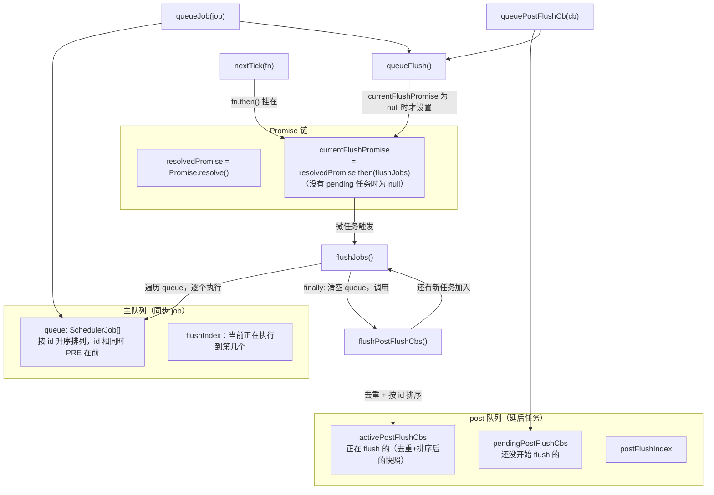
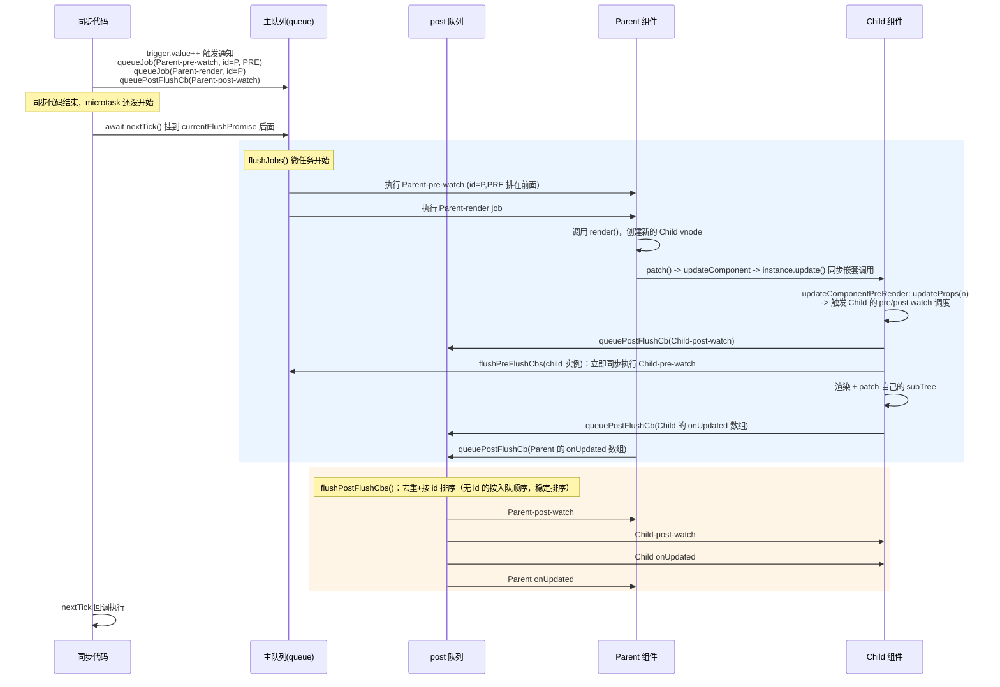
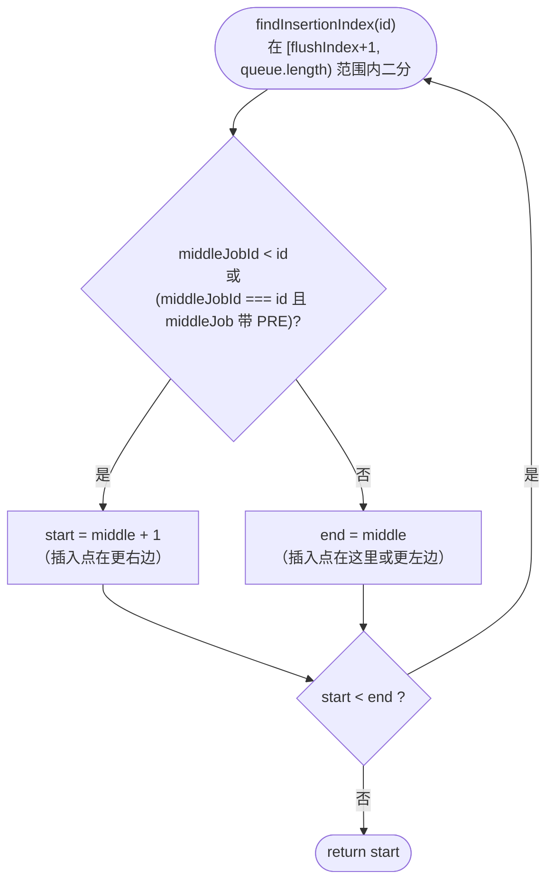
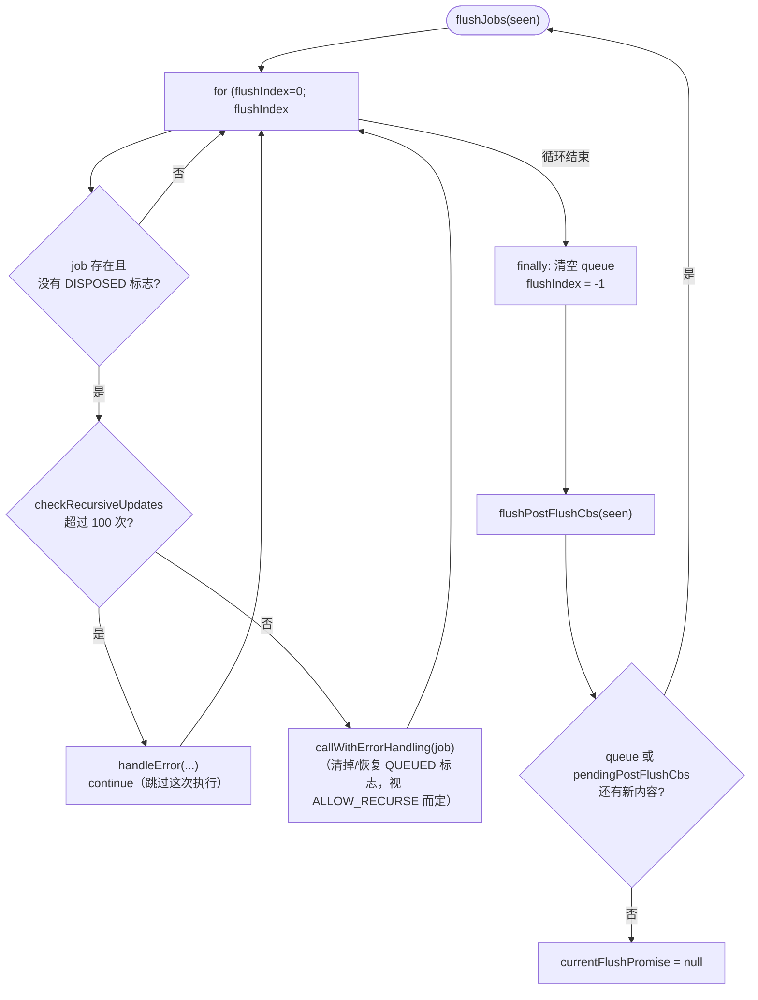
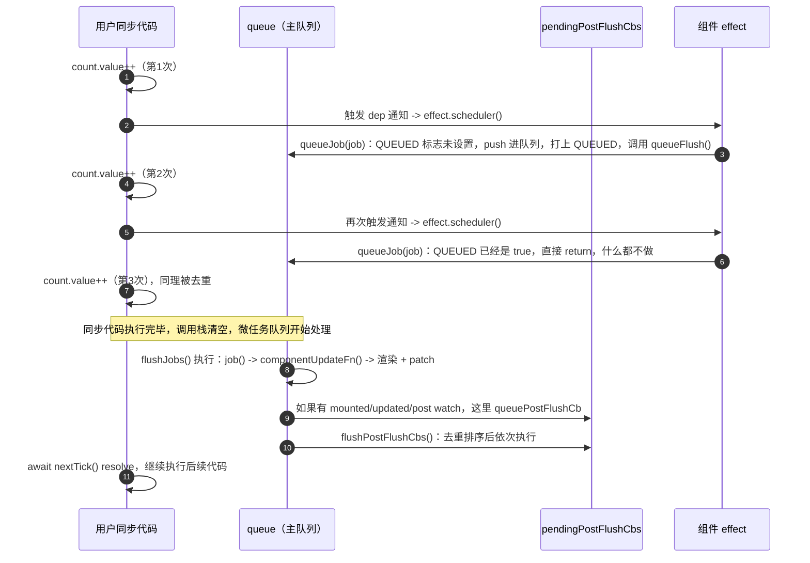

# 08. 调度器与 nextTick：批处理、pre/post flush、递归更新保护

> 为什么同步改 100 次状态只渲染一次？为什么 `watch` 回调总是能拿到"更新后"的 DOM？为什么父组件先于子组件更新？答案都在这一个 350 行的文件里：`packages/runtime-core/src/scheduler.ts`。

## 本章导读

学完本章能回答：

- 组件的"更新"本质上是什么？它是怎么从"响应式数据变化"变成"一次 DOM 更新"的？
- 同步代码里连续改 N 次状态，为什么只触发一次重新渲染？这个"去重"是怎么实现的？
- `nextTick()` 到底在等什么？它和"一个微任务"是不是一回事？
- `watch` 的 `flush: 'pre'`（默认）/`'post'`/`'sync'` 三种模式，分别在调度队列的哪个位置执行？
- 为什么在 `updated` 钩子里改状态会报"递归更新超限"的错，在 `beforeUpdate` 里改却没事？
- 一次状态更新里，pre watch、组件渲染（父→子）、post watch、`mounted`/`updated` 钩子、`nextTick` 回调，完整的先后顺序是怎样的？

**前置章节**：06（组件实例、`setupRenderEffect`）、07（`patch()`、`setRef`——本章会反复引用 `queuePostRenderEffect`）。

预计阅读时间：60-80 分钟。

**涉及源码文件清单**：

| 文件 | 作用 | 行数量级 |
|---|---|---|
| `packages/runtime-core/src/scheduler.ts` | 调度队列、`nextTick`、pre/post flush、递归保护 | 349 行 |
| `packages/runtime-core/src/renderer.ts` | `setupRenderEffect` 里组件 job 的创建（`#L1626-1639`） | 节选 |
| `packages/runtime-core/src/apiWatch.ts` | `watch`/`watchEffect` 的 `flush` 选项如何对接调度器（`#L198-232`） | 节选 |
| `packages/runtime-core/src/errorHandling.ts` | `handleError`/`logError`：递归更新报错时实际走的路径 | 节选 |

## 先跑起来

```bash
pnpm ex chapters/08-scheduler/examples/01-batch-updates.ts
```

真实输出节选：

```
│  1. 同步执行 count++ 三次
│      三次赋值已经执行完，此刻 renderCalls = 0（还没 flush，应该是 0）
│      render() 第 1 次被调用，count = 3
│      await nextTick() 之后，renderCalls = 1（预期 1：三次修改只触发一次渲染）
│      [update after 3x count++] 1 次宿主操作
│         1. setElementText(<div#2>, "3")
```

```
│  1. 同步执行 n++ 三次
│      sync watch 回调第 1 次，n = 1
│      sync watch 回调第 2 次，n = 2
│      sync watch 回调第 3 次，n = 3
```

看到了什么：同样是改 3 次状态，组件更新（走调度队列）只渲染一次、只产生一次宿主操作；而 `flush: 'sync'` 的 watch **完全绕开**调度队列，改几次就触发几次。这就是本章要讲的"批处理"的字面意思——不是"攒起来一起处理"，而是"同一个 job 在没 flush 之前，无论触发多少次，队列里永远只有一份"。

再跑一个看完整时序的：

```bash
pnpm ex chapters/08-scheduler/examples/02-job-order.ts
```

```
│  2. await nextTick()：等这一轮 flush 全部跑完
│      #2 [Parent] pre watch
│      #3 [Parent] render
│      #4 [Child] pre watch
│      #5 [Parent] post watch
│      #6 [Child] post watch
│      #7 [Child] onUpdated
│      #8 [Parent] onUpdated
│      #9 nextTick 回调
```

这个顺序——父的 pre watch 先跑、接着父渲染、父渲染过程中"顺便"把子的 pre watch 跑了、然后是 post watch（父先子后）、然后是 `onUpdated`（**子先父后**）、最后才是 `nextTick`——本章的"源码精读"会逐行解释这个顺序是怎么产生的。

## 整体图

### 图 1：调度器的几组状态



### 图 2：一次完整更新的时序（对应示例 02 的真实输出）



### 图 3：`findInsertionIndex` 的二分查找



### 图 4：`flushJobs` 的主循环与递归 flush



## 源码精读

### 2.1 `SchedulerJob` 与 `SchedulerJobFlags`

```ts
// packages/runtime-core/src/scheduler.ts#L5-40
export enum SchedulerJobFlags {
  QUEUED = 1 << 0,
  PRE = 1 << 1,
  ALLOW_RECURSE = 1 << 2,
  DISPOSED = 1 << 3,
}

export interface SchedulerJob extends Function {
  id?: number
  flags?: SchedulerJobFlags
  /** Attached by renderer.ts when setting up a component's render effect.
   *  Used to obtain component information when reporting max recursive updates.
   *  Also set on watcher jobs: null marks a watcher without an owner component. */
  i?: ComponentInternalInstance | null
}
```

一个 `SchedulerJob` 本质就是一个**普通函数**，挂了几个标记属性：

- **`id`**：决定在队列里的排序位置。组件更新 job 的 `id` 就是组件的 `uid`（创建顺序），父组件总是先创建，`id` 更小。
- **`flags`**：`QUEUED`（已经在队列里，避免重复 push）、`PRE`（pre watch 专用，决定同 id 时的排序优先级）、`ALLOW_RECURSE`（是否允许自己触发自己）、`DISPOSED`（组件已卸载，调度器应该跳过它，哪怕它还在队列里）。
- **`i`**：指向这个 job 属于哪个组件实例。3.5 版本里这是一个比较新的字段（早期版本靠闭包捕获 `instance`），主要用于报递归更新错误时打印组件名、以及 `flushPreFlushCbs` 按实例过滤 pre job。

**为什么用位标志而不是几个布尔字段**：一次性判断"是否已入队 且 不允许递归"这种组合条件时，位运算（`job.flags! & (QUEUED | ...)`）比多个布尔属性更省内存也更快，这在一个要被频繁创建（每个组件一个 job）、频繁检查的结构上是有意义的微优化。

### 2.2 队列状态与 `nextTick`

```ts
// packages/runtime-core/src/scheduler.ts#L44-68
const queue: SchedulerJob[] = []
let flushIndex = -1

const pendingPostFlushCbs: SchedulerJob[] = []
let activePostFlushCbs: SchedulerJob[] | null = null
let postFlushIndex = 0

const resolvedPromise = /*@__PURE__*/ Promise.resolve() as Promise<any>
let currentFlushPromise: Promise<void> | null = null

export function nextTick<T, R>(this: T, fn?: (this: T) => R | Promise<R>): Promise<void | R> {
  const p = currentFlushPromise || resolvedPromise
  return fn ? p.then(this ? fn.bind(this) : fn) : p
}
```

`nextTick` 的实现只有一行核心逻辑：**取当前的 `currentFlushPromise`（如果有正在进行/排队的 flush），否则退化成一个已经 resolved 的 Promise**，然后把回调 `.then` 在它后面。

**为什么要链在 `currentFlushPromise` 后面，而不是直接 `Promise.resolve().then(fn)`**：如果当前有 pending 的更新（`currentFlushPromise` 非空），直接 `resolvedPromise.then(fn)` 会让 `fn` 在**下一个微任务**就执行——但这时候 `flushJobs` 可能还没跑完（如果 `flushJobs` 本身因为 DOM 操作、同步回调等做了更多事情，或者在递归 flush 中），用户传进来的 `fn`（通常是想读取"更新后的 DOM"）就可能读到旧状态。挂在 `currentFlushPromise` 后面，保证了 `fn` 一定在**这一整轮**（包括递归产生的新一轮，因为 `flushJobs` 自己会一直占用这个 Promise 的 resolve 时机直到真正没有新任务）flush 彻底结束之后才执行。

示例 03 验证了一个容易被忽略的细节：`nextTick` 回调的实际执行顺序看的是"谁先对 `currentFlushPromise` 调用 `.then()`"（attach 顺序），不是"回调函数字面写在代码的哪个位置"——因为 Promise 的 `.then()` 回调严格按 attach 顺序进入微任务队列。

### 2.3 `findInsertionIndex`：二分插入

```ts
// packages/runtime-core/src/scheduler.ts#L79-98
function findInsertionIndex(id: number) {
  let start = flushIndex + 1
  let end = queue.length
  while (start < end) {
    const middle = (start + end) >>> 1
    const middleJob = queue[middle]
    const middleJobId = getId(middleJob)
    if (middleJobId < id || (middleJobId === id && middleJob.flags! & SchedulerJobFlags.PRE)) {
      start = middle + 1
    } else {
      end = middle
    }
  }
  return start
}
```

队列要保持按 `id` 升序——这保证了两件事（源码注释原话）：① 组件总是从父到子更新，因为父的 `id` 永远更小；② 如果一个组件在父组件更新过程中被卸载，它的更新 job 可以被跳过（`DISPOSED` 标志配合）。

二分查找范围是 `[flushIndex + 1, queue.length)`——**不包括已经执行过的部分**，`flushIndex` 是当前正在执行到的下标，已经跑过的 job 不需要、也不应该被重新定位。

**同 id 时 PRE 排在前面**：`middleJobId === id && middleJob.flags! & PRE` 这个条件为真时也继续往右找——意味着新插入的 job（如果没有 PRE 标志）会被排在所有同 id 的 PRE job **之后**。pre watch 的 job 和它所属组件的更新 job 的 `id` 相同（见 2.6 节），这保证了"属于同一个组件的 pre watch 永远排在这个组件的渲染 job 前面"。

### 2.4 `queueJob` / `queueFlush`：入队去重

```ts
// packages/runtime-core/src/scheduler.ts#L100-124
export function queueJob(job: SchedulerJob): void {
  if (!(job.flags! & SchedulerJobFlags.QUEUED)) {
    const jobId = getId(job)
    const lastJob = queue[queue.length - 1]
    if (!lastJob || (!(job.flags! & SchedulerJobFlags.PRE) && jobId >= getId(lastJob))) {
      queue.push(job) // 快路径：新 job 的 id 比队尾还大，直接 push
    } else {
      queue.splice(findInsertionIndex(jobId), 0, job)
    }
    job.flags! |= SchedulerJobFlags.QUEUED
    queueFlush()
  }
}

function queueFlush() {
  if (!currentFlushPromise) {
    currentFlushPromise = resolvedPromise.then(flushJobs)
  }
}
```

`if (!(job.flags! & QUEUED))` 这一行就是"批处理"的全部秘密——**同一个 job 对象**（组件的更新 job 在整个生命周期内是同一个函数引用）如果已经带着 `QUEUED` 标志，`queueJob` 直接什么都不做就返回。这就是为什么示例 01 里同步改 3 次状态，只会有 1 次 `queueJob` 真正生效——后两次调用在第一次调用时标志就已经被打上了。

`ALLOW_RECURSE` 的例外：组件更新函数和 watch 回调默认允许"自己触发自己"（`toggleRecurse` 会打开这个标志），所以一个 job 在**执行完**之后，如果 `ALLOW_RECURSE` 打开，它的 `QUEUED` 标志会在 `flushJobs` 里被及时清掉（见 2.8 节），让它有机会被重新排队——这是"在 `updated` 钩子里改状态能再次触发更新"的前提，但这同时也是需要 2.9 节递归保护的原因。

无 `id` 的 job（`getId` 返回 `Infinity`，或者 PRE 标志下返回 `-1`）走"快路径"直接 `push`——没有明确归属的 job（比如没有 `instance` 的独立 `watchEffect`）不需要精确排序，排在最后就行。

### 2.5 `queuePostFlushCb`

```ts
// packages/runtime-core/src/scheduler.ts#L126-146
export function queuePostFlushCb(cb: SchedulerJobs): void {
  if (!isArray(cb)) {
    if (activePostFlushCbs && cb.id === -1) {
      activePostFlushCbs.splice(postFlushIndex + 1, 0, cb)
    } else if (!(cb.flags! & SchedulerJobFlags.QUEUED)) {
      pendingPostFlushCbs.push(cb)
      cb.flags! |= SchedulerJobFlags.QUEUED
    }
  } else {
    // cb 是数组：组件生命周期钩子数组（onMounted/onUpdated 收集的多个回调），
    // 已经在主队列的 job 层面去重过了，这里不需要再检查，用 for 循环避免
    // 大数组 spread 导致调用栈溢出
    for (let i = 0; i < cb.length; i++) pendingPostFlushCbs.push(cb[i])
  }
  queueFlush()
}
```

两个分支：单个 job（比如一个 watch 的 post 回调、`setRef` 的 ref 赋值 job）走去重逻辑；数组（`onMounted`/`onUpdated` 等生命周期钩子，`instance.m`/`instance.u` 本身就是数组）直接整体展开塞进去，**不去重**——因为这个数组本身只会在一次组件更新里被 `queuePostRenderEffect` 一次（上游已经靠主队列的 job 去重保证了不会重复调用）。

`activePostFlushCbs && cb.id === -1` 这个特判是给 `setRef` 用的——ref 赋值 job 的 `id` 固定是 `-1`（渲染器模板 ref 一节提到过），如果当前正在 flush post 队列过程中又触发了新的 ref 赋值，直接插到当前处理位置的下一个，尽快处理。

### 2.6 `flushPreFlushCbs`：组件更新前，先跑完属于它的 pre job

```ts
// packages/runtime-core/src/scheduler.ts#L148-184
export function flushPreFlushCbs(
  instance?: ComponentInternalInstance,
  minUid?: number,
  seen?: CountMap,
  i: number = flushIndex + 1,
): void {
  for (; i < queue.length; i++) {
    const cb = queue[i]
    if (cb && cb.flags! & SchedulerJobFlags.PRE) {
      if ((instance && cb.id !== instance.uid) || (minUid !== undefined && !(cb.id! >= minUid))) {
        continue
      }
      if (__DEV__ && checkRecursiveUpdates(seen!, cb)) continue
      queue.splice(i, 1)
      i = instance ? i - 1 : flushIndex
      if (cb.flags! & SchedulerJobFlags.ALLOW_RECURSE) cb.flags! &= ~SchedulerJobFlags.QUEUED
      cb()
      if (!(cb.flags! & SchedulerJobFlags.ALLOW_RECURSE)) cb.flags! &= ~SchedulerJobFlags.QUEUED
    }
  }
}
```

这个函数有两个调用场景：

1. **无参数**（`instance` 为 `undefined`）：根挂载时由 `flushOnAppMount` 调用，flush 所有 PRE job（可配合 `minUid` 只 flush 本次挂载创建的那些实例的 job）。
2. **带 `instance`**：`updateComponentPreRender`（`renderer.ts#L1653-1670`）在组件即将渲染前调用，**只** flush `cb.id === instance.uid` 的 job——也就是只处理"属于这个组件自己"的 pre watch，不会误跑到其它组件的 pre job。

关键在于这个函数是**从 `queue` 数组里直接 `splice` 出来立即执行**，而不是等主循环的 `flushIndex` 走到它——这意味着在父组件渲染过程中，子组件的 props 一旦更新（`updateProps`）触发了子组件的 pre watch 调度（`queueJob` 把它插入主队列），紧接着这里的 `flushPreFlushCbs(childInstance)` 就能立刻把它摘出来同步执行，不需要等主循环按顺序轮到它。这正是示例 02 里"`Child pre watch`"紧跟在"`Parent render`"后面、而不是排在主队列末尾单独执行的原因。

### 2.7 `flushPostFlushCbs`：去重、排序、递归处理新增项

```ts
// packages/runtime-core/src/scheduler.ts#L186-242（节选，省略 skip/minUid 的 root-mount 分支）
export function flushPostFlushCbs(seen？, skip？, minUid = 0): void {
  if (pendingPostFlushCbs.length) {
    let cbs = pendingPostFlushCbs
    // ...（root mount 场景下按 skip/minUid 过滤，拆出真正属于本次 flush 的 cbs）
    const deduped = [...new Set(cbs)].sort((a, b) => getId(a) - getId(b))
    pendingPostFlushCbs.length = kept

    if (activePostFlushCbs) {
      // #1947：已经有一个 active 队列在跑，说明是嵌套调用，直接并入外层循环
      for (let i = 0; i < deduped.length; i++) activePostFlushCbs.push(deduped[i])
      return
    }

    activePostFlushCbs = deduped
    for (postFlushIndex = 0; postFlushIndex < activePostFlushCbs.length; postFlushIndex++) {
      const cb = activePostFlushCbs[postFlushIndex]
      if (__DEV__ && checkRecursiveUpdates(seen!, cb)) continue
      if (cb.flags! & SchedulerJobFlags.ALLOW_RECURSE) cb.flags! &= ~SchedulerJobFlags.QUEUED
      if (!(cb.flags! & SchedulerJobFlags.DISPOSED)) cb()
      cb.flags! &= ~SchedulerJobFlags.QUEUED
    }
    activePostFlushCbs = null
    postFlushIndex = 0
  }
}
```

`[...new Set(cbs)]` 去重（同一个 job 可能被 `queuePostFlushCb` 调用多次但只应该跑一次——虽然单个 job 的入口已经有 `QUEUED` 检查，这里是双保险，尤其是处理数组展开进来的生命周期钩子），然后**按 `id` 排序**。

**关键细节（和 `getId` 的实现相关）**：`watch` 的 `flush: 'post'` 回调和组件的 `onMounted`/`onUpdated` 钩子数组，都**没有设置 `.id`**（`apiWatch.ts#L200-206` 的 post 分支只设置了 `job.i`，没有设置 `job.id`；`renderer.ts` 里 `queuePostRenderEffect(m, ...)`/`queuePostRenderEffect(u, ...)` 传的也是裸数组，没有 `id`）。`getId` 对没有 `id` 的 job 返回 `Infinity`（`#L270-271`）。既然大家的 `id` 都一样是 `Infinity`，`Array.prototype.sort` 按照 ES2019 规范是**稳定排序**，等效于"谁先被 push 进 `pendingPostFlushCbs` 数组，谁就先执行"——这正好解释了示例 02 里 `Parent-post-watch`（更新最先触发时就同步 push 进去的）排在 `Child-post-watch`（嵌套在父渲染过程中才 push 的）前面，而两者的 `onUpdated` 又是另一组独立的"先 push 先执行"关系（子组件在自己的 `componentUpdateFn` 里先把自己的 `onUpdated` 数组 push 完，才返回到父组件继续执行并 push 父组件的 `onUpdated`）。

`activePostFlushCbs` 存在时说明是**嵌套调用**（flush 过程中又产生了新的 post cb），直接并入当前正在跑的这一批，让同一轮 `for` 循环的 `postFlushIndex` 继续往后处理，而不是另起一次独立的 flush。

### 2.8 `flushJobs`：主循环、递归上限、finally 清理

```ts
// packages/runtime-core/src/scheduler.ts#L273-327
function flushJobs(seen?: CountMap) {
  const check = __DEV__ ? (job: SchedulerJob) => checkRecursiveUpdates(seen!, job) : NOOP
  try {
    for (flushIndex = 0; flushIndex < queue.length; flushIndex++) {
      const job = queue[flushIndex]
      if (job && !(job.flags! & SchedulerJobFlags.DISPOSED)) {
        if (__DEV__ && check(job)) continue
        if (job.flags! & SchedulerJobFlags.ALLOW_RECURSE) job.flags! &= ~SchedulerJobFlags.QUEUED
        callWithErrorHandling(job, job.i, job.i ? ErrorCodes.COMPONENT_UPDATE : ErrorCodes.SCHEDULER)
        if (!(job.flags! & SchedulerJobFlags.ALLOW_RECURSE)) job.flags! &= ~SchedulerJobFlags.QUEUED
      }
    }
  } finally {
    for (; flushIndex < queue.length; flushIndex++) {
      const job = queue[flushIndex]
      if (job) job.flags! &= ~SchedulerJobFlags.QUEUED // 出错时也要把剩下的标志清掉
    }
    flushIndex = -1
    queue.length = 0
    flushPostFlushCbs(seen)
    currentFlushPromise = null
    if (queue.length || pendingPostFlushCbs.length) {
      flushJobs(seen) // 新任务是在 flush 过程中加入的，继续 flush
    }
  }
}
```

**`DISPOSED` 跳过**：一个组件在父组件更新过程中被卸载（`unmountComponent` 会给 `job.flags |= DISPOSED`，07 章 2.14 节），即使它的更新 job 还躺在队列里没被清理，这里也会直接跳过，不会对着一个已经卸载的实例做无意义的渲染。

**`ALLOW_RECURSE` 的"提前清标志"技巧**：执行 job **之前**先把 `QUEUED` 清掉（如果允许递归），这样 job 执行过程中如果自己把自己 `queueJob` 回去，能立刻成功入队（不会被"已经 QUEUED"挡住）；执行完之后再按情况清一次（兜底，应对 job 内部没有重新触发自己的情况）。不允许递归的 job 则是**执行完之后才清** `QUEUED`，确保它在自己运行期间无法被重新排队。

**`checkRecursiveUpdates` 和 `RECURSION_LIMIT = 100`**：

```ts
// scheduler.ts#L329-348
function checkRecursiveUpdates(seen: CountMap, fn: SchedulerJob) {
  const count = seen.get(fn) || 0
  if (count > RECURSION_LIMIT) {
    const instance = fn.i
    const componentName = instance && getComponentName(instance.type)
    handleError(`Maximum recursive updates exceeded${componentName ? ` in component <${componentName}>` : ``}. ...`, null, ErrorCodes.APP_ERROR_HANDLER)
    return true
  }
  seen.set(fn, count + 1)
  return false
}
```

`seen` 是一个在**一整轮递归 flushJobs**（包括 `finally` 里触发的后续 `flushJobs(seen)` 调用——同一个 `seen` 实例被原样传下去）生命周期内有效的 `Map<job, count>`，每次这个 job 被执行就计数 +1，超过 100 次直接报错并返回 `true`（调用方据此 `continue`/跳过这次执行，但**不会清空整个队列**，也不会阻止其它 job 继续执行）。

**一个容易被忽略的细节**：`handleError(msg, null, ErrorCodes.APP_ERROR_HANDLER)` 这里**把 `instance` 硬编码成了 `null`**，而不是 `fn.i`——这意味着即便你配置了 `app.config.errorHandler`，这个特定的错误也**不会**被它捕获（`handleError` 内部只有 `if (instance)` 为真时才会尝试调用 `errorHandler`，`errorHandling.ts#L121-152`），而是直接走 `logError`：开发环境下默认行为是 `throw err`（`errorHandling.ts#L173-178`，"crash in dev by default so it's more noticeable"）。示例 04 验证了这一点——不处理的话这个错误会变成一个**未捕获的 Promise rejection**，直接让 Node 进程退出，必须显式 `try/catch` 住 `await nextTick()` 才能继续往下跑。

### 2.9 组件更新 job 的创建：`id`、`scheduler`、`toggleRecurse`

```ts
// packages/runtime-core/src/renderer.ts#L1626-1639
instance.scope.on()
const effect = (instance.effect = new ReactiveEffect(componentUpdateFn))
instance.scope.off()

const update = (instance.update = effect.run.bind(effect))
const job: SchedulerJob = (instance.job = effect.runIfDirty.bind(effect))
job.i = instance
job.id = instance.uid
effect.scheduler = () => queueJob(job)

toggleRecurse(instance, true)
```

组件的"更新"本质上是一个 `ReactiveEffect`：`componentUpdateFn` 是真正的渲染逻辑（区分首次挂载和后续更新两个分支，07 章 2.9 节之前已经读过），`effect.scheduler` 决定了"这个 effect 的依赖发生变化时该做什么"——不是立即重新执行 `componentUpdateFn`，而是 `queueJob(job)` 把它排进调度队列。`job.id = instance.uid` 把"组件创建顺序"直接变成了"更新顺序的依据"：父组件总是先创建（`uid` 更小），所以父组件的更新 job 永远排在子组件前面。

**为什么父先更新能让子的更新被跳过或合并**：父组件重新渲染时，如果传给子组件的 props 没有变化（`shouldUpdateComponent` 判断为 `false`），`updateComponent`（07 章 2.9 节）直接跳过子组件的渲染，子组件即使因为自己的状态变化而被排进了队列，这次更新所读到的 props 依然是最新的（因为父组件的渲染一定先发生）；如果 props 变化了，`updateComponentPreRender` 会直接**同步调用** `instance.update()`（而不是等待队列轮到它，见 07 章 2.9 节 `updateComponent` 的 `instance.update()` 调用），相当于把子组件这一次的更新"并入"了父组件这次渲染的调用栈——子组件原本因为自己状态变化而排队的那个 job，等真正轮到队列处理到它时，会因为 `effect.runIfDirty` 发现"已经不脏了"（上一次同步渲染已经处理过）而直接跳过，不会渲染两次。`job = effect.runIfDirty.bind(effect)` 这个绑定本身就是"合并"机制的关键——调度队列里存的不是"无条件重新渲染"，而是"如果脏就渲染"。

**`toggleRecurse`**：

```ts
// renderer.ts#L2530-2541
function toggleRecurse({ effect, job }: ComponentInternalInstance, allowed: boolean) {
  if (allowed) {
    effect.flags |= EffectFlags.ALLOW_RECURSE
    job.flags! |= SchedulerJobFlags.ALLOW_RECURSE
  } else {
    effect.flags &= ~EffectFlags.ALLOW_RECURSE
    job.flags! &= ~SchedulerJobFlags.ALLOW_RECURSE
  }
}
```

`setupRenderEffect` 末尾默认打开 `ALLOW_RECURSE`（组件更新函数被允许自己触发自己，这是 `updated` 钩子能修改状态的前提）；但在 `beforeUpdate`/`onVnodeBeforeUpdate` 执行期间（`patchElement`/`componentUpdateFn` 里能看到成对的 `toggleRecurse(instance, false)` → 钩子调用 → `toggleRecurse(instance, true)`），这个标志被临时关掉——此时这个组件的渲染 effect 正在运行、还没走到"读取新依赖"的阶段，如果在 `beforeUpdate` 里修改了它依赖的状态，这次通知会命中"effect 不允许自我递归"的判断，直接被跳过，不会产生任何新的调度。示例 04 的第二组用例验证了这一点：`beforeUpdate` 里的自我修改完全不会触发第二次渲染（`renderCalls` 始终是 1），这和 `updated` 钩子（产生 101 次调用，被递归上限兜住）是完全不同的两种"自触发"结局——一个是"从源头没有被调度"，一个是"被调度了但次数超限被拦下"。

### 2.10 `watch` 的 `flush` 选项如何对接调度器

```ts
// packages/runtime-core/src/apiWatch.ts#L198-232（节选）
let isPre = false
if (flush === 'post') {
  baseWatchOptions.scheduler = (job: SchedulerJob) => {
    job.i = instance
    queuePostRenderEffect(job, instance && instance.suspense)
  }
} else if (flush !== 'sync') {
  // default: 'pre'
  isPre = true
  baseWatchOptions.scheduler = (job, isFirstRun) => {
    if (isFirstRun) job() // 首次执行（比如 immediate）直接同步跑，不经过队列
    else queueJob(job)
  }
}

baseWatchOptions.augmentJob = (job: SchedulerJob) => {
  if (cb) job.flags! |= SchedulerJobFlags.ALLOW_RECURSE // watch 回调默认允许自触发（#1727）
  if (isPre) {
    job.flags! |= SchedulerJobFlags.PRE
    if (instance) {
      job.id = instance.uid // pre watch 的 id 和它所属组件的更新 job 相同
      job.i = instance
    }
  }
}
```

三种 `flush` 对应完全不同的调度路径：

- **`'pre'`（默认）**：走 `queueJob`，并且 `job.flags |= PRE`、`job.id = instance.uid`——和组件更新 job 挤在同一个 `id` 位置，靠 `findInsertionIndex` 的"同 id PRE 优先"规则排在组件更新之前。这保证了"状态变化 → pre watch 读到新值并做一些处理（通常是修改其它响应式状态）→ 组件用最终确定的状态渲染"这个顺序。
- **`'post'`**：直接走 `queuePostRenderEffect`（约等于 `queuePostFlushCb`，没有 Suspense 时完全等价），**没有设置 `id`**——在 `flushPostFlushCbs` 里只能靠入队顺序（稳定排序）确定先后，详见 2.7 节。
- **`'sync'`**：既不设置 `scheduler` 也不需要（源码在 `flush === 'sync'` 时走另一条完全不同的路径，直接在 `trigger` 阶段同步调用，不经过这里列出的任何调度函数）——这就是示例 01 里"`flush:'sync'` 的 watch 改几次触发几次"的根本原因：它压根不进 `queue`/`pendingPostFlushCbs` 这两个数组。

`isFirstRun` 分支（pre watch 的首次执行，比如 `immediate: true`）直接同步调用，不经过 `queueJob`——这是为了让"立即执行一次"真的是立即的，不需要等一个微任务。

## 时序图：从"同步改 3 次状态"到"`nextTick` 回调"

把本章开头示例 01、02 的真实输出串成一张完整的图：



## 与 Vue 2 对比

| 维度 | Vue 2（`src/core/observer/scheduler.ts`、`src/core/util/next-tick.ts`） | Vue 3（本章） | 为什么这么改 / 代价 |
|---|---|---|---|
| 去重机制 | `queueWatcher(watcher)`：用一个 `has: { [id]: true }` 的普通对象记录"这个 watcher id 是否已经在队列里"，`flushing` 为 `true`（正在 flush）时改走"按 id 插入"逻辑，否则直接 push | `queueJob(job)`：用 job 自身的 `flags & QUEUED` 位标志判断，`findInsertionIndex` 二分插入 | Vue 2 的 `has` 表是和队列分离的旁路结构，需要维护一致性（`flushSchedulerQueue` 结束后要 `resetSchedulerState` 清空 `has`）；Vue 3 把标志直接挂在 job 对象自己身上，少一次 Map/对象查找，且二分插入比"线性找位置再插入"快 |
| 排序依据 | `flushSchedulerQueue` 执行前对 `queue` **整体 `sort`**（按 `watcher.id` 升序），用户 watcher 因为比渲染 watcher 先创建（`id` 更小）天然排在渲染更新前面 | `queueJob` 插入时就保持有序（`findInsertionIndex`），不需要事后整体排序；pre watch 靠**显式的 `PRE` 标志**（而不是"碰巧 id 更小"）确保排在组件更新前面 | Vue 2 依赖"watcher 创建顺序"这个隐式约定（用户 `watch` 选项在 `initState` 阶段比渲染 watcher 创建得早），Vue 3 用显式标志更明确，也支持 `flush:'post'` 这种"故意排到后面"的场景（Vue 2 没有对应的 `post` watcher 概念，`$nextTick` 式的"视图更新后"需要手动包一层） |
| 递归更新保护 | `flushSchedulerQueue` 里 `circular[id]` 计数，超过 `MAX_UPDATE_COUNT = 100` 直接 `warn` 并 `break` 整个 flush 循环 | `checkRecursiveUpdates`：每个 job 独立计数，超过 `RECURSION_LIMIT = 100` 只 `continue` 跳过这一个 job，**不影响**队列里其它 job 的执行 | Vue 2 的 `break` 是"一刀切"地中止整个 flush；Vue 3 更精细，一个失控的 job 不会连累同一轮里其它本该正常执行的更新 |
| `nextTick` 的降级策略 | `src/core/util/next-tick.ts` 的 `timerFunc`：优先 `Promise.then`，不支持则退化到 `MutationObserver`，再不支持退化到 `setImmediate`，最后兜底 `setTimeout(fn, 0)`；`callbacks` 数组 + `pending` 标志手动管理回调队列 | 只用 `Promise.resolve().then()`，不做任何降级 | Vue 2 发布时还需要兼容不支持原生 Promise 的环境（旧版 IE 等）；Vue 3 直接要求现代浏览器环境，彻底砍掉了兼容层，`nextTick` 实现因此简化成一行 |
| `sync` 更新 | `watcher.sync` 选项：为 `true` 时 `update()` 直接同步调用 `run()`，不经过 `queueWatcher` | `watch(..., { flush: 'sync' })`：效果一致，但是作为一个显式的 `flush` 枚举值暴露给用户 | 语义更清晰（和 `'pre'`/`'post'` 并列，而不是一个特殊的布尔开关），用户心智模型更统一 |
| 组件更新 vs 用户 watcher 的顺序保证 | 纯粹依赖 `id` 比较：用户 watcher 在 `initState` 时创建，总是先于当前组件的渲染 watcher；但**没有**类似 Vue 3 `PRE` 标志的机制去保证"父组件的用户 watcher 先于子组件的渲染"这种跨组件场景的精确顺序 | `job.id = instance.uid` + `PRE` 标志，跨组件的顺序关系在"创建顺序"这一个维度上就有完整保证 | Vue 3 的组件实例 `uid` 是全局递增的，不区分"用户 watcher"还是"渲染 effect"，排序逻辑统一；Vue 2 的 watcher id 也是全局递增，但排序规则（仅靠 id 排序 + sort）不区分 pre/post 语义，能表达的"相对顺序"更弱 |

> 说明：本节 Vue 2 的描述基于 `vuejs/vue` 2.6/2.7 版本 `src/core/observer/scheduler.ts`（`queueWatcher`/`flushSchedulerQueue`/`resetSchedulerState`）、`src/core/util/next-tick.ts`（`timerFunc`/`callbacks`/`pending`）的公开实现与社区广泛记录的行为，本环境未额外 clone Vue 2 源码逐行核对，如果你本地有 Vue 2 源码，建议对照 `flushSchedulerQueue` 函数核实 `MAX_UPDATE_COUNT` 的具体处理分支。

## 动手：mini 实现 / 实验

`mini-vue/runtime-core/scheduler.ts` 是源码的逐行复刻，保留了 `queueJob`/`queuePostFlushCb`/`flushJobs`/`nextTick`/`findInsertionIndex`/`PRE` 标志/去重/递归上限这些主干逻辑，额外导出了一个仅供测试用的 `__resetSchedulerForTest()`（真实源码没有这个函数，它是长期存活的单例模块）。

```bash
pnpm vitest run mini-vue/runtime-core/scheduler.test.ts
```

11 个用例覆盖：去重、按 id 排序、同 id PRE 优先、"同步改 3 次只 flush 一次"、递归更新上限（101 次后停止并报错）、`queuePostFlushCb` 数组展开+去重+排序、post cb 在主任务之后执行、`nextTick` 的链式关系（包括 `this` 绑定）、`flushPreFlushCbs` 按 instance 过滤。

建议自己改一改：

1. 把 `mini-vue/runtime-core/scheduler.ts` 里 `queueJob` 的"快路径"（`jobId >= getId(lastJob)` 直接 push）去掉，强制所有插入都走 `findInsertionIndex`，用一个大数量级的 benchmark（比如循环 queue 10000 个递增 id 的 job）比较两种实现的耗时差异，体会这个快路径的实际意义。
2. 给 `mini-vue/runtime-core/scheduler.ts` 加一个 `flush: 'sync'` 的等价能力（一个直接跳过队列、同步执行的 `queueSyncJob` 函数），并写测试验证它确实不经过 `QUEUED` 去重。
3. 修改 `RECURSION_LIMIT` 为一个很小的值（比如 3），重新跑 `04-recursive-update-guard.ts`（需要同步改一下示例里断言的次数），观察递归保护在边界值下的行为是否符合预期。

## 常见疑问

**Q1：`nextTick()` 是不是等价于 "等一个微任务"？**
不完全是。没有任何 pending 更新时，`nextTick()` 确实退化成 `Promise.resolve().then()`，接近"一个微任务"；但只要有 `queueJob`/`queuePostFlushCb` 产生了 `currentFlushPromise`，`nextTick` 回调就要等**这一整轮 flush**（可能包含多次递归 `flushJobs`）彻底结束才执行，可能跨越不止一个微任务 tick。

**Q2：为什么组件更新 job 用 `effect.runIfDirty` 而不是 `effect.run`？**
`runIfDirty` 会先检查这个 effect 依赖的数据是不是真的"脏"了（版本号比对，第 03 章细节）才真正执行 `run`。这避免了"props 已经在 `updateComponentPreRender` 里同步更新过，子组件本来排队的那个 job 轮到时又重复渲染一次"的问题（2.9 节的"父先子后"小节有展开）。

**Q3：`watch` 的 `flush: 'pre'` 和组件更新 job 同一个 `id`，会不会互相覆盖？**
不会。`queue` 数组允许同一个 `id` 出现多次（不同的 job 对象），`findInsertionIndex` 只是保证"同 id 时 PRE 排在非 PRE 前面"，两个 job 都会被执行，只是顺序确定了。

**Q4：`checkRecursiveUpdates` 报错之后，页面会变成什么状态？**
不会"崩溃重置"，队列里这一个 job 被跳过（`continue`），但该轮次里其它 job 照常执行，`seen` 这个计数 Map 只在本轮（含递归）有效，下一次全新的更新周期会用一个全新的 `seen`。但如果这个报错没有被捕获（2.8 节提到的 `handleError` 硬编码 `null`），在开发环境会直接 `throw`，表现为未处理的 Promise rejection。

**Q5：`toggleRecurse(instance, false)` 这种"临时关闭"操作会不会影响别的组件？**
不会，`toggleRecurse` 操作的是传入的那个 `instance` 自己的 `effect.flags`/`job.flags`，只影响这一个组件的这一次渲染/更新窗口。

**Q6：为什么 `onUpdated`/`flush:'post'` watch 不设置 `id`，会不会导致顺序不可预测？**
不会不可预测，`Array.prototype.sort` 在现代 JS 引擎（ES2019 起规范保证）里对相等的比较结果（这里都是 `Infinity - Infinity = NaN`？需要注意：`getId(a) - getId(b)` 在两者都是 `Infinity` 时结果是 `NaN`，`Array.prototype.sort` 把比较函数返回 `NaN` 当作 `0` 处理，等效于"相等"）是稳定排序，相当于保留原始的 push 顺序。

## 小结

- "批处理"的本质是 **job 对象自身的 `QUEUED` 标志去重**，不是"攒够时间再处理"。
- `nextTick()` 把回调挂在 `currentFlushPromise` 后面，保证回调一定在当前这一整轮 flush（含递归）结束之后执行；attach 顺序决定微任务执行顺序。
- 队列按 `id`（创建顺序/组件 `uid`）升序排列，`findInsertionIndex` 二分查找插入点；同 `id` 时 `PRE` 标志的 job 排在前面。
- `flushPreFlushCbs(instance)` 能在组件渲染前"插队"同步执行属于它的 pre watch，不需要等主循环顺序轮到。
- `flushPostFlushCbs` 去重 + 按 `id` 排序；没有 `id` 的 job（`post` watch、生命周期钩子数组）靠稳定排序保留入队顺序。
- `flushJobs` 失败不清空整个队列，只 `continue` 跳过出问题的那个 job；`finally` 里递归调用自己处理 flush 过程中新增的任务。
- 组件更新 job 的 `id = instance.uid`，父先于子；`effect.runIfDirty` 保证父组件已经同步处理过的子组件更新不会被重复执行。
- `toggleRecurse` 在 `beforeUpdate`/`onVnodeBeforeUpdate` 期间临时关闭 `ALLOW_RECURSE`，让"beforeUpdate 里改自身依赖"从源头上不触发新调度，区别于"`updated` 里改状态"会被递归上限兜底的报错路径。
- `handleError` 对递归更新错误硬编码 `instance=null`，意味着这类错误不会走用户配置的 `app.config.errorHandler`，开发环境下会直接抛出。

## 延伸阅读

- Vue 3 官方文档 - 响应式基础 / 侦听器的 `flush` 时机：https://cn.vuejs.org/guide/essentials/watchers.html#callback-flush-timing
- `nextTick` 官方文档：https://cn.vuejs.org/api/general.html#nexttick
- MDN - 微任务与 `queueMicrotask`：https://developer.mozilla.org/zh-CN/docs/Web/API/HTML_DOM_API/Microtask_guide
- `vuejs/core` 仓库中围绕 `#1727`（watch 回调允许自触发）、`#1801`/`#2043`（组件渲染 effect 允许递归）、`#5721`/`#6728`（`flushOnAppMount` 的挂载时序修复）这几个 issue/PR，可在 GitHub 搜索对应编号追更详细的历史讨论。

## 思考题

1. 如果一个组件的 `onUpdated` 钩子里，修改的不是"触发这次更新的状态"，而是另一个完全无关的响应式状态，会不会也触发递归更新保护？为什么？

   <details><summary>答案</summary>

   会，只要这个修改最终导致**同一个组件**的渲染 effect 再次被 `queueJob`，不管改的是不是"触发这次更新的那个状态"，只要它是这个组件渲染时读取过的依赖（哪怕是一个完全不相关的、新引入的响应式状态），`checkRecursiveUpdates` 按 job 本身（而不是按"触发源"）计数，一样会在 101 次后触发报错。递归保护的粒度是"这个 job 在本轮 flush 里被执行了多少次"，和具体改了哪个状态无关。

   </details>

2. `queuePostFlushCb` 对数组参数（生命周期钩子）不做去重，这是否意味着如果同一个 `onMounted` 回调被注册了两次（比如 `onMounted(fn); onMounted(fn)`，同一个函数引用），`mounted` 阶段会执行两次？

   <details><summary>答案</summary>

   会执行两次。`instance.m` 本身就是一个普通数组（`invokeArrayFns` 遍历调用），`onMounted` 的实现是直接 `push` 进这个数组，不检查重复；`queuePostFlushCb` 处理数组时也明确说明"已经在主队列的 job 层面去重过了，这里不需要再检查"——这个假设的前提是"数组本身在一次更新里只会被塞入 pendingPostFlushCbs 一次"，而不是"数组内部元素不重复"。两次 `onMounted(fn)` 对应数组里两个相同的函数引用，`invokeArrayFns` 会老老实实调用两次。

   </details>

3. 本章例子大多是组件自己触发的更新，走的是 `queueJob` 的异步调度路径。结合第 07 章"根组件首次 `render()` 是同步 flush（`flushOnAppMount`）"这个结论，如果在根组件的 `setup()` 里（也就是首次挂载过程中）就调用了 `nextTick(fn)`，`fn` 会在 `render()`/`app.mount()` 调用返回之前还是之后执行？

   <details><summary>答案</summary>

   一定在 `render()`/`app.mount()` **调用返回之后**才执行。原因是：`setup()` 阶段这次调用 `nextTick(fn)` 发生时，`currentFlushPromise` 多半还是 `null`（挂载过程还没有任何 job 被 `queueJob` 排队，或者即使有也是在 `flushOnAppMount` 同步调用的 `flushPreFlushCbs`/`flushPostFlushCbs` 里，不经过 `currentFlushPromise`），所以 `nextTick` 退化成 `resolvedPromise.then(fn)`——这无论如何都是一个**微任务**，而 `flushOnAppMount` 内部的同步 flush 逻辑是在**当前调用栈**（也就是 `render()` 这次函数调用本身）里完成的。微任务必须等当前同步代码执行栈清空之后才会被处理，所以 `fn` 一定排在 `render()` 返回之后。

   </details>
