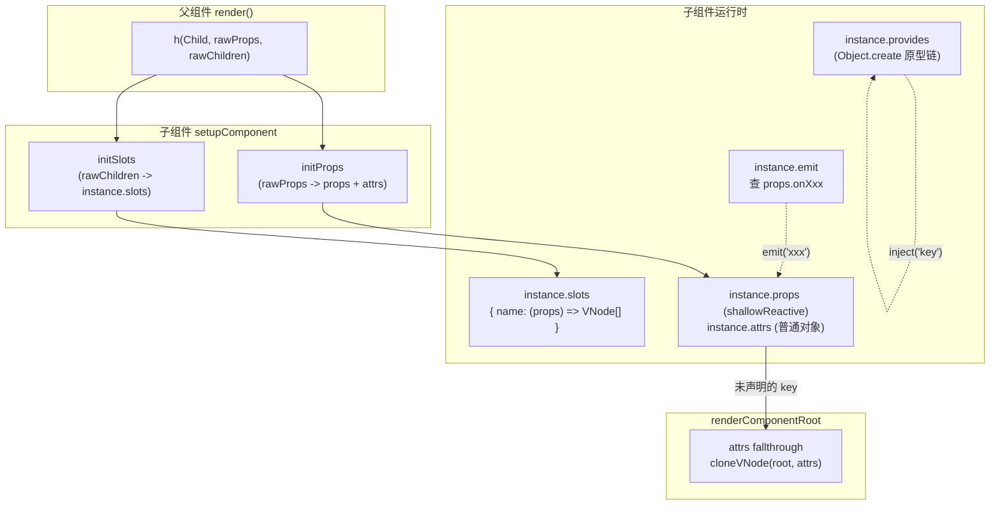

# 09. props / emits / slots / attrs / provide-inject / defineModel 运行时

> 组件之间怎么传数据、怎么通知事件、怎么塞渲染内容——这一章把"父子组件通信"的全部运行时机制讲透。

## 本章导读

学完本章能回答：

- `props: ['a', 'b']` 和 `props: { a: String }` 两种写法最终被规范化成什么结构？Boolean 类型的 prop 为什么写 `<Comp disabled />` 就会变成 `true`？
- `emit('xxx')` 内部到底是怎么"找到"父组件传入的 `onXxx` 处理函数的？v-model 的修饰符是怎么生效的？
- 插槽内容在运行时到底是什么东西？作用域插槽和普通插槽有什么运行时区别（其实没有）？
- 为什么组件默认会把未声明的属性"糊"到根节点上？多根节点组件为什么不会自动这样做？
- `provide`/`inject` 的查找是沿着什么结构走的，为什么不需要 Vue 自己维护一条"向上查找链"？

前置章节：第 05 章（VNode）、第 06 章（组件实例/setup）。预计阅读时间 70~90 分钟。

涉及源码文件：

| 文件 | 作用 | 行数量级 |
|---|---|---|
| `packages/runtime-core/src/componentProps.ts` | props 规范化、`initProps`/`updateProps`、Boolean casting、校验 | ~830 行 |
| `packages/runtime-core/src/componentEmits.ts` | `emit()`、emits 规范化、v-model 修饰符处理 | ~316 行 |
| `packages/runtime-core/src/componentSlots.ts` | `initSlots`/`updateSlots`、插槽规范化 | ~252 行 |
| `packages/runtime-core/src/helpers/renderSlot.ts` | `<slot>` 的运行时实现 | ~143 行 |
| `packages/runtime-core/src/apiInject.ts` | `provide`/`inject`/`hasInjectionContext` | ~94 行 |
| `packages/runtime-core/src/apiSetupHelpers.ts` | `defineProps`/`defineEmits` 等编译期宏、`useModel`/`useAttrs`/`useSlots` | ~573 行 |
| `packages/runtime-core/src/helpers/useModel.ts` | `useModel()` 的 customRef 实现 | ~137 行 |
| `packages/runtime-core/src/componentRenderUtils.ts` | `renderComponentRoot` 里的 attrs fallthrough 逻辑、`shouldUpdateComponent` | ~500 行（第 06 章已读过大部分） |
| `packages/shared/src/slotFlags.ts` | `SlotFlags` 枚举 | 30 行 |

## 先跑起来

```bash
pnpm ex chapters/09-props-emits-slots/examples/02-props-update-fast-path.ts
```

关键输出（节选，刻意构造的"坑"）：

```
│  1. 同时修改 msgA 和 extraA，但 dynamicProps 只报了 "msg"
│      [更新后的宿主操作] 1 次宿主操作
│         1. setElementText(<span#3>, "msg=m2 attrs.extra=e1")
│      结果：msg 正确更新成 m2（在 dynamicProps 里），但 attrs.extra 还停留在 e1
```

一句话点出看到了什么：**`PatchFlags.PROPS` 的快速路径只会遍历 `dynamicProps` 数组里明确列出的 key**，这是用编译期信息换运行时性能的直接体现——也意味着如果这份"提示信息"是错的（比如手写漏报了一个 key），运行时完全没有能力发现，会安安静静地留下一个过期值。这就是为什么 `createElementBlock`/`dynamicProps` 这类 API 永远只应该由编译器生成，不应该手写。

再看 provide/inject 的原型链：

```bash
pnpm ex chapters/09-props-emits-slots/examples/06-provide-inject-chain.ts
```

```
│  1. 打印 provides 原型链：从 grandchild 往上，每一层 Object.getPrototypeOf 分别是谁
│      depth0: own keys = [level]
│      depth1: own keys = [theme]
│      depth2: own keys = []
```

看到的是：`provide`/`inject` 没有任何"遍历组件树"的代码，`level`/`theme` 分别挂在不同深度的原型上，`inject('theme')` 之所以能在孙子组件读到，纯粹是 JS 原型链 `in` 运算符自动往上找的结果。

## 整体图



一句话解说：父组件传下来的一堆原始数据（`rawProps`/`rawChildren`）在子组件这边被拆成四条完全独立的通道——声明过的进 `props`，没声明的进 `attrs`（可能再透传回宿主节点），函数式子节点/对象进 `slots`，`provide` 的值走原型链而不经过 props/attrs 这套机制。

## 源码精读

### 9.1 normalizePropsOptions：两种写法的统一

```ts
// packages/runtime-core/src/componentProps.ts#L515-L622（节选）
export function normalizePropsOptions(comp: ConcreteComponent, appContext: AppContext, asMixin = false): NormalizedPropsOptions {
  const cache = asMixin ? mixinPropsCache : appContext.propsCache
  const cached = cache.get(comp)
  if (cached) return cached

  const raw = comp.props
  const normalized: NormalizedPropsOptions[0] = {}
  const needCastKeys: NormalizedPropsOptions[1] = []

  // mixins/extends 的 props 先合并进来（递归调用自身，asMixin=true）
  // ...

  if (isArray(raw)) {
    for (const key of raw) {
      const normalizedKey = camelize(key)
      normalized[normalizedKey] = EMPTY_OBJ   // 数组写法：没有任何校验规则
    }
  } else if (raw) {
    for (const key in raw) {
      const normalizedKey = camelize(key)
      const opt = raw[key]
      const prop = (normalized[normalizedKey] = isArray(opt) || isFunction(opt) ? { type: opt } : extend({}, opt))
      const propType = prop.type
      let shouldCast = false, shouldCastTrue = true

      if (isArray(propType)) {
        for (const type of propType) {
          const typeName = isFunction(type) && type.name
          if (typeName === 'Boolean') { shouldCast = true; break }
          else if (typeName === 'String') { shouldCastTrue = false }   // String 排在 Boolean 前面时特殊处理
        }
      } else {
        shouldCast = isFunction(propType) && propType.name === 'Boolean'
      }
      prop[BooleanFlags.shouldCast] = shouldCast
      prop[BooleanFlags.shouldCastTrue] = shouldCastTrue
      if (shouldCast || hasOwn(prop, 'default')) needCastKeys.push(normalizedKey)
    }
  }
  const res: NormalizedPropsOptions = [normalized, needCastKeys]
  cache.set(comp, res)
  return res
}
```

两种写法最终都统一成 `[normalized, needCastKeys]` 这个二元组：`normalized` 是 `camelCase key -> 规范化后的选项对象`；`needCastKeys` 只收录"需要 Boolean 转换"或"有 default"的 key——这是个关键的性能设计，`initProps`/`updateProps` 之后处理每个 prop 值时，只有在 `needCastKeys` 里的 key 才需要走 `resolvePropValue`（见 9.2），其余 key 原样赋值即可，不需要对每个 prop 都做一次"要不要转换"的判断。

`shouldCast`/`shouldCastTrue` 这两个标记用 `BooleanFlags` 这个内部 enum（`shouldCast = 0, shouldCastTrue = 1`）当 key 存在 `prop` 对象上——它们本质上是"类型信息预先计算好的缓存位"，不需要每次转换时重新判断 `type === Boolean`。`[String, Boolean]` 和 `[Boolean, String]` 的顺序会影响 `shouldCastTrue`（示例 01 第 3 节验证）：**`String` 排在 `Boolean` 前面时，空字符串不会被转成 `true`**，这是为了让 `<input value="">` 这种"值碰巧是空字符串"的场景不会被误判成布尔真值——这条规则的唯一目的就是服务于 `value`/`modelValue` 这类"类型可能是 String 也可能是 Boolean"的内置组件 props。

`appContext.propsCache` 是个 `WeakMap<ConcreteComponent, NormalizedPropsOptions>`，键是组件定义对象——同一个组件被多次实例化（比如 `v-for` 循环渲染一百个同款子组件）只会规范化一次 props 声明。

### 9.2 initProps / setFullProps / resolvePropValue

```ts
// packages/runtime-core/src/componentProps.ts#L199-L234
export function initProps(instance, rawProps, isStateful, isSSR = false): void {
  const props: Data = {}
  const attrs: Data = createInternalObject()
  instance.propsDefaults = Object.create(null)
  setFullProps(instance, rawProps, props, attrs)

  // 保证每个声明过的 prop key 在 props 对象上"至少存在"（哪怕值是 undefined）
  for (const key in instance.propsOptions[0]) {
    if (!(key in props)) props[key] = undefined
  }
  if (__DEV__) validateProps(rawProps || {}, props, instance)

  instance.props = isStateful ? (isSSR ? props : shallowReactive(props)) : /* 函数式组件分支 */ props
  instance.attrs = attrs
}
```

```ts
// packages/runtime-core/src/componentProps.ts#L380-L456（setFullProps，节选）
function setFullProps(instance, rawProps, props, attrs) {
  const [options, needCastKeys] = instance.propsOptions
  let rawCastValues: Data | undefined
  if (rawProps) {
    for (let key in rawProps) {
      if (isReservedProp(key)) continue   // key/ref 等永远不下发给子组件
      const value = rawProps[key]
      let camelKey
      if (options && hasOwn(options, (camelKey = camelize(key)))) {
        // 声明过的 prop：如果不需要 cast，直接赋值；需要 cast 的先暂存，稍后统一处理
        if (!needCastKeys || !needCastKeys.includes(camelKey)) props[camelKey] = value
        else (rawCastValues || (rawCastValues = {}))[camelKey] = value
      } else if (!isEmitListener(instance.emitsOptions, key)) {
        // 没声明过，也不是 emits 监听器 -> 进 attrs（保留原始 key 大小写形式）
        attrs[key] = value
      }
      // 如果 key 是 emits 里声明的事件监听器（onXxx），既不进 props 也不进 attrs，直接丢弃——
      // 它会在 instance.vnode.props 里保留，emit() 直接从那里读取（见 9.3 节）
    }
  }
  if (needCastKeys) {
    const rawCurrentProps = toRaw(props)
    for (const key of needCastKeys) {
      props[key] = resolvePropValue(options!, rawCurrentProps, key, (rawCastValues || EMPTY_OBJ)[key], instance, !hasOwn(rawCastValues || EMPTY_OBJ, key))
    }
  }
}
```

**`isEmitListener(emits, key)` 排除掉声明过的事件监听器**，这意味着 `emits: ['customEvent']` 声明之后，`onCustomEvent` 这个 prop **既不会出现在 `props` 里，也不会出现在 `attrs` 里**——它只会留在 `instance.vnode.props`（vnode 自己的原始 props 对象）上，`emit()` 直接从这里读取处理函数（9.3 节）。这也是为什么"事件监听器默认不会被当成需要透传的 attrs"——它已经被 Vue 认领走了。

```ts
// packages/runtime-core/src/componentProps.ts#L457-L508（resolvePropValue，节选）
function resolvePropValue(options, props, key, value, instance, isAbsent) {
  const opt = options[key]
  if (opt != null) {
    const hasDefault = hasOwn(opt, 'default')
    if (hasDefault && value === undefined) {
      const defaultValue = opt.default
      if (opt.type !== Function && !opt.skipFactory && isFunction(defaultValue)) {
        const { propsDefaults } = instance
        if (key in propsDefaults) {
          value = propsDefaults[key]          // 命中缓存，不重新调用工厂函数
        } else {
          value = propsDefaults[key] = defaultValue.call(null, props)   // 只在第一次调用并缓存结果
        }
      } else {
        value = defaultValue
      }
    }
    if (opt[BooleanFlags.shouldCast]) {
      if (isAbsent && !hasDefault) value = false                                            // 缺省 -> false
      else if (opt[BooleanFlags.shouldCastTrue] && (value === '' || value === hyphenate(key))) value = true  // 空字符串或同名字符串 -> true
    }
  }
  return value
}
```

`instance.propsDefaults` 是"每个实例一份"的缓存（不是全局缓存），保证 `default: () => ({})` 这种每次调用都返回新对象的工厂函数，在同一个实例的生命周期内只会被调用一次——否则每次 `updateProps` 都重新跑一次工厂函数，产生一个新对象引用，会导致依赖这个 prop 的 `watch` 被无意义地触发（示例 01 第 4 节验证了"强制重新渲染不会重新调用工厂函数"）。

**`props` 是 `shallowReactive`，`attrs` 是普通对象**——这个差异是故意的：`props` 需要在模板/渲染函数里被访问时建立响应式依赖（父组件改了传入的值，子组件要能重新渲染），但只需要浅层响应式（prop 值本身的替换要被追踪，但不需要深度代理到 prop 值内部，那应该是数据所有者负责的响应式对象）；`attrs` 本身不参与常规的响应式追踪链路，它的"变化通知"是通过 `updateProps` 最后手动 `trigger(instance.attrs, TriggerOpTypes.SET, '')`（见 9.2 下一段）完成的，专门服务于 `$attrs`/`useAttrs()` 场景。

### 9.3 updateProps：快速路径 vs 全量 diff

```ts
// packages/runtime-core/src/componentProps.ts#L246-L365（节选，结构已在 09 章开头的示例验证过）
export function updateProps(instance, rawProps, rawPrevProps, optimized): void {
  const { props, attrs, vnode: { patchFlag } } = instance
  const rawCurrentProps = toRaw(props)
  const [options] = instance.propsOptions
  let hasAttrsChanged = false

  if (!(__DEV__ && isInHmrContext(instance)) && (optimized || patchFlag > 0) && !(patchFlag & PatchFlags.FULL_PROPS)) {
    if (patchFlag & PatchFlags.PROPS) {
      // 快速路径：只遍历 dynamicProps 列出的 key
      for (const key of instance.vnode.dynamicProps!) {
        if (isEmitListener(instance.emitsOptions, key)) continue
        const value = rawProps![key]
        if (options) {
          if (hasOwn(attrs, key)) { if (value !== attrs[key]) { attrs[key] = value; hasAttrsChanged = true } }
          else { props[camelize(key)] = resolvePropValue(options, rawCurrentProps, camelize(key), value, instance, false) }
        } else {
          if (value !== attrs[key]) { attrs[key] = value; hasAttrsChanged = true }
        }
      }
    }
  } else {
    // 全量 diff：setFullProps 重新走一遍 + 清理 rawCurrentProps 里"新 rawProps 没有的 key"
    if (setFullProps(instance, rawProps, props, attrs)) hasAttrsChanged = true
    for (const key in rawCurrentProps) {
      if (!rawProps || (!hasOwn(rawProps, key) && !hasOwn(rawProps, hyphenate(key)))) {
        if (options) {
          if (rawPrevProps && (rawPrevProps[key] !== undefined || rawPrevProps[hyphenate(key)] !== undefined)) {
            props[key] = resolvePropValue(options, rawCurrentProps, key, undefined, instance, true)  // isAbsent=true，走 default/false
          }
        } else {
          delete props[key]
        }
      }
    }
    if (attrs !== rawCurrentProps) {
      for (const key in attrs) {
        if (!rawProps || !hasOwn(rawProps, key)) { delete attrs[key]; hasAttrsChanged = true }
      }
    }
  }
  if (hasAttrsChanged) trigger(instance.attrs, TriggerOpTypes.SET, '')
  if (__DEV__) validateProps(rawProps || {}, props, instance)
}
```

这是本章示例 02 验证的核心逻辑：**快速路径的前提是 `optimized || patchFlag > 0`，且 `patchFlag` 不含 `FULL_PROPS`**，此时只信任 `dynamicProps` 数组，完全不检查"有没有 key 被删除"——这正是 `PatchFlags.PROPS` 注释里"Mutually exclusive with FULL_PROPS"的原因：**PROPS 快速路径的正确性前提是 key 集合永远不变**，一旦 key 集合可能变化，编译器只会生成 `FULL_PROPS`，自动落到全量 diff 分支（示例 02 第 4 节验证了"删除一个 prop"场景下全量 diff 能正确清理）。`hasAttrsChanged` 触发的 `trigger(instance.attrs, TriggerOpTypes.SET, '')` 是给 `$attrs` 的响应式访问用的——插槽内容如果读取了 `$attrs`，这个 trigger 能让相关依赖重新求值。

开发环境下 HMR 场景会强制走全量 diff（`isInHmrContext`），因为热更新后组件代码本身可能变了，`dynamicProps` 这份"旧编译产物的提示信息"不再可信。

### 9.4 componentEmits.ts：emit() 的事件名查找

```ts
// packages/runtime-core/src/componentEmits.ts#L113-L229（节选）
export function emit(instance, event, ...rawArgs) {
  if (instance.isUnmounted) return
  const props = instance.vnode.props || EMPTY_OBJ

  if (__DEV__) {
    const { emitsOptions, propsOptions: [propsOptions] } = instance
    if (emitsOptions && !(event in emitsOptions)) {
      if (!propsOptions || !(toHandlerKey(camelize(event)) in propsOptions)) {
        warn(`Component emitted event "${event}" but it is neither declared...`)
      }
    } else {
      const validator = emitsOptions[event]
      if (isFunction(validator) && !validator(...rawArgs)) warn(`Invalid event arguments...`)
    }
  }

  let args = rawArgs
  const isModelListener = event.startsWith('update:')
  const modifiers = isModelListener && getModelModifiers(props, event.slice(7))
  if (modifiers) {
    if (modifiers.trim) args = rawArgs.map(a => (isString(a) ? a.trim() : a))
    if (modifiers.number) args = args.map(looseToNumber)
  }

  let handlerName
  let handler = props[(handlerName = toHandlerKey(event))] || props[(handlerName = toHandlerKey(camelize(event)))]
  if (!handler && isModelListener) handler = props[(handlerName = toHandlerKey(hyphenate(event)))]
  if (handler) callWithAsyncErrorHandling(handler, instance, ErrorCodes.COMPONENT_EVENT_HANDLER, args)

  const onceHandler = props[handlerName + `Once`]
  if (onceHandler) {
    if (!instance.emitted) instance.emitted = {}
    else if (instance.emitted[handlerName]) return
    instance.emitted[handlerName] = true
    callWithAsyncErrorHandling(onceHandler, instance, ErrorCodes.COMPONENT_EVENT_HANDLER, args)
  }
}
```

`emit('customEvent')` 要在 `props` 对象上找 `onCustomEvent`——**`toHandlerKey` + `camelize` 这两步转换是容错设计**：`emit('custom-event')`（kebab-case 事件名，模板里 `v-on:custom-event` 编译产物常见）也能找到 `onCustomEvent`。`v-model` 相关的事件（`update:xxx`）还会额外尝试 `hyphenate` 形式的 handler key，兼容"父组件用 kebab-case 字符串传 prop 名"的场景。

**`onXxxOnce` 的去重**不是在"注册监听器"阶段做的（Vue 3 事件系统本身没有"监听器列表"，`onXxx` 就是一个 prop），而是在 `emit()` 触发时查 `instance.emitted` 这个 Map——`emitted[handlerName] = true` 之后再次 `emit` 同名事件，`onXxxOnce` 分支直接 `return`，不会调用两次（主 `handler`——也就是不带 Once 后缀的那个——仍然每次都会被调用，示例 03 验证了这一点：普通 `onCustomEvent` 多次触发都生效，只有 `onCustomEventOnce` 被去重）。

**v-model 修饰符**的传递方式是一个"隐藏 prop"：`v-model.trim="x"` 编译产物会额外传一个 `modelModifiers: { trim: true }` prop（具名 v-model `v-model:age.number` 则是 `ageModifiers: { number: true }`，`getModelModifiers` 函数负责按事件名找到对应的修饰符对象）。`emit()` 在真正调用处理函数前，对 `trim`/`number` 这两个内置修饰符做了统一处理，这意味着**用户自定义的修饰符不会被运行时处理**，只能在组件内部自己读 `props.modelModifiers.xxx` 来实现。

### 9.5 componentSlots.ts：插槽的运行时统一

```ts
// packages/runtime-core/src/componentSlots.ts#L185-L252（节选）
export const initSlots = (instance, children, optimized): void => {
  const slots = (instance.slots = createInternalObject())
  if (instance.vnode.shapeFlag & ShapeFlags.SLOTS_CHILDREN) {
    const type = (children as RawSlots)._
    if (type) {
      assignSlots(slots, children as Slots, optimized)              // 编译产物：直接浅拷贝引用
      if (optimized) def(slots, '_', type, true)                    // 保留编译标记（不可枚举）
    } else {
      normalizeObjectSlots(children as RawSlots, slots, instance)   // 手写对象插槽：逐个 normalizeSlot
    }
  } else if (children) {
    normalizeVNodeSlots(instance, children)                         // 手写 render 函数返回数组/字符串：包成 default 插槽
  }
}

export const updateSlots = (instance, children, optimized): void => {
  const { vnode, slots } = instance
  let needDeletionCheck = true
  let deletionComparisonTarget: any = EMPTY_OBJ
  if (vnode.shapeFlag & ShapeFlags.SLOTS_CHILDREN) {
    const type = (children as RawSlots)._
    if (type) {
      if (optimized && type === SlotFlags.STABLE) {
        needDeletionCheck = false        // 编译器确认稳定：完全跳过重新赋值，见示例 04
      } else {
        assignSlots(slots, children as Slots, optimized)
      }
    } else {
      needDeletionCheck = !(children as RawSlots).$stable
      normalizeObjectSlots(children as RawSlots, slots, instance)
    }
    deletionComparisonTarget = children
  } else if (children) {
    normalizeVNodeSlots(instance, children)
    deletionComparisonTarget = { default: 1 }
  }
  if (needDeletionCheck) {
    for (const key in slots) {
      if (!isInternalKey(key) && deletionComparisonTarget[key] == null) delete slots[key]
    }
  }
}
```

无论是默认插槽、具名插槽还是作用域插槽，**运行时统一存成 `instance.slots` 上的一组函数**（`InternalSlots = { [name]: (props?) => VNode[] }`）——"作用域插槽"在运行时根本不是一个独立概念，区别只在于 `renderSlot(slots, name, props)` 调用插槽函数时传不传参数（9.6 节），示例 04 第 2 节验证了子组件通过 `renderSlot` 第三个参数把数据传给父组件写的插槽函数。

`SlotFlags`（`packages/shared/src/slotFlags.ts`）三个值的含义：

| 值 | 含义 |
|---|---|
| `STABLE = 1` | 插槽内容只引用了"稳定依赖"（slot props 或组件自身状态），父组件重新渲染时子组件不需要跟着强制更新 |
| `DYNAMIC = 2` | 插槽内容引用了外部作用域的变量（`v-for` 迭代值、外层 slot prop）或者有条件结构（`v-if`/`v-for`），子组件必须强制更新 |
| `FORWARDED = 3` | `<slot/>` 被原样转发给更深层的子组件，具体是 STABLE 还是 DYNAMIC 要在运行时根据"自己从父组件收到的插槽类型"决定（9.1 节提到的 `normalizeChildren` 里那段 FORWARDED 分支逻辑） |

**关键细节（示例 04 用一次"故意设错标记"的实验验证）**：`updateSlots` 里 `optimized && type === SlotFlags.STABLE` 这个条件**必须 `optimized` 同时为 `true`**——而 `optimized` 来自组件 vnode 自己的 `patchFlag` 是否包含 `PatchFlags.DYNAMIC_SLOTS`（编译器在 `transformElement.ts` 检测到插槽依赖了可能变化的外部状态时，会同时给 `createVNode` 调用本身加上 `DYNAMIC_SLOTS` 这个 patchFlag，而不只是在 slots 对象上标记 `_: SlotFlags.DYNAMIC`）。如果只手动给 slots 对象打 `_: SlotFlags.STABLE` 标记但不触发 Block 优化路径（`optimized` 始终为 `false`），`updateSlots` 根本不会走"跳过重新赋值"这条分支，`assignSlots` 依然会执行——这也印证了"手写编译产物相关的标记必须同时配齐所有相关信息，少一个都会导致行为不一致"这个贯穿本章的主题（9.3 节的 `dynamicProps` 漏报也是同样的教训）。

### 9.6 renderSlot：`<slot>` 的运行时实现

```ts
// packages/runtime-core/src/helpers/renderSlot.ts#L27-L126（节选）
export function renderSlot(slots, name, props = {}, fallback?, noSlotted?, branchKey?): VNode {
  let slot = slots[name]
  if (slot && (slot as ContextualRenderFn)._c) (slot as ContextualRenderFn)._d = false   // 强制开启 block 收集

  openBlock()
  let rendered: VNode
  const validSlotContent = slot && ensureValidVNode(slot(props))
  const slotKey = props.key || branchKey || (validSlotContent && validSlotContent.key)
  rendered = createBlock(
    Fragment,
    { key: (slotKey && !isSymbol(slotKey) ? slotKey : `_${name}`) + (!validSlotContent && fallback ? '_fb' : '') },
    validSlotContent || (fallback ? fallback() : []),
    validSlotContent && (slots as RawSlots)._ === SlotFlags.STABLE ? PatchFlags.STABLE_FRAGMENT : PatchFlags.BAIL,
  )
  if (slot && (slot as ContextualRenderFn)._c) (slot as ContextualRenderFn)._d = true
  if (!noSlotted && rendered.scopeId) rendered.slotScopeIds = [rendered.scopeId + '-s']
  return rendered
}
```

**`renderSlot` 永远返回一个 `Fragment`**（哪怕插槽内容只有一个节点），而且自带一个 `key`——这样"插槽内容"在父树里始终是一个独立、稳定的单元，`<slot>` 所在位置换成别的插槽内容时，diff 算法能把它当成一整块来处理，不会和周围兄弟节点的 key 产生冲突（示例 04 第 3 节验证了这一点）。

`PatchFlags.STABLE_FRAGMENT`（插槽内容确认稳定）和 `PatchFlags.BAIL`（放弃优化，手写 render 函数产出的插槽、或者没有命中 STABLE 的场景）的选择依据是 `slots._`（也就是 9.5 节的 `SlotFlags`）——这和 `updateSlots` 读取的是同一个标记位，但服务于不同目的：`updateSlots` 用它决定"要不要重新赋值 slots 对象"，`renderSlot` 用它决定"这个 Fragment 自己的 patchFlag 要不要允许父 block 走快速 diff"。

`ensureValidVNode` 会过滤掉"全是注释节点"的插槽内容（比如插槽里只写了一段 `<!-- comment -->`），这种情况视为"没有提供有效内容"，会 fallback 到默认内容（9.6 节示例已验证 footer fallback 的行为）。

### 9.7 attrs fallthrough：renderComponentRoot 里的合并逻辑

```ts
// packages/runtime-core/src/componentRenderUtils.ts#L151-L217（节选，承接第 06 章 6.10 节）
let root = result
if (fallthroughAttrs && inheritAttrs !== false) {
  const keys = Object.keys(fallthroughAttrs)
  const { shapeFlag } = root
  if (keys.length) {
    if (shapeFlag & (ShapeFlags.ELEMENT | ShapeFlags.COMPONENT)) {
      if (propsOptions && keys.some(isModelListener)) {
        fallthroughAttrs = filterModelListeners(fallthroughAttrs, propsOptions)   // 组件自己声明了对应 prop 的 v-model 监听器不透传
      }
      root = cloneVNode(root, fallthroughAttrs, false, true)   // 单根节点：克隆根 vnode，合并 attrs
    } else if (__DEV__ && !accessedAttrs && root.type !== Comment) {
      // 多根（Fragment）/ 纯文本 / Teleport 根：不自动透传，开发期警告
      // ...（示例 05 第 2 节验证过的那条警告文案）
    }
  }
}
```

**单根节点**（`shapeFlag & (ELEMENT | COMPONENT)`）才会走 `cloneVNode(root, fallthroughAttrs, false, true)`——注意这是**克隆**而不是原地修改：render 函数返回的那个 vnode 对象本身保持不变，attrs fallthrough 产出一个新的 vnode 替换掉 `result`。`cloneVNode` 带 `extraProps`（第 05 章 5.7 节讲过）会合并 class/style、给 `patchFlag` 加 `FULL_PROPS`。

**多根节点**（Fragment）场景下，Vue 没有"唯一的根节点"可以糊 attrs，所以直接跳过，开发期还会检测 `accessedAttrs`（用户是否在 render 过程中访问过 `$attrs`，即 `markAttrsAccessed()` 有没有被调用过）——如果访问过，默认认为用户自己处理了透传（手动把 `$attrs` 分发到某个子节点），不再警告；没访问过就是真的"漏了"，打印 `Extraneous non-props attributes` 警告（示例 05 第 2 节实测）。

`inheritAttrs: false` 直接跳过整个自动透传逻辑，用户需要自己在 render 里读 `this.$attrs`/`useAttrs()` 决定塞到哪个节点（示例 05 第 3 节）。

### 9.8 apiInject.ts：原型链实现的依赖注入

```ts
// packages/runtime-core/src/apiInject.ts#L10-L85（已在 06 章创建实例时见过 provides 的初始赋值，这里看读写逻辑）
export function provide(key, value): void {
  if (currentInstance) {
    let provides = currentInstance.provides
    const parentProvides = currentInstance.parent && currentInstance.parent.provides
    if (parentProvides === provides) {
      // 还没分裂过（和父级共享同一个对象）：第一次调用 provide 时分裂出自己的一层
      provides = currentInstance.provides = Object.create(parentProvides)
    }
    provides[key as string] = value
  }
}

export function inject(key, defaultValue?, treatDefaultAsFactory = false) {
  const instance = getCurrentInstance()
  if (instance || currentApp) {
    const provides = currentApp
      ? currentApp._context.provides
      : instance
        ? (instance.parent == null || instance.ce ? instance.vnode.appContext?.provides : instance.parent.provides)
        : undefined
    if (provides && (key as string | symbol) in provides) {
      return provides[key as string]       // `in` 运算符自动沿原型链查找
    } else if (arguments.length > 1) {
      return treatDefaultAsFactory && isFunction(defaultValue) ? defaultValue.call(instance && instance.proxy) : defaultValue
    } else if (__DEV__) {
      warn(`injection "${String(key)}" not found.`)
    }
  }
}
```

**`provide()` 的"分裂"判断**是 `parentProvides === provides`——组件实例创建时默认 `provides = parent.provides`（同一个引用），只有第一次调用 `provide()` 时才会 `Object.create(parentProvides)` 创建自己的一层并重新赋值给 `currentInstance.provides`，之后这个实例内再调用 `provide()` 不会重复分裂（因为这时候 `parentProvides !== provides` 了）。这个设计让"大部分组件完全不调用 `provide()`"的常见情况**零额外开销**——它们的 `provides` 永远是和父组件同一个对象引用，不会凭空多出一层空的原型对象。

**`inject()` 读取 `key in provides` 用的是 JS 原生的 `in` 运算符**，这个运算符天然会沿着原型链向上查找，所以 Vue 不需要像"沿 `$parent` 链逐级调用 `resolveInject`"那样自己写一个循环（对比 Vue 2 的实现，见下一节）——`provides` 对象的原型链结构本身就是"组件树上 provide 层级"的直接映射。

根组件的特殊处理：`instance.parent == null` 时用 `instance.vnode.appContext.provides`（而不是 `instance.provides` 的父级，因为根组件没有父级）；自定义元素（`instance.ce`）同理要用 `vnode.appContext`，因为自定义元素的 provides 继承链路和普通组件不一样。`currentApp` 的优先级最高——`app.runWithContext(fn)` 执行期间，`inject()` 会优先从 `currentApp._context.provides` 读取，这让插件代码（在 `app.use()` 里，没有任何组件实例的上下文）也能读到 app 级 provide（示例 06 第 5 节验证）。

### 9.9 apiSetupHelpers.ts / useModel：编译期宏与运行时唯二的例外

`defineProps`/`defineEmits`/`defineExpose`/`defineOptions`/`defineSlots`/`withDefaults` 这些 `<script setup>` 宏**只在编译期有意义**，`compileScript` 会把它们的调用整体替换成普通的 `setup(props, { emit, expose })` 形式参数。它们的运行时实现只是占位：

```ts
// packages/runtime-core/src/apiSetupHelpers.ts#L92-L96（节选）
export function defineProps() {
  if (__DEV__) warn(`defineProps() is a compiler-hint helper that is only usable inside <script setup>...`)
  return null
}
```

**`useModel()` 是个例外**——它不是编译期宏，是一个真正在运行时执行的 Composition API（第 05/13 章提到的 `v-model` 编译产物在没有 `<script setup>` 的场景下，或者需要手写双向绑定逻辑时会直接用到它）：

```ts
// packages/runtime-core/src/helpers/useModel.ts#L20-L109（节选，完整版本见本章开头源码表）
export function useModel(props, name, options = EMPTY_OBJ): Ref {
  const i = getCurrentInstance()!
  const camelizedName = camelize(name)
  const modifiers = getModelModifiers(props, camelizedName)

  const res = customRef((track, trigger) => {
    let localValue: any
    watchSyncEffect(() => {
      const propValue = props[camelizedName]
      if (hasChanged(localValue, propValue)) { localValue = propValue; trigger() }   // props 变化 -> 同步本地值
    })
    return {
      get() { track(); return options.get ? options.get(localValue) : localValue },
      set(value) {
        const emittedValue = options.set ? options.set(value) : value
        // ...去重判断...
        const rawProps = i.vnode!.props
        const hasVModel = !!(rawProps && (name in rawProps || camelizedName in rawProps) && (`onUpdate:${name}` in rawProps || `onUpdate:${camelizedName}` in rawProps))
        if (!hasVModel) { localValue = value; trigger() }   // 父组件没有用 v-model，退化成纯本地状态
        i.emit(`update:${name}`, emittedValue)              // 不管有没有监听，emit 总是会调用
      },
    }
  })
  return res
}
```

`useModel` 返回一个 `customRef`：**读取时走 `localValue`（由 `watchSyncEffect` 同步 props 的最新值）**，**写入时先判断父组件是否真的传了 `v-model`**（`hasVModel`：rawProps 里同时有值和对应的 `onUpdate:xxx` 监听器）——如果有，只 `emit`，等父组件更新 props 后再通过 `watchSyncEffect` 同步回 `localValue`（单向数据流的"回路"）；如果没有，直接本地更新 `localValue` 并 `trigger()`，这样组件在"没有被 v-model 绑定"时依然可以独立工作，不会因为缺少父组件配合而完全失效（示例 03 第 3b 节验证）。这个设计让一个组件既可以单独使用（内部状态自洽），又可以被 `v-model` 接管（外部状态驱动），不需要写两套逻辑。

## 与 Vue 2 对比

| 维度 | Vue 2 | Vue 3 | 为什么这么改 / 代价 |
|---|---|---|---|
| props 初始化 | `src/core/util/props.ts` 的 `validateProp`/`getPropDefaultValue`，`initProps` 对每个 prop 单独 `defineReactive` | `normalizePropsOptions` 统一规范化并缓存（`appContext.propsCache`），`initProps` 一次性 `shallowReactive(props)` | Vue 2 对每个 prop key 都要单独调用一次 `Object.defineProperty`（`defineReactive`），初始化成本随 prop 数量线性增长；Vue 3 用一个 Proxy（`shallowReactive`）包装整个对象，初始化是 O(1) 的，访问时才按需建立依赖 |
| `$emit` 实现 | `_events` 事件中心（`$on`/`$off`/`$once`），`initEvents` 在组件创建时把父组件传入的 `v-on` 监听器注册进 `vm._events` | 没有事件中心，`emit()` 直接在 `props` 对象上查 `onXxx` | Vue 2 的事件系统是"发布订阅"模式，需要维护一个 Map 并支持动态增删监听器；Vue 3 把"监听器"统一看作一种特殊的 prop（`onXxx`），复用了 props 传递的整个链路，减少了一套独立的状态管理（代价是不再支持运行时动态 `$on`/`$off`，但这类 API 在 Vue 3 里本来就被移除了） |
| `$attrs`/`$listeners` | 两个独立对象：`$attrs` 只含未声明的 attribute，`$listeners` 只含事件监听器 | 统一成一个 `$attrs`，事件监听器（`onXxx`）也包含在内 | Vue 2 需要分别处理两种透传（`v-bind="$attrs"` + `v-on="$listeners"`），Vue 3 的事件本来就以 `onXxx` prop 形式存在，自然和其他 attrs 统一处理，`v-bind="$attrs"` 一次性透传所有未声明内容 |
| 插槽 | `$slots`（静态插槽/具名插槽）+ `$scopedSlots`（作用域插槽）两套机制，`normalizeScopedSlots` 做桥接 | 统一成一套：`instance.slots` 全部是函数，没有"作用域"和"普通"的区分 | Vue 2 的历史包袱（作用域插槽是后加的特性，复用了部分旧插槽实现又要保持兼容），Vue 3 设计时直接统一成"插槽内容就是一个可以传参数的函数"，概念上更简单，性能上也避免了两套机制之间的桥接开销 |
| provide/inject 查找 | `resolveInject` 沿 `$parent` 指针逐级向上找 `vm._provided[key]`（`src/core/inject.ts`） | 原型链 `Object.create`，`key in provides` 自动利用原型链查找 | Vue 2 的实现需要手写一个 while 循环逐层访问 `$parent`；Vue 3 把"组件树的层级关系"直接映射成"JS 对象的原型链"，查找逻辑完全委托给语言本身的机制，代码更少，理论上也更快（原型链查找是引擎原生优化的） |
| v-model / .sync | `v-model` 默认只对应 `value` prop + `input` 事件（可通过 `model` 选项自定义），`.sync` 修饰符是另一套独立机制（`update:xxx` 事件 + `xxx.sync="y"` 语法糖） | `v-model` 本身就支持参数化（`v-model:xxx`），`.sync` 被完全并入 `v-model` 语法，两者统一成同一套 `modelValue`/`update:modelValue` 机制 | Vue 2 两套"双向绑定风格"（`v-model` 和 `.sync`）概念上是重复的，Vue 3 把 `.sync` 的能力直接做成 `v-model` 的参数化版本，减少了用户需要记忆的 API 数量 |

## 动手：mini 实现 / 实验

本章不单独提供新的 mini 实现——props/emits/slots 的规范化逻辑涉及大量开发期校验和兼容分支，拆出一个有意义的缩小版本比较困难，收益有限。建议读者：

1. 在第 05 章 `mini-vue/runtime-core/vnode.ts` 的基础上，自己实现一个最简的 `initProps(rawProps, propsOptions)`，只处理"数组写法声明 + 默认值"两种情况，体会"遍历 rawProps 分离已声明/未声明 key"的过程。
2. 修改 `chapters/09-props-emits-slots/examples/02-props-update-fast-path.ts`，故意把 `dynamicProps` 数组写错（比如把 `'msg'` 拼错成 `'msg2'`），观察这种"编译器都不应该犯的错误"会导致什么后果——再反过来体会为什么官方文档反复强调不要手写 `createElementBlock`/`dynamicProps` 这类底层 API。
3. 参照 9.9 节 `useModel` 的实现，自己用 `customRef` 写一个简化版（去掉 `options.get`/`options.set`、去掉修饰符处理），只保留"读 props、写时判断 hasVModel"的核心逻辑，验证两种场景（有/无 v-model 绑定）下的行为差异。

## 常见疑问

**Q: 为什么修改 `props.xxx` 会报警告，但修改 `props` 对象本身（比如 `Object.assign(this.$props, {...})`）好像没有报错？**
A: `shallowReactive(props)` 的 `set` 陷阱在底层响应式系统里本来就是允许写入的（它只是"浅层响应式"，不代表只读）；真正阻止修改的是 `PublicInstanceProxyHandlers.set`，只拦截"通过 `this.xxx = yyy` 或 `this.$props.xxx = yyy`"这种访问路径。如果你拿到 `instance.props` 这个内部对象的直接引用去改，是绕过了公开 API 的保护层——所以永远不要在业务代码里尝试访问组件的内部 `instance`。

**Q: `attrs` 为什么不是 `shallowReactive` 而是普通对象，那 `$attrs` 在模板里怎么能响应式更新？**
A: `$attrs` 的响应式不是靠 `attrs` 对象本身的 Proxy 拦截，而是 `updateProps` 结尾处手动调用的 `trigger(instance.attrs, TriggerOpTypes.SET, '')`，配合 `PublicInstanceProxyHandlers.get` 在访问 `$attrs` 时调用的 `track(instance.attrs, TrackOpTypes.GET, '')`——这是一套手动维护的 track/trigger 配对（用空字符串 `''` 当 key），而不是通过 Proxy 自动拦截每个属性的读写。详见 9.3/9.7 节。

**Q: `emits` 选项声明的事件，如果子组件 `emit()` 了一个没声明的事件会怎样？**
A: 开发环境下会警告"Component emitted event ... but it is neither declared in the emits option nor as an onXxx prop"，但**事件仍然会正常触发**（警告不影响功能）——这个校验纯粹是开发期的提示，帮助开发者保持 `emits` 声明和实际 `emit()` 调用的一致性。

**Q: 作用域插槽的参数对象是响应式的吗？**
A: 不是。`renderSlot(slots, name, props)` 里的 `props` 是子组件每次渲染时新建的一个普通对象（比如 `{ item, index }`），它本身不经过 `reactive()`。它能够正确更新的原因是：子组件每次重新渲染都会重新调用 `renderSlot`，传入最新的值，父组件写的插槽函数每次都会拿到这个新对象——"更新"是靠"重新渲染+重新传参"实现的，不是靠对象的响应式追踪。

**Q: `provide`/`inject` 的 key 用 `Symbol` 还是字符串更好？**
A: 库作者通常用 `Symbol`（通过 `InjectionKey<T>` 类型标注），因为字符串 key 容易在大型项目里和其他库/业务代码的 provide key 冲突；`Symbol` 天然唯一，不存在这个问题。两者在 `provides[key as string]` 这行代码里都是用作普通对象的属性 key（JS 里 Symbol 也可以做对象属性 key），实现上没有区别，纯粹是工程实践上的建议。

## 小结

- props 两种声明写法最终都统一成 `[normalized, needCastKeys]`，`needCastKeys` 是性能优化：只有需要 Boolean 转换或有 default 的 key 才会走额外的 `resolvePropValue` 处理。
- `props` 是 `shallowReactive`（需要被模板依赖追踪），`attrs` 是普通对象（变化通知靠手动 `track`/`trigger` 配合空字符串 key）。
- `updateProps` 的快速路径（`PatchFlags.PROPS` + `dynamicProps`）只信任编译器给出的 key 列表，正确性完全依赖编译器生成的信息准确——这是本章示例反复强调的"编译期优化信息不能手工伪造"的核心教训。
- `emit()` 没有独立的事件中心，直接在 `props` 上查 `onXxx`/`onXxxOnce`，v-model 修饰符通过 `${name}Modifiers` 这个隐藏 prop 传递。
- 插槽运行时统一成一组函数（`instance.slots`），"作用域插槽"只是"调用插槽函数时传了参数"，没有独立的运行时机制；`SlotFlags.STABLE` 要和 vnode 自身的 `PatchFlags.DYNAMIC_SLOTS`（或其缺失）配合才能生效。
- `renderSlot()` 永远产出一个带 key 的 Fragment，让插槽内容在父树里是一个独立、稳定的 diff 单元。
- attrs fallthrough 只在单根节点场景自动发生（`cloneVNode` 克隆根节点），多根节点需要手动用 `$attrs`/`useAttrs()` 处理，否则会有开发期警告。
- `provide`/`inject` 用原型链（`Object.create`）实现查找，组件默认和父组件共享同一个 `provides` 引用，第一次调用 `provide()` 才会分裂出自己的一层。
- `useModel()` 是编译期宏之外真正在运行时工作的 API，用 `customRef` 实现"有 v-model 时走 emit 回路，没有时退化成本地状态"的双模式。

## 延伸阅读

- v-model 参数化 RFC：<https://github.com/vuejs/rfcs/blob/master/active-rfcs/0024-multiple-v-model.md>
- `useModel` 相关 RFC/PR 讨论：<https://github.com/vuejs/core/pull/9574>（`defineModel` 的实现历史）
- Vue 3 迁移指南中关于 `$listeners` 移除、`$attrs` 合并的说明：<https://v3-migration.vuejs.org/breaking-changes/#attrs-includes-class-style>
- `provide`/`inject` 官方文档：<https://cn.vuejs.org/guide/components/provide-inject.html>

## 思考题

1. 如果一个组件同时声明了 `props: { foo: String }` 和 `emits: ['update:foo']`，父组件传了 `foo="x"` 和 `onUpdate:foo="handler"`，这两个 key 分别会流向哪里（props/attrs/vnode.props）？结合 9.2 节的 `setFullProps` 逻辑说明原因。

   <details><summary>答案</summary>

   `foo="x"` 会进入 `instance.props.foo`（因为 `options` 里声明了 `foo` 这个 camelize 后的 key）。`onUpdate:foo` 不会进入 `props`（没有声明同名 prop），也不会进入 `attrs`（因为 `isEmitListener(emitsOptions, 'onUpdate:foo')` 返回 true，`update:foo` 在 `emits` 数组里），所以它只会留在 `instance.vnode.props` 上，`emit('update:foo', ...)` 调用时直接从这里读取。
   </details>

2. `renderSlot(slots, 'default', { x: 1 })` 的第三个参数如果不传（直接 `renderSlot(slots, 'default')`），父组件写的插槽函数 `(props) => [...]` 里的 `props` 参数会是什么？会报错吗？

   <details><summary>答案</summary>

   `renderSlot` 的 `props` 参数有默认值 `{}`（签名 `props?: Data | null = {}`... 注意源码签名里默认是通过函数体内 `if (props == null) props = {}` 处理的，不是参数默认值语法，但效果一致），所以插槽函数接收到的是一个空对象 `{}`，不会报错，`props.x` 访问结果是 `undefined`。这也是为什么默认插槽/具名插槽（非作用域）可以直接写 `<template #default>` 不接收参数也不会出错的原因。
   </details>

3. `provide('key', ref(0))` 和 `provide('key', 0)` 在子组件 `inject('key')` 时有什么本质区别？如果父组件后续修改了 provide 的值，子组件能感知到吗？

   <details><summary>答案</summary>

   `provide('key', ref(0))` 存入 `provides` 的是一个 `ref` 对象引用；子组件 `inject('key')` 拿到的是同一个 `ref`，读写 `.value` 都是响应式的，父组件修改 `ref.value` 子组件能自动感知。`provide('key', 0)` 存入的是一个原始值快照，父组件后续即使有变量引用着这个值并修改它（比如用一个新的 `provide('key', 1)` 调用覆盖），子组件已经拿到手的 `inject` 结果也不会自动更新——因为 `inject()` 只在 `setup()` 执行时读取一次 `provides[key]`，之后不会重新订阅。这也是官方文档推荐"要让 provide 的值可响应，必须自己传一个 ref/reactive 对象"的原因。
   </details>
