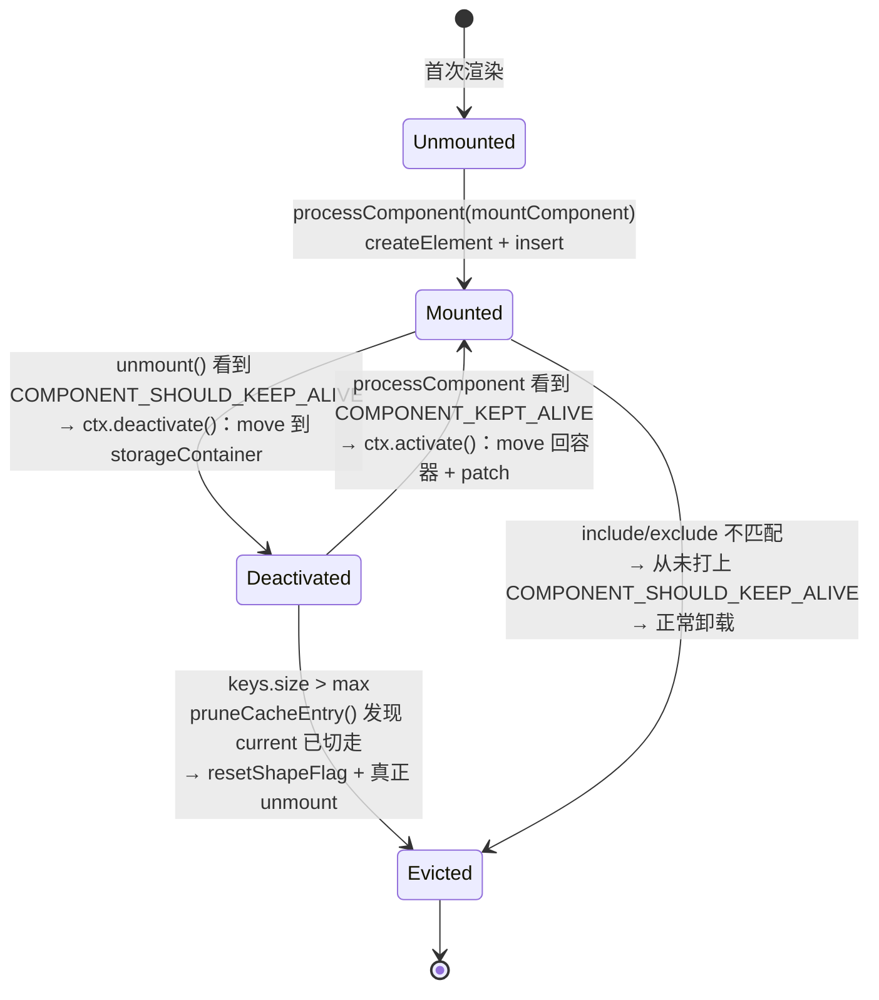
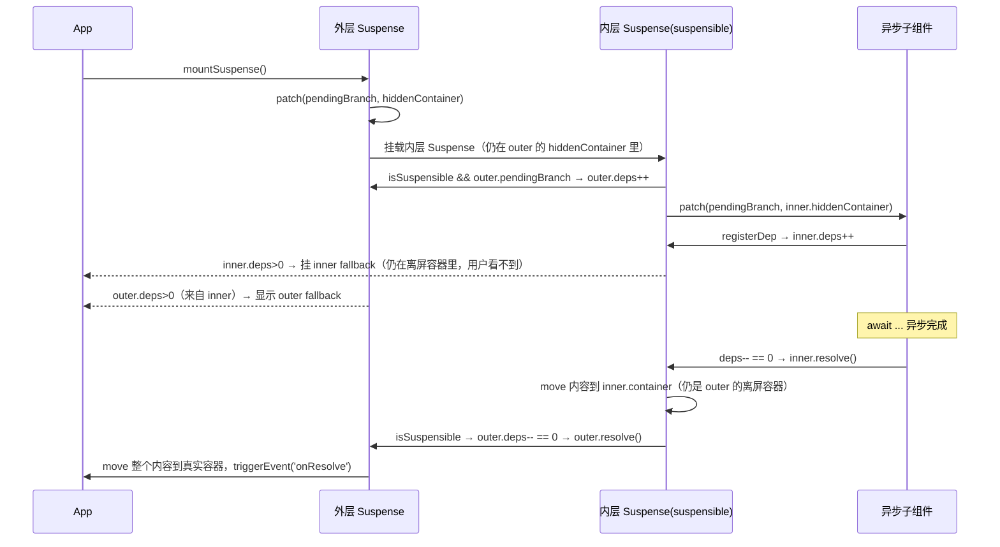
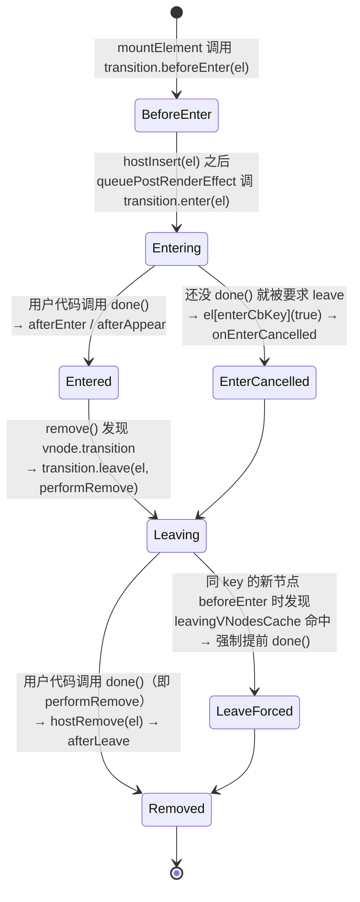

# 10. 内置组件：KeepAlive / Teleport / Suspense / Transition / 异步组件

> `KeepAlive`、`Teleport`、`Suspense`、`BaseTransition` 都不是普通组件——它们是渲染器认识的「特殊 vnode 类型」，直接改写 mount/unmount/move 的行为；而 `defineAsyncComponent` 则反过来，把一段异步逻辑伪装成一个普通组件。

## 本章导读

学完本章能回答：

- `KeepAlive` 切换子组件时，DOM 到底是被整个重建，还是只是“挪了个地方”？缓存满了之后淘汰的是真的 `unmount` 吗？
- `Teleport` 为什么能把内容渲染到 DOM 树的另一个位置，而组件实例的父子关系却完全不受影响？它在原位置留下了什么？
- `Suspense` 怎么知道“下面有几个异步组件还没好”？`fallback` 和真实内容是怎么并存又互不干扰的？
- 为什么 `<transition>` 能和任意 CSS 动画库配合，而不需要知道“动画”具体是什么？`done()` 回调在整个链路里起什么作用？
- `defineAsyncComponent` 包出来的组件，在有没有 `<Suspense>` 的两种场景下，实现路径完全不同，区别在哪？

前置章节：建议先读过 **06-component**（组件实例、生命周期）、**07-renderer-diff**（`patch`/`unmount`/`move` 的基本分派）、**08-scheduler**（`queuePostRenderEffect`、`nextTick`）。本章不会重新讲这些机制，只讲这几个内置组件如何“挂钩”进去。

涉及源码文件：

| 文件 | 作用 | 行数量级 |
|---|---|---|
| `packages/runtime-core/src/components/KeepAlive.ts` | 组件级缓存：cache/keys、activate/deactivate | ~490 行 |
| `packages/runtime-core/src/components/Teleport.ts` | 跨容器挂载/移动，占位注释节点 | ~600 行 |
| `packages/runtime-core/src/components/Suspense.ts` | 异步依赖收集、fallback 切换 | ~980 行 |
| `packages/runtime-core/src/components/BaseTransition.ts` | 平台无关的过渡状态机，产出 `TransitionHooks` | ~610 行 |
| `packages/runtime-core/src/apiAsyncComponent.ts` | `defineAsyncComponent` | ~290 行 |
| `packages/runtime-dom/src/components/Transition.ts` | 把 CSS 类名策略接到 `BaseTransition` 的钩子上 | ~480 行 |
| `packages/runtime-dom/src/components/TransitionGroup.ts` | 列表场景下的 FLIP 动画 | ~340 行 |
| `packages/runtime-core/src/renderer.ts` | `processComponent`/`unmount`/`move`/`remove` 里与上述组件配合的分支 | 本章只看相关片段 |

## 先跑起来

```bash
pnpm ex chapters/10-builtin-components/examples/01-keepalive-cache-lru.ts
pnpm ex chapters/10-builtin-components/examples/02-teleport-mount-and-move.ts
pnpm ex chapters/10-builtin-components/examples/03-suspense-flow.ts
pnpm ex chapters/10-builtin-components/examples/04-async-component-states.ts
pnpm ex chapters/10-builtin-components/examples/05-base-transition-hooks.ts
```

01 的关键输出（完整切换一轮 A → B → A）：

```
[mount A] 5 次宿主操作
   1. createElement(div) -> <div#2>
   2. createElement(div) -> <div#3>
   ...
   5. insert(<div#3> -> <root#1>)
cache keys = [ 'CompA' ]
手动把 CompA 的 count 改成 2 ...
切换到 B（A 应该被 deactivate：move 到 storageContainer，而不是 unmount）
[hook] CompA.deactivated (count=2)
[hook] CompB.mounted
[switch to B] 5 次宿主操作
   1. insert(<div#3> -> <div#2>)     // A 被 move 走，不是 remove
   2. createElement(div) -> <div#6>  // B 是全新 mount
   ...
再切回 A（应该命中缓存：activate 时只有 move，没有 createElement；count 还是 2）
[switch back to A] 2 次宿主操作
   1. insert(<div#6> -> <div#2>)     // B 被 move 进 storageContainer
   2. insert(<div#3> -> <root#1>)    // A 被 move 回来，没有 createElement
CompA.count after activate = 2
```

一句话点出看到了什么：**第二次看到 A，宿主操作里完全没有 `createElement`，只有 `insert`（代码里叫 `move`）**——组件实例、DOM 节点、内部状态全部复用，这就是 KeepAlive 和“用 `v-if` 简单切换”的本质区别。

02 的关键输出：

```
appRoot  HTML: <app-root>
  <div class="app">
    <p>main content</p>
    <!--teleport start-->
    <!--teleport end-->
  </div>
</app-root>
modalRoot HTML: <modal-root>
  <div class="modal">I am teleported</div>
</modal-root>
```

主视图里 `Teleport` 的位置只剩两个注释节点，内容真的被 `insert` 到了 `modalRoot` 里。

03 的关键输出（两个异步子组件 + `suspensible` 嵌套）：

```
刚 mount 完: deps=2 isInFallback=true pendingId=0
可见 HTML: <root><div>Loading...</div></root>
40ms 后（ChildA 已 resolve，ChildB 还没）: deps=1 isInFallback=true pendingId=0
[event] onResolve
100ms 后: deps=0 isInFallback=false pendingId=0
可见 HTML: <root><div><div class="ChildA">ChildA ready</div><div class="ChildB">ChildB ready</div></div></root>
```

`deps` 是从 `vnode.suspense`（`SuspenseBoundary` 对象）里直接读出来的真实计数器，不是推测。

04 的关键输出（`timeout` 比 `loader` 先到）：

```
[Vue warn]: Unhandled error during execution of async component loader
Error: Async component timed out after 30ms.
t=50ms（已超过 timeout=30ms，errorComponent 顶替上场）: <root><div class="error">加载出错：Async component timed out after 30ms.</div></root>
```

05 的关键输出（`mode="out-in"`）：

```
tab: A -> B（out-in：A 必须先 leave 完，B 才开始 enter）
[切换瞬间的宿主操作（这里不会 insert B，因为 B 还在等 A leave 完）] 2 次宿主操作
   1. createComment("") -> <!--#9-->
   2. insert(<!--#9--> -> <root#6>)
这期间 HTML（A 还占着位置，B 还没出现）: <root><div tag="A">tab A</div><!----></root>
[30ms 后：A leave 完成 -> afterLeave 触发重新渲染 -> B 才被 createElement+insert] 6 次宿主操作
```

A、B 两个分支**不会同时出现**在树里，中间用一个注释 vnode 顶着——这正是 `mode="out-in"` 和默认模式（两者短暂共存）的区别。

## 整体图

这五个东西在 `renderer.ts` 里的接入方式并不统一：KeepAlive 是“劫持 `shapeFlag` + 通过 `ctx` 注入回调”，Teleport/Suspense 是“整个 `process` 函数都自己写”，Transition 是“往 `vnode.transition` 挂一组钩子，由 renderer 在固定时机调用”，异步组件则完全不碰渲染器，只是在组件层“伪装”。

```mermaid
flowchart TB
    subgraph patch["patch(n1, n2, ...)"]
        direction TB
        A["processComponent"] -->|"n1==null && shapeFlag & COMPONENT_KEPT_ALIVE"| KA["parentComponent.ctx.activate(n2, ...)"]
        A -->|否则| MC["mountComponent / updateComponent"]
        B["shapeFlag & TELEPORT"] --> TP["TeleportImpl.process(..., internals)"]
        C["shapeFlag & SUSPENSE"] --> SP["SuspenseImpl.process(..., internals)"]
    end
    subgraph unmount["unmount(vnode, ...)"]
        direction TB
        D["shapeFlag & COMPONENT_SHOULD_KEEP_ALIVE?"] -->|是| KD["parentComponent.ctx.deactivate(vnode)<br/>(return，不走真正卸载)"]
        D -->|否| E["真正 unmountComponent / unmount children"]
    end
    subgraph mountElement["mountElement / remove / move"]
        direction TB
        F["vnode.transition 存在?"] -->|mount| G["transition.beforeEnter(el) → insert → transition.enter(el)"]
        F -->|unmount| H["transition.leave(el, performRemove)<br/>done() 之后才真正 hostRemove"]
    end
    KeepAliveComp["<KeepAlive> 组件自己的 setup()"] -. "把 activate/deactivate 写进<br/>instance.ctx" .-> KA
    KeepAliveComp -. ctx.deactivate .-> KD
    BaseTransitionComp["<BaseTransition> 组件自己的 setup()"] -. "resolveTransitionHooks()<br/>写进 vnode.transition" .-> F
    AsyncWrapper["defineAsyncComponent() 返回的<br/>AsyncComponentWrapper 组件"] -. "是一个普通组件，<br/>走 MC/updateComponent" .-> MC
```

要点：KeepAlive 和 Transition 都不直接出现在渲染器源码里（`renderer.ts` 从不 `import` 它们），而是靠 `vnode.shapeFlag` 上的标记位、`instance.ctx` 上的回调、`vnode.transition` 上的钩子对象这几个“松耦合接口”和渲染器打交道——这是为了**可 tree-shaking**：如果你的应用没用到 `<Teleport>`，构建产物里就不会包含 `Teleport.ts` 的代码，但 `renderer.ts` 仍然要能在运行时识别出“这是个 Teleport vnode”，所以用 `type.__isTeleport` 这种标记而不是 `===` 比较。Teleport/Suspense 则反过来，直接把自己的 `process` 方法等塞进 vnode 的 `type` 对象里，渲染器在分派时用 `(type as typeof TeleportImpl).process(...)` 调用，并把自己的内部方法（`internals`，即 `RendererInternals`）整体传进去——这是因为它们的挂载/更新逻辑太“非典型”（Teleport 要操作另一个容器；Suspense 要先 mount 到离屏容器），没法复用 `patch` 的默认流程。

## 源码精读

### 10.1 KeepAlive：用 move 代替 mount/unmount

#### 10.1.1 入口标记与 setup 骨架

```ts
// packages/runtime-core/src/components/KeepAlive.ts#L76-L100
export const isKeepAlive = (vnode: VNode): boolean =>
  (vnode.type as any).__isKeepAlive

const KeepAliveImpl: ComponentOptions = {
  name: `KeepAlive`,

  // Marker for special handling inside the renderer. We are not using a ===
  // check directly on KeepAlive in the renderer, because importing it directly
  // would prevent it from being tree-shaken.
  __isKeepAlive: true,

  props: {
    include: [String, RegExp, Array],
    exclude: [String, RegExp, Array],
    max: [String, Number],
  },

  setup(props: KeepAliveProps, { slots }: SetupContext) {
    const instance = getCurrentInstance()!
    // KeepAlive communicates with the instantiated renderer via the
    // ctx where the renderer passes in its internals,
    // and the KeepAlive instance exposes activate/deactivate implementations.
```

`KeepAlive` 从头到尾只是一个**名字和实现都很特殊的普通组件**：它的 `setup()` 正常执行、有自己的 `instance`，唯一特殊之处是它把 `activate`/`deactivate` 两个函数写回 `instance.ctx`（见下）。注释里说得很直白：之所以不在 `renderer.ts` 里 `import { KeepAlive } from './components/KeepAlive'` 再做 `===` 比较，是为了让没用到 `<KeepAlive>` 的应用可以把这部分代码摇掉。

#### 10.1.2 activate / deactivate：move 而不是 mount/unmount

```ts
// packages/runtime-core/src/components/KeepAlive.ts#L121-L195
const {
  renderer: {
    p: patch,
    m: move,
    um: _unmount,
    o: { createElement },
  },
} = sharedContext
const storageContainer = createElement('div')

sharedContext.activate = (vnode, container, anchor, namespace, optimized) => {
  const instance = vnode.component!
  move(vnode, container, anchor, MoveType.ENTER, parentSuspense)
  // in case props have changed
  patch(instance.vnode, vnode, container, anchor, instance, parentSuspense,
    namespace, vnode.slotScopeIds, optimized)
  queuePostRenderEffect(() => {
    instance.isDeactivated = false
    if (instance.a) invokeArrayFns(instance.a)
    // ... onVnodeMounted
  }, parentSuspense)
}

sharedContext.deactivate = (vnode: VNode) => {
  const instance = vnode.component!
  invalidateMount(instance.m)
  invalidateMount(instance.a)
  move(vnode, storageContainer, null, MoveType.LEAVE, parentSuspense)
  queuePostRenderEffect(() => {
    if (instance.da) invokeArrayFns(instance.da)
    // ... onVnodeUnmounted
    instance.isDeactivated = true
  }, parentSuspense)
}
```

`storageContainer` 是 KeepAlive 自己 `createElement('div')` 造出来的、**从来不会被插入真实 DOM 树**的容器——它只是“暂存区”。`deactivate` 把组件的根 DOM 节点 `move` 进这个暂存区（组件没有被卸载，事件监听、内部 `ref`、子组件全部原样保留），`activate` 再把它 `move` 回真正的容器，并且补一次 `patch`（因为父组件可能带了新的 props 下来）。`a`/`da` 分别是 `activated`/`deactivated` 生命周期回调数组（挂在 `instance` 上，命名参考 `m`=mounted、`bm`=beforeMount 这套缩写）。

#### 10.1.3 render 函数：匹配、缓存命中、LRU

```ts
// packages/runtime-core/src/components/KeepAlive.ts#L334-L376
const key = vnode.key == null ? comp : vnode.key
const cachedVNode = cache.get(key)

// clone vnode if it's reused because we are going to mutate it
if (vnode.el) {
  vnode = cloneVNode(vnode)
  // ...
}
pendingCacheKey = key

if (cachedVNode) {
  // copy over mounted state
  vnode.el = cachedVNode.el
  vnode.component = cachedVNode.component
  if (vnode.transition) setTransitionHooks(vnode, vnode.transition!)
  // avoid vnode being mounted as fresh
  vnode.shapeFlag |= ShapeFlags.COMPONENT_KEPT_ALIVE
  // make this key the freshest
  keys.delete(key)
  keys.add(key)
} else {
  keys.add(key)
  // prune oldest entry
  if (max && keys.size > parseInt(max as string, 10)) {
    pruneCacheEntry(keys.values().next().value!)
  }
}
// avoid vnode being unmounted
vnode.shapeFlag |= ShapeFlags.COMPONENT_SHOULD_KEEP_ALIVE
```

默认缓存 key 是**组件定义对象本身**（没写 `key` 的话），不是组件名字符串——这也是为什么 `include`/`exclude` 要单独按 `name` 过滤，两套机制互相独立。`keys` 是一个 `Set`，天然保持插入顺序；`Set.values().next().value` 就是“最旧的那个”。命中缓存时 `keys.delete(key); keys.add(key)` 这两行是整个 LRU 的核心——**把命中的 key 移到 Set 末尾**，所以 `max` 限制淘汰的永远是“最久没被访问”的那个，而不是“最早创建”的那个（见示例 01 第 3 节，`A → B → A → C` 时被淘汰的是 `B` 不是 `A`）。

`vnode.shapeFlag |= COMPONENT_SHOULD_KEEP_ALIVE` 这一位是关键的“跨函数传令”：它不是打在 KeepAlive 自己身上，而是打在**它的子 vnode**上，renderer.ts 的 `unmount()` 函数看到这一位就会把“卸载”改道成“调用 `ctx.deactivate`”（见 10.1.4）。`COMPONENT_KEPT_ALIVE` 则是打给 `processComponent` 看的，告诉它“这不是一次新 mount，去调用 `ctx.activate`”。两个标记一来一回，渲染器核心代码完全不需要知道 KeepAlive 的存在。

#### 10.1.4 renderer.ts 侧的配合

```ts
// packages/runtime-core/src/renderer.ts#L1196-L1219（processComponent）
if (n1 == null) {
  if (n2.shapeFlag & ShapeFlags.COMPONENT_KEPT_ALIVE) {
    ;(parentComponent!.ctx as KeepAliveContext).activate(
      n2, container, anchor, namespace, optimized,
    )
  } else {
    mountComponent(n2, container, anchor, parentComponent, parentSuspense, namespace, optimized)
  }
} else {
  updateComponent(n1, n2, optimized)
}
```

```ts
// packages/runtime-core/src/renderer.ts#L2211-L2214（unmount 内部）
if (shapeFlag & ShapeFlags.COMPONENT_SHOULD_KEEP_ALIVE) {
  ;(parentComponent!.ctx as KeepAliveContext).deactivate(vnode)
  return
}
```

`parentComponent.ctx` 这个字段平时是组件公共实例代理用的 `ComponentRenderContext`，KeepAlive 的 `setup()` 直接把它当作“跟父级（也就是自己）通信的信箱”来复用——`activate`/`deactivate` 写进去之后，任何以这个 KeepAlive 实例为 `parentComponent` 的子组件在 mount/unmount 时都能摸到这两个函数。这也解释了为什么 `onActivated`/`onDeactivated` 的钩子要“一路往上找最近的 KeepAlive 根”（见下一节）——信箱是按组件树挂的，不是全局的。

#### 10.1.5 onActivated/onDeactivated 怎么找到正确的 KeepAlive

```ts
// packages/runtime-core/src/components/KeepAlive.ts#L426-L462
function registerKeepAliveHook(hook, type, target = currentInstance) {
  const wrappedHook =
    hook.__wdc ||
    (hook.__wdc = () => {
      // only fire the hook if the target instance is NOT in a deactivated branch.
      let current: ComponentInternalInstance | null = target
      while (current) {
        if (current.isDeactivated) return
        current = current.parent
      }
      return hook()
    })
  injectHook(type, wrappedHook, target)
  if (target) {
    let current = target.parent
    while (current && current.parent) {
      if (isKeepAlive(current.parent.vnode)) {
        injectToKeepAliveRoot(wrappedHook, type, target, current)
      }
      current = current.parent
    }
  }
}
```

这里有两层防御：① `__wdc`（with deactivation check）包一层，防止组件嵌套在**已经被 deactivate 的祖先**里时，某次父级链路上的更新又误触发了子孙的 `activated`；② 额外把同一个 `wrappedHook` 注册到**所有祖先 KeepAlive 根**上（`injectToKeepAliveRoot`，`prepend: true`）——这样 KeepAlive 自己 `activate` 一个子树时，不需要递归遍历子树去找谁注册了 `onActivated`，直接触发“挂在自己身上”的那一份就行，是用“写时多存一份”换“读时不用遍历树”的典型空间换时间。



### 10.2 Teleport：原地留两个注释，内容搬到别处

#### 10.2.1 挂载：两个“锚点世界”

```ts
// packages/runtime-core/src/components/Teleport.ts#L178-L202
if (n1 == null) {
  // insert anchors in the main view
  const placeholder = (n2.el = __DEV__ ? createComment('teleport start') : createText(''))
  const mainAnchor = (n2.anchor = __DEV__ ? createComment('teleport end') : createText(''))
  insert(placeholder, container, anchor)
  insert(mainAnchor, container, anchor)

  if (isTeleportDeferred(n2.props) ||
      (__FEATURE_SUSPENSE__ && parentSuspense && parentSuspense.pendingBranch)) {
    queuePendingMount(n2)
    return
  }

  if (disabled) {
    mount(n2, container, mainAnchor)
    updateCssVars(n2, true)
  }
  mountToTarget()
}
```

```ts
// packages/runtime-core/src/components/Teleport.ts#L45-L76（resolveTarget）
const resolveTarget = <T = RendererElement>(
  props: TeleportProps | null,
  select: RendererOptions['querySelector'],
): T | null => {
  const targetSelector = props && props.to
  if (isString(targetSelector)) {
    if (!select) {
      // 需要 querySelector 这个 renderer option；logging-renderer 没实现，会走到这里
      __DEV__ && warn(/* ... */)
      return null
    } else {
      const target = select(targetSelector)
      // ... __DEV__ 下会在找不到目标时 warn
      return target as T
    }
  } else {
    // ... __DEV__ 下会在 targetSelector 为空时 warn
    return targetSelector as T // 直接把对象当目标用
  }
}
```

```ts
// packages/runtime-core/src/components/Teleport.ts#L576-L596（prepareAnchor）
function prepareAnchor(target, vnode, createText, insert) {
  const targetStart = (vnode.targetStart = createText(''))
  const targetAnchor = (vnode.targetAnchor = createText(''))
  targetStart[TeleportEndKey] = targetAnchor
  if (target) {
    insert(targetStart, target, anchor)
    insert(targetAnchor, target, anchor)
  }
  return targetAnchor
}
```

一次 Teleport 挂载其实留了**四个锚点**：主视图里的 `placeholder`/`mainAnchor`（`n2.el`/`n2.anchor`，开发模式下是注释 `<!--teleport start-->`/`<!--teleport end-->`，生产模式是空文本节点以省体积）；目标容器里的 `targetStart`/`targetAnchor`（两个空文本节点，不区分 DEV/PROD，因为用户看不到目标容器内部的实现细节）。真正的子内容永远 `insert` 在 `targetAnchor` 之前——这保证了以后再有新内容插入目标容器时，无论谁先谁后，Teleport 自己的内容范围边界始终清楚，这也是 `nextSibling` 搜索要跳过 `TeleportEndKey` 标记的原因（同一个物理容器里可能摆了好几个独立 Teleport 的内容，互不能越界）。

示例 02 的 `appRoot` 输出印证了这一点：`<div class="app">` 下面只有 `<p>` 和两个注释，内容完全不在这棵树里。

#### 10.2.2 为什么 disabled / `to` 切换只是 move，不是重新渲染

```ts
// packages/runtime-core/src/components/Teleport.ts#L260-L310（更新分支，节选）
if (disabled) {
  if (!wasDisabled) {
    // enabled -> disabled：挪回主容器
    moveTeleport(n2, container, mainAnchor, internals, TeleportMoveTypes.TOGGLE)
  }
} else {
  if ((n2.props && n2.props.to) !== (n1.props && n1.props.to)) {
    // to 变了：挪到新目标
    const nextTarget = resolveTarget(n2.props, querySelector)
    if (nextTarget) {
      n2.target = nextTarget
      moveTeleport(n2, nextTarget, null, internals, TeleportMoveTypes.TARGET_CHANGE)
    }
  } else if (wasDisabled) {
    // disabled -> enabled：挪到 target
    moveTeleport(n2, target, targetAnchor, internals, TeleportMoveTypes.TOGGLE)
  }
}
```

```ts
// packages/runtime-core/src/components/Teleport.ts#L378-L423（moveTeleport 节选）
function moveTeleport(vnode, container, parentAnchor, { o: { insert }, m: move }, moveType) {
  if (moveType === TeleportMoveTypes.TARGET_CHANGE) {
    if (vnode.targetStart) insert(vnode.targetStart, container, parentAnchor)
    insert(vnode.targetAnchor!, container, parentAnchor)
    parentAnchor = vnode.targetAnchor!
  }
  const { el, anchor, shapeFlag, children, props } = vnode
  const isReorder = moveType === TeleportMoveTypes.REORDER
  if (isReorder) insert(el!, container, parentAnchor)
  if (!pendingMounts.has(vnode) && (!isReorder || isTeleportDisabled(props))) {
    if (shapeFlag & ShapeFlags.ARRAY_CHILDREN) {
      for (let i = 0; i < (children as VNode[]).length; i++) {
        move((children as VNode[])[i], container, parentAnchor, MoveType.REORDER)
      }
    }
  }
  if (isReorder) insert(anchor!, container, parentAnchor)
}
```

`TeleportMoveTypes` 有三种：`TARGET_CHANGE`（`to` 变了）、`TOGGLE`（`disabled` 翻转）、`REORDER`（Teleport 本身在父级列表 diff 中被重新排序，比如外层是 `v-for`）。三种场景复用同一个 `move`（逐个子节点调用 renderer 的 `m: move`），**从不触碰子组件实例或 DOM 属性**，所以无论挪到哪、挪多少次，组件内部状态（`ref`、事件监听、动画状态）都原样保留。这和 KeepAlive 的 `move` 是同一个 renderer 内部函数（`renderer.ts` 的 `move: MoveFn`），只是调用的场景不同：KeepAlive 挪组件整体，Teleport 挪的是“挂在某个 vnode 下面的一组子节点”。

示例 02 第 3 节的输出也证明了这点：`to: A -> B` 只产生了 3 次 `insert`，完全没有 `createElement`。

#### 10.2.3 为什么 Teleport 要自己实现 `process`，而不是走 renderer 默认流程

`patch()` 默认的挂载/更新流程假设“vnode 对应的 DOM 子树和它在 vnode 树里的位置是重合的”——父 vnode 的 DOM 容器就是子 vnode 该去的地方。Teleport 打破了这个假设：它的“逻辑父级”（谁在 template 里包着它）和“DOM 父级”（`to` 指向哪）是两棵不同的树。renderer.ts 没法用同一套 `mountElement`/`patchElement`/`unmountComponent` 来处理“先确定目标容器，再决定要不要真的现在挂载（`defer`/`disabled`/`Suspense` 未 resolve 时还要 `queuePendingMount`）”这种分支爆炸的逻辑，于是干脆让 `TeleportImpl` 自己写一份完整的 `process`/`remove`/`move`/`hydrate`，renderer 只负责在看到 `shapeFlag & ShapeFlags.TELEPORT` 时把自己的 `internals`（即所有 host ops 和 `patch`/`unmount`/`move` 等内部函数的集合）整体转交过去：

```ts
// packages/runtime-core/src/renderer.ts#L476-L489
} else if (shapeFlag & ShapeFlags.TELEPORT) {
  ;(type as typeof TeleportImpl).process(
    n1 as TeleportVNode, n2 as TeleportVNode, container, anchor,
    parentComponent, parentSuspense, namespace, slotScopeIds, optimized,
    internals,
  )
} else if (__FEATURE_SUSPENSE__ && shapeFlag & ShapeFlags.SUSPENSE) {
  ;(type as typeof SuspenseImpl).process(/* 同样整体转交 internals */)
}
```

Suspense 是同样的理由（下一节）。`internals` 这个参数就是 `createRenderer` 内部那一大堆闭包函数（`patch`/`move`/`unmount`/host ops...）打包导出的对象——相当于渲染器给这两个“编外组件”开了个后门，让它们可以像渲染器自己一样操作宿主节点。

### 10.3 Suspense：离屏挂载 + 依赖计数

#### 10.3.1 SuspenseBoundary：一套完整的本地状态机

```ts
// packages/runtime-core/src/components/Suspense.ts#L438-L469
export interface SuspenseBoundary {
  vnode: VNode
  parent: SuspenseBoundary | null
  parentComponent: ComponentInternalInstance | null
  container: RendererElement        // 真实容器
  hiddenContainer: RendererElement  // 离屏容器（跟 KeepAlive 的 storageContainer 是同一种套路）
  activeBranch: VNode | null        // 当前真正显示的分支（fallback 或已 resolve 的内容）
  pendingBranch: VNode | null       // 正在离屏准备中的分支
  deps: number                      // 还没 resolve 的异步依赖个数
  pendingId: number                 // 每次重新进入 pending 状态都会 +1，用来丢弃过期回调
  timeout: number
  isInFallback: boolean
  isHydrating: boolean
  effects: Function[]               // resolve 之前积攒的 post effect，resolve 时统一 flush
  resolve(force?, sync?): void
  registerDep(instance, setupRenderEffect, optimized, namespace): void
  // ...
}
```

#### 10.3.2 mountSuspense：先离屏 patch，deps>0 才显示 fallback

```ts
// packages/runtime-core/src/components/Suspense.ts#L165-L228
function mountSuspense(vnode, container, anchor, parentComponent, parentSuspense,
  namespace, slotScopeIds, optimized, rendererInternals) {
  const { p: patch, o: { createElement } } = rendererInternals
  const hiddenContainer = createElement('div')
  const suspense = (vnode.suspense = createSuspenseBoundary(
    vnode, parentSuspense, parentComponent, container, hiddenContainer,
    anchor, namespace, slotScopeIds, optimized, rendererInternals,
  ))

  // start mounting the content subtree in an off-dom container
  patch(null, (suspense.pendingBranch = vnode.ssContent!), hiddenContainer, null,
    parentComponent, suspense, namespace, slotScopeIds)

  // now check if we have encountered any async deps
  if (suspense.deps > 0) {
    triggerEvent(vnode, 'onPending')
    triggerEvent(vnode, 'onFallback')
    patch(null, vnode.ssFallback!, container, anchor, parentComponent,
      null /* fallback tree 不挂 suspense 上下文 */, namespace, slotScopeIds)
    setActiveBranch(suspense, vnode.ssFallback!)
  } else {
    suspense.resolve(false, true)
  }
}
```

**关键在于 `patch` 调用的同步性**：`patch(null, vnode.ssContent, hiddenContainer, ...)` 是同步执行完的——里面如果有子组件的 `setup()` 返回了 Promise，`component.ts` 会把这个 Promise 存进 `instance.asyncDep`，`mountComponent` 看到 `instance.asyncDep` 就不会同步跑 `setupRenderEffect`（不会渲染真实内容），而是转去调用 `parentSuspense.registerDep(...)`（见 10.3.3）。所以 `patch()` 这一行调用结束后，`suspense.deps` 已经被每个异步子组件的 `registerDep` 累加好了，`mountSuspense` 只需要同步检查这个数字就知道要不要显示 `fallback`——**没有任何“先猜一下再纠正”的逻辑，完全是因为 JS 单线程、Promise 的 `.then` 一定要等到下一个微任务**。

对照示例 03 的输出：`mount` 这一步 `ChildA.setup()`/`ChildB.setup()` 的日志先打印（`setup()` 同步部分执行、`await` 让出控制权），然后是 `[event] onFallback`，最后才是可见 HTML——这就是“两个子组件的 setup 都先跑了一截、都把 Promise 挂进 asyncDep、`deps` 变成 2”之后，`mountSuspense` 才决定显示 fallback 的真实时序。

#### 10.3.3 registerDep：谁最后 resolve，谁负责喊 resolve()

```ts
// packages/runtime-core/src/components/Suspense.ts#L740-L809（节选）
registerDep(instance, setupRenderEffect, optimized, namespace) {
  const isInPendingSuspense = !!suspense.pendingBranch
  if (isInPendingSuspense) suspense.deps++
  instance.asyncDep!
    .catch(err => handleError(err, instance, ErrorCodes.SETUP_FUNCTION))
    .then(asyncSetupResult => {
      if (instance.isUnmounted || suspense.isUnmounted ||
          suspense.pendingId !== instance.suspenseId) {
        return // 组件 / suspense 已经失效，或者这是一次过期的 pending 周期
      }
      instance.asyncResolved = true
      handleSetupResult(instance, asyncSetupResult, false)
      setupRenderEffect(instance, vnode, parentNode(instance.subTree.el!)!,
        next(instance.subTree), suspense, namespace, optimized)
      // ...
      if (isInPendingSuspense && --suspense.deps === 0) {
        suspense.resolve()
      }
    })
},
```

`instance.asyncDep` 就是 `setup()` 返回的那个 Promise 本身。`registerDep` 先 `deps++`（占坑），等 Promise resolve 之后才真正调用 `handleSetupResult` + `setupRenderEffect`（这时候才会产生 `createElement` 之类的宿主操作，渲染出真实内容，但目标容器仍然是 `hiddenContainer`），然后 `deps--`。**谁的 `.then` 回调恰好让 `deps` 减到 0，谁就负责调用 `suspense.resolve()`**——不需要全局协调，纯靠计数器本身的单调性。`suspense.pendingId !== instance.suspenseId` 这行是防御“旧一轮 pending 的回调在新一轮开始后才姗姗来迟”，`pendingId` 每次重新进入 pending 都会自增，等于给每一轮 pending 发了个版本号。

#### 10.3.4 resolve：把内容从离屏容器搬到真实容器

```ts
// packages/runtime-core/src/components/Suspense.ts#L597-L620（节选）
if (activeBranch && !suspense.isFallbackMountPending) {
  if (parentNode(activeBranch.el!) === container) {
    anchor = next(activeBranch)
  }
  unmount(activeBranch, parentComponent, suspense, true) // 卸载 fallback
}
if (!delayEnter) {
  move(pendingBranch!, container, anchor, MoveType.ENTER) // 真正内容搬进来
}
```

`resolve()` 做的事情和 KeepAlive 的 `activate` 异曲同工：真正展示的内容早就在 `hiddenContainer` 里 patch 好了，`resolve` 只是把它 `move` 到 `container`，同时把原来的 `fallback`（`activeBranch`）卸载掉。`effects`（在 pending 期间通过 `queueEffectWithSuspense` 积攒下来的 post-flush 回调，比如子组件的 `onMounted`）会在这里统一 `queuePostFlushCb(effects)` 补发——这保证了“虽然子组件早就在离屏容器里渲染完了，但它的 `mounted` 钩子要等真正挂到可见 DOM 之后才触发”，语义上符合用户对 `mounted` 的预期（这时候 `el` 已经在真实文档里了，`getBoundingClientRect()` 之类的 API 才有意义）。

#### 10.3.5 suspensible：让嵌套的 Suspense 把自己算成外层的一个依赖

```ts
// packages/runtime-core/src/components/Suspense.ts#L505-L512
let parentSuspenseId: number | undefined
const isSuspensible = isVNodeSuspensible(vnode)
if (isSuspensible) {
  if (parentSuspense && parentSuspense.pendingBranch) {
    parentSuspenseId = parentSuspense.pendingId
    parentSuspense.deps++
  }
}
```

```ts
// packages/runtime-core/src/components/Suspense.ts#L973-L976
function isVNodeSuspensible(vnode: VNode) {
  const suspensible = vnode.props && vnode.props.suspensible
  return suspensible != null && suspensible !== false
}
```

一个 `suspensible: true` 的内层 `<Suspense>`，在**创建**（`createSuspenseBoundary`）的那一刻，如果外层正好处于 `pendingBranch` 阶段（也就是外层还在离屏 patch 自己的内容），就会把自己注册成外层的一个 `deps`。之后内层 `resolve()` 的末尾会对称地做 `parentSuspense.deps--`，归零则调用 `parentSuspense.resolve()`（见 10.3.4 之前的源码）。效果是：外层的 `fallback` 会一直显示到**内层也 resolve** 为止，用户不会看到“外层内容先出来、里面还嵌着一个内层 fallback”的两段式加载——这正是示例 03 第 2/3 节对比的内容：不开 `suspensible` 时，内层会在外层已经可见的 DOM 里自己再闪一次 `fallback`。



### 10.4 Transition：一套平台无关的状态机 + 平台相关的“翻译层”

#### 10.4.1 BaseTransition 只管「时机」，不管「动画」

```ts
// packages/runtime-core/src/components/BaseTransition.ts#L63-L78
export interface TransitionHooks<HostElement = RendererElement> {
  mode: BaseTransitionProps['mode']
  persisted: boolean
  beforeEnter(el: HostElement): void
  enter(el: HostElement): void
  leave(el: HostElement, remove: () => void): void
  clone(vnode: VNode): TransitionHooks<HostElement>
  afterLeave?(): void
  delayLeave?(el, earlyRemove, delayedLeave): void
  delayedLeave?(): void
}
```

`BaseTransition` 的 `setup()`（`packages/runtime-core/src/components/BaseTransition.ts#L148-L265`）每次渲染都调用 `resolveTransitionHooks()` 生成一份 `TransitionHooks`，`setTransitionHooks(innerChild, enterHooks)` 把它挂到子 vnode 的 `.transition` 字段上。renderer.ts 完全不知道“过渡”是什么，它只知道：挂载元素时如果 `vnode.transition` 存在就依次调用 `beforeEnter(el)`、插入、`enter(el)`；卸载/替换元素时调用 `leave(el, performRemove)` 并且**只有 `leave` 内部调用了 `remove` 回调之后才真正执行 `hostRemove`**。

```ts
// packages/runtime-core/src/renderer.ts#L747-L765（mountElement 节选）
const needCallTransitionHooks = needTransition(parentSuspense, transition)
if (needCallTransitionHooks) {
  transition!.beforeEnter(el)
}
hostInsert(el, container, anchor)
// ... 在 queuePostRenderEffect 里:  needCallTransitionHooks && transition!.enter(el)
```

```ts
// packages/runtime-core/src/renderer.ts#L2320-L2350（remove 节选）
const performRemove = () => {
  hostRemove(el!)
  if (transition && !transition.persisted && transition.afterLeave) transition.afterLeave()
}
if (leavingNode && transition && !transition.persisted) {
  const { leave, delayLeave } = transition
  const performLeave = () => leave(leavingEl, performRemove)
  delayLeave ? delayLeave(leavingEl, performRemove, performLeave) : performLeave()
} else {
  performRemove()
}
```

这就是示例 05 第 1 节看到的现象：`visible1.value = false` 之后立刻检查宿主操作是空的——节点既没有被 `remove`，也没有任何视觉变化（因为 `leave(el, done)` 钩子只是存起来 `done`，真正干活靠用户自己写的 `setTimeout`）；30ms 后用户代码调用 `done()`，`done` 内部才调用 `performRemove()` 触发 `hostRemove`。**renderer 把“什么时候可以真正移除节点”的决定权完全交给了过渡钩子**，这是整个过渡系统能够对接任意动画技术（CSS transition、CSS animation、Web Animations API、GSAP……）的根本原因：它只认一个 `done` 回调。

#### 10.4.2 out-in / in-out：谁等谁

```ts
// packages/runtime-core/src/components/BaseTransition.ts#L219-L232（out-in 节选）
if (mode === 'out-in' && innerChild.type !== Comment) {
  state.isLeaving = true
  leavingHooks.afterLeave = () => {
    state.isLeaving = false
    if (!(instance.job.flags! & SchedulerJobFlags.DISPOSED)) {
      instance.update()
    }
    delete leavingHooks.afterLeave
  }
  return emptyPlaceholder(child)
}
```

`out-in` 的实现思路很巧妙：当检测到“子节点类型变了”（比如 `tab` 从 A 切到 B），**本次 render 函数直接返回一个占位节点**（`emptyPlaceholder`，对 `KeepAlive` 特殊处理、否则就是外层已经渲染的旧节点本身，由 renderer 走正常 diff 流程把它的 `leave` 跑起来），同时把旧节点的 `leavingHooks.afterLeave` 改写成“等旧节点彻底 leave 完，再手动调用 `instance.update()` 强制重新渲染一次”。**新节点在旧节点的 leave 完成之前，根本不会出现在这次的渲染结果里**——所以 renderer 根本不知道有“in-out”这回事，只是老老实实处理了两次完全独立的 render。示例 05 第 2 节的宿主操作日志正是如此：切换瞬间只有一次 `insert` 注释占位，B 真正的 `createElement` 要等到 A 的 `leave` 结束、`afterLeave` 触发 `instance.update()` 之后才出现。

`in-out` 反过来：新节点先正常 enter，旧节点的卸载被 `delayLeave` 推迟，直到新节点 `enter` 的回调链里主动调用 `delayedLeave()`。两种模式的通用骨架相同，差别只在“谁的 `afterLeave`/`delayLeave` 被设置成等待谁”。

#### 10.4.3 runtime-dom 的 Transition：把钩子翻译成 CSS 类名操作

```ts
// packages/runtime-dom/src/components/Transition.ts#L245-L286（节选）
onLeave(el, done) {
  el._isLeaving = true
  const resolve = () => finishLeave(el, done)
  addTransitionClass(el, leaveFromClass)
  if (!el._enterCancelled) {
    forceReflow(el) // 强制触发一次 reflow，让 *-leave-from 立即生效
    addTransitionClass(el, leaveActiveClass)
  } else {
    addTransitionClass(el, leaveActiveClass)
    forceReflow(el)
  }
  nextFrame(() => {
    if (!el._isLeaving) return // 被取消了
    removeTransitionClass(el, leaveFromClass)
    addTransitionClass(el, leaveToClass)
    if (!hasExplicitCallback(onLeave)) whenTransitionEnds(el, type, leaveDuration, resolve)
  })
  callHook(onLeave, [el, resolve])
},
```

`runtime-dom` 的 `<Transition>` 组件本质是 `h(BaseTransition, resolveTransitionProps(props), slots)`（`packages/runtime-dom/src/components/Transition.ts#L87-L90`）——它不是另一个组件体系，只是给 `BaseTransition` 的 `onEnter`/`onLeave` 等 JS 钩子**生成了一套默认实现**：`enter-from`/`enter-active`/`enter-to` 这几个类名在 `nextFrame`（两次 `requestAnimationFrame`，确保浏览器先完成一次布局计算）的节奏下依次加减，真正判断“动画有没有结束”则是监听 `transitionend`/`animationend` 事件（`whenTransitionEnds`，内部用 `getTransitionInfo` 解析 `transition-duration`/`animation-duration` 取最长值，并且设置超时兜底防止事件丢失）。`vtcKey`（`el[vtcKey]`）记录当前过渡过程中临时加上去的类名集合，目的是让 `patchClass`（14 章）在过渡期间更新 `class` 属性时不会把这些临时类名覆盖掉——这是 runtime-core 和 runtime-dom 之间少数几处需要“双向感知”的地方。

#### 10.4.4 TransitionGroup：FLIP

```ts
// packages/runtime-dom/src/components/TransitionGroup.ts#L104-L148（节选）
onUpdated(() => {
  if (!willMove()) { prevChildren = []; return }
  prevChildren.forEach(callPendingCbs)
  prevChildren.forEach(c => recordPosition(c, shift)) // 记录「新位置」之前先记一遍，这是 Last
  const movedChildren = prevChildren.filter(applyTranslation) // 用 transform 瞬移回「旧位置」，这是 Invert
  forceReflow(instance.vnode.el as Node)
  movedChildren.forEach(c => {
    const el = c.el
    addTransitionClass(el, moveClass)
    el.style.transform = el.style.webkitTransform = el.style.transitionDuration = '' // 清空 transform，触发 Play
    // transitionend 时 removeTransitionClass(el, moveClass)
  })
})
```

`TransitionGroup` 不走 `BaseTransition` 的单子节点模式，而是用 `onUpdated` 这个普通生命周期钩子，在**列表 diff 已经完成、DOM 已经是新顺序**之后，用经典的 FLIP（First-Last-Invert-Play）技巧补一次位移动画：`recordPosition` 在 diff 前后各记录一次每个元素的 `getBoundingClientRect()`（First / Last），算出差值后立刻用 `transform` 把元素“拉回”旧位置（Invert，视觉上元素看起来完全没动），强制 `forceReflow` 让这次位移先同步生效，然后清空 `transform` 并加上 `moveClass`（通常只设置 `transition` 属性）——浏览器会在下一帧把元素从“视觉旧位置”平滑过渡到“真实新位置”（Play）。这套机制完全建立在 renderer 的 keyed diff 之上：`TransitionGroup` 根本不关心某个元素是新增、删除还是移动，它只关心“这一轮渲染前后，同一个 DOM 元素的坐标变了多少”。



### 10.5 异步组件：把“等待”包装成一个普通组件

```ts
// packages/runtime-core/src/apiAsyncComponent.ts#L120-L269（节选，省略 hydrate 相关）
return defineComponent({
  name: 'AsyncComponentWrapper',
  __asyncLoader: load,
  get __asyncResolved() { return resolvedComp },

  setup() {
    const instance = currentInstance!
    if (resolvedComp) return () => createInnerComp(resolvedComp!, instance)

    const onError = (err: Error) => {
      pendingRequest = null
      handleError(err, instance, ErrorCodes.ASYNC_COMPONENT_LOADER, !errorComponent)
    }

    // suspense-controlled or SSR.
    if ((__FEATURE_SUSPENSE__ && suspensible && instance.suspense) || /* SSR */ false) {
      return load()
        .then(comp => () => createInnerComp(comp, instance))
        .catch(err => { onError(err); return () => errorComponent ? createVNode(errorComponent, { error: err }) : null })
    }

    const loaded = ref(false), error = ref(), delayed = ref(!!delay)
    if (delay) delayTimer = setTimeout(() => { delayed.value = false }, delay)
    if (timeout != null) timeoutTimer = setTimeout(() => {
      if (!loaded.value && !error.value) { onError(new Error(`Async component timed out after ${timeout}ms.`)); error.value = err }
    }, timeout)

    load().then(() => { loaded.value = true }).catch(err => { onError(err); error.value = err })

    return () => {
      if (loaded.value && resolvedComp) return createInnerComp(resolvedComp, instance)
      if (error.value && errorComponent) return createVNode(errorComponent, { error: error.value })
      if (loadingComponent && !delayed.value) return createInnerComp(loadingComponent, instance)
    }
  },
})
```

`defineAsyncComponent` 的全部秘密就是：它返回的不是“某种特殊类型”，而是**一个名字叫 `AsyncComponentWrapper` 的、彻头彻尾的普通组件**，挂了几个约定的私有字段（`__asyncLoader`/`__asyncResolved`，给 `KeepAlive` 的 `isAsyncWrapper` 判断用，详见 10.1.3 的 `name` 查找逻辑）。它的行为完全由 `setup()` 内部的 `if` 分支决定，分成两条完全不同的路：

1. **在 `<Suspense>` 里且 `suspensible !== false`**：`setup()` 直接 `return load().then(...)`——也就是说这个组件的 `setup()` 自己也返回了一个 `Promise`！于是它会走 10.3.2 提到的 `instance.asyncDep` 分支，被外层 `Suspense` 当成一个异步依赖来 `registerDep`。`loading`/`delay`/`timeout`/`error` 这一整套状态机**完全不会被创建**（代码在 `return load().then(...)` 那一行就 `return` 了），全部交给 `Suspense` 的 `fallback` 统一处理。示例 04 第 4 节印证了这点：即使传了 `loadingComponent`，在 `<Suspense>` 环境下也完全用不上。
2. **没有 `<Suspense>`**：自己维护 `loaded`/`error`/`delayed` 三个 `ref`，配合 `delay`/`timeout` 两个定时器，`render` 函数按状态返回 `loading`/`error`/真实组件之一。`timeout` 定时器和 `load()` 的 `.then()` 是两条独立的异步链，谁先完成是纯粹的 race——示例 04 第 2 节 `timeout=30ms < loader 80ms` 就是故意让 `timeout` 赢。

`onError(err, retry, fail, attempts)` 的 `retry`/`fail` 是 `load()` 内部临时构造的 `Promise` 的 `resolve`/`reject`（见 `apiAsyncComponent.ts#L82-L93`）：`userOnError` 被调用时，`load()` 的 `.catch()` 链还**没有决出胜负**，用户调用 `retry()` 就是让这个临时 Promise `resolve(retry())`（即重新发起 `load()` 并把结果接力下去），调用 `fail()` 就是 `reject(err)` 把原始错误继续往下传。

## 与 Vue 2 对比

| 维度 | Vue 2 | Vue 3 | 为什么这么改 / 代价 |
|---|---|---|---|
| **KeepAlive 缓存内容** | `src/core/components/keep-alive.js`：`cache` 存 `vnode`，真正复用的是 `vnode.componentInstance`；靠 `vnode.data.keepAlive` 标记，在 `createComponent` 的 `init` patch 钩子里判断「已有 `componentInstance`」就直接走 `prepatch` 复用，而不会重新 `$mount` | `cache: Map<key, VNode>` + `keys: Set`；复用通过 `shapeFlag` 标记（`COMPONENT_KEPT_ALIVE`）让 `processComponent` 分流到 `ctx.activate`，本质仍是 `patch` 一次 + `move` | Vue 3 把“要不要重新创建”这件事从 patch 钩子的隐式判断，变成了 vnode 上的显式标记位，渲染器主流程不用对 KeepAlive 特判，可读性更好，也便于 tree-shaking |
| **activate/deactivate 的触发方式** | `activateChildComponent`/`deactivateChildComponent`（`src/core/instance/lifecycle.js`）递归遍历子组件树，手动调用每个子组件实例的钩子 | `queuePostRenderEffect` 调度，钩子查找靠 `registerKeepAliveHook` 在**注册时**就沿父链预先登记到所有祖先 KeepAlive 根，`activate` 时不需要遍历树 | 时间复杂度从“每次 activate 都遍历一次子树”变成“注册时登记一次，之后 O(1) 触发”；代价是多一层 `__wdc` 包装和多份引用需要在 `onUnmounted` 时清理 |
| **LRU 实现** | `pruneCacheEntry` 遍历普通对象 `cache`（`{}`），`keys` 是数组，`push`/`splice` 维护顺序 | `Map` + `Set`，`keys.delete(key); keys.add(key)` 利用 `Set` 保证插入序的特性做「刷新到最新」 | `Map`/`Set` 原生保证插入序且 `delete`+`add` 是 O(1)（数组 `splice` 是 O(n)），同时 key 可以是任意对象（组件定义本身），不需要转成字符串 |
| **Teleport** | 没有官方实现，社区用 `portal-vue` 之类的库，本质是手动操作 DOM + 自己管理一套 `Vue.extend` 出来的「假根实例」 | `Teleport.ts`：组件自己实现 `process`/`remove`/`move`，深度集成进 patch 流程，支持 `disabled`/`defer`/SSR hydration | 这是真正意义上的新能力，而不是“改了实现方式”；代价是 renderer.ts 必须开放 `internals` 这个相对庞大的内部接口给它 |
| **Suspense** | 没有官方实现（`vue-async-manager` 等三方方案，或者手写 `v-if` + loading 状态） | `Suspense.ts`：离屏容器 + `deps` 计数 + `registerDep` | 同上，新能力。设计上明确标注“实验性”（源码里 `createSuspenseBoundary` 还在用 `console.info` 提醒），API 在 3.x 生命周期里确实发生过调整 |
| **Transition 单元素** | `platforms/web/runtime/modules/transition.js` 的 `enter`/`leave` 函数直接在 patch 的 `create`/`remove`/`activate` 钩子里调用，和「CSS 类名」「`transitionend` 监听」耦合在同一个文件里 | 拆成两层：`BaseTransition.ts`（平台无关的状态机，产出 `{beforeEnter,enter,leave,...}`）+ `runtime-dom/components/Transition.ts`（把这些钩子实现成 CSS 类名操作）。renderer.ts 只认 `vnode.transition` 这个统一接口 | 分层之后，`runtime-core` 的单元测试、非 DOM 渲染器（比如小程序/Canvas 渲染器）都能复用同一套「enter/leave 时机控制」，不需要重新发明 `mode`/`appear`/取消逻辑 |
| **Transition 的组件实现方式** | `platforms/web/runtime/components/transition.js`：一个 `functional` 组件，`render` 里手工 `mergeVNodeHook` 把过渡钩子函数混进子 vnode 的 `data.hook` | `Transition` 是 `h(BaseTransition, resolveTransitionProps(props), slots)`，钩子通过标准的 `vnode.transition` 字段传递，不是 `hook` 合并 | Vue 2 的 `mergeVNodeHook` 本质是在往 `vnode.data.hook` 上叠加回调，命名和合并逻辑都比较隐晦；Vue 3 把“过渡钩子”单独开了一个一等字段，渲染器判断起来更直接 |
| **TransitionGroup** | `platforms/web/runtime/components/transition-group.js`，同样是 FLIP，但位置记录用 `_initialStyle`/`newPos`/`oldPos` 直接挂在 `vnode.data` 上 | `TransitionGroup.ts` 用模块级 `WeakMap<VNode, Position>`（`positionMap`/`newPositionMap`）记录坐标 | 用 `WeakMap` 代替在 vnode/data 上挂私有字段，减少对 vnode 结构本身的侵入，也顺带解决了内存泄漏问题（`WeakMap` 的 key 被回收后条目自动消失） |
| **异步组件** | `resolveAsyncComponent`（`src/core/vdom/helpers/resolve-async-component.js`）在 `createComponent` 内联处理：工厂函数的返回值、`component.resolved`/`component.loading`/`component.error` 缓存在**工厂函数对象自己身上**，`forceRender` 通过 `$forceUpdate` 让父组件重新走一次 `createComponent` 来「切换」展示内容 | `defineAsyncComponent` 包装成一个真正的组件（`AsyncComponentWrapper`），状态用标准的 `ref`，渲染靠组件自身重新 render，不需要父组件 `forceUpdate` | Vue 3 的方式让异步组件可以独立于父组件参与 diff（有自己的 `type`、可以被 `<KeepAlive>`/`<Suspense>` 正确识别），Vue 2 的「工厂函数挂状态 + 强制父组件重渲染」更像一个补丁式的实现 |
| **与 Suspense 的协同** | 无 `Suspense` 概念，异步组件只能走自己的 `loading`/`error` 插槽（Vue 2.6+ 的 `component: () => ({ component: import(...), loading, error, delay, timeout })`） | 有 `<Suspense>` 时整个状态机被跳过，`setup()` 直接返回 `load().then(...)` 把异步性“过继”给 Suspense | 统一了「等待」的语义：不管是异步组件还是 `async setup()`，对 `Suspense` 来说都只是「`instance.asyncDep` 是不是一个 Promise」这一件事 |

## 动手：实验

本章没有新增 `mini-vue` 文件（这几个内置组件的实现和真实渲染器的接口耦合很深，拆成 mini 实现意义不大），建议直接在 `examples/` 的文件基础上改：

1. **KeepAlive**：在示例 01 的基础上，把 `max` 改成 `0` 或不传，观察 `pruneCacheEntry` 的 `max && keys.size > parseInt(...)` 判断——`max` 为 `undefined` 时这个条件恒为 `false`，缓存会无限增长，试着证明这一点（连续切换 20 个不同组件，打印 `cache.size`）。
2. **Teleport**：把示例 02 改成同一个 `Teleport` 的 `to` 在三个 `createRoot()` 之间循环切换，并在某次切换时顺带把 `disabled` 也切换，观察 `moveTeleport` 走的是 `TARGET_CHANGE` 还是 `TOGGLE`（提示：看 `Teleport.ts#L260-L310` 的分支条件，两个变化**不会同时处理**，想想如果 `to` 和 `disabled` 同一次 render 一起变会发生什么）。
3. **Suspense**：在示例 03 的嵌套场景里，把内层 `AsyncChildC` 的 `setup()` 改成直接 `throw`（同步抛错，不 `await`），看看 `registerDep` 的 `.catch()` 分支和 `handleError` 是怎么把这个错误往上传的，`onResolve` 还会不会触发。
4. **Transition**：在示例 05 第 3 节的基础上，把 `onLeave` 也加一个 50ms 延时，让「旧元素还没走完」时又快速切回 `visible=true`，触发 `beforeEnter` 里 `el[leaveCbKey](true)` 的分支（这是和「同 key 不同元素」不一样的「同一个元素反复横跳」场景），对比两种取消路径触发的钩子有什么不同。

## 常见疑问

**Q: `<KeepAlive>` 包裹的组件，`beforeUnmount`/`unmounted` 还会触发吗？**
不会，第一次被 `deactivate` 时触发的是 `deactivated`，真正的 `unmounted` 只在缓存被淘汰（`pruneCacheEntry`）或 `<KeepAlive>` 自己被卸载（`onBeforeUnmount` 遍历 `cache` 调用 `unmount`）时才会触发。见 `KeepAlive.ts#L265-L279`。

**Q: `include`/`exclude` 为什么是按组件 `name` 匹配，而不是组件对象本身？**
因为用户写 `include="Foo"` 的意图是“名字叫 Foo 的组件”，而不是“某个具体的 import 对象”——尤其是异步组件场景下，`vnode.type` 在 resolve 前后是不同的对象（`AsyncComponentWrapper` vs 真实组件），只有 `name` 是稳定可读的标识。源码里专门处理了这种情况：`isAsyncWrapper(vnode) ? vnode.type.__asyncResolved || {} : comp`（`KeepAlive.ts#L314-L320`）。

**Q: Teleport 的内容算谁的子组件？`provide`/`inject` 还能正常工作吗？**
算原来父级的子组件——Teleport 只搬运 DOM，组件树（`parentComponent`）完全不变，所以 `inject` 找到的还是 template 里的真实祖先，和内容被渲染到哪个物理 DOM 位置无关。

**Q: Suspense 的 `timeout` 和异步组件自己的 `timeout` 是一回事吗？**
不是。`<Suspense timeout="3000">` 控制的是“切换到 `fallback` 这件事本身要不要延迟”（`patchSuspense` 更新场景下给一点缓冲，避免网络稍微卡一下就猛地闪回 loading），而 `defineAsyncComponent({ timeout })` 是“加载本身超过多久算失败”。两者在 `<Suspense>` 包裹异步组件时是并存的两套独立机制。

**Q: 为什么 `mode="out-in"` 切换时，中间会有一瞬间什么都不显示？**
因为它是真实的“等旧的彻底走完，再开始显示新的”，不是过渡层面的视觉技巧。如果旧节点的 `leave` 动画本身比较长，中间空白期会很明显——这也是为什么很多 UI 库会在 `out-in` 中间插一个 loading 占位，而不是依赖默认行为。

**Q: `defineAsyncComponent` 的 `loadingComponent` 在 `<Suspense>` 里为什么完全不显示？**
看 10.5 节：在 `<Suspense>` 且 `suspensible !== false` 时，`setup()` 直接 `return load().then(...)`，`loaded`/`delayed` 这些 `ref` 根本没有被创建，`loadingComponent` 这个 `if` 分支的代码在类型上存在，但永远不会被执行到。

## 小结

- KeepAlive、Teleport、Suspense 都不是“语法糖”，而是改写了 `processComponent`/`unmount`/`patch` 的分派路径；它们和渲染器之间用 `shapeFlag` 标记位、`instance.ctx` 回调、`vnode.transition` 钩子对象这类“松耦合接口”通信，核心目的是保持可 tree-shaking。
- KeepAlive 的本质是“用 `move` 代替 `mount`/`unmount`”，`cache`(Map) + `keys`(Set) 组成一个插入序可控的 LRU；命中缓存时 `keys.delete + add` 是整个淘汰策略的关键一步。
- Teleport 在原地留两个注释锚点（`teleport start`/`teleport end`），在目标容器留两个文本锚点（`targetStart`/`targetAnchor`），内容搬运靠 `moveTeleport` 的三种 `TeleportMoveTypes`，组件树完全不受影响。
- Suspense 先把内容 `patch` 到离屏容器，同步统计 `deps`；`registerDep` 让每个异步组件自己在 resolve 后 `deps--`，归零者负责调用 `resolve()` 把内容 `move` 到真实容器。`suspensible` 让嵌套 Suspense 可以把自己注册成外层的一个依赖，合并 fallback 展示。
- BaseTransition 只管“什么时候可以真正 remove/何时调用 enter”，具体动画实现（CSS 类名/`transitionend`）由 runtime-dom 的 `Transition.ts` 单独实现；两者通过 `TransitionHooks`（`beforeEnter/enter/leave/...`）这套接口解耦。`mode="out-in"` 的实现是让旧节点 render 返回占位符、靠 `afterLeave` 手动 `instance.update()`，renderer 对“模式”本身一无所知。
- `TransitionGroup` 用经典 FLIP 手法在 `onUpdated` 钩子里补一次位移动画，完全建立在 renderer 的 keyed diff 已经产出的“最终 DOM 顺序”之上。
- `defineAsyncComponent` 把“等待”伪装成一个真正的组件：有 `Suspense` 时 `setup()` 自己返回 Promise，交给 Suspense 的 `registerDep` 机制；没有时用三个 `ref`（`loaded`/`error`/`delayed`）配合两个定时器自管理状态机。

## 延伸阅读

- Suspense 官方文档（明确标注“实验性功能”）：<https://cn.vuejs.org/guide/built-ins/suspense.html>
- Teleport 官方文档：<https://cn.vuejs.org/guide/built-ins/teleport.html>
- Transition 官方文档（含 `mode`/`appear`/JS 钩子完整列表）：<https://cn.vuejs.org/guide/built-ins/transition.html>
- TransitionGroup 官方文档：<https://cn.vuejs.org/guide/built-ins/transition-group.html>
- KeepAlive 官方文档：<https://cn.vuejs.org/guide/built-ins/keep-alive.html>
- `defineAsyncComponent` 官方文档：<https://cn.vuejs.org/guide/components/async.html>
- Vue 3 源码仓库（本章对照的具体版本）：<https://github.com/vuejs/core/tree/v3.5.44/packages/runtime-core/src/components>

## 思考题

1. KeepAlive 的 `cache` 默认用组件定义对象做 key，如果同一个异步组件被 `defineAsyncComponent` 包了两次（两个不同的 `AsyncComponentWrapper` 对象，但 `loader` 完全一样），它们会被当成同一个缓存条目吗？为什么？

   <details><summary>答案</summary>

   不会。`key = vnode.key == null ? comp : vnode.key`，这里的 `comp` 就是 `vnode.type`（`AsyncComponentWrapper` 对象本身）。两次调用 `defineAsyncComponent()` 会产出两个不同的 `defineComponent({...})` 返回值（JS 对象恒等性不同），哪怕内部 `loader` 函数逻辑完全一样，`cache.get(key)` 也不会命中——除非用户显式给 `v-for`/手写 vnode 传同一个 `key`。

   </details>

2. 为什么 Suspense 的 `pendingId` 要在 `patchSuspense` 检测到“切换到完全不同类型的分支”时自增（`suspense.pendingId = suspenseId++`），而不是只在 `mountSuspense` 时设置一次？

   <details><summary>答案</summary>

   因为一个 `Suspense` 组件的生命周期里可能发生多轮 pending：第一轮异步内容还没 resolve，用户又导航到了另一个完全不同的异步分支（`isSameVNodeType` 为 `false`）。这时候第一轮注册的 `registerDep` 回调迟早会 resolve，如果不通过 `pendingId` 失效，它的 `.then()` 回调执行时会检查 `suspense.pendingId !== instance.suspenseId` 发现不匹配而直接 `return`，避免“过期的第一轮内容”污染已经切换到第二轮的 UI。

   </details>

3. `BaseTransition` 的 `leave(el, remove)` 钩子签名里，`remove` 这个参数到底是谁传进来的？如果用户写的 `onLeave` 钩子完全不调用 `done()`，会发生什么？

   <details><summary>答案</summary>

   `remove` 就是 renderer.ts `remove()` 函数里的 `performRemove`（见 10.4.1）。`resolveTransitionHooks` 产出的 `leave(el, remove)` 内部会把这个 `remove` 包装成 `el[leaveCbKey]`，再传给用户的 `onLeave(el, done)` 当作 `done`。如果用户的钩子既不显式声明两个参数（`hook.length <= 1` 时源码会自动调用一次 `done()`，见 `callAsyncHook`），也不是这种情况（即声明了 `(el, done)` 两个参数却从不调用 `done`），那么 `hostRemove` 永远不会被调用，该 DOM 节点会永久停留在文档里，造成内存/DOM 泄漏——这是过渡钩子最常见的实践坑。

   </details>
