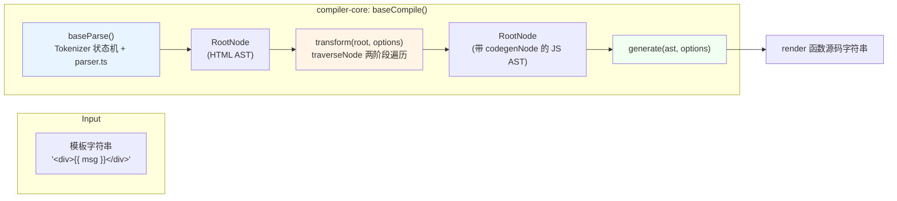
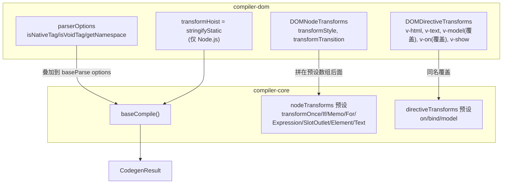

# 11. compiler-core：parse → transform → codegen

> 模板字符串怎么变成一个 `render` 函数：词法状态机、两阶段遍历的 AST 变换、以及按需生成的 JS 代码。

## 本章导读

学完本章，你应该能回答：

- `compile('<div>{{ msg }}</div>')` 这一行代码，内部依次调用了哪些函数？`baseCompile`、`getBaseTransformPreset`、`transform`、`generate` 各自负责什么？
- compiler-core 和 compiler-dom 的边界在哪里？为什么 `v-model`/`v-on` 在两边都有一份实现？
- 3.4 为什么把 parser 从"正则 + 递归下降"重写成状态机 tokenizer？两者本质区别是什么？
- `transform()` 里 `traverseNode` 的"进入/退出"两阶段设计解决了什么问题？为什么 exitFns 要倒序执行？
- 同一个模板，`mode: 'function'` 和 `mode: 'module'`、`prefixIdentifiers: true/false` 编译出来的代码分别长什么样，为什么会不一样？

前置章节：建议先看过第 01 章（整体架构）。本章不要求读过运行时章节，但第 05/07 章（vnode、renderer diff）里提到的 patchFlag/Block 会在第 12 章详细展开，本章只是"埋下线索"。预计阅读时间：70~90 分钟。

涉及源码文件：

| 文件 | 作用 | 行数量级 |
|---|---|---|
| `compiler-core/src/compile.ts` | `baseCompile` 总入口、`getBaseTransformPreset` 拼装 transform 列表 | 122 |
| `compiler-core/src/tokenizer.ts` | 词法状态机（3.4 重写，移植自 htmlparser2） | 1197 |
| `compiler-core/src/parser.ts` | 消费 tokenizer 的回调，组装 AST | 1079 |
| `compiler-core/src/ast.ts` | 所有 AST 节点类型定义 + 工厂函数 | 897 |
| `compiler-core/src/transform.ts` | `TransformContext`、`traverseNode`、结构型指令框架 | 520 |
| `compiler-core/src/codegen.ts` | AST(JS AST) → 代码字符串 | 1118 |
| `compiler-core/src/transforms/transformExpression.ts` | `prefixIdentifiers` 模式下给表达式加前缀 | 421 |
| `compiler-dom/src/index.ts` | compiler-dom 的 `compile()`：叠加 DOM 专属 parserOptions/transforms | 78 |
| `compiler-dom/src/parserOptions.ts` | `isNativeTag`/`isVoidTag`/`getNamespace` 等平台细节 | 69 |

## 先跑起来

```bash
pnpm ex chapters/11-compiler-core/examples/01-parse-ast.ts
```

关键输出（节选，完整见 `examples/01-parse-ast.ts` 运行结果）：

```
┌────────────────────────────────────── 1. 基础元素 / 属性 / 指令 / 插值
│  1. 解析一个常见模板
ROOT
  ELEMENT <div> [ELEMENT] props={id="app" v-bind:class="cls" v-on:click="onClick" v-if="visible"} codegenNode=(none)
    INTERPOLATION {{ msg }}
```

一眼能看到的事实：`id="app"` 被解析成 `ATTRIBUTE`，而 `:class`/`@click`/`v-if` 全部被解析成统一的 `DIRECTIVE` 节点（`name` 字段分别是 `bind`/`on`/`if`，区别只在 `arg`）——**parse 阶段还没有"内置指令"和"用户指令"的区别，这是 transform 阶段才关心的事**。另外注意此刻 `codegenNode` 还是 `(none)`：parse 只产出"HTML AST"，`codegenNode`（"JS AST"）要等 transform 跑完才会出现，这是本章要讲的第二条主线。

再跑一个运行时例子，直接看"编译产物真的能跑"：

```bash
pnpm ex chapters/11-compiler-core/examples/05-run-compiled-render.ts
```

```
[update 触发的宿主操作（只应该有 patchProp(class) 和 setElementText）] 2 次宿主操作
   1. patchProp(<div#2>, class: null -> "dark")
   2. setElementText(<div#2>, "count: 1")
```

两次 `render()` 调用之间，`@vue/runtime-core` 的 `patch()` 只做了两件事——这就是 patchFlag 在起作用（第 12 章详细拆）。

本章全部示例（`chapters/11-compiler-core/examples/`，都能用 `pnpm ex <路径>` 直接跑）：

| 示例 | 内容 |
|---|---|
| `01-parse-ast.ts` | printAST 打印多种模板的 AST：元素/属性/指令/插值/注释/文本压缩/v-pre/textarea vs script |
| `02-parse-edge-cases.ts` | whitespace condense vs preserve、实体解码、onError 收集错误而不中断解析 |
| `03-transform-pipeline.ts` | 自定义 nodeTransform 验证 enter/exit 顺序、`context.helper`/`replaceNode` |
| `04-codegen-modes.ts` | `mode`/`prefixIdentifiers`/`bindingMetadata` 对生成代码的影响 |
| `05-run-compiled-render.ts` | compile → `new Function` → logging-renderer 实际渲染+更新 |
| `06-custom-directive-transform.ts` | 自定义 `directiveTransforms`/`nodeTransforms` 扩展点 |

## 整体图





这张图对应 `compiler-dom/src/index.ts#L42-65` 的 `compile()` 函数：它不重新实现 parse/transform/codegen，而是把 DOM 专属的 `parserOptions`、`DOMNodeTransforms`、`DOMDirectiveTransforms` 通过 `extend()` 叠加/覆盖到 `baseCompile` 上。**compiler-core 不知道"浏览器""HTML"这些概念**，它处理的是一个平台无关的模板语法超集；"这个标签是不是原生标签""属性该怎么标准化"这些问题全部通过 `options` 注入，这正是 Vue 3 能同时支持 Web/小程序/自定义渲染器编译的关键设计。

## 源码精读

### 2.1 baseCompile：三步走

```ts
// packages/compiler-core/src/compile.ts#L67-121
export function baseCompile(
  source: string | RootNode,
  options: CompilerOptions = {},
): CodegenResult {
  const onError = options.onError || defaultOnError
  const isModuleMode = options.mode === 'module'
  // ...
  const prefixIdentifiers =
    !__BROWSER__ && (options.prefixIdentifiers === true || isModuleMode)
  if (!prefixIdentifiers && options.cacheHandlers) {
    onError(createCompilerError(ErrorCodes.X_CACHE_HANDLER_NOT_SUPPORTED))
  }
  // ...
  const ast = isString(source) ? baseParse(source, resolvedOptions) : source
  const [nodeTransforms, directiveTransforms] =
    getBaseTransformPreset(prefixIdentifiers)

  transform(ast, extend({}, resolvedOptions, {
    nodeTransforms: [...nodeTransforms, ...(options.nodeTransforms || [])],
    directiveTransforms: extend({}, directiveTransforms, options.directiveTransforms || {}),
  }))

  return generate(ast, resolvedOptions)
}
```

三行话能说完：`baseParse` 把字符串变成 AST；`transform` 原地改造这棵 AST（挂上 `codegenNode`，顺便改写 `helpers`/`components`/`hoists` 等 root 上的元信息）；`generate` 读这棵 AST 吐出代码字符串。`source` 既可以是字符串也可以直接是一个已经 parse 好的 `RootNode`——这给了 compiler-sfc 这样的上层调用者插手 AST 的机会（比如先自己 parse，插入一些自定义节点，再丢给 `transform`）。

`prefixIdentifiers` 的计算值得多看一眼：**它不是一个单纯的用户选项，而是 `mode: 'module'` 的隐含推论**（`options.prefixIdentifiers === true || isModuleMode`）。这是因为 ES Module 顶层没有 `with` 语句可用，模板里的裸标识符 `msg` 必须显式改写成 `_ctx.msg` 才能在生成的 `render` 函数里正确取值——详见 2.6 节。

`getBaseTransformPreset` 决定了 `nodeTransforms` 数组的固定顺序：

```ts
// packages/compiler-core/src/compile.ts#L32-63
return [
  [
    transformVBindShorthand,
    transformOnce,
    transformIf,
    transformMemo,
    transformFor,
    ...(__COMPAT__ ? [transformFilter] : []),
    ...(!__BROWSER__ && prefixIdentifiers
      ? [trackVForSlotScopes, transformExpression] // order is important
      : __BROWSER__ && __DEV__ ? [transformExpression] : []),
    transformSlotOutlet,
    transformElement,
    trackSlotScopes,
    transformText,
  ],
  { on: transformOn, bind: transformBind, model: transformModel },
]
```

这个顺序不是随便排的（第 12 章会逐条解释"为什么必须是这个顺序"），这里先记住三个关键点：

1. **结构型指令（v-once/v-if/v-memo/v-for）排最前面**。它们会把当前节点整体替换成别的节点类型（`ElementNode` → `IfNode`/`ForNode`），必须在其它 transform 还没来得及读取这个节点之前就完成替换。
2. **`transformExpression` 只在非浏览器构建 + `prefixIdentifiers` 开启时才会被加入**（或者是浏览器 DEV 模式用于校验表达式语法，不做真正的改写）。
3. **`transformElement` 和 `transformText` 排最后**。它们的真正工作发生在"退出"阶段（下面会看到为什么），需要别的 transform 已经把 `props`/`children` 处理完。

### 2.2 tokenizer.ts：3.4 重写的状态机

3.3 及更早版本的 parser 是"正则匹配找到下一个 `<` 或 `{{`，截取子串，递归下降"；3.4 整体移植了 [htmlparser2](https://github.com/fb55/htmlparser2) 的做法，改成一个**不依赖正则、逐字符扫描**的有限状态机。动机很直接：正则在长文本上有回溯开销，而且每次都要重新 `indexOf`/`slice`，状态机只需要一次线性扫描，内存分配也更少（不需要为每一次子串匹配都创建临时字符串）。

状态枚举（节选，完整在 `tokenizer.ts#L85-134`）：

```ts
export enum State {
  Text = 1,
  InterpolationOpen, Interpolation, InterpolationClose,
  BeforeTagName, InTagName, InSelfClosingTag,
  BeforeClosingTagName, InClosingTagName, AfterClosingTagName,
  BeforeAttrName, InAttrName, InDirName, InDirArg, InDirDynamicArg, InDirModifier,
  AfterAttrName, BeforeAttrValue, InAttrValueDq, InAttrValueSq, InAttrValueNq,
  BeforeDeclaration, InDeclaration, InProcessingInstruction,
  BeforeComment, CDATASequence, InSpecialComment, InCommentLike,
  BeforeSpecialS, BeforeSpecialT, SpecialStartSequence, InRCDATA,
  InEntity, InSFCRootTagName,
}
```

`InDirName`/`InDirArg`/`InDirModifier` 这几个状态专门为 Vue 模板语法准备——htmlparser2 原版没有"指令"概念。当扫描到属性名以 `v-`/`:`/`@`/`#`/`.` 开头时，tokenizer 会切换进这几个状态，分段识别出指令名、参数、修饰符，再通过回调分别通知 parser：

```ts
// packages/compiler-core/src/tokenizer.ts#L180-206（Callbacks 接口节选）
export interface Callbacks {
  ontext(start: number, endIndex: number): void
  oninterpolation(start: number, endIndex: number): void
  onopentagname(start: number, endIndex: number): void
  onattribname(start: number, endIndex: number): void
  ondirname(start: number, endIndex: number): void
  ondirarg(start: number, endIndex: number): void
  ondirmodifier(start: number, endIndex: number): void
  onattribend(quote: QuoteType, endIndex: number): void
  oncomment(start: number, endIndex: number): void
  // ...
}
```

tokenizer **完全不知道"AST"是什么**，它只管识别词法单元并喊一声回调——这是经典的"扫描器/解析器分离"设计。真正把这些回调拼装成 `AttributeNode`/`DirectiveNode` 的逻辑在 `parser.ts` 里，是一组闭包状态变量（`currentOpenTag`/`currentProp`/`currentAttrValue`）：

```ts
// packages/compiler-core/src/parser.ts#L201-233（节选）
ondirname(start, end) {
  const raw = getSlice(start, end)
  const name =
    raw === '.' || raw === ':' ? 'bind' :
    raw === '@' ? 'on' :
    raw === '#' ? 'slot' : raw.slice(2)
  // ...
  currentProp = {
    type: NodeTypes.DIRECTIVE,
    name, rawName: raw, exp: undefined, arg: undefined,
    modifiers: raw === '.' ? [createSimpleExpression('prop')] : [],
    loc: getLoc(start),
  }
  if (name === 'pre') {
    inVPre = tokenizer.inVPre = true
    // 把此前已经解析出的指令统统转回普通属性
    // ...
  }
},
```

这里有个容易被忽略的细节：`:id` 的简写（3.4 新增）被当成 `v-bind` 处理，而不是单独开一个指令类型；`.id`（v-bind 同名简写修饰符简写）直接在 `name === '.'` 时预置一个 `prop` 修饰符——这是为什么示例 01 里能看到 `:class` 被打印成 `v-bind:class` 的原因。

文本压缩逻辑同样值得一读：

```ts
// packages/compiler-core/src/parser.ts#L837-861（节选）
function condenseWhitespace(nodes: TemplateChildNode[]): TemplateChildNode[] {
  const shouldCondense = currentOptions.whitespace !== 'preserve'
  for (let i = 0; i < nodes.length; i++) {
    const node = nodes[i]
    if (node.type === NodeTypes.TEXT) {
      if (!inPre) {
        if (isAllWhitespace(node.content)) {
          const prev = nodes[i - 1]?.type, next = nodes[i + 1]?.type
          if (!prev || !next ||
              (shouldCondense && (
                (prev === NodeTypes.COMMENT && (next === NodeTypes.COMMENT || next === NodeTypes.ELEMENT)) ||
                (prev === NodeTypes.ELEMENT && (next === NodeTypes.COMMENT ||
                  (next === NodeTypes.ELEMENT && hasNewlineChar(node.content))))))) {
            nodes[i] = null as any // 删除
          } else {
            node.content = ' ' // 压成一个空格
          }
        } else if (shouldCondense) {
          node.content = condense(node.content) // 连续空白压成一个
        }
      }
    }
  }
  return removedWhitespace ? nodes.filter(Boolean) : nodes
}
```

规则比"删掉所有空白"复杂：首尾的空白文本直接删；夹在两个元素之间、且**包含换行符**的纯空白文本也删（因为这通常是缩进排版产生的，不是作者想要的内容）；其余的空白文本压缩成一个空格（保留"inline 元素之间需要一个空格分隔"这种语义）。`examples/02-parse-edge-cases.ts` 用 `whitespace: 'preserve'` 对比跑了一遍，能直接看到两种模式的输出差异。

`<textarea>`/`<title>` 是 RCDATA（tokenizer 术语：Raw Character Data），和 `<script>`/`<style>` 的"纯文本"不是一回事——源码里专门写了注释说明：

```ts
// packages/compiler-core/src/tokenizer.ts#L452-461
if (
  this.currentSequence === Sequences.TitleEnd ||
  (this.currentSequence === Sequences.TextareaEnd && !this.inSFCRoot)
) {
  // We have to parse entities in <title> and <textarea> tags.
  if (!__BROWSER__ && c === CharCodes.Amp) { this.startEntity() }
  else if (!this.inVPre && c === this.delimiterOpen[0]) {
    // We also need to handle interpolation
    this.state = State.InterpolationOpen
    // ...
  }
} else if (this.fastForwardTo(CharCodes.Lt)) {
  // Outside of <title> and <textarea> tags, we can fast-forward.
  this.sequenceIndex = 1
}
```

`<textarea>{{ msg }}</textarea>` 里的 `{{ msg }}` **真的会被解析成插值**（这点容易猜错，笔者最初也猜反了，靠 `examples/01-parse-ast.ts` 的真实输出纠正）；而 `<script>`/`<style>` 走的是 `fastForwardTo` 快进扫描，内部文本原样保留，`{{ }}` 不会被当插值处理。

### 2.3 ast.ts：HTML AST 与 JS AST 共用一套节点体系

`NodeTypes` 是一个贯穿全书的大枚举：

```ts
// packages/compiler-core/src/ast.ts#L29-58
export enum NodeTypes {
  ROOT, ELEMENT, TEXT, COMMENT,
  SIMPLE_EXPRESSION, INTERPOLATION, ATTRIBUTE, DIRECTIVE,
  // containers
  COMPOUND_EXPRESSION, IF, IF_BRANCH, FOR, TEXT_CALL,
  // codegen
  VNODE_CALL, JS_CALL_EXPRESSION, JS_OBJECT_EXPRESSION, JS_PROPERTY,
  JS_ARRAY_EXPRESSION, JS_FUNCTION_EXPRESSION, JS_CONDITIONAL_EXPRESSION, JS_CACHE_EXPRESSION,
  // ssr codegen
  JS_BLOCK_STATEMENT, JS_TEMPLATE_LITERAL, JS_IF_STATEMENT,
  JS_ASSIGNMENT_EXPRESSION, JS_SEQUENCE_EXPRESSION, JS_RETURN_STATEMENT,
}
```

注意这个枚举分了三段注释："containers"（解析阶段产出，但需要进一步展开成别的东西的中间节点，比如 `IF`/`FOR`）、"codegen"（纯粹为了生成代码而存在的 JS AST 节点，模板语法里没有直接对应）、"ssr codegen"（只有 SSR 编译才用得到）。**这就是"HTML AST 与 JS AST 分层"的字面证据**：`ElementNode`/`TextNode`/`InterpolationNode` 描述的是"模板长什么样"，`VNodeCall`/`CallExpression`/`ObjectExpression` 描述的是"要生成什么 JS 代码"——一个 `ElementNode` 在 transform 之后会同时拥有这两种身份：它自己还是 `ElementNode`（`type` 字段不变），但多了一个 `codegenNode: VNodeCall` 字段，codegen 阶段只认 `codegenNode`，不再关心原始的 `tag`/`props`/`children`。

`ElementTypes` 区分"这个标签编译出来应该是什么"：

```ts
// packages/compiler-core/src/ast.ts#L63-68
export enum ElementTypes {
  ELEMENT,    // 原生标签，tag 编译成字符串字面量 "div"
  COMPONENT,  // 组件，tag 编译成 resolveComponent(...) 或已知的组件引用
  SLOT,       // <slot>，编译成 renderSlot(...)
  TEMPLATE,   // <template>，自身不产出 vnode，只是语法容器
}
```

`VNodeCall` 是整章最重要的一个 JS AST 节点，`transformElement`/`vIf`/`vFor` 最终都是在构造它：

```ts
// packages/compiler-core/src/ast.ts#L318-340（节选）
export interface VNodeCall extends Node {
  type: NodeTypes.VNODE_CALL
  tag: string | symbol | CallExpression
  props: PropsExpression | undefined
  children: TemplateChildNode[] | TemplateTextChildNode | SlotsExpression
    | ForRenderListExpression | SimpleExpressionNode | CacheExpression | undefined
  patchFlag: PatchFlags | undefined
  dynamicProps: string | SimpleExpressionNode | undefined
  directives: DirectiveArguments | undefined
  isBlock: boolean
  disableTracking: boolean
  isComponent: boolean
}
```

`tag` 的类型是 `string | symbol | CallExpression` 这件事本身就在讲故事：普通元素是字符串字面量（生成时会原样输出 `"div"`）；内置的 `Fragment`/`Teleport`/`Suspense` 是 `symbol`（生成时会查 `helperNameMap` 换成 `_Fragment` 这样的别名）；动态组件 `<component :is="x">` 是一个 `CallExpression`（`resolveDynamicComponent(x)`）。`isBlock`/`disableTracking` 两个布尔值就是第 12 章 Block tree 的起点——本章只需要知道它们存在，具体语义留到下一章。

`createVNodeCall` 工厂函数顺手把 helper 的登记也做了：

```ts
// packages/compiler-core/src/ast.ts#L627-653（节选）
export function createVNodeCall(context, tag, props, children, patchFlag, dynamicProps,
  directives, isBlock = false, disableTracking = false, isComponent = false, loc = locStub) {
  if (context) {
    if (isBlock) {
      context.helper(OPEN_BLOCK)
      context.helper(getVNodeBlockHelper(context.inSSR, isComponent))
    } else {
      context.helper(getVNodeHelper(context.inSSR, isComponent))
    }
    if (directives) context.helper(WITH_DIRECTIVES)
  }
  return { type: NodeTypes.VNODE_CALL, tag, props, children, patchFlag, dynamicProps, directives, isBlock, disableTracking, isComponent, loc }
}
```

这是个很实用的模式：**"构造一个 AST 节点"和"登记这个节点需要哪些运行时 helper"合并成一步**，调用方不需要自己记得"用了 block 就要调 `context.helper(OPEN_BLOCK)`"，工厂函数替你做了。`transform.ts` 一节会看到 `context.helper()` 具体是怎么被 codegen 消费的。

`ConstantTypes` 是贯穿第 12 章 cacheStatic 的核心概念，这里先留一个印象：

```ts
// packages/compiler-core/src/ast.ts#L215-221
export enum ConstantTypes {
  NOT_CONSTANT = 0,
  CAN_SKIP_PATCH,
  CAN_CACHE,
  CAN_STRINGIFY,
}
```

数值越大代表"越能被优化"，且高等级隐含低等级（注释原文："Higher levels implies lower levels. e.g. a node that can be stringified can always be hoisted and skipped for patch."）。本章的 parser/transform/codegen 都不关心具体数值，只是把每个表达式节点的 `constType` 字段设置好；真正读取并做决策的是第 12 章的 `cacheStatic.ts`。

### 2.4 transform.ts：两阶段遍历

`TransformContext` 是整个 transform 阶段的"全局状态"，`createTransformContext` 创建它：

```ts
// packages/compiler-core/src/transform.ts#L128-154（节选，省略默认值展开）
export function createTransformContext(root, {
  prefixIdentifiers = false, hoistStatic = false, cacheHandlers = false,
  nodeTransforms = [], directiveTransforms = {}, transformHoist = null,
  bindingMetadata = EMPTY_OBJ, onError = defaultOnError, /* ... */
}) {
  const context: TransformContext = {
    // options 原样透传
    prefixIdentifiers, hoistStatic, cacheHandlers, nodeTransforms, directiveTransforms, transformHoist, bindingMetadata, onError,
    // state
    root, helpers: new Map(), components: new Set(), directives: new Set(),
    hoists: [], imports: [], cached: [], temps: 0,
    identifiers: Object.create(null),
    scopes: { vFor: 0, vSlot: 0, vPre: 0, vOnce: 0 },
    parent: null, grandParent: null, currentNode: root, childIndex: 0, inVOnce: false,
    helper(name) { /* Map 计数 +1 */ },
    removeHelper(name) { /* Map 计数 -1，归零则删除 */ },
    replaceNode(node) { context.parent!.children[context.childIndex] = context.currentNode = node },
    removeNode(node) { /* 从 parent.children 里 splice 掉，并维护 childIndex */ },
    hoist(exp) { /* push 进 context.hoists，返回一个 _hoisted_N 的 SimpleExpressionNode 引用 */ },
    cache(exp, isVNode, inVOnce) { /* push 进 context.cached，返回一个 CacheExpression */ },
  }
  return context
}
```

`helpers` 用 `Map<symbol, number>` 而不是 `Set`：因为同一个 helper 可能被多处用到，`removeHelper`（比如 v-if 把子节点从"普通 vnode"升级成"block"时，要把原来的 `createElementVNode` helper 计数减一，换成 `openBlock`/`createElementBlock`）需要知道"减到 0 才真的移除"，用 `Set` 做不到这件事。`scopes` 记录当前遍历深度处在几层 `v-for`/`v-slot`/`v-pre`/`v-once` 里面——这是后面 `transformExpression`/`buildSlots` 判断"要不要把这个节点强制标记成动态"的依据。

`transform()` 本体和 `traverseNode` 是本节的核心：

```ts
// packages/compiler-core/src/transform.ts#L425-486
export function traverseNode(node, context) {
  context.currentNode = node
  const { nodeTransforms } = context
  const exitFns = []
  for (let i = 0; i < nodeTransforms.length; i++) {
    const onExit = nodeTransforms[i](node, context)
    if (onExit) {
      if (isArray(onExit)) exitFns.push(...onExit)
      else exitFns.push(onExit)
    }
    if (!context.currentNode) return // 节点被移除
    else node = context.currentNode  // 节点可能被替换
  }

  switch (node.type) {
    case NodeTypes.COMMENT: /* helper(CREATE_COMMENT) */ break
    case NodeTypes.INTERPOLATION: /* helper(TO_DISPLAY_STRING) */ break
    case NodeTypes.IF:
      for (let i = 0; i < node.branches.length; i++) traverseNode(node.branches[i], context)
      break
    case NodeTypes.IF_BRANCH:
    case NodeTypes.FOR:
    case NodeTypes.ELEMENT:
    case NodeTypes.ROOT:
      traverseChildren(node, context)
      break
  }

  // exit transforms（倒序！）
  context.currentNode = node
  let i = exitFns.length
  while (i--) { exitFns[i]() }
}
```

这是全章最值得反复看的一段代码。拆成三步：

1. **进入（enter）**：依次调用 `nodeTransforms` 数组里的每一个函数。每个 transform 可以选择返回一个"退出回调"（也可以什么都不返回）。进入阶段结束后，`exitFns` 数组里存的是"这一层按注册顺序排列的退出回调"。
2. **递归**：按节点类型决定要不要往下钻（`IF` 要特殊处理，因为它的"children"是 `branches`，不是普通的 `children` 数组）。
3. **退出（exit）**：**倒序**执行 `exitFns`。

为什么是倒序？因为"先注册的 transform，它关心的信息往往要等后注册的 transform 处理完子节点之后才齐全"。具体到 `getBaseTransformPreset` 的顺序：`transformIf`（第 3 个注册）的退出回调需要用到 `transformElement`（第 9 个注册）给子节点生成好的 `codegenNode`（`vIf.ts` 的 `createChildrenCodegenNode` 直接读 `child.codegenNode`）——如果不是倒序，`transformIf` 的退出逻辑会在 `transformElement` 还没来得及给子节点生成 `codegenNode` 之前就执行，读到的会是 `undefined`。`examples/03-transform-pipeline.ts` 用两个自定义 transform（排在数组最前 `myFirst` 和最后 `myLast`）实测了一遍：

```
[
  'enter:myFirst(ROOT)',   'enter:myLast(ROOT)',
  'enter:myFirst(ELEMENT)','enter:myLast(ELEMENT)',
  'enter:myFirst(INTERPOLATION)', 'enter:myLast(INTERPOLATION)',
  'exit:myLast(INTERPOLATION)',  'exit:myFirst(INTERPOLATION)',
  'exit:myLast(ELEMENT)',        'exit:myFirst(ELEMENT)',
  'exit:myLast(ROOT)',           'exit:myFirst(ROOT)'
]
```

`myFirst` 最先进入，但因为它排在 `exitFns[0]`，倒序遍历时反而最后被取到，所以最后退出——"后进先出"，和函数调用栈的直觉是一致的。

`createStructuralDirectiveTransform` 是结构型指令（v-if/v-for）的公共基础设施：

```ts
// packages/compiler-core/src/transform.ts#L488-520
export function createStructuralDirectiveTransform(name, fn) {
  const matches = isString(name) ? (n) => n === name : (n) => name.test(n)
  return (node, context) => {
    if (node.type === NodeTypes.ELEMENT) {
      const { props } = node
      if (node.tagType === ElementTypes.TEMPLATE && props.some(isVSlot)) return
      const exitFns = []
      for (let i = 0; i < props.length; i++) {
        const prop = props[i]
        if (prop.type === NodeTypes.DIRECTIVE && matches(prop.name)) {
          props.splice(i, 1); i--  // 先摘除，避免死循环 / 被当成普通指令处理
          const onExit = fn(node, prop, context)
          if (onExit) exitFns.push(onExit)
        }
      }
      return exitFns
    }
  }
}
```

关键细节：匹配到的指令会**立刻从 `props` 数组里摘除**，而且是在调用 `fn`（也就是 `processIf`/`processFor`）之前摘除。这样做有两个好处：一是避免 `transformElement` 后续把 `v-if`/`v-for` 当成普通属性塞进 `createElementVNode` 的 props 对象；二是避免如果 `fn` 内部又把节点重新插入树里（`v-if`/`v-for` 都会这么做），再次被同一个 `createStructuralDirectiveTransform` 扫到造成无限递归。

### 2.5 codegen.ts：按需导入 helper、With 块 vs 显式前缀

`generate()` 的骨架：

```ts
// packages/compiler-core/src/codegen.ts#L283-335（节选）
export function generate(ast, options = {}) {
  const context = createCodegenContext(ast, options)
  const { mode, push, prefixIdentifiers, indent, deindent, scopeId, ssr } = context
  const useWithBlock = !prefixIdentifiers && mode !== 'module'

  if (mode === 'module') genModulePreamble(ast, context, genScopeId, isSetupInlined)
  else genFunctionPreamble(ast, context)

  const functionName = ssr ? 'ssrRender' : 'render'
  const args = ssr ? ['_ctx', '_push', '_parent', '_attrs'] : ['_ctx', '_cache']
  if (options.bindingMetadata && !options.inline) args.push('$props', '$setup', '$data', '$options')

  push(`function ${functionName}(${args.join(', ')}) {`)
  indent()
  if (useWithBlock) {
    push('with (_ctx) {'); indent()
    if (hasHelpers) push(`const { ${helpers.map(aliasHelper).join(', ')} } = _Vue\n`)
  }
  // ... genAssets(components/directives) ...
  push('return ')
  ast.codegenNode ? genNode(ast.codegenNode, context) : push('null')
  if (useWithBlock) { deindent(); push('}') }
  deindent(); push('}')
  return { ast, code: context.code, preamble, map }
}
```

`useWithBlock` 这一行是整章最关键的一个判断：**只有"非 module 模式 + 没开 prefixIdentifiers"才会用 `with`**。这正对应浏览器里直接 `new Function()` 跑编译产物的场景——此时没有构建工具帮你做静态分析，`with (_ctx) { ... }` 让模板里写的每一个裸标识符（`msg`、`onClick`）运行时自动去 `_ctx` 上找，不需要编译期就知道它到底是 `data`/`props`/`setup` 里的哪一种绑定。代价是 `with` 语句在严格模式下"看上去"要做运行时属性查找（实际上 V8 对这种模式有专门优化路径，但依然不如静态绑定快），而且 ESLint/TypeScript 都不允许出现在普通业务代码里——所以构建工具编译时永远走 `mode: 'module'` + `prefixIdentifiers: true`，彻底不用 `with`。

`genFunctionPreamble` 展示了"for the record"级别的细节：**helper 的 const 解构被放在 `with` 块内部**，而不是函数顶部：

```ts
// packages/compiler-core/src/codegen.ts#L408-465（节选）
function genFunctionPreamble(ast, context) {
  const VueBinding = ssr ? `require("vue")` : runtimeGlobalName // 浏览器里是 "Vue"
  if (helpers.length > 0) {
    if (!__BROWSER__ && prefixIdentifiers) {
      push(`const { ${helpers.map(aliasHelper).join(', ')} } = ${VueBinding}\n`)
    } else {
      // "with" mode：先把 Vue 存到 _Vue，helper 解构放进 with 块里（下面能看到）
      push(`const _Vue = ${VueBinding}\n`)
      if (ast.hoists.length) {
        // hoists 是在 with 块外面生成的常量，但它们可能引用 createVNode 之类的 helper，
        // 所以这里要在 with 块外也声明一份"静态 helper"
        const staticHelpers = [CREATE_VNODE, CREATE_ELEMENT_VNODE, CREATE_COMMENT, CREATE_TEXT, CREATE_STATIC]
          .filter(h => helpers.includes(h)).map(aliasHelper).join(', ')
        push(`const { ${staticHelpers} } = _Vue\n`)
      }
    }
  }
  genHoists(ast.hoists, context)
  push('return ')
}
```

注释写得很直白："in 'with' mode, helpers are declared inside the with block to avoid has check cost"——如果把 `const { _createVNode } = Vue` 放在 `with` 块外面，`with` 内部每次访问 `_createVNode` 这种以 `_` 开头的标识符时，JS 引擎依然要先对 `_ctx` 做一次 `in` 判断（`with` 语句的语义就是"先查对象上有没有这个属性，没有才按正常作用域链查找"），放进 `with` 块内部可以利用"块内声明的变量在作用域链上比 `with` 对象更靠内层"这件事，直接命中词法作用域，不用过一遍 `has` 检查。

`genVNodeCall` 是生成 `createElementVNode(...)`/`createElementBlock(...)` 调用的地方：

```ts
// packages/compiler-core/src/codegen.ts#L817-878（节选）
function genVNodeCall(node, context) {
  const { tag, props, children, patchFlag, dynamicProps, directives, isBlock, disableTracking, isComponent } = node
  let patchFlagString
  if (patchFlag) {
    // __DEV__ 下会在数字后面拼一段 /* TEXT, CLASS */ 注释，方便调试
  }
  if (directives) push(helper(WITH_DIRECTIVES) + '(')
  if (isBlock) push(`(${helper(OPEN_BLOCK)}(${disableTracking ? 'true' : ''}), `)
  const callHelper = isBlock ? getVNodeBlockHelper(context.inSSR, isComponent) : getVNodeHelper(context.inSSR, isComponent)
  push(helper(callHelper) + '(')
  genNodeList(genNullableArgs([tag, props, children, patchFlagString, dynamicProps]), context)
  push(')')
  if (isBlock) push(')')
  if (directives) { push(', '); genNode(directives, context); push(')') }
}
```

`genNullableArgs` 负责把参数列表尾部连续的 `undefined`/`null` 砍掉——这就是为什么 `<div>hello</div>` 编译出来是 `createElementBlock("div", null, "hello")` 而不是 `createElementBlock("div", null, "hello", undefined, undefined)`。`patchFlag` 字符串在开发模式下会拼一段 `/* TEXT, CLASS */` 的注释（`chapters/11.../examples/05-run-compiled-render.ts` 的真实输出里能看到 `3 /* TEXT, CLASS */`），这完全是给人读的调试信息，生产构建（`__DEV__` 为 false）不会生成。

最后看 `genCacheExpression`，第 12 章会反复用到它：

```ts
// packages/compiler-core/src/codegen.ts#L1015-1044（节选）
function genCacheExpression(node, context) {
  const { needPauseTracking, needArraySpread } = node
  if (needArraySpread) push('[...(')
  push(`_cache[${node.index}] || (`)
  if (needPauseTracking) {
    indent()
    push(`${helper(SET_BLOCK_TRACKING)}(-1${node.inVOnce ? ', true' : ''}),`)
    push('(')
  }
  push(`_cache[${node.index}] = `)
  genNode(node.value, context)
  if (needPauseTracking) {
    push(`).cacheIndex = ${node.index},`)
    push(`${helper(SET_BLOCK_TRACKING)}(1),`)
    push(`_cache[${node.index}]`)
  }
  push(')')
  if (needArraySpread) push(')]')
}
```

最简单的形态就是 `_cache[n] || (_cache[n] = <value>)`——经典的"惰性初始化 + 缓存"写法：第一次渲染时 `_cache[n]` 是 `undefined`（`_cache` 由组件实例持有，初始是一个空数组），走右边表达式求值并存进 `_cache[n]`；后续每次渲染只要 `_cache[n]` 已经有值，`||` 短路，直接复用同一个对象引用——**render 函数每次都会重新执行，但这个子表达式的值"钉"在了实例级别的 `_cache` 数组里，不会随每次 render 重新创建**。`needPauseTracking` 分支是 v-once 专用的更复杂形态（配合 `setBlockTracking` 临时关闭依赖收集），第 12 章会结合真实产物细看。

### 2.6 transformExpression.ts：谁来决定前缀

`processExpression` 只在 `context.prefixIdentifiers` 为真时才会真正改写表达式——浏览器直接运行的场景完全跳过这个函数（2.5 节已经解释了为什么用 `with` 代替）：

```ts
// packages/compiler-core/src/transforms/transformExpression.ts#L105-125（节选）
export function processExpression(node, context, asParams = false, asRawStatements = false, localVars = Object.create(context.identifiers)) {
  if (__BROWSER__) {
    if (__DEV__) validateBrowserExpression(node, context, asParams, asRawStatements)
    return node // 浏览器构建：不改写，只在 DEV 下做语法校验
  }
  if (!context.prefixIdentifiers || !node.content.trim()) return node
  // ...
}
```

真正决定前缀的是 `rewriteIdentifier`，`bindingMetadata` 在这里被消费：

```ts
// packages/compiler-core/src/transforms/transformExpression.ts#L218-234（节选，非 inline 模式）
} else {
  if ((type && type.startsWith('setup')) || type === BindingTypes.LITERAL_CONST) {
    return `$setup.${raw}`
  } else if (type === BindingTypes.PROPS_ALIASED) {
    return `$props['${bindingMetadata.__propsAliases![raw]}']`
  } else if (type) {
    return `$${type}.${raw}` // BindingTypes.DATA -> $data.xxx, OPTIONS -> $options.xxx ...
  }
}
// fallback to ctx
return `_ctx.${raw}`
```

没有传 `bindingMetadata`（或者某个标识符查不到对应的 binding 类型）时，一律落到 `_ctx.${raw}`——这是最保守也最通用的策略，`render(_ctx, _cache, $props, $setup, $data, $options)` 这组参数（`generate()` 里 `args.push('$props', '$setup', '$data', '$options')`）只有在传了 `bindingMetadata` 时才会出现在函数签名里。`examples/04-codegen-modes.ts` 把 `SETUP_REF`/`PROPS`/`DATA`/`OPTIONS` 四种 binding 分别编译了一遍，产物分别是 `$setup.x`/`$props.x`/`$data.x`/`$options.x`——这组前缀正是 `<script setup>` 编译出的组件和 Options API 组件能共用同一套 `renderComponentRoot` 运行时逻辑的原因：**模板里的变量访问方式在编译期就已经被"拍平"成了几种固定形态**，运行时不需要再做任何"猜这个变量是谁声明的"的判断。

## 与 Vue 2 对比

| 维度 | Vue 2 | Vue 3.5 | 为什么这么改 |
|---|---|---|---|
| 解析方式 | `compiler/parser/index.ts` 的 `parseHTML`：正则匹配标签边界 + 回调驱动（`src/compiler/parser/html-parser.ts`） | tokenizer 状态机（3.4 起），逐字符扫描，无正则 | 减少正则回溯和中间字符串分配；状态机天然支持流式解析（虽然 Vue 目前没利用这点），和 htmlparser2 同源意味着可以直接复用社区对 HTML 边界情况的处理经验 |
| 解析期做的事 | parse 的同时就做了大量语义处理：`processFor`/`processIf`/`processKey`/`processSlotContent`/`processAttrs` 都在 parser 阶段跑（`src/compiler/parser/index.ts`） | parse 只产出"纯语法"的 HTML AST（`ElementNode`/`DirectiveNode` 等），不关心 v-if/v-for 语义；语义处理全部挪到 transform 阶段 | 职责分离：parser 不需要知道"内置指令"有哪些，方便独立测试、方便不同编译目标（client/SSR）复用同一棵 AST 跑不同的 transform 预设 |
| 静态分析 | `optimizer.ts` 的 `markStatic`/`markStaticRoots`，标记 `el.static`/`el.staticRoot` 两个布尔字段 | `ConstantTypes` 四级枚举 + `cacheStatic.ts`（第 12 章） | Vue 2 只能回答"是不是静态"；Vue 3 还要回答"静态到什么程度"（能不能连同 props 一起序列化成字符串），粒度更细 |
| codegen 产出 | 字符串拼接："`_c('div', {attrs:{id:"app"}}, [_v(_s(msg))])`"，外层包一层 `with(this)`（`src/compiler/codegen/index.ts`） | 先构造一棵 JS AST（`VNodeCall`/`CallExpression`/...），再用 `genNode` 分派表统一生成 | Vue 3 的 JS AST 层让"要不要包 block""要不要加 patchFlag"这些决策和"怎么把它打印成字符串"解耦，方便单独测试 transform 输出的 AST 结构，不用对字符串做正则断言 |
| AST 节点类型 | `ASTElement`/`ASTText`/`ASTExpression`，用 `attrsList`/`attrsMap`/`rawAttrsMap` 三份数据表示同一组属性 | 统一的 `NodeTypes` 枚举 + `AttributeNode`/`DirectiveNode`，属性只有一份 `props` 数组 | Vue 2 的三份属性表示是历史包袱（分别服务于不同阶段的查找效率）；Vue 3 用统一的数组 + `type` 字段区分，减少心智负担 |
| `this`/变量访问 | 生成的代码包一层 `with(this)`，无论开发还是生产构建都一样 | 默认构建走 `prefixIdentifiers: true`，`with` 只在"浏览器运行时直接编译"这一种场景出现 | 显式前缀让 V8 能做更好的内联缓存优化，也让 TypeScript/ESLint 能够正常分析生成的代码（SFC 的 `<script setup>` 场景下尤其重要） |

## 动手：mini 实现 / 实验

对应文件：`mini-vue/compiler-core/{ast,parse,transform,codegen,compile}.ts` + `transforms/{transformElement,transformText,vIf}.ts`，测试：

```bash
pnpm vitest run mini-vue/compiler-core
```

mini 版本刻意**不用状态机**，退回到"正则 + 递归下降"（`parse.ts` 里 `parseChildren`/`parseElement`/`parseAttribute` 的写法接近 Vue 2 时代的 parser），这样读者可以先建立"解析器到底在做什么"的直觉，再回头理解状态机为什么要这么设计。`transform.ts`/`codegen.ts` 则尽量贴近源码的函数划分和命名（`createTransformContext`/`traverseNode`/`createStructuralDirectiveTransform`/`genVNodeCall`），帮助对照阅读。

mini 版本里一个"踩坑后才理解"的细节值得一提：`vIf.ts` 最初没有给每个分支注入 `key`，结果 `<p v-if="ok">YES</p><p v-else>NO</p>` 切换时，由于两个分支都是 `<p>`、都没有 `patchFlag`，运行时的 `isSameVNodeType` 判定成"同一个元素，只是内容没变"，**文字完全不会更新**。补上 `key: 0`/`key: 1` 之后行为才和真实 Vue 一致（`mini-vue/compiler-core/transforms/vIf.ts` 的文件头注释完整记录了这个过程，`compile.test.ts` 里也专门有一条用例跑真实渲染器验证这一点）。这比单纯读源码注释更容易体会"源码为什么要有这一行"。

建议自己动手试的三个实验：

1. 在 mini 版本的 `transformElement.ts` 里加上 `class`/`style` 的专属 patchFlag（目前简化成统一进 `PROPS`），对照第 12 章的真实源码实现。
2. 给 mini 的 `parse.ts` 加上注释节点（`<!-- -->`）的支持，并在 `transform.ts` 里处理（提示：真实源码在 `traverseNode` 里对 `COMMENT` 类型做了 `helper(CREATE_COMMENT)` 登记，但没有子节点需要递归）。
3. 把 mini 的 codegen 从 `with` 模式改成显式 `_ctx.` 前缀模式（对照 2.6 节的 `rewriteIdentifier`），体会"谁来决定要不要前缀"这件事从运行时（`with` 的 `has` 检查）挪到了编译期。

## 常见疑问

**Q: 为什么 `compile()` 的参数可以是 `string | RootNode`？**
`baseCompile` 的 `source` 参数支持传入一个已经 parse 好的 `RootNode`（`compile.ts#L95`：`isString(source) ? baseParse(...) : source`）。这让 compiler-sfc 可以先对 `<template>` 做一些预处理（比如注入 `v-bind` CSS 变量），再把处理过的 AST 交给 `baseCompile` 走 transform/codegen，不需要重新拼接成字符串再解析一遍。

**Q: `with` 语句不是公认的性能陷阱吗，Vue 为什么还在用？**
只在"浏览器运行时直接编译模板"这一种场景用（`mode !== 'module' && !prefixIdentifiers`，见 `codegen.ts#L304`）。生产环境的构建流程（vite-plugin-vue、vue-loader）始终走 `mode: 'module'`，不会生成 `with`。`with` 在这里只是"省去编译期静态分析、把变量查找完全交给运行时"的权宜之计，适用场景本身就对性能不敏感（CDN 引入、在线 Playground 之类）。

**Q: `NodeTypes.TEXT_CALL` 是干什么用的，和 `NodeTypes.TEXT` 有什么区别？**
`TEXT` 是解析阶段产出的"纯文本"节点；`TEXT_CALL` 是 `transformText`（第 12 章细讲）在多子节点场景下把文本/插值包装成 `createTextVNode(...)` 调用后产生的 codegen 层节点。单一文本子节点场景不会产生 `TEXT_CALL`（有专门的"单子节点优化"，直接把文本/插值塞进父元素的 `children` 字段）。

**Q: `transform()` 为什么要把处理过的信息写回 `root.helpers`/`root.components` 等字段，而不是直接返回？**
`generate()` 读取的是 `ast.helpers`/`ast.hoists`/`ast.cached` 这些挂在 `RootNode` 上的字段（`transform.ts#L344-350`），而不是 `TransformContext`。这样设计是为了让 `RootNode` 自身就是一个完整的、可以被序列化/缓存的产物——`transform` 跑完之后 `TransformContext` 可以被丢弃，后续任何时候只要还持有这棵 `RootNode`，就能重新跑一遍 `generate()`。

## 小结

- `baseCompile` = `baseParse` + `transform` + `generate` 三段流水线；compiler-dom 的 `compile()` 不重新实现这三步，只是叠加平台相关的 `parserOptions`/`nodeTransforms`/`directiveTransforms`。
- 3.4 的 tokenizer 用状态机取代了正则 + 递归下降的 parser，移植自 htmlparser2，核心收益是减少正则回溯和中间字符串分配。
- AST 分两层："HTML AST"（`ElementNode`/`TextNode`/...）描述模板长什么样，"JS AST"（`VNodeCall`/`CallExpression`/...）描述要生成什么代码；`codegenNode` 字段是两层之间的桥梁。
- `traverseNode` 的进入/退出两阶段设计 + exitFns 倒序执行，是"子节点先处理完、父节点才能合成 codegenNode"这个依赖关系的底层机制。
- `nodeTransforms` 数组的顺序是硬约束：结构型指令最前，`transformElement`/`transformText` 最后；倒序执行的 exitFns 让"后注册的先完成"。
- `prefixIdentifiers` 决定了 codegen 是用 `with` 块还是给每个标识符加显式前缀；这个值本质上由 `mode: 'module'` 推导出来，不是一个独立的用户决策。
- `bindingMetadata` 配合 `prefixIdentifiers` 能让生成的代码直接访问 `$setup.x`/`$props.x`，不需要运行时再判断变量来源。

## 延伸阅读

- Tokenizer 重写的原始 PR：<https://github.com/vuejs/core/pull/9674>
- htmlparser2（Vue 3.4 tokenizer 的设计蓝本）：<https://github.com/fb55/htmlparser2>
- Vue 官方文档「模板语法」：<https://cn.vuejs.org/guide/essentials/template-syntax.html>
- Evan You 关于编译期优化的分享（Vue 3 设计理念）：<https://vuejs.org/guide/extras/rendering-mechanism.html>

## 思考题

1. 如果一个模板里同时出现 `<script>` 和 `{{ }}`，为什么 `<script>` 标签内部的 `{{ }}` 不会被解析成插值？结合 2.2 节 tokenizer 的 `fastForwardTo` 逻辑说明原因。
   <details><summary>答案</summary>
   `<script>`/`<style>` 的结束序列匹配（`Sequences.ScriptEnd`/`StyleEnd`）不属于 `TitleEnd`/`TextareaEnd` 那个特判分支，走的是 `fastForwardTo(CharCodes.Lt)`，整段内容在遇到下一个 `<` 之前都被当作纯文本快进跳过，不会进入 `InterpolationOpen` 状态，自然不会触发 `oninterpolation` 回调。
   </details>

2. `createStructuralDirectiveTransform` 为什么要在调用 `fn` **之前**就把指令从 `props` 数组里摘除，而不是等 `fn` 处理完之后再摘除？
   <details><summary>答案</summary>
   `fn`（比如 `processIf`）内部会调用 `context.replaceNode`/`traverseNode` 把节点重新插入树里继续遍历。如果指令还留在 `props` 上，节点被重新遍历时会再次被同一个 `createStructuralDirectiveTransform` 实例匹配到，形成无限递归；摘除之后即使节点被重新访问，也不会再命中这个指令。
   </details>

3. 为什么 `generate()` 的 `args` 数组只有在 `options.bindingMetadata` 存在且 `!options.inline` 时才会追加 `'$props', '$setup', '$data', '$options'`？`inline` 模式下这些参数去哪了？
   <details><summary>答案</summary>
   `inline` 模式是 `<script setup>` 编译内联到 `setup()` 返回函数时使用的（compiler-sfc 场景），此时模板里的变量直接通过闭包访问 `setup()` 作用域里的局部变量，不需要通过 `$setup` 这层间接访问，所以不需要把它们作为参数传入；`processExpression` 在 `inline` 分支里走的是另一套改写规则（`exp.value`、`unref(exp)` 等，见 `transformExpression.ts` 的 `inline` 分支），本章没有展开（和 compiler-sfc 相关，留给第 13 章）。
   </details>
