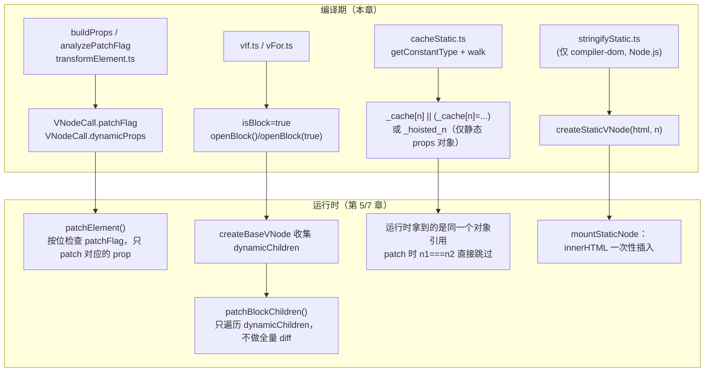
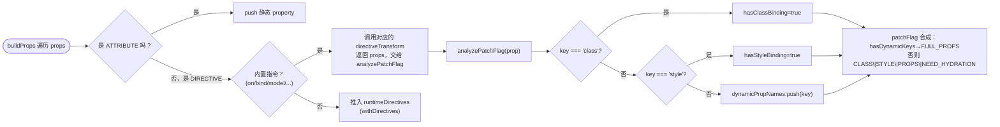
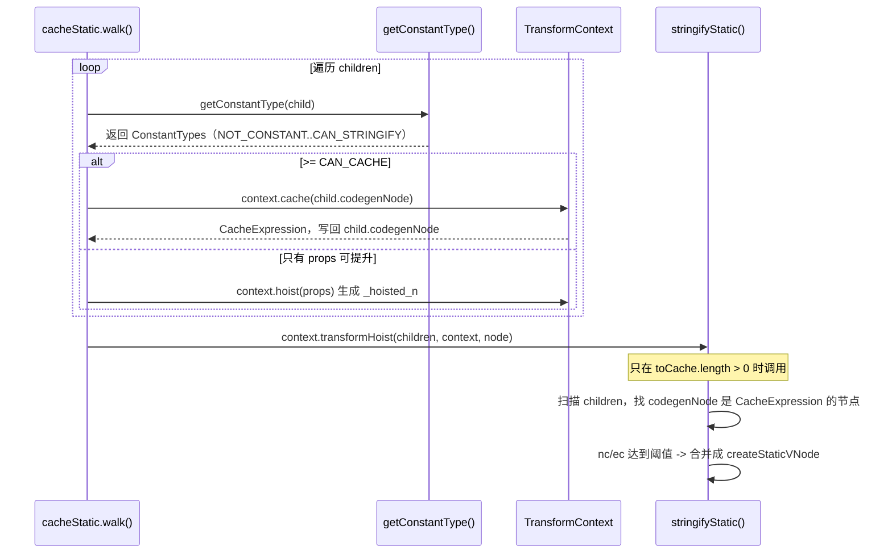

# 12. compiler-optimization：Block tree、PatchFlags、缓存、指令 transform

> 编译器怎么把"这里会变""这里不会变"这件事提前算好，让运行时 diff 不用再猜。

## 本章导读

学完本章，你应该能回答：

- `patchFlag` 数字是怎么算出来的？`:class` 和 `:title` 为什么占不同的 bit？`@click` 和 `@mouseover` 为什么会生成不同的 flag？
- "Block tree"到底是什么——为什么根元素要被转成 `createElementBlock`，`dynamicChildren` 里收集的是哪些节点？
- 3.5 的 `cacheStatic.ts`（前身是 `hoistStatic.ts`）相比旧版本，静态内容到底是"提升到模块顶部"还是"缓存进 `_cache` 数组"？两者的产物有什么区别，为什么要改？
- `v-if`/`v-else` 的每个分支为什么要注入一个 `key`，不注入会出什么问题？
- `v-for` 生成的 `openBlock(true)` 里这个 `true` 是什么意思？
- 组件的 `v-model` 和原生 `<input v-model>` 编译出来为什么完全不是一回事？

前置章节：**必须先读第 11 章**（parse/transform/codegen 的基础设施、`VNodeCall`/`ConstantTypes` 这些概念本章会直接使用，不再重复介绍）。建议对照第 05/07 章（vnode 的 `ShapeFlags`/`PatchFlags`、renderer 的 `patchElement`/`patchBlockChildren`）一起看，本章讲"编译期怎么生成标记"，那两章讲"运行时怎么消费标记"。预计阅读时间：90~120 分钟。

涉及源码文件：

| 文件 | 作用 | 行数量级 |
|---|---|---|
| `compiler-core/src/transforms/transformElement.ts` | `buildProps`/`analyzePatchFlag`：patchFlag 的合成逻辑 | 965 |
| `compiler-core/src/transforms/cacheStatic.ts` | 3.5 由 `hoistStatic` 改名，决定哪些节点能被缓存/提升 | 465 |
| `compiler-dom/src/transforms/stringifyStatic.ts` | 连续静态节点合并成 `createStaticVNode` | 432 |
| `compiler-core/src/transforms/vIf.ts` | v-if/v-else(-if) → `ConditionalExpression` + key 注入 | 348 |
| `compiler-core/src/transforms/vFor.ts` | v-for → `renderList` + Fragment block | 399 |
| `compiler-core/src/transforms/vSlot.ts` | 插槽编译（STABLE/DYNAMIC/FORWARDED） | 423 |
| `compiler-core/src/transforms/vOn.ts` + `compiler-dom/src/transforms/vOn.ts` | 事件处理函数、修饰符 | 179 + 154 |
| `compiler-core/src/transforms/vBind.ts` | `:xxx` 动态属性、`.camel/.prop/.attr` 修饰符 | 86 |
| `compiler-core/src/transforms/vModel.ts` + `compiler-dom/src/transforms/vModel.ts` | 组件 vs 原生元素的 v-model | 169 + 127 |
| `compiler-core/src/transforms/transformText.ts`、`vOnce.ts`、`vMemo.ts` | 文本合并、v-once 缓存、v-memo | 119 + 28 + 43 |
| `shared/src/patchFlags.ts` | `PatchFlags` 枚举定义 | 144 |

本章全部示例（`chapters/12-compiler-optimization/examples/`）：

| 示例 | 内容 |
|---|---|
| `01-patchflag-decoder.ts` | 逐个 patchFlag 的最小复现模板 + 解码表 |
| `02-block-tree-visualize.ts` | compile → 真实渲染 → 递归打印 `dynamicChildren` 嵌套关系 |
| `03-v-if-v-for-codegen.ts` | 分支 key 注入、注释占位、Fragment 三种 flag、`openBlock(true)` |
| `04-static-cache-and-stringify.ts` | cacheStatic 真实产物 + stringifyStatic 阈值验证 |
| `05-v-on-cache-and-modifiers.ts` | handler 三种形态、`cacheHandlers`、事件修饰符 |
| `06-slots-codegen.ts` | STABLE/DYNAMIC/FORWARDED 插槽 + `renderSlot` fallback |
| `07-v-model-codegen.ts` | 组件 vs 原生元素（text/checkbox/radio/select/dynamic）v-model |

## 先跑起来

```bash
pnpm ex chapters/12-compiler-optimization/examples/01-patchflag-decoder.ts
```

```
NEED_HYDRATION(32)：注意不是 @click（click 有专属 hydration 快速路径，被源码特判排除） | <<div @mouseover="go">x</div>>
    tag="div"  patchFlag=40 /* PROPS, NEED_HYDRATION */  dynamicProps=["onMouseover"]
对比：@click 不会带 NEED_HYDRATION，但仍然算进 dynamicProps/PROPS | <<div @click="go">x</div>>
    tag="div"  patchFlag=8 /* PROPS */  dynamicProps=["onClick"]
```

这两行是本章最容易被直觉误导的地方：`@click` 和 `@mouseover` 看起来是"同一类东西"（都是事件），但编译出来的 `patchFlag` 不一样——`onclick` 在源码里被显式排除出 `NEED_HYDRATION` 判定（因为运行时对 click 事件的 hydration 有专属快速路径），但两者都会被记进 `dynamicProps`。这种"看似对称、实则不对称"的细节，只看文档是猜不到的，必须跑一遍真实编译器。

再跑一个和直觉冲突更大的例子：

```bash
pnpm ex chapters/12-compiler-optimization/examples/04-static-cache-and-stringify.ts
```

```
1. 9 个 <li>x</li>：nc = 9 个元素 + 9 个文本子节点 = 18，还没到 20，只会被逐个 _cache[n] 缓存
   不包含 createStaticVNode
2. 10 个 <li>x</li>：nc = 10 + 10 = 20，刚好达到阈值，触发 stringifyStatic
   _cache[0] || (_cache[0] = _createStaticVNode("<li>x</li>...(10个)...", 10))
```

只需要 **10 个** `<li>x</li>`，而不是直觉上的 20 个，就能触发 `createStaticVNode` 合并——因为 `stringifyStatic` 的节点计数器 `nc` 不是数"有几个标签"，而是对每一层子节点都 `nc++`（文本子节点也算一个），下面会细讲。

## 整体图







## 源码精读

### 2.1 transformElement.ts：patchFlag 是怎么"长"出来的

`transformElement` 的真正工作在"退出"阶段（`postTransformElement`），因为它需要所有子节点、所有指令都处理完才能合成最终的 `VNodeCall`：

```ts
// packages/compiler-core/src/transforms/transformElement.ts#L73-145（节选）
export const transformElement: NodeTransform = (node, context) => {
  return function postTransformElement() {
    node = context.currentNode!
    if (!(node.type === NodeTypes.ELEMENT && (node.tagType === ElementTypes.ELEMENT || node.tagType === ElementTypes.COMPONENT))) return

    const { tag, props } = node
    const isComponent = node.tagType === ElementTypes.COMPONENT
    let vnodeTag = isComponent ? resolveComponentType(node, context) : `"${tag}"`
    const isDynamicComponent = isObject(vnodeTag) && vnodeTag.callee === RESOLVE_DYNAMIC_COMPONENT

    let shouldUseBlock =
      isDynamicComponent ||
      vnodeTag === TELEPORT ||
      vnodeTag === SUSPENSE ||
      (!isComponent && (tag === 'svg' || tag === 'foreignObject' || tag === 'math'))

    if (props.length > 0) {
      const propsBuildResult = buildProps(node, context, undefined, isComponent, isDynamicComponent)
      vnodeProps = propsBuildResult.props
      patchFlag = propsBuildResult.patchFlag
      // ...
      if (propsBuildResult.shouldUseBlock) shouldUseBlock = true
    }
    // ... children 处理（下面单独讲）...
    node.codegenNode = createVNodeCall(context, vnodeTag, vnodeProps, vnodeChildren,
      patchFlag === 0 ? undefined : patchFlag, vnodeDynamicProps, vnodeDirectives,
      !!shouldUseBlock, false, isComponent, node.loc)
  }
}
```

`shouldUseBlock` 的判定列表值得记住——`svg`/`foreignObject`/`math` **即使内容完全静态也会被强制开 block**，源码注释解释了原因：这类元素需要运行时在 block 更新时带上正确的 `isSVG` 标志（`transformElement.ts#L108-118` 的原话是"must be forced into blocks so that block updates inside get proper isSVG flag at runtime"）——这是一个平台相关但又不得不写进 compiler-core 的例外（注释里也承认"this is technically web-specific, but splitting the logic out of core leads to too much unnecessary complexity"）。`examples/01-patchflag-decoder.ts` 没有覆盖这一条，但读者可以自己用 `compile('<svg><circle/></svg>')` 验证。

`buildProps` 里的 `analyzePatchFlag` 是本章的核心函数：

```ts
// packages/compiler-core/src/transforms/transformElement.ts#L440-505（节选）
const analyzePatchFlag = ({ key, value }: Property) => {
  if (isStaticExp(key)) {
    const name = key.content
    const isEventHandler = isOn(name)
    if (isEventHandler && (!isComponent || isDynamicComponent)
        && name.toLowerCase() !== 'onclick'         // click 有专属 hydration 快速路径，排除
        && name !== 'onUpdate:modelValue'            // v-model 内部事件，排除
        && !isReservedProp(name)) {
      hasHydrationEventBinding = true
    }
    if (isEventHandler && isReservedProp(name)) hasVnodeHook = true
    if (name === 'ref') hasRef = true

    if (isEventHandler && value.type === NodeTypes.JS_CALL_EXPRESSION) {
      value = value.arguments[0] as JSChildNode // 剥开 withModifiers(fn) 外壳，看真正的表达式
    }
    if (value.type === NodeTypes.JS_CACHE_EXPRESSION ||
        ((value.type === SIMPLE_EXPRESSION || value.type === COMPOUND_EXPRESSION) && getConstantType(value, context) > 0)) {
      return // 缓存过的 handler 或者常量值，不需要 patch，直接跳过
    }

    if (name === 'class') hasClassBinding = true
    else if (name === 'style') hasStyleBinding = true
    else if (name !== 'ref' && name !== 'key' && !dynamicPropNames.includes(name)) {
      dynamicPropNames.push(name) // 包括事件名！onClick 也会被 push 进这里
    }
  } else {
    hasDynamicKeys = true
  }
}
```

三个容易读错的地方：

1. **事件处理函数也会被推进 `dynamicPropNames`**。源码没有对"事件"做特殊豁免——`@click="onClick"` 编译出来的 `onClick` 属性和 `:title="t"` 的 `title` 属性走的是同一套 `dynamicPropNames` 逻辑，区别只在于 `onclick`（小写）被单独排除出 `hasHydrationEventBinding` 的判定。`examples/01-patchflag-decoder.ts` 第 6/7 行用 `@mouseover` vs `@click` 对比验证了这一点（前面"先跑起来"已经贴过）。
2. **`class`/`style` 有专属的 bit，不计入 `dynamicPropNames`**。这意味着运行时可以直接走 `normalizeClass`/`normalizeStyle` 这类专用 helper，不用把它们混进"通用 props diff"的逻辑里。
3. **值如果是 `JS_CACHE_EXPRESSION` 或者常量（`constType > 0`），直接 `return` 跳过**——`v-on` 开了 `cacheHandlers` 之后生成的 `_cache[n] || (...)` 就属于这一类，不会被当成"需要 patch 的动态 prop"（5.5 节会细看）。

最终的 patchFlag 合成：

```ts
// packages/compiler-core/src/transforms/transformElement.ts#L751-773
if (hasDynamicKeys) {
  patchFlag |= PatchFlags.FULL_PROPS
} else {
  if (hasClassBinding && !isComponent) patchFlag |= PatchFlags.CLASS
  if (hasStyleBinding && !isComponent) patchFlag |= PatchFlags.STYLE
  if (dynamicPropNames.length) patchFlag |= PatchFlags.PROPS
  if (hasHydrationEventBinding) patchFlag |= PatchFlags.NEED_HYDRATION
}
const needsPatch = (patchFlag === 0 || patchFlag === PatchFlags.NEED_HYDRATION) && (hasRef || hasVnodeHook || runtimeDirectives.length > 0)
if (!shouldUseBlock && needsPatch) patchFlag |= PatchFlags.NEED_PATCH
```

`FULL_PROPS` 和其它所有 bit 互斥——一旦出现动态 key（`:[key]="val"`），运行时没法只靠"记住几个属性名"来定位变化，只能整个 props 对象做全量 diff（`examples/01-patchflag-decoder.ts` 的 `FULL_PROPS(16)` 那一行验证了 `dynamicProps` 确实是 `-`，不会和 `PROPS` 的"精确属性名列表"共存）。

**`PatchFlags.NEED_HYDRATION` 这个名字是 3.5 的产物**：如果你读过更早版本的博客/面试题，可能见过的名字是 `HYDRATE_EVENTS`。本仓库基于 3.5.44，`shared/src/patchFlags.ts#L64` 的注释写的是"Indicates an element that requires props hydration (but not necessarily patching) e.g. event listeners & v-bind with prop modifier"——不只是事件，`.prop` 修饰符的 v-bind 现在也会用到这个 flag。如果你在别的资料里看到 `HYDRATE_EVENTS = 1 << 5`，那是旧版本的叫法，含义上是 `NEED_HYDRATION` 的子集。

单子节点优化是容易被忽略的一段（`transformElement.ts#L183-205`）：

```ts
} else if (node.children.length === 1 && vnodeTag !== TELEPORT) {
  const child = node.children[0]
  const hasDynamicTextChild = child.type === NodeTypes.INTERPOLATION || child.type === NodeTypes.COMPOUND_EXPRESSION
  if (hasDynamicTextChild && getConstantType(child, context) === ConstantTypes.NOT_CONSTANT) {
    patchFlag |= PatchFlags.TEXT
  }
  if (hasDynamicTextChild || child.type === NodeTypes.TEXT) {
    vnodeChildren = child as TemplateTextChildNode // 直接用这个节点，不包数组！
  } else {
    vnodeChildren = node.children
  }
}
```

`<div>{{ msg }}</div>` 的 `children` 字段最终是 `_toDisplayString(msg)` 这个表达式本身，**不是 `[_toDisplayString(msg)]` 数组**——这正是 `examples/01-patchflag-decoder.ts` 里 `TEXT(1)` 那一行产物 `createElementBlock("div", null, _toDisplayString(msg), 1)` 的由来。运行时拿到的 `vnode.children` 如果是字符串，会走 `el.textContent = children` 的专属快速路径（第 7 章 renderer.ts），比"先创建一个 Text vnode 再插入"快得多。

### 2.2 cacheStatic.ts：从"提升"到"缓存"

`cacheStatic` 这个文件名本身就是线索——在更早的版本里它叫 `hoistStatic.ts`，做的事是把整棵静态子树提升成模块作用域的 `_hoisted_1`/`_hoisted_2` 常量，`render()` 函数每次执行时直接引用同一个模块级变量，彻底不会重新创建。3.5 把这个文件改名成 `cacheStatic.ts`，**对于整棵静态的元素/文本节点，不再提升到模块作用域，而是缓存进组件实例自己的 `_cache` 数组**：

```ts
// packages/compiler-core/src/transforms/cacheStatic.ts#L71-109（节选）
for (let i = 0; i < children.length; i++) {
  const child = children[i]
  if (child.type === NodeTypes.ELEMENT && child.tagType === ElementTypes.ELEMENT) {
    const constantType = doNotHoistNode ? ConstantTypes.NOT_CONSTANT : getConstantType(child, context)
    if (constantType > ConstantTypes.NOT_CONSTANT) {
      if (constantType >= ConstantTypes.CAN_CACHE) {
        (child.codegenNode as VNodeCall).patchFlag = PatchFlags.CACHED
        toCache.push(child)
        continue
      }
    } else {
      // 节点本身不是常量，但它的 props 对象可能是常量 —— 单独把 props 提升
      const codegenNode = child.codegenNode!
      if (codegenNode.type === NodeTypes.VNODE_CALL) {
        const flag = codegenNode.patchFlag
        if ((flag === undefined || flag === PatchFlags.NEED_PATCH || flag === PatchFlags.TEXT)
            && getGeneratedPropsConstantType(child, context) >= ConstantTypes.CAN_CACHE) {
          const props = getNodeProps(child)
          if (props) codegenNode.props = context.hoist(props) // 这里仍然用 hoist！
        }
      }
    }
  }
  // ...
}
if (!cachedAsArray) {
  for (const child of toCache) {
    child.codegenNode = context.cache(child.codegenNode!) // 整节点用 cache，不是 hoist
  }
}
```

**两套机制并存，分工不同**：

- 整个元素/文本节点（`constantType >= CAN_CACHE`）→ `context.cache()` → `_cache[n] || (_cache[n] = createElementVNode(...))`。
- 元素本身有动态子节点、但它的 **props 对象**是纯静态的 → `context.hoist()` → 提升成 `_hoisted_n`（一个普通的对象/数组字面量，不是 vnode）。

`examples/04-static-cache-and-stringify.ts` 的输出直接证实了这个分工：

```js
// 整节点缓存：<p>static</p> 和 {{ msg }} 混在一起
_cache[0] || (_cache[0] = _createElementVNode("p", null, "static", -1 /* CACHED */)),
_createTextVNode(_toDisplayString(msg), 1 /* TEXT */)

// 只有 props 提升：<input> 本身有动态文本兄弟节点，但它自己的 props 是常量
const _hoisted_1 = ["disabled"]
// ...
_createElementVNode("input", { disabled: false, placeholder: "name" }, null, 8 /* PROPS */, _hoisted_1)
```

**为什么整节点不再提升到模块作用域？** 线索藏在 `runtimeHelpers.ts` 里两个被标记为 `@deprecated` 的 helper：

```ts
// packages/compiler-core/src/runtimeHelpers.ts#L69-77
/**
 * @deprecated no longer needed in 3.5+ because we no longer hoist element nodes
 * but kept for backwards compat
 */
export const PUSH_SCOPE_ID: unique symbol = Symbol(...)
/** @deprecated kept for backwards compat */
export const POP_SCOPE_ID: unique symbol = Symbol(...)
```

旧版本把静态元素提升到模块顶部后，这些 `_hoisted_n` 的创建代码跑在 `render()` 函数之外、组件第一次被加载时就执行一次——如果组件带 `<style scoped>`，这些提前创建好的 vnode 需要手动 `pushScopeId()`/`popScopeId()` 包一层才能正确带上 scopeId（因为正常情况下 scopeId 是在 `render()` 执行期间通过当前渲染上下文自动带上的，提升到模块作用域就脱离了这个上下文）。改成 `cache` 之后，`_cache[n] = createElementVNode(...)` 这行代码运行在 `render()` **内部**，和其它 vnode 一样自然地处于正确的渲染上下文里，不再需要 `pushScopeId`/`popScopeId` 这层特殊处理。这同时也解决了"模块级 hoist 在多个应用实例间共享同一个 vnode 对象"的潜在问题（同一个 `.vue` 文件被 `createApp()` 两次，`_hoisted_1` 这个模块级变量是共享的；缓存进各自组件实例的 `_cache` 数组后，每个实例拥有自己独立的缓存）。

`getConstantType` 是整条链路的判断核心，递归判断一个节点（及其子树）是否"常量"：

```ts
// packages/compiler-core/src/transforms/cacheStatic.ts#L253-355（节选，ELEMENT 分支）
case NodeTypes.ELEMENT:
  if (node.tagType !== ElementTypes.ELEMENT) return ConstantTypes.NOT_CONSTANT
  const codegenNode = node.codegenNode!
  if (codegenNode.type !== NodeTypes.VNODE_CALL) return ConstantTypes.NOT_CONSTANT
  if (codegenNode.isBlock && node.tag !== 'svg' && node.tag !== 'foreignObject' && node.tag !== 'math') {
    return ConstantTypes.NOT_CONSTANT // 已经是 block 的元素（比如 v-if 分支根）不能再被当常量
  }
  if (codegenNode.patchFlag === undefined) {
    let returnType = ConstantTypes.CAN_STRINGIFY
    const generatedPropsType = getGeneratedPropsConstantType(node, context)
    if (generatedPropsType === ConstantTypes.NOT_CONSTANT) return ConstantTypes.NOT_CONSTANT
    if (generatedPropsType < returnType) returnType = generatedPropsType
    for (let i = 0; i < node.children.length; i++) {
      const childType = getConstantType(node.children[i], context)
      if (childType === ConstantTypes.NOT_CONSTANT) return ConstantTypes.NOT_CONSTANT
      if (childType < returnType) returnType = childType
    }
    // 如果这个元素是（唯一可能是 block 的）svg/foreignObject/math，发现它其实全静态，
    // 就把它从 block 降级回普通 vnode——没有动态后代，不需要专门开一个更新边界
    if (codegenNode.isBlock) {
      context.removeHelper(OPEN_BLOCK)
      context.removeHelper(getVNodeBlockHelper(context.inSSR, codegenNode.isComponent))
      codegenNode.isBlock = false
      context.helper(getVNodeHelper(context.inSSR, codegenNode.isComponent))
    }
    return returnType
  }
  return ConstantTypes.NOT_CONSTANT // 有 patchFlag，肯定不是常量
```

有 `patchFlag` 的节点直接判定为非常量（符合直觉：有 patchFlag 就意味着"有东西会变"）；没有 `patchFlag` 的节点要递归检查 props 和所有子节点，**任何一处非常量都会让整个节点判定为非常量**（`getConstantType` 取的是"所有部分里最弱的那个等级"——`returnType` 只会被不断调低，不会调高）。

### 2.3 stringifyStatic.ts：阈值和一个容易算错的计数规则

`compile()` 默认其实是**不开 `hoistStatic` 的**——`transform()` 里只有 `if (options.hoistStatic) { cacheStatic(root, context) }`（`transform.ts#L337`），而 `compiler-dom/src/index.ts` 的 `compile()` 函数没有在默认参数里把 `hoistStatic` 设成 `true`。这意味着如果你直接调用 `compile(template)` 不传任何选项，`cacheStatic`/`stringifyStatic` 都不会跑——`examples/04-static-cache-and-stringify.ts` 的第 3 节专门验证了这一点。真实项目里感知不到这个默认值，是因为 `vite-plugin-vue`/`vue-loader` 在调用处都会显式传 `{ hoistStatic: true }`。

`stringifyStatic` 只有在 `cacheStatic` 的 `walk()` 产生了至少一个可缓存节点时才会被调用（`cacheStatic.ts#L248-250`：`if (toCache.length && context.transformHoist) { context.transformHoist(children, context, node) }`），而且它只检查**已经被 `cache()` 过的节点**：

```ts
// packages/compiler-dom/src/transforms/stringifyStatic.ts#L41-44、173-182
export enum StringifyThresholds {
  ELEMENT_WITH_BINDING_COUNT = 5,
  NODE_COUNT = 20,
}
const getCachedNode = (node: TemplateChildNode): CacheExpression | undefined => {
  if (((node.type === NodeTypes.ELEMENT && node.tagType === ElementTypes.ELEMENT) || node.type === NodeTypes.TEXT_CALL)
      && node.codegenNode && node.codegenNode.type === NodeTypes.JS_CACHE_EXPRESSION) {
    return node.codegenNode
  }
}
```

节点计数 `nc`（node count）和"带绑定元素计数"`ec`（element-with-binding count）由 `analyzeNode`/`walk` 递归统计：

```ts
// packages/compiler-dom/src/transforms/stringifyStatic.ts#L213-291（节选）
function analyzeNode(node: StringifiableNode): [number, number] | false {
  if (node.type === NodeTypes.TEXT_CALL) return [1, 0]
  let nc = 1
  let ec = node.props.length > 0 ? 1 : 0
  function walk(node: ElementNode): boolean {
    // ... 遍历 props，遇到非静态属性/绑定直接 bail() 返回 false ...
    for (let i = 0; i < node.children.length; i++) {
      nc++ // <-- 每个子节点都 +1，包括纯文本子节点！
      const child = node.children[i]
      if (child.type === NodeTypes.ELEMENT) {
        if (child.props.length > 0) ec++
        walk(child)
      }
    }
    return true
  }
  return walk(node) ? [nc, ec] : false
}
```

`<li>x</li>` 的 `nc` 不是 1，而是 **2**：`<li>` 本身算 1，它的文本子节点 `"x"` 在 `walk` 的子节点循环里又让 `nc++` 了一次。`examples/04-static-cache-and-stringify.ts` 验证了边界：9 个 `<li>x</li>`（`nc = 18`）不会触发合并，10 个（`nc = 20`）恰好触发；换成 5 个带静态属性的 `<li class="x">x</li>`（`ec = 5`）也能单独触发，即使 `nc` 远没到 20。这是一个**只看文档/只凭直觉会算错**的细节，必须读 `walk()` 的实现或者跑一遍真实编译器才能确定。

一旦某个节点不满足"可缓存"（比如混进了一个动态插值的 `<li>{{ dyn }}</li>`），当前这一段"连续静态节点"的扫描窗口就会被打断，已经攒够阈值的那一段会被单独合并，之后重新计数：

```ts
// packages/compiler-dom/src/transforms/stringifyStatic.ts#L146-172（节选）
let i = 0
for (; i < children.length; i++) {
  const child = children[i]
  const isCached = isParentCached || getCachedNode(child)
  if (isCached) {
    const result = analyzeNode(child as StringifiableNode)
    if (result) { nc += result[0]; ec += result[1]; currentChunk.push(child); continue }
  }
  i -= stringifyCurrentChunk(i) // 遇到不可缓存的节点，结算当前 chunk
  nc = 0; ec = 0; currentChunk.length = 0
}
stringifyCurrentChunk(i) // 循环结束后再结算一次最后一段
```

`examples/04-static-cache-and-stringify.ts` 第 5 节把 10+1+10 个 `<li>` 混在一起（中间一个动态），产物是**两段独立的 `createStaticVNode(..., 10)`**，中间那个动态 `<li>` 原样保留在数组里——完全符合这段"遇到不可缓存节点就结算"的逻辑。

### 2.4 vIf.ts：key 注入、block 转换、注释占位

`processIf` 对 `v-if` 本身的处理是把当前元素**整体替换**成一个 `IfNode`：

```ts
// packages/compiler-core/src/transforms/vIf.ts#L116-126（节选）
if (dir.name === 'if') {
  const branch = createIfBranch(node, dir)
  const ifNode: IfNode = { type: NodeTypes.IF, loc: cloneLoc(node.loc), branches: [branch] }
  context.replaceNode(ifNode)
  if (processCodegen) return processCodegen(ifNode, branch, true)
}
```

`v-else(-if)` 则是**去找前一个相邻的 `IfNode` 兄弟**，把自己摘下来挂成新分支：

```ts
// packages/compiler-core/src/transforms/vIf.ts#L127-196（节选）
const siblings = context.parent!.children
let i = siblings.indexOf(node)
while (i-- >= -1) {
  const sibling = siblings[i]
  if (sibling && isCommentOrWhitespace(sibling)) { context.removeNode(sibling); continue }
  if (sibling && sibling.type === NodeTypes.IF) {
    context.removeNode()
    const branch = createIfBranch(node, dir)
    sibling.branches.push(branch)
    const onExit = processCodegen && processCodegen(sibling, branch, false)
    traverseNode(branch, context) // 节点已经从树上摘掉，手动触发一次遍历
    if (onExit) onExit()
    context.currentNode = null
  } else {
    context.onError(createCompilerError(ErrorCodes.X_V_ELSE_NO_ADJACENT_IF, node.loc))
  }
  break
}
```

注意中间会跳过**注释和空白文本节点**（`isCommentOrWhitespace`）去寻找相邻的 `v-if`——这就是为什么 `<p v-if="ok">A</p>\n<p v-else>B</p>`（标签之间有换行）依然能正确配对，即使模板字符串里这两个标签之间隔着一个空白文本节点。

key 的注入发生在 `createChildrenCodegenNode` 里：

```ts
// packages/compiler-core/src/transforms/vIf.ts#L240-303（节选）
function createChildrenCodegenNode(branch: IfBranchNode, keyIndex: number, context: TransformContext) {
  const keyProperty = createObjectProperty('key', createSimpleExpression(`${keyIndex}`, false, locStub, ConstantTypes.CAN_CACHE))
  // ...单子节点分支...
  const vnodeCall = getMemoedVNodeCall(ret)
  if (vnodeCall.type === NodeTypes.VNODE_CALL) convertToBlock(vnodeCall, context)
  injectProp(vnodeCall, keyProperty, context)
  return ret
}
```

`keyIndex` 从 0 开始按分支数递增（`vIf.ts#L48-59` 里专门有一段计算"当前位置已经有多少个相邻的 v-if 链占用了 key 空间"的逻辑，避免同一层级多个独立的 v-if 链互相冲突）。**这一行 `injectProp` 是本章最值得记住的细节之一**：即使两个分支内容都是纯静态文本、完全没有 `patchFlag`，只要它们是不同的 `v-if` 分支，就会被分别打上 `key: 0`/`key: 1`——目的是让运行时 `isSameVNodeType`（只比较 `type` 和 `key`）判定出"这是两个不同的节点"，强制 `remove` 旧的、`insert` 新的，而不是误判成"同一个元素，只是内容变了，原地 patch 一下"。

**笔者在写 `mini-vue/compiler-core/transforms/vIf.ts` 时真的踩到了这个坑**：最初省略了 key 注入（觉得"不过是优化细节"），结果 `<p v-if="ok">YES</p><p v-else>NO</p>` 切换时，用 `logging-renderer` 渲染两次，**文字完全没有更新**——因为两个分支都是 `<p>`、都没有 `patchFlag`，`dynamicChildren` 是空数组（纯静态文本不会被收集进 block 的动态子节点列表），运行时的 `patchElement` 走到"检查 `patchFlag`"这一步发现是 0，又没有 `dynamicChildren` 可用，只能靠"vnode 是否被判定为同一个节点"来决定要不要重新渲染，而 `isSameVNodeType` 判定成"是同一个"，于是整个更新被跳过。补上 `key: keyIndex` 之后行为才和真实 Vue 一致（细节见 `chapters/12-compiler-optimization/examples/02-block-tree-visualize.ts` 的运行时验证，以及 mini-vue 的 `compile.test.ts`）。

没有 `v-else` 时，缺失的分支会被替换成一个注释占位：

```ts
// packages/compiler-core/src/transforms/vIf.ts#L219-238（节选）
function createCodegenNodeForBranch(branch, keyIndex, context) {
  if (branch.condition) {
    return createConditionalExpression(
      branch.condition,
      createChildrenCodegenNode(branch, keyIndex, context),
      createCallExpression(context.helper(CREATE_COMMENT), [__DEV__ ? '"v-if"' : '""', 'true']), // 占位
    )
  }
  return createChildrenCodegenNode(branch, keyIndex, context)
}
```

`examples/03-v-if-v-for-codegen.ts` 的真实产物：

```js
return ok
  ? (_openBlock(), _createElementBlock("p", { key: 0 }, "YES"))
  : _createCommentVNode("v-if", true)
```

这个注释节点保证了"这个位置在条件为 false 时也有一个真实的 DOM 锚点"——如果直接返回 `null`，会打乱兄弟节点在父元素 `children` 数组里的位置对应关系（第 7 章 `patchChildren` 依赖子节点在数组里的位置和实际 DOM 顺序保持一致）。

### 2.5 vFor.ts：Fragment 的三种 flag 和 disableTracking

`processFor`/`transformFor` 把 `v-for` 元素包进一个 `ForNode`，最终生成一个 `renderList(...)` 调用包在 Fragment block 里：

```ts
// packages/compiler-core/src/transforms/vFor.ts#L101-122（节选）
const isStableFragment = forNode.source.type === NodeTypes.SIMPLE_EXPRESSION && forNode.source.constType > ConstantTypes.NOT_CONSTANT
const fragmentFlag = isStableFragment ? PatchFlags.STABLE_FRAGMENT
  : keyProp ? PatchFlags.KEYED_FRAGMENT
  : PatchFlags.UNKEYED_FRAGMENT

forNode.codegenNode = createVNodeCall(context, helper(FRAGMENT), undefined, renderExp,
  fragmentFlag, undefined, undefined,
  true /* isBlock */, !isStableFragment /* disableTracking */, false, node.loc)
```

`isStableFragment` 要求遍历的 `source` 表达式的 `constType > NOT_CONSTANT`——但 `constType` 的真正计算发生在 `processExpression`（第 11 章 2.6 节），**只有开了 `prefixIdentifiers` 才会跑这一步**！`examples/01-patchflag-decoder.ts` 验证了这个反直觉的结果：

```
mode: function (默认，不做 prefixIdentifiers) -> 256 /* UNKEYED_FRAGMENT */
mode: module（强制 prefixIdentifiers=true，会调用 processExpression 判定常量）-> 64 /* STABLE_FRAGMENT */
```

同样是 `v-for="n in [1,2,3]"`，不传 `mode: 'module'` 编译出来的是 `UNKEYED_FRAGMENT`，传了才是 `STABLE_FRAGMENT`——**这不是 bug，是 `constType` 分析本来就依赖 `prefixIdentifiers` 开启时才会执行的 `processExpression`**。日常写 `.vue` 文件走 vite-plugin-vue 编译（永远是 `mode: 'module'`）感知不到这个差异，但如果自己直接调 `compile()` 做实验，很容易被这个结果搞糊涂。

`disableTracking: !isStableFragment` 对应 codegen 里的 `openBlock(true)`：

```ts
// packages/compiler-core/src/codegen.ts#L855-856
if (isBlock) push(`(${helper(OPEN_BLOCK)}(${disableTracking ? 'true' : ''}), `)
```

`openBlock(true)` 在运行时（第 5/7 章细讲）会让"打开的这个 block"不收集自己的 `dynamicChildren`——`examples/02-block-tree-visualize.ts` 用真实渲染验证了效果：

```
<ul> patchFlag=(none) dynamicChildren=1
  <v-fgt> patchFlag=128 /* KEYED_FRAGMENT */ dynamicChildren=0
```

`ul` 的 `dynamicChildren` 里收了 1 项——整个 v-for 产生的 Fragment（因为它本身是"动态的"：列表长度/内容随时可能变），但这个 Fragment **自己的** `dynamicChildren` 是空的（长度 0），因为 `disableTracking` 期间创建的每个 `<li>` 不会被这个 Fragment 收集。原因很直接：**v-for 的列表更新本来就要走专门的 `patchKeyedChildren`（最长递增子序列 diff），不是靠"精确定位到某个动态子节点"的 block 快路径**，把每个 `<li>` 收进 `dynamicChildren` 没有意义，干脆关闭追踪。

单个列表项是否自己也开 block，取决于 `isStableFragment`：

```ts
// packages/compiler-core/src/transforms/vFor.ts#L189-215（节选）
const shouldUseBlock = !isStableFragment || childBlock.isBlockRequired === true
// ...
childBlock.isBlock = shouldUseBlock
```

`examples/03-v-if-v-for-codegen.ts` 里 `v-for="n in 5"`（`mode: 'module'`，判定为 `STABLE_FRAGMENT`）的每个 `<li>` 编译出来是**不带 block 的** `createElementVNode`：

```js
return (_openBlock(), _createElementBlock(_Fragment, null, _renderList(5, (n) => {
  return _createElementVNode("li", null, _toDisplayString(n), 1 /* TEXT */) // 没有 openBlock！
}), 64 /* STABLE_FRAGMENT */))
```

逻辑是：如果遍历的是一个"稳定"的范围/字面量数组（长度、顺序都不会变），列表项本身不需要单独的更新边界，只要外层 Fragment 的 `renderList` 回调每次重新执行、重新 diff 就够了；只有 `isStableFragment` 为 false（真正的动态列表）时，每个 `<li>` 才会单独开 block，方便自己内部的动态子节点被精确定位。

`<template v-for>` 多子节点的情况会在每一轮循环内再包一层 Fragment（`examples/03-v-if-v-for-codegen.ts` 的第 3 节有完整产物），key 会被放到这一层内部 Fragment 的 props 上，而不是外层循环 Fragment 上——因为 key 要能区分"列表的每一项"，而不是"这个 v-for 整体"。

### 2.6 vSlot.ts：插槽为什么要编译成函数

`buildSlots` 产出一个 `slots` 对象表达式，每个插槽是一个用 `withCtx` 包裹的函数：

```ts
// packages/compiler-core/src/transforms/vSlot.ts#L107-114
const buildClientSlotFn: SlotFnBuilder = (props, _vForExp, children, loc) =>
  createFunctionExpression(props, children, false, true /* isSlot */, children.length ? children[0].loc : loc)
```

**插槽内容惰性求值**：插槽函数直到父组件的 `renderSlot()` 真正调用它才会执行，这样插槽内部引用的响应式数据，其依赖收集会精确地归属到"调用这个函数时正在渲染的那个组件"（通常是提供插槽内容的父组件，而不是声明 `<slot>` 的子组件）。`withCtx` 就是负责这件事的 helper：它在插槽函数执行前后临时切换 `currentRenderingInstance`，确保 `inject`/`track` 这些依赖"渲染上下文"的逻辑落在正确的实例上，而不是落在"当前正在渲染的子组件"身上。

`slotFlag` 是插槽对象上一个容易被忽略的字段：

```ts
// packages/compiler-core/src/transforms/vSlot.ts#L350-368（节选）
const slotFlag = hasDynamicSlots ? SlotFlags.DYNAMIC
  : hasForwardedSlots(node.children) ? SlotFlags.FORWARDED
  : SlotFlags.STABLE
let slots = createObjectExpression(
  slotsProperties.concat(createObjectProperty('_', createSimpleExpression(slotFlag + ..., false))),
  loc,
)
```

`examples/06-slots-codegen.ts` 三种 flag 的真实产物：

- **STABLE(1)**：普通的 `<Comp>hello {{ name }}</Comp>`，`_: 1`。插槽内容虽然引用了 `name`，但插槽结构本身（有哪些插槽、插槽的 scope 变量）不会变，组件可以放心跳过"插槽是否需要重新收集"的判断。
- **DYNAMIC(2)**：`<template v-slot:[slotName]>` 或者插槽出现在 `v-for`/另一个 `v-slot` 内部（`hasDynamicSlots = context.scopes.vSlot > 0 || context.scopes.vFor > 0`）。此时插槽集合本身可能变化（名字是动态的，或者数量跟着 v-for 变），组件必须强制 force update。
- **FORWARDED(3)**：组件内部只是把自己收到的 `$slots` 原样转发给另一个组件（`<Outer><Inner><slot/></Inner></Outer>` 这种"透传"场景），`hasForwardedSlots` 递归检查 children 里有没有裸的 `<slot>` 出口。

`transformSlotOutlet.ts` 负责 `<slot>` 自身的编译，产出 `renderSlot(...)` 调用：

```
_renderSlot($slots, "footer", { year: 2024 }, () => [_createTextVNode("© default footer")])
```

四个参数依次是：`$slots` 对象、插槽名、传给插槽的 props、fallback 内容函数。**`renderSlot` 在运行时决定到底用调用方传入的插槽函数还是这个 fallback**——`<slot>` 所在的组件完全不需要关心外部有没有提供这个插槽。

### 2.7 vOn.ts：三种 handler 形态与 cacheHandlers

`transformOn` 要在三种写法之间做判断：方法引用（`isMemberExpression`）、函数表达式（`isFnExpression`）、内联语句（两者都不是）：

```ts
// packages/compiler-core/src/transforms/vOn.ts#L76-153（节选）
const isMemberExp = isMemberExpression(exp, context)
const isInlineStatement = !(isMemberExp || isFnExpression(exp, context))
const hasMultipleStatements = exp.content.includes(';')
// ...
if (isInlineStatement || (shouldCache && isMemberExp)) {
  exp = createCompoundExpression([
    `${isInlineStatement ? '$event' : '(...args)'} => ${hasMultipleStatements ? '{' : '('}`,
    exp,
    hasMultipleStatements ? '}' : ')',
  ])
}
```

`examples/05-v-on-cache-and-modifiers.ts` 的真实产物：

```js
// 方法引用：直接用，不包箭头函数
{ onClick: onClick }
// 内联语句（单条）：包成 $event => (...)
{ onClick: $event => (count++) }
// 内联语句（多条，分号隔开）：包成代码块
{ onClick: $event => {count++; log(count)} }
// 函数表达式：直接用，不再包一层
{ onClick: () => count++ }
```

方法引用不包箭头函数是有意为之：**如果 `onClick` 引用不变，传给子组件的这个 prop 的值（函数引用）在两次渲染之间也是同一个引用**，子组件如果做了 `memo`/`shouldUpdate` 之类的优化就不会因为"父组件重渲染导致 handler 是个新函数"而被迫跟着更新。

`cacheHandlers` 更进一步：即使是内联语句，也希望这个新建的箭头函数对象本身是"稳定"的：

```ts
// packages/compiler-core/src/transforms/vOn.ts#L81、169-173（节选）
let shouldCache = context.cacheHandlers && !exp && !context.inVOnce
// ...
if (shouldCache) {
  ret.props[0].value = context.cache(ret.props[0].value)
}
```

`cacheHandlers` 必须配合 `prefixIdentifiers` 才能用（`compile.ts#L85-87`：`if (!prefixIdentifiers && options.cacheHandlers) onError(X_CACHE_HANDLER_NOT_SUPPORTED)`），`examples/05-v-on-cache-and-modifiers.ts` 验证了不开 `prefixIdentifiers` 直接用会抛错。开启之后，方法引用会被改写成一个略显奇怪的形态：

```js
onClick: _cache[0] || (_cache[0] = (...args) => (_ctx.onClick && _ctx.onClick(...args)))
```

**反而多包了一层箭头函数**——这是因为 `_cache[0]` 这个箭头函数对象本身要在多次渲染之间保持引用稳定（缓存的意义所在），但 `_ctx.onClick` 这个方法引用如果组件内部重新声明了（比如 `onClick` 是 `setup()` 里的一个会被重新创建的闭包），缓存的箭头函数仍然需要在**每次被调用时**读到最新的 `_ctx.onClick`，所以箭头函数内部不能直接捕获某一次渲染时的 `onClick` 值，要在调用时重新读 `_ctx.onClick`。内联语句场景不需要这层包装（`$event => (_ctx.count++)` 本来就是重新创建的，直接整体缓存即可）。

compiler-dom 层的 `transformOn` 在这之上叠加了修饰符处理，分三类：

```ts
// packages/compiler-dom/src/transforms/vOn.ts#L20-30
const isEventOptionModifier = makeMap('passive,once,capture')
const isNonKeyModifier = makeMap('stop,prevent,self,ctrl,shift,alt,meta,exact,middle')
const maybeKeyModifier = makeMap('left,right')
const isKeyboardEvent = makeMap('onkeyup,onkeydown,onkeypress')
```

`examples/05-v-on-cache-and-modifiers.ts` 的结果印证了三类修饰符走向三种不同的编译策略：

- `.stop`/`.prevent`/`.ctrl`/`.exact` 等 → 包一层运行时 helper `withModifiers(fn, ["stop","prevent"])`。
- `.once`/`.capture`/`.passive` → **不需要运行时 helper**，直接改写事件名后缀：`@click.once.capture.passive` 变成 `onClickOnceCapturePassive`（真实运行时 `patchEvent` 会解析这个后缀，用对应的 `addEventListener` 第三个参数）。注意一旦事件名加上后缀，它就不再是字面意义上的 `onclick`，`hasHydrationEventBinding` 的特判（"排除 onclick"）也就不再命中，这个例子里能看到 `patchFlag` 变成了 `40 /* PROPS, NEED_HYDRATION */`，和裸的 `@click` 不同。
- 按键修饰符（`.enter`/`.ctrl` 这种"可能是也可能不是按键修饰符"的）→ `withKeys(fn, ["enter"])`，运行时根据 `event.key` 判断是否放行。
- `.right`/`.middle` 这两个特殊：鼠标右键/中键不会真的触发 `click` 事件，所以编译期直接把事件名换成 `contextmenu`/`mouseup`。

### 2.8 vBind.ts / vModel.ts：修饰符与组件 vs 原生的分叉

`vBind.ts` 的修饰符都是"字符串拼接"级别的简单改写：

```ts
// packages/compiler-core/src/transforms/vBind.ts#L61-68
if (!context.inSSR) {
  if (modifiers.some(mod => mod.content === 'prop')) injectPrefix(arg, '.')
  if (modifiers.some(mod => mod.content === 'attr')) injectPrefix(arg, '^')
}
```

`.prop`/`.attr` 分别给属性名加上 `.`/`^` 前缀，运行时的 `patchProp`（第 14 章）靠这个前缀字符在"走 DOM property 赋值"还是"走 `setAttribute`"之间做选择，编译期不需要知道 DOM API 的细节，只管做字符串标记。

`v-model` 是本章里"同一个指令名、两套完全不同实现"的最佳案例。`transformModel`（compiler-core）处理的是**组件** v-model，产出 `modelValue` prop + `onUpdate:modelValue` 事件：

```ts
// packages/compiler-core/src/transforms/vModel.ts#L86-127（节选）
const propName = arg ? arg : createSimpleExpression('modelValue', true)
const eventName = arg ? `onUpdate:${camelize(arg.content)}` : `onUpdate:modelValue`
const assignmentExp = createCompoundExpression([`${eventArg} => ((`, exp, `) = $event)`])
const props = [
  createObjectProperty(propName, dir.exp!),
  createObjectProperty(eventName, assignmentExp),
]
```

compiler-dom 的 `transformModel` 先调用 compiler-core 版本拿到基础结果，**如果目标是原生元素，整个重新接管**：

```ts
// packages/compiler-dom/src/transforms/vModel.ts#L20-26、116-124（节选）
export const transformModel: DirectiveTransform = (dir, node, context) => {
  const baseResult = baseTransform(dir, node, context)
  if (!baseResult.props.length || node.tagType === ElementTypes.COMPONENT) return baseResult
  // ... 根据 tag/type 选择 V_MODEL_TEXT/CHECKBOX/RADIO/SELECT/DYNAMIC ...
  baseResult.props = baseResult.props.filter(p => !(p.key.content === 'modelValue'))
  return baseResult
}
```

`examples/07-v-model-codegen.ts` 的产物直接对比出区别：

```js
// 组件：modelValue + onUpdate:modelValue 都是 props
{ modelValue: value, "onUpdate:modelValue": $event => ((value) = $event) }

// 原生 <input>：没有 modelValue prop，换成指令对象
_withDirectives((_openBlock(), _createElementBlock("input", {
  "onUpdate:modelValue": $event => ((value) = $event)
}, null, 8, ["onUpdate:modelValue"])), [[_vModelText, value]])
```

原生元素场景下 `modelValue` 这个 prop 被过滤掉了——因为 `vModelText`/`vModelCheckbox` 这些内置指令对象的 `beforeMount`/`updated` 钩子会直接读 `binding.value`（也就是 `v-model` 绑定的原始表达式），不需要再额外传一份 `modelValue` prop，省掉重复数据。`type` 属性决定走哪个内置指令：静态 `type="checkbox"` 在编译期就能确定用 `vModelCheckbox`；`:type="t"` 这种动态绑定编译期无法确定，只能退化成运行时才判断的 `vModelDynamic`。

### 2.9 transformText.ts / vOnce.ts / vMemo.ts：三个收尾优化

`transformText` 在第 11 章已经介绍过合并相邻文本/插值的逻辑，这里补充"为什么单子节点不包 `createTextVNode`"：源码注释直接写明了原因（`transformText.ts#L59-62`）——"the runtime has dedicated fast path for this by directly setting textContent of the element"，也就是 2.1 节讲的"单子节点优化"。

`transformOnce` 的产物用到了 `genCacheExpression` 的 `needPauseTracking` 分支（第 11 章 2.5 节预告过）：

```ts
// packages/compiler-core/src/transforms/vOnce.ts#L16-26（节选）
context.inVOnce = true
context.helper(SET_BLOCK_TRACKING)
return () => {
  context.inVOnce = false
  cur.codegenNode = context.cache(cur.codegenNode, true /* isVNode */, true /* inVOnce */)
}
```

对照 `codegen.ts#L1015-1044`（第 11 章已贴过），`isVNode: true` 对应 `needPauseTracking`，生成形如：

```js
_cache[0] || (
  (_setBlockTracking(-1, true),
  (_cache[0] = createElementVNode(...)).cacheIndex = 0,
  _setBlockTracking(1),
  _cache[0])
)
```

`setBlockTracking(-1)` 临时关闭"把这个 vnode 收集进父 block 的 `dynamicChildren`"这件事——v-once 的内容创建一次之后永远不会再变，收集进 `dynamicChildren` 毫无意义，反而会让父 block 每次遍历 `dynamicChildren` 时多做一次无用功。

`vMemo.ts` 走的是另一条路：不经过 `cacheStatic`，而是直接用 `withMemo` 包裹整个 vnode 创建过程：

```ts
// packages/compiler-core/src/transforms/vMemo.ts#L23-40（节选）
if (node.tagType !== ElementTypes.COMPONENT) convertToBlock(codegenNode, context)
node.codegenNode = createCallExpression(context.helper(WITH_MEMO), [
  dir.exp!, createFunctionExpression(undefined, codegenNode), `_cache`, String(context.cached.length),
])
context.cached.push(null) // 占一个 _cache 槽位，但值交给 withMemo 运行时自己维护
```

`withMemo(deps, () => vnode, _cache, index)` 运行时会对比 `deps` 数组和上一次缓存的 `deps` 是否相等（浅比较），相等就直接复用上一次缓存的 vnode，完全跳过 `() => vnode` 这个工厂函数的执行——这是 v-memo 和 v-once 的本质区别：v-once 是"只创建一次，之后永远复用"，v-memo 是"每次都重新判断依赖是否变化，变了才重新创建"。

## 与 Vue 2 对比

| 维度 | Vue 2 | Vue 3.5 | 为什么这么改 |
|---|---|---|---|
| 静态标记粒度 | `optimizer.ts` 的 `markStatic`（`el.static`）/`markStaticRoots`（`el.staticRoot`，且要求非单文本子节点）——只有"是/否静态" | `ConstantTypes` 四级枚举（`NOT_CONSTANT`/`CAN_SKIP_PATCH`/`CAN_CACHE`/`CAN_STRINGIFY`） | Vue 2 跳过整棵静态子树；Vue 3 还能单独提升"动态元素里的静态 props 对象"（2.2 节），粒度更细，优化面更广 |
| 更新定位方式 | 没有"block"概念，`patch()` 每次都要递归比较整棵 vnode 树的子节点（`vdom/patch.js` 的 `updateChildren`），只是跳过标记为 `static` 的子树 | Block tree + `dynamicChildren`：运行时直接拿到"这棵树里所有会变的节点"的扁平列表，不需要逐层递归比较（本章只讲编译期怎么生成，运行时在第 7 章） | 即使是"动态节点所在的子树"，Vue 2 依然要逐层 diff props/children；Vue 3 的 block 让"定位到哪个节点变了"从 O(树深度) 降到 O(动态节点数) |
| props 分类 | `genData` 把 props 拆成 `attrs`/`domProps`/`on`/`nativeOn`/`class`/`style` 好几类分别生成代码（`src/compiler/codegen/index.ts`） | 统一的 `props` 对象 + `patchFlag` 位标记（`CLASS`/`STYLE`/`PROPS`/`FULL_PROPS`） | Vue 2 的分类是运行时解包这个 data 对象用的；Vue 3 把"哪些 key 会变"在编译期直接算成一个数字，运行时按位判断，不用遍历分类好的子对象 |
| v-for | 没有 block，`key` 只用于 diff 算法本身（`sameVnode` 判断） | `renderList` + Fragment block，`disableTracking` 关闭自身 tracking，交给专门的 `patchKeyedChildren` | 本质没变（列表 diff 依然靠 key），但编译期多做的事是：把"这是一个会变长度的列表"这个信息体现成 `UNKEYED/KEYED_FRAGMENT` patchFlag，让运行时一眼识别出要不要走 block 快路径 |
| 事件修饰符 | `genHandler` 在生成的代码里内联 if 语句判断修饰符（`compiler/codegen/events.ts` 的 `modifierCode`），比如 `.stop` 编译成 `$event.stopPropagation();` 插进 handler 函数体最前面 | `withModifiers(fn, ['stop'])`/`withKeys(fn, ['enter'])` 运行时 helper，不内联判断逻辑 | Vue 3 把修饰符处理收敛成通用的运行时函数，编译产物更短（不用为每个修饰符生成一段 if），helper 本身可以被 tree-shake（用不到的修饰符对应的 helper 不会被导入） |
| 插槽 | `_u([...])` 编译成 `scopedSlots` 数组 + `$stable` 布尔值（`v2.6+` 的新插槽语法） | `slots` 对象 + `SlotFlags`（STABLE/DYNAMIC/FORWARDED 三态，而不是布尔值） | 三态比布尔值多了"FORWARDED"这个语义——能识别"纯转发"场景，这在 Vue 2 里没有对应概念 |
| v-model | `model.ts` 的 `genDefaultModel`/`genCheckboxModel` 在 codegen 阶段内联生成事件绑定代码，逻辑和"要不要用 `change` 还是 `input` 事件"混在一起 | 原生元素改成"指令对象"（`vModelText`/`vModelCheckbox`/...），由 directiveTransform 决定用哪个指令，具体的 DOM 事件绑定逻辑封装进指令对象的生命周期钩子 | 把"选择哪种 DOM 交互策略"这件事从 codegen 字符串拼接搬到运行时的指令对象里，职责更清晰，也方便复用到自定义元素等场景 |

## 动手：mini 实现 / 实验

对应文件：`mini-vue/compiler-core/transforms/vIf.ts`（和第 11 章共用同一套 mini-vue，key 注入这部分是本章的直接产物）：

```bash
pnpm vitest run mini-vue/compiler-core
```

`compile.test.ts` 里有一条用例专门验证"v-if/v-else 切换，key 的差异迫使运行时 remove 旧节点、insert 新节点（而不是原地改文字）"——这是本章 2.4 节讲的那个坑在 mini 版本里的真实复现和回归测试。

建议自己动手试的三个实验：

1. 给 mini 版本的 `transformElement.ts` 加上 `class`/`style` 的专属 patchFlag（目前统一走 `PROPS`），对照 2.1 节的真实 `analyzePatchFlag` 实现，体会"为什么 class/style 要单独占位"。
2. 在真实的 `compile()` 上实验：构造一个刚好 19 个 `nc`（比如 9 个 `<li>x</li>` 加一个空的 `<li></li>`）和刚好 20 个的模板，验证 2.3 节的计数规则，直到你能不跑代码就口算出某个模板的 `nc`/`ec`。
3. 用 `compile()` 对比 `v-for="n in list"` 和 `v-for="n in list" :key="n"` 在**同一个真实渲染器**（`logging-renderer`）里打乱顺序更新时的宿主操作差异（提示：不带 key 会退化成"按位置 patch"，很可能观察到大量不必要的 `patchProp`/`setElementText`，而不是你期望的 `insert`/`move`）。

## 常见疑问

**Q: `patchFlag` 是负数（比如 `-1`）和正数分别代表什么？可以直接 `flag & PatchFlags.TEXT` 判断负数 flag 吗？**
正数 flag 可以按位组合（`TEXT | CLASS = 3`），负数 flag（`CACHED = -1`、`BAIL = -2`）是互斥的特殊标记，`shared/src/patchFlags.ts` 的注释明确写了"Special flags are negative integers...and are mutually exclusive"。运行时代码只在 `patchFlag > 0` 的分支里做按位判断，遇到负数会单独用 `===` 比较（第 7 章细节）。

**Q: 为什么 `compile()` 默认不开 `hoistStatic`，这不会让大多数人踩坑吗？**
这是 `baseCompile`/`compile()` 作为"底层 API"的保守选择——它们是给上层工具（vite-plugin-vue、vue-loader、在线 REPL）调用的，默认关闭意味着调用方必须显式决定要不要开启这类"假设组件会被重复渲染很多次"的优化（对一次性渲染的场景，缓存反而是纯粹的内存开销）。真实项目里由构建工具负责传对参数，开发者几乎不会直接调用这些底层函数。

**Q: v-for 没有 key 会发生什么？是不是一定会出 bug？**
没有 `:key` 时，`vFor.ts` 生成 `UNKEYED_FRAGMENT`，运行时走"按位置假设对应关系没变"的简化 diff（`patchUnkeyedChildren`，第 7 章），性能比 keyed 快（不需要构建 key-to-index 映射），但如果列表项顺序会变、或者列表项内部有自己的状态（比如包含表单输入框），没有 key 会导致状态错位。纯展示、顺序不变的列表完全可以不加 key。

**Q: `withCtx` 包裹插槽函数，和 `cacheHandlers` 缓存事件处理函数，是不是同一类优化？**
不是。`withCtx` 解决的是"依赖收集归属"问题（插槽内容渲染时 `currentRenderingInstance` 要指向正确的组件），每次渲染都会重新创建、重新包裹；`cacheHandlers`/`cache()` 解决的是"对象引用稳定性"问题，两次渲染之间复用同一个函数/vnode 对象。两者可以同时作用在同一个节点上（比如一个被 `v-once` 缓存的组件，它的插槽函数依然会被 `withCtx` 包裹，只是整个 vnode 连同插槽函数本身一起被 `_cache` 缓存）。

## 小结

- `patchFlag` 由 `buildProps`/`analyzePatchFlag` 在编译期合成，`class`/`style` 有专属 bit，其余动态属性（包括事件名）记进 `dynamicProps`，`FULL_PROPS` 和其它 bit 互斥。
- 3.5 把 `hoistStatic.ts` 改名成 `cacheStatic.ts`：整节点的静态内容不再提升到模块作用域，改成缓存进组件实例的 `_cache` 数组（`context.cache()`）；纯静态的 props 对象仍然走 `context.hoist()` 提升到 `_hoisted_n`。
- `stringifyStatic` 只在 Node.js 端生效，阈值是 `nc >= 20 || ec >= 5`，但 `nc` 的计数包含文本子节点，容易算错，必须以真实编译输出为准。
- v-if/v-else 的每个分支都会被注入 `key`，哪怕内容是纯静态文本——这是为了让 `isSameVNodeType` 正确判定"这是不同的节点"，否则静态分支切换时文字根本不会更新（mini-vue 实现时真实踩过的坑）。
- v-for 的 Fragment flag（STABLE/KEYED/UNKEYED）由 `source` 的 `constType` 和有没有 `:key` 共同决定；`STABLE_FRAGMENT` 的判定依赖 `prefixIdentifiers`，`mode: 'function'` 下很难触发。
- 插槽编译成函数（`withCtx` 包裹）是为了让依赖收集落在正确的渲染上下文；`slotFlag`（STABLE/DYNAMIC/FORWARDED）决定组件要不要强制在插槽变化时 force update。
- v-model 在组件和原生元素上是两套完全不同的实现：组件走 props + 事件，原生元素走内置指令对象（`vModelText`/`Checkbox`/`Radio`/`Select`/`Dynamic`），由 `type` 属性（静态还是动态）决定选哪一个。

## 延伸阅读

- Vue 3.5 发布说明（`_hoisted` → `_cache` 等改动的官方总结）：<https://blog.vuejs.org/posts/vue-3-5>
- `cacheStatic` 重命名相关讨论可在 vuejs/core 仓库搜索 `hoistStatic` 的历史变更记录：<https://github.com/vuejs/core/commits/main/packages/compiler-core/src/transforms/cacheStatic.ts>
- Vue 官方文档「渲染机制」（Block tree 的概念性介绍）：<https://cn.vuejs.org/guide/extras/rendering-mechanism.html>
- Vue 官方文档「v-model 组件用法」：<https://cn.vuejs.org/guide/components/v-model.html>

## 思考题

1. 为什么 `svg`/`foreignObject`/`math` 元素即使内容完全静态，也会被 `shouldUseBlock` 强制转成 block？如果不强制会出什么问题？
   <details><summary>答案</summary>
   这几类元素的子孙节点在创建 vnode 时需要知道自己处于 SVG/MathML 命名空间（影响用 `createElementNS` 还是 `createElement`）。block 在运行时更新时会把 `isSVG` 这类命名空间标志沿着 block 边界传递下去；如果不强制开 block，block 更新路径可能跳过命名空间信息的传递，导致动态插入的子节点用错创建方式。
   </details>

2. `getConstantType` 判断一个元素是否常量时，为什么"子节点全部常量"还不够，还要检查 `generatedPropsType`？
   <details><summary>答案</summary>
   元素的 `codegenNode.props` 可能包含编译器注入的动态内容（比如 `v-if` 分支注入的 `key`、`cacheHandlers` 生成的 `_cache[n]` 引用），这些不会体现在"子节点"里，必须单独检查 props 对象本身的常量等级，两者取较弱的一个才是整个元素的真实常量等级。
   </details>

3. `v-memo` 的 `withMemo` 和普通的 `cacheStatic`/`context.cache()` 都会把一段 `_cache[n]` 作为缓存槽位，为什么 `withMemo` 的产物里 `context.cached.push(null)` 而不是像别的地方一样 `push(实际的 CacheExpression)`？
   <details><summary>答案</summary>
   `cacheStatic`/`vOnce` 生成的 `_cache[n]` 由 codegen 阶段的 `genCacheExpression` 直接生成赋值代码（`_cache[n] = ...`）；`v-memo` 的这个槽位是**运行时的 `withMemo` 函数自己负责读写**的（对比 deps 决定是否复用），编译期只需要预占一个索引，不需要（也不能）在 codegen 阶段生成赋值表达式，所以 `push(null)` 只是占位，不对应任何 `genNode` 要处理的内容。
   </details>
