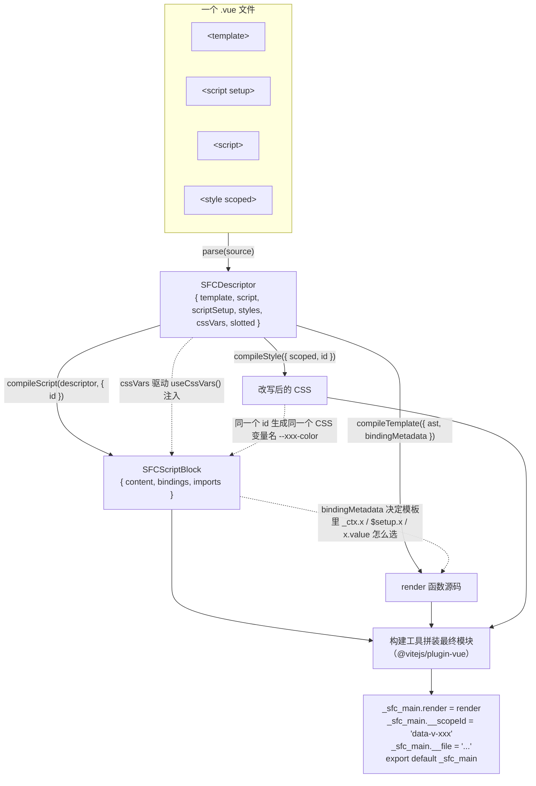
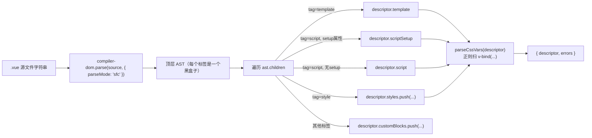
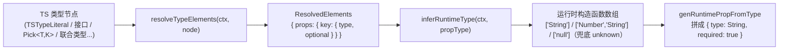
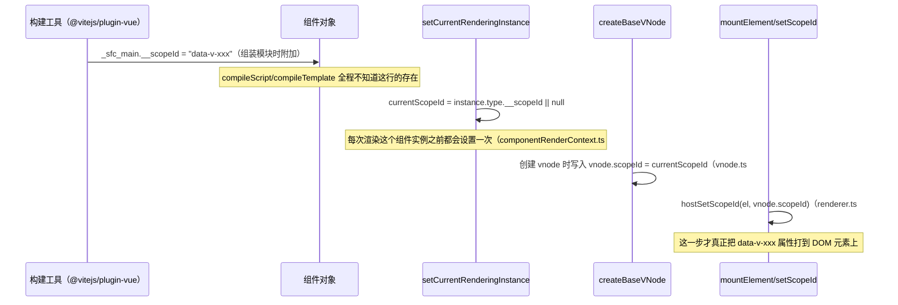

# 13. 单文件组件编译：compiler-sfc

> 一个 `.vue` 文件最终变成一个普通 JS 模块，靠的是 `@vue/compiler-sfc` 把 `<template>`/`<script>`/`<style>` 三块分别编译，再由构建工具（vite-plugin-vue / vue-loader）拼成一个模块；本章逐个拆解这条流水线。

## 本章导读

学完本章能回答：

- `.vue` 文件从磁盘到浏览器要经过哪几次独立编译？谁负责拼装最终模块？
- `<script setup>` 里的 `defineProps`/`defineEmits`/`defineModel` 这些"宏"到底是什么，为什么它们不是真的函数调用？
- 同一个 `ref` 变量，为什么在模板里有时候要写 `.value`，有时候不用？这是谁决定的？
- `scoped` 样式的 `data-v-xxx` 属性是编译期拼进代码里的，还是运行时加上去的？
- CSS 里的 `v-bind(color)` 怎么跟 JS 里的响应式变量联系起来？

前置章节：建议先看过第 11 章（compiler-core 的 parse/transform/codegen）和第 12 章（Block tree / PatchFlags），本章默认你已经理解 `_createElementBlock`/`openBlock`/`PatchFlags` 这些产物的含义。预计阅读时间：60~90 分钟。

涉及源码文件（均为 `packages/compiler-sfc/src/`，行数为 3.5.44 实测）：

| 文件 | 作用 | 行数量级 |
|---|---|---|
| `parse.ts` | `.vue` 源码 → `SFCDescriptor` | 485 |
| `compileScript.ts` | `<script setup>` 主编译流程 | 1417 |
| `script/context.ts` | `ScriptCompileContext`，贯穿编译过程的状态容器 | 207 |
| `script/defineProps.ts` | `defineProps`/`withDefaults` | 398 |
| `script/defineEmits.ts` | `defineEmits` | 128 |
| `script/defineModel.ts` | `defineModel` | 180 |
| `script/defineOptions.ts` / `defineSlots.ts` / `defineExpose.ts` | 其余三个宏 | 87/33/19 |
| `script/definePropsDestructure.ts` | 3.5 稳定的响应式 props 解构 | 401 |
| `script/analyzeScriptBindings.ts` | 普通 `<script>`（Options API）的绑定分析 | 131 |
| `script/resolveType.ts` | TS 类型 → 运行时 props/emits 推断 | 2286（全仓库最大单文件之一） |
| `script/topLevelAwait.ts` | 顶层 `await` 改写 | 69 |
| `compileTemplate.ts` | 调 compiler-dom/compiler-ssr 编译模板 | 337 |
| `template/transformAssetUrl.ts` / `transformSrcset.ts` | 资源路径转 import | 281/184 |
| `compileStyle.ts` | postcss 管线入口 | 242 |
| `style/pluginScoped.ts` | scoped 选择器改写 | 426 |
| `style/cssVars.ts` | `v-bind()` CSS 变量 | 348 |

## 先跑起来

```bash
pnpm ex chapters/13-compiler-sfc/examples/01-parse-descriptor.ts
```

关键输出（节选）：

```
│  3. scriptSetup block（attrs.setup 为 true 时才会进入这里，见 parse.ts#L196-L208）
│      {
│        lang: 'ts',
│        setup: true,
│        loc: { startLine: 6, endLine: 10 },
│        ...
│      }
│  7. cssVars：从 style 内容里用 v-bind() 扫出来的变量名列表（见 style/cssVars.ts#parseCssVars）
│      [ 'color' ]
│  8. slotted：style 里出现 :slotted() → true（见 parse.ts#L287-L291 的 slottedRE）
│      true
```

看到了什么：`parse()` 只是把一份 `.vue` 源文件按顶层标签切成几个 `SFCBlock`，**并不理解**里面的 JS/CSS 语义——`cssVars`/`slotted` 这些字段是用正则 + 小状态机扫出来的「提示信息」，真正的语义分析在 `compileScript`/`compileStyle` 里才发生。再跑一个能看到"同一段代码两种访问方式"的例子：

```bash
pnpm ex chapters/13-compiler-sfc/examples/04-compileScript-inline-template.ts
```

```
=> ref 访问 $setup.count（不带 .value，因为 $setup 实参是 proxyRefs() 包过的 setupState，读取时自动 unref）
=> count 是 setup() 作用域里的局部变量（ref 对象本身），所以要显式 `.value`
```

同一个 `{{ count }}`，`inlineTemplate: false` 时生成 `$setup.count`，`inlineTemplate: true` 时生成 `count.value`——这就是本章要讲清楚的"为什么"。

## 整体图



三路编译**互不依赖对方的产物代码**，只通过 `SFCDescriptor` 里的少量元信息（`bindingMetadata`、`cssVars`、同一个 `id`）互相"对齐"。这也是为什么 `compileScript`/`compileTemplate`/`compileStyle` 可以被构建工具分别调用、分别走 HMR：改一行 CSS 不需要重新编译 script。

## 源码精读

### 2.1 parse：从源文件到 SFCDescriptor

`parse()` 本身不认识 Vue 语法，它借用 `@vue/compiler-dom` 的 parser，只是传了 `parseMode: 'sfc'`（compiler-dom 的 parser 本来是解析模板用的，`sfc` 模式下它把顶层的 `<template>/<script>/<style>/自定义标签` 当作"不需要理解内部语义的容器元素"来解析，只管定位边界）：

```ts
// parse.ts#L144-L151
const ast = compiler.parse(source, {
  parseMode: 'sfc',
  prefixIdentifiers: true,
  ...templateParseOptions,
  onError: e => {
    errors.push(e)
  },
})
```

然后遍历顶层子节点按标签名分流（`parse.ts#L152-L224`）：

```ts
switch (node.tag) {
  case 'template':
    if (!descriptor.template) {
      const templateBlock = (descriptor.template = createBlock(node, source, false))
      if (!templateBlock.attrs.src) {
        templateBlock.ast = createRoot(node.children, source)
      }
      // 警告 2.x 的 <template functional>
    } else {
      errors.push(createDuplicateBlockError(node))
    }
    break
  case 'script':
    const scriptBlock = createBlock(node, source, pad) as SFCScriptBlock
    const isSetup = !!scriptBlock.attrs.setup
    if (isSetup && !descriptor.scriptSetup) {
      descriptor.scriptSetup = scriptBlock
      break
    }
    if (!isSetup && !descriptor.script) {
      descriptor.script = scriptBlock
      break
    }
    errors.push(createDuplicateBlockError(node, isSetup))
    break
  // style / default(customBlocks) 同理
}
```

规则很直白：**最多一个 `<script setup>` + 最多一个普通 `<script>`**，多了就报"只能有一个"的错误。`createBlock()`（`parse.ts#L314-L351`）负责把 `node.innerLoc` 切片出 `content`，并从标签属性里抽 `lang`/`src`/`scoped`/`module`/`setup`。

`SFCBlock.loc` 记录的是**整份源文件里的真实坐标**，不是从 0 开始——示例 01 里 `<script setup>` 在源文件第 6 行，`loc.start.line` 就是 6。这个坐标后面被 `genMap()`（`parse.ts#L265-L282`）直接用来生成 source map：不需要逐字符扫，只要按行数做偏移。



对应示例：`examples/01-parse-descriptor.ts`。

### 2.2 compileScript 主流程：按源码顺序讲

`compileScript()` 的函数体本质是一条流水线，源码里用注释标了序号（`1.1` ~ `11`），我们按这个顺序讲。先看入口判断（`compileScript.ts#L168-L215`）：

```ts
export function compileScript(
  sfc: SFCDescriptor,
  options: SFCScriptCompileOptions,
): SFCScriptBlock {
  const { script, scriptSetup, source, filename } = sfc
  // ...
  if (!scriptSetup) {
    // 没有 <script setup>：只做 Options API 的绑定分析，见 2.2.0
    const ctx = new ScriptCompileContext(sfc, options)
    return processNormalScript(ctx, scopeId)
  }
  const ctx = new ScriptCompileContext(sfc, options)
  // ... 下面是有 <script setup> 的完整流程
}
```

#### 2.2.0 没有 `<script setup>` 时：processNormalScript

```ts
// script/normalScript.ts#L10-L53
export function processNormalScript(
  ctx: ScriptCompileContext,
  scopeId: string,
): SFCScriptBlock {
  const script = ctx.descriptor.script!
  let content = script.content
  const scriptAst = ctx.scriptAst!
  const bindings = analyzeScriptBindings(scriptAst.body)
  // 如果有 cssVars，用 rewriteDefaultAST 把 export default 改成
  // const __default__ = {...}，再追加一段 genNormalScriptCssVarsCode
  // 把 useCssVars() 包进 __default__.setup 里
  return { ...script, content, bindings, scriptAst: scriptAst.body }
}
```

这条路径下 `analyzeScriptBindings`（`script/analyzeScriptBindings.ts`）直接静态分析 `export default { props, data, computed, methods, setup }` 这几个 Options API 字段，产出跟 `<script setup>` 一样形状的 `BindingMetadata`，这样模板编译不需要关心组件到底是哪种写法。

#### 2.2.1 ScriptCompileContext：贯穿全程的状态容器

`compileScript` 一开始就创建一个 `ScriptCompileContext`（`script/context.ts#L14-L133`），它是一个"大背包"，装着编译过程中要反复读写的东西：

```ts
// script/context.ts#L19-L67（节选）
export class ScriptCompileContext {
  scriptAst: Program | null
  scriptSetupAst: Program | null
  s: MagicString = new MagicString(this.source)   // 字符串级别的增删改
  startOffset = this.descriptor.scriptSetup?.loc.start.offset
  endOffset = this.descriptor.scriptSetup?.loc.end.offset

  userImports: Record<string, ImportBinding> = Object.create(null)

  // 各宏的"是否出现过"标记 + 抓到的 AST 节点
  propsRuntimeDecl, propsTypeDecl, propsDestructuredBindings, ...
  emitsRuntimeDecl, emitsTypeDecl, ...
  modelDecls: Record<string, ModelDecl> = Object.create(null)

  bindingMetadata: BindingMetadata = {}
  helperImports: Set<string> = new Set()
  helper(key: string): string {
    this.helperImports.add(key)
    return `_${key}`
  }
}
```

关键点：**编译的本质是对 `MagicString` 做增删改**，不是生成全新 AST 再 print 出来。这意味着除了被显式 `overwrite`/`remove`/`move` 的片段，源码里的格式、注释、空行全部原样保留——这也是为什么 `<script setup>` 的报错信息能精确指到用户原始代码的某一行。

#### 2.2.2 处理 import（去重 + 模板使用检测）

`<script>` 和 `<script setup>` 的 import 分两步登记（`compileScript.ts#L302-L393`），都调用 `registerUserImport`：

```ts
// compileScript.ts#L251-L280
function registerUserImport(source, local, imported, isType, isFromSetup, needTemplateUsageCheck) {
  let isUsedInTemplate = needTemplateUsageCheck
  if (needTemplateUsageCheck && ctx.isTS && sfc.template && !sfc.template.src && !sfc.template.lang) {
    isUsedInTemplate = isImportUsed(local, sfc, options.templateOptions)
  }
  ctx.userImports[local] = { isType, imported, local, source, isFromSetup, isUsedInTemplate }
}
```

`isImportUsed()`（`script/importUsageCheck.ts`）会**用 compiler-dom 的 parser 把模板解析一遍**，`walkIdentifiers` 收集模板里用到的所有标识符，看 import 进来的本地名是否在其中。这件事只在 **TS + 非 inline 模式**下才做——因为非 inline 模式下模板是独立编译的，compileScript 不知道模板到底用了哪些 import，必须自己扫一遍模板才能决定"要不要把这个 import 塞进 `__returned__`"（不这么做的话，未使用的 TS-only 类型 import 也会被当成值绑定，生成多余代码）。`<script>` 里的 import 同理去重，`<script setup>` 里重复 import 同一个来源会被 `removeSpecifier` 原地切掉。

#### 2.2.3 遍历 `scriptSetupAst.body`：识别宏调用

这是整个文件最核心的一段循环（`compileScript.ts#L522-L708`）。对每条顶层语句：

```ts
// compileScript.ts#L522-L544（节选）
for (const node of scriptSetupAst.body) {
  if (node.type === 'ExpressionStatement') {
    const expr = unwrapTSNode(node.expression)
    if (
      processDefineProps(ctx, expr) ||
      processDefineEmits(ctx, expr) ||
      processDefineOptions(ctx, expr) ||
      processDefineSlots(ctx, expr)
    ) {
      ctx.s.remove(node.start! + startOffset, node.end! + startOffset)
    } else if (processDefineExpose(ctx, expr)) {
      // defineExpose({}) -> __expose({})
      ctx.s.overwrite(callee.start!, callee.end!, '__expose')
    } else {
      processDefineModel(ctx, expr)
    }
  }
  if (node.type === 'VariableDeclaration' && !node.declare) {
    // const x = defineProps(...) / const emit = defineEmits(...) 等赋值写法
    // 同样调用 processDefineXxx，但这次要把整条声明语句"吃掉"或改写
  }
}
```

**宏不是函数**——`defineProps`/`defineEmits` 等从来不会被真的调用到。每个 `processDefineXxx(ctx, node)` 函数做的事情是：

1. 识别 `node` 是不是 `isCallOf(node, 'defineProps')`（`script/utils.ts`，检查 callee 名字）；
2. 把关心的参数（运行时对象 / 类型参数）记到 `ctx.propsRuntimeDecl` / `ctx.propsTypeDecl`；
3. 直接对 `ctx.s`（MagicString）做 `remove`/`overwrite`，把宏调用从源码里"抹掉"或替换成真正的运行时调用。

拿 `defineModel` 举例（`script/defineModel.ts#L102-L118`），它不是被删除，而是被**改写成 `useModel()` 调用**：

```ts
// defineModel.ts#L102-L118
ctx.s.overwrite(
  ctx.startOffset! + node.callee.start!,
  ctx.startOffset! + node.callee.end!,
  ctx.helper('useModel'),
)
ctx.s.appendLeft(
  ctx.startOffset! + (node.arguments.length ? node.arguments[0].start! : node.end! - 1),
  `__props, ` + (hasName ? `` : `${JSON.stringify(modelName)}${optionsRemoved ? `` : `, `}`),
)
```

示例 03 的真实产物验证了这一点：

```ts
const modelValue = _useModel<string>(__props, "modelValue")
const count = _useModel<number>(__props, 'count')
```

```mermaid
sequenceDiagram
    participant Loop as scriptSetupAst.body 遍历
    participant DP as processDefineProps
    participant DE as processDefineEmits
    participant DM as processDefineModel
    participant S as ctx.s (MagicString)

    Loop->>DP: node = defineProps<Props>()
    DP->>S: 记录 propsTypeDecl，整条语句 remove 或改写
    Loop->>DE: node = defineEmits(['change'])
    DE->>S: 记录 emitsRuntimeDecl，callee 改写为 __emit
    Loop->>DM: node = defineModel('count', {...})
    DM->>S: callee 改写为 _useModel，参数前插入 __props
    Note over S: 所有改动都是对同一份 MagicString 的增量编辑
```

对应示例：`examples/03-compileScript-macros.ts`。

#### 2.2.4 props 解构（3.5 稳定特性）

`const { title, count = 0 } = defineProps<Props>()` 这种写法在 `processDefineProps` 里被识别（`defineProps.ts#L84-L87`）：

```ts
if (!isWithDefaults && declId && declId.type === 'ObjectPattern') {
  processPropsDestructure(ctx, declId)
}
```

`processPropsDestructure`（`definePropsDestructure.ts#L28-L91`）记录每个解构出来的本地名对应哪个 prop key、有没有默认值，写进 `ctx.propsDestructuredBindings`；默认值被摘出来，后面在 `genRuntimeProps` 阶段合并进运行时 `props` 声明的 `default` 字段（**不是**留在 setup 函数体里跑一遍 `??`）。

真正的"解构变量在哪里被用到就在哪里改写"发生在 `transformDestructuredProps`（`definePropsDestructure.ts#L99-`），它用 `estree-walker` 的 `walk` 遍历**整个 `<script setup>` 的 AST**（不只是声明语句那一行！），对每个标识符用作用域栈判断"这个名字当前是不是指向解构出来的 prop"，是的话就地替换成 `__props.xxx`。示例 05 验证了这个改写会深入 `watch()` 的 getter 回调、普通函数体：

```ts
// 源码
const { title, count = 0 } = defineProps<{ title: string; count?: number }>()
watch(() => count, (v) => console.log(v))
function show() { console.log(title, count) }

// 产物
watch(() => __props.count, (v) => console.log(v))
function show() { console.log(__props.title, __props.count) }
```

这正是"响应式 props 解构"名字的由来：解构出来的 `count` 看起来是个普通变量，实际上每次被读取都会重新从 `__props.count` 取值，所以它始终反映最新的 prop，而不是解构那一刻的快照。

对应示例：`examples/05-props-destructure.ts`。

### 2.3 BindingTypes：模板怎么知道一个标识符该怎么访问

这是本章最重要的一张"判定表"。`BindingTypes` 定义在 `compiler-core/src/options.ts#L113-L155`：

```ts
export enum BindingTypes {
  DATA = 'data',
  PROPS = 'props',
  PROPS_ALIASED = 'props-aliased',
  SETUP_LET = 'setup-let',
  SETUP_CONST = 'setup-const',
  SETUP_REACTIVE_CONST = 'setup-reactive-const',
  SETUP_MAYBE_REF = 'setup-maybe-ref',
  SETUP_REF = 'setup-ref',
  OPTIONS = 'options',
  LITERAL_CONST = 'literal-const',
}
```

`compileScript.ts` 里的 `walkDeclaration()`（`#L1136-L1239`）按"怎么声明的"分类，判定顺序大致是：

```mermaid
flowchart TD
    A["const/let 声明"] --> B{是 const 且\n初始值是字面量?}
    B -->|是| LC["LITERAL_CONST\n(字符串/数字/布尔/模板字面量等)"]
    B -->|否| C{"isCallOf(init, reactive 别名)?"}
    C -->|是| RC["SETUP_REACTIVE_CONST\n(const = reactive(...))"]
    C -->|否| D{"canNeverBeRef(init)?\n对象/数组/函数/new 等字面量\n或 defineProps()/defineEmits() 调用"}
    D -->|是| SC["SETUP_CONST"]
    D -->|否| E{是 const 吗?}
    E -->|否 (let)| SL["SETUP_LET"]
    E -->|是| F{"isCallOf(init, ref/computed/\nshallowRef/toRef/defineModel 等)?"}
    F -->|是| SR["SETUP_REF"]
    F -->|否| SM["SETUP_MAYBE_REF\n(不确定是不是 ref 的函数调用结果)"]
```

示例 02 的真实输出验证了这张表：

```
a (字符串字面量)         -> literal-const
obj = { x: 1 }           -> setup-const       （对象字面量，canNeverBeRef）
n = ref(0)                -> setup-ref
count (let)               -> setup-let
state = reactive({...})   -> setup-reactive-const
maybe = useSomething()    -> setup-maybe-ref   （不认识的函数调用）
```

这张表决定的是**模板编译阶段怎么访问这个标识符**，具体逻辑在 `compiler-core/src/transforms/transformExpression.ts` 的 `rewriteIdentifier()`（`#L127-L222`）：

```ts
// transformExpression.ts#L148-L213（节选，inline 模式分支）
if (isConst(type) || type === BindingTypes.SETUP_REACTIVE_CONST) {
  return raw                                    // 不用任何前缀
} else if (type === BindingTypes.SETUP_REF) {
  return `${raw}.value`                         // 确定是 ref，直接 .value
} else if (type === BindingTypes.SETUP_MAYBE_REF) {
  return isAssignmentLVal ? `${raw}.value` : wrapWithUnref(raw)   // 不确定，包 unref()
} else if (type === BindingTypes.SETUP_LET) {
  // let 既可能是 ref 也可能是普通值，运行时用 isRef() 分支判断
  return `${isRef}(${raw}) ? ${raw}.value ${op} ${rhs} : ${raw}`
} else if (type === BindingTypes.PROPS) {
  return genPropsAccessExp(raw)                 // __props.xxx
}
// ... 非 inline 分支
} else {
  if (type?.startsWith('setup') || type === BindingTypes.LITERAL_CONST) {
    return `$setup.${raw}`
  } else if (type === BindingTypes.PROPS_ALIASED) {
    return `$props['${bindingMetadata.__propsAliases![raw]}']`
  } else if (type) {
    return `$${type}.${raw}`                    // $data.xxx / $options.xxx
  }
}
return `_ctx.${raw}`   // 兜底：全局属性、Vue 内置、未知标识符
```

`context.inline` 这个开关就是 2.4 节要讲的 `inlineTemplate`。

对应示例：`examples/02-compileScript-bindings.ts`。

### 2.4 inlineTemplate：两条截然不同的产物路径

`compileScript()` 走到第 9 步"生成 return 语句"时（`compileScript.ts#L892-L997`），根据 `options.inlineTemplate` 分叉：

```ts
// compileScript.ts#L896-L997（节选）
if (!options.inlineTemplate || (!sfc.template && ctx.hasDefaultExportRender)) {
  // 非 inline：原样返回所有绑定，模板由外部单独编译
  returned = `{ ` + /* 遍历 scriptBindings/setupBindings/userImports 拼对象字面量 */ ` }`
} else {
  // inline：调用 compileTemplate({ inline: true, bindingMetadata: ctx.bindingMetadata })
  // 把生成的 render 函数源码（preamble + code）直接拼进当前的 MagicString
  const { code, preamble, ast } = compileTemplate({ ..., compilerOptions: { inline: true, bindingMetadata: ctx.bindingMetadata } })
  if (preamble) ctx.s.prepend(preamble)
  returned = code
}
```

非 inline 模式下，`compileScript` 完全不知道模板长什么样，只管把"暴露给模板用"的变量打包进 `__returned__`；真正的 render 函数是构建工具另外调 `compileTemplate()` 生成的**独立函数**，通过固定参数签名 `render(_ctx, _cache, $props, $setup, $data, $options)` 访问状态——这也是为什么 `$setup.count` 不需要 `.value`：这个 `$setup` 实参就是 `instance.setupState`，而 `instance.setupState = proxyRefs(setupResult)`（`runtime-core/src/component.ts#L964`），`proxyRefs` 在 get/set 时自动做了 unref。

inline 模式下，render 函数的源码被直接拼进 `setup()` 函数体末尾，作为一个闭包返回。这时候模板表达式里的 `count` 就是 setup 作用域里那个真正的 `ref` 对象，必须显式 `.value`；`props.title` 因为没有对应的本地变量名，直接生成 `__props.title`。

对比两种模式的产物（示例 04 真实输出）：

```js
// inlineTemplate: false ——————————————————————————
export default _defineComponent({
  __name: 'Inline',
  props: { title: { type: String, required: true } },
  setup(__props, { expose: __expose }) {
    __expose()
    const props = __props
    const count = ref(0)
    function inc() { count.value++ }
    const __returned__ = { props, count, inc }
    Object.defineProperty(__returned__, '__isScriptSetup', { value: true })
    return __returned__
  }
})
// 另外编译出来的独立 render 函数：
export function render(_ctx, _cache, $props, $setup, $data, $options) {
  return (_openBlock(), _createElementBlock("div", { onClick: $setup.inc },
    _toDisplayString($setup.count) + " - " + _toDisplayString($props.title), 1))
}

// inlineTemplate: true ——————————————————————————
export default _defineComponent({
  __name: 'Inline',
  props: { title: { type: String, required: true } },
  setup(__props) {
    const props = __props
    const count = ref(0)
    function inc() { count.value++ }
    return (_ctx, _cache) => {
      return (_openBlock(), _createElementBlock("div", { onClick: inc },
        _toDisplayString(count.value) + " - " + _toDisplayString(__props.title), 1))
    }
  }
})
```

`inlineTemplate: true` 生成的代码更紧凑（不需要通过 `_ctx`/`$setup` 间接访问，直接闭包捕获），但代价是**模板不能脱离脚本单独热更新**——官方文档明确标注它"should only be used in production"（`compileScript.ts#L97-L102` 的选项注释）。`@vitejs/plugin-vue` 在生产构建下默认用 inline 模式，开发模式用非 inline 模式以支持模板单独 HMR。

对应示例：`examples/04-compileScript-inline-template.ts`。

### 2.5 defineProps / withDefaults / resolveType 概览

运行时写法（`defineProps({ title: String })`）直接把对象字面量透传到生成的 `props` 选项里（`defineProps.ts#L141-L177` 的 `genRuntimeProps`）。类型写法（`defineProps<Props>()`）则要先用 `resolveType.ts` 把 TS 类型"拍扁"：



`resolveTypeElements` 要处理接口继承、交叉类型、`Pick`/`Omit`/`Partial` 等 utility types，甚至"类型是从别的文件 import 进来的"——这时候它会通过 `TSFileSystem`（基于 `ts.sys` 或调用方传入的虚拟文件系统）读取那个文件，重新用 Babel 解析出 AST 再递归解析类型，解析结果缓存在 `fileToScopeCache` 里避免重复读盘。这部分是 `compiler-sfc` 里最庞大（2286 行）也最少被需要逐行读的模块——**一般只需要知道它能把几乎所有常见 TS 类型写法映射成 `[String, Number, ...]` 这样的运行时类型数组**，复杂 utility types 或跨文件类型解析细节建议遇到问题再去源码定位。

`withDefaults(defineProps<Props>(), { size: 'small' })` 本质是给 `defineProps` 套了层壳（`defineProps.ts#L95-L139`），把第二个参数记到 `ctx.propsRuntimeDefaults`，生成时如果默认值全是静态字面量就直接内联进每个 prop 的 `default` 字段（`hasStaticWithDefaults`），否则退化为运行时 `mergeDefaults(props, defaults)` 调用。

对应示例：`examples/03-compileScript-macros.ts`。

### 2.6 顶层 await：withAsyncContext

`<script setup>` 里的顶层 `await` 会被 `walk()` 发现（`compileScript.ts#L637-L680`），函数边界会被跳过（`isFunctionType(child) && this.skip()`，`#L644-L646`），所以只有真正"顶层"的 `await` 被处理：

```ts
// topLevelAwait.ts#L56-L67
ctx.s.overwrite(node.start!, argumentStart,
  `${needSemi ? `;` : ``}(\n  ([__temp,__restore] = ${ctx.helper('withAsyncContext')}(() => `)
ctx.s.appendLeft(node.end!,
  `)),\n  ${isStatement ? `` : `__temp = `}await __temp,\n  __restore()${isStatement ? `` : `,\n  __temp`}\n)`)
```

真实产物（示例 08）：

```js
const data = (
  ([__temp,__restore] = _withAsyncContext(() => fetch('/api').then(r => r.json()))),
  __temp = await __temp,
  __restore(),
  __temp
)
```

为什么需要这层包装：`getCurrentInstance()` 依赖一个**模块级全局变量** `currentInstance`。如果 `await` 之后代码直接在微任务里继续跑，这期间其他组件的 `setup()` 可能也在执行，会把 `currentInstance` 改写成别的实例；`await` 之后紧跟着调用 `onMounted()` 之类的生命周期 API 就会挂错实例。`withAsyncContext`（`runtime-core/src/apiSetupHelpers.ts#L522-`）在 `await` 前记住当前实例，`await` 后（`__restore()`）主动恢复，保证了"即使跨越了一次微任务调度，`setup()` 内后续的生命周期注册仍然挂在正确的实例上"。这也是 `setup()` 变成 `async function` 后必须配合 `<Suspense>` 的根本原因——它的返回值变成了 `Promise`。

对应示例：`examples/08-top-level-await.ts`。

### 2.7 compileTemplate：注入 nodeTransforms + 选择编译器

```ts
// compileTemplate.ts#L178-L237（节选）
let nodeTransforms: NodeTransform[] = [transformAssetUrl, transformSrcset]
const defaultCompiler = ssr ? CompilerSSR : CompilerDOM
let { code, ast, preamble, map } = compiler.compile(inAST || source, {
  mode: 'module',
  prefixIdentifiers: true,
  hoistStatic: true,
  cacheHandlers: true,
  scopeId: scoped ? longId : undefined,
  slotted,
  ...compilerOptions,
  nodeTransforms: nodeTransforms.concat(compilerOptions.nodeTransforms || []),
})
```

`transformAssetUrl`（`template/transformAssetUrl.ts`）把 `` 这类相对路径改写成具名 import（`import _imports_0 from './a.png'`），交给打包工具解析真实 URL；`transformSrcset` 对 `srcset` 属性里的多个候选图分别处理，编译期拼接成字符串。

这里传了 `scopeId: scoped ? longId : undefined`，但**这是一个几乎不起作用的参数**——下一节详细讲这个反直觉的事实。

对应示例：`examples/06-compileTemplate-scope-and-assets.ts`。

### 2.8 scoped 的真相：scopeId 不是编译期拼进代码的

这是本章一个容易被误解、也是示例验证出来的关键事实：**`compileTemplate({ scoped: true })` 和 `{ scoped: false }` 产出的 render 函数代码逐字节相同**（示例 06 用 `===` 比较验证）。

追到 `compiler-core/src/codegen.ts#L305`：

```ts
const genScopeId = !__BROWSER__ && scopeId != null && mode === 'module'
```

这个 `genScopeId` 被传进 `genModulePreamble(ast, preambleContext, genScopeId, isSetupInlined)`，但在 3.5.44 的 `genModulePreamble`/`genHoists` 函数体内**根本没有被使用**。再看 `runtime-core/src/componentRenderContext.ts#L44-L53`：

```ts
export function pushScopeId(id: string | null): void {
  currentScopeId = id
}
// Technically we no longer need this after 3.0.8 but we need to keep the
// same API for backwards compat w/ code generated by compilers.
export const withScopeId = (_id: string): typeof withCtx => withCtx
```

源码注释写得很直接：**从 3.0.8 开始就不再需要这套"编译期插入 pushScopeId/popScopeId"的机制了**，保留只是为了兼容"更老版本编译器生成、但和新版运行时一起打包"的场景。真正的实现是：



`__scopeId` 这行代码不是 `compiler-sfc` 加的，是 `@vitejs/plugin-vue` 在拼装最终模块时追加的（证据：`node_modules/@vitejs/plugin-vue/dist/index.mjs` 里能直接搜到 `attachedProps.push(['__scopeId', JSON.stringify(\`data-v-${descriptor.id}\`)])`）。这个设计把"样式作用域"完全从模板编译中剥离——**同一份编译出来的 render 函数，加不加 scoped 样式，代码毫无差别**，scopeId 的开销只在渲染期查一次全局变量、在每个 vnode 上存一个字段、挂载时设一次 DOM 属性，不随模板复杂度增长。

插槽内容需要特殊处理：子组件渲染插槽时执行的是**父组件写的模板片段**，但这段代码此刻的 `currentRenderingInstance` 是子组件实例。`withCtx()`（`componentRenderContext.ts#L70-`）包裹插槽函数，调用前后临时切换 `currentRenderingInstance`/`currentScopeId` 回父实例，这样插槽内容创建的 vnode 才会带着"父组件的 scopeId"——这正是 `:slotted()` 选择器要解决的问题的运行时基础。

对应示例：`examples/06-compileTemplate-scope-and-assets.ts`。

### 2.9 compileStyle：postcss 插件管线

`compileStyle`（`compileStyle.ts#L88-L142`）是一条固定顺序的 postcss 插件链：

```ts
const plugins = (postcssPlugins || []).slice()
plugins.unshift(cssVarsPlugin({ id: shortId, isProd }))   // 1. v-bind() -> var()
if (trim) plugins.push(trimPlugin())                       // 2. 去空白
if (scoped) plugins.push(scopedPlugin(longId))              // 3. 选择器改写
if (modules) plugins.push(postcssModules({ ... }))          // 4. CSS Modules（仅 compileStyleAsync）
```

**scoped 选择器改写**（`style/pluginScoped.ts`）的核心是 `rewriteSelector()`，按复合选择器从右往左找"最后一个有效节点"插入属性选择器：

| 写法 | 结果 | 原因 |
|---|---|---|
| `.a {}` | `.a[data-v-xxx] {}` | 直接在选择器末尾插入 |
| `.b .c {}` | `.b .c[data-v-xxx] {}` | 只加在"最后一个复合选择器"上，不是每一级都加 |
| `:deep(.inner) {}` | `[data-v-xxx] .inner {}` | 作用域锚点放在前面，`.inner` 及后面不受限 |
| `::v-slotted(.foo) {}` | `.foo[data-v-xxx-s] {}` | 用 `id + '-s'` 另一个后缀，和普通 scopeId 区分开 |
| `:global(.foo) {}` | `.foo {}` | 完全不加，用户自己负责影响范围 |
| `@keyframes fade {}` | `@keyframes fade-xxx {}` | 关键帧改名避免跨组件冲突，`animation`/`animation-name` 同步改写引用 |

`v-bind()` CSS 变量（`style/cssVars.ts`）分两侧配合：

- **style 侧**（`cssVarsPlugin`，`#L273-L300`）：手写一个小状态机 `lexBinding()` 找到 `v-bind(...)` 里带括号表达式的真正右括号位置（不能用简单正则，因为表达式里可能还有括号/引号），把整段替换成 `var(--${id}-${变量名})`；
- **script 侧**（`genCssVarsCode`，`#L303-L329`）：`compileScript` 第 7 步（`compileScript.ts#L822-L839`）自动在 setup 顶部注入：

```js
_useCssVars(_ctx => ({ "abc123-color": (color.value) }))
```

两侧用同一个 `id`（即 `compileScript`/`compileStyle` 共享的 scopeId 短 ID）生成同一个变量名，样式和脚本才能对上。运行时 `useCssVars`（`runtime-dom/src/helpers/useCssVars.ts#L20-L67`）在 `onMounted` 时建立 `watch(setVars, NOOP, { flush: 'post' })`，依赖变化后重新执行 `getter(instance.proxy)` 算出变量值对象，再逐个 `el.style.setProperty('--xxx', value)`；额外用一个 `MutationObserver` 盯着父节点，处理元素被 `Teleport` 挪动之后仍要正确设置变量的情况。

对应示例：`examples/07-compileStyle-scoped-cssvars.ts`。

## 与 Vue 2 对比

| 维度 | Vue 2 | Vue 3 | 为什么这么改 |
|---|---|---|---|
| SFC 编译入口 | `vue-loader` + `@vue/component-compiler-utils`：`parse()`/`compileTemplate()`/`compileStyle()` 分散在独立包里，`vue-template-compiler` 提供底层 parser | 统一收进一个包 `@vue/compiler-sfc`，`vue-loader`/`@vitejs/plugin-vue` 只是薄薄的调用方 | 3.x 的 compiler-sfc 本身就能被非 webpack 工具（Vite）直接复用，不用再维护一套适配层 |
| `<script setup>` | Vue 2.7 才补上，2.6 及之前完全没有。实测 `vuejs/vue@v2.7.16` 的 `packages/compiler-sfc/src/compileScript.ts` 是单文件 1916 行（不像 3.5 拆成 `script/*.ts` 十几个模块），只有 `defineProps`/`defineEmits`/`defineExpose`/`withDefaults` 四个宏（`compileScript.ts#L53-L56`），`BindingTypes` 也一一对应 | 从 3.2 起稳定；3.5 的 `BindingTypes`/宏集合已扩展到 `defineOptions`/`defineSlots`/`defineModel`，且 `resolveType.ts`/各宏被拆成独立模块 | 2.7 是官方给 2.x 用户的"迁移垫脚石"，整体思路（宏识别 + MagicString 改写 + bindingMetadata）与 3.x 同源，但版本停留在移植时（约 3.2 时代）的状态，之后 3.3+ 新增的宏和重构都不会同步进 2.7 |
| scoped 实现位置 | 比想象中更接近 Vue 3：实测 `vuejs/vue@v2.7.16` 的 `src/compiler/codegen/` 里**完全没有 `scopeId` 字样**——模板编译产物同样不关心 scoped；`_scopeId` 是 vue-loader 直接设到组件 `options` 对象上的静态字段（和 Vue 3 的 `__scopeId` 做法一样）。区别在运行时：`src/core/vdom/patch.ts#L306-L327` 的 `setScope(vnode)` 在**每个元素创建时**（`createElm` 内部，`patch.ts#L167`/`#L220` 调用点）读 `vnode.context.$options._scopeId`（函数式组件读 `vnode.fnScopeId`），并沿着 `vnode.parent`（组件根节点的"占位 vnode"链，用于处理组件根元素层层转发的情况）继续向上找，命中几个就设几个 `data-v-xxx` 属性 | **渲染期一次性全局变量**：`componentRenderContext.ts` 在每次渲染组件**开始前**把 `currentScopeId` 设成 `instance.type.__scopeId`，之后该次渲染创建的每个 `vnode` 都顺手记到 `vnode.scopeId`（`vnode.ts#L460`），`patch` 阶段再统一读 `vnode.scopeId` 设置 DOM 属性（`renderer.ts#L713-L808`） | 两代做法的共同点是"scopeId 都不出现在编译产物里"；差异在触发时机——Vue 2 在**每个元素创建时**查一次（经由 `vnode.context`/`vnode.parent` 链），Vue 3 改成**每次组件渲染只查一次**（渲染前设一次模块变量），再把结果"广播"给这次渲染产生的所有 vnode，减少了重复查找 |
| 函数式组件模板 | `<template functional>` 有专门的编译路径和运行时分支（`FunctionalRenderContext`） | 完全移除，`parse.ts#L179-L191` 显式检测并报错："functional components no longer have significant performance difference from stateful ones" | 3.x 的组件挂载/更新开销已经降到和函数式组件接近，不再需要为"少一次实例化"单独做一套编译与运行时路径 |
| `inlineTemplate` | 没有对应概念：vue-loader 里模板始终单独编译成 `render` 函数挂到选项上 | `compileScript({ inlineTemplate: true })` 可以把 render 函数内联进 `setup()` 闭包，换取直接变量访问、省去 `_ctx`/`$setup` 间接层 | script setup 的本地变量天然就是闭包变量，内联省掉了一层通过组件实例代理查找属性的开销；代价是模板不能单独 HMR，所以只在生产构建开启 |
| props 解构 | 不存在"解构就是响应式"这个概念，Vue 2 的 `props` 对象本身就是响应式的（基于 `Object.defineProperty`），直接解构会丢失响应性（和 Vue 3 `reactive()` 解构的坑一样） | 3.5 起 `const { x } = defineProps()` 被编译器静态改写为处处访问 `__props.x`，语法上看起来是解构，实际从不丢失响应性 | 这是纯编译期把戏：没有运行时代理能让"解构赋值出来的普通变量"保持响应性，只能在编译期把所有引用点换成访问原对象 |

## 动手：实验

本章没有对应的 `mini-vue` 实现——`compileScript`/`resolveType` 这类模块的"精简版"意义有限（核心复杂度恰恰在于处理各种边界写法），更适合直接读源码、改源码观察效果。建议在现有示例基础上做这些实验：

1. **改 `examples/02`**：把 `const maybe = useSomething()` 换成 `const maybe = useSomething() as Ref<number>`（显式类型断言），看 `BindingTypes` 判定会不会变化——提示：`walkDeclaration` 并不读类型标注，只看初始化表达式的*调用目标名字*，所以断言不会改变判定结果，这是个常见的认知误区。
2. **改 `examples/03`**：给 `defineProps` 的类型写法加一个联合类型 `size?: 'small' | 'large' | number`，观察 `inferRuntimeType` 推导出的 `type: [String, Number]` 数组，并思考为什么运行时 props 校验这种情况下会放宽（`skipCheck`）。
3. **改 `examples/06`**：把 `transformAssetUrls: false` 传给 `compileTemplate`，对比 `` 的 `src` 还是不是原始字符串；再试着给 `tags` 配置加一个自定义标签（比如 `MyIcon: ['icon']`），验证自定义资源属性也能被转换。

## 常见疑问

**Q: `defineProps`/`defineEmits` 为什么不用 import 就能用？**
A: 它们是编译期宏，`compileScript` 在遍历 `<script setup>` 顶层语句时按名字识别调用（`isCallOf`），处理完直接从源码里删除或改写掉，运行时从来不存在这两个函数。如果手动 `import { defineProps } from 'vue'`，反而会被 `compileScript.ts#L353-L357` 识别出来并警告"是编译器宏，不需要 import"。

**Q: 同一个 ref，为什么有的地方要 `.value`，有的地方不用？**
A: 取决于访问位置的 `BindingTypes` 和当前是 inline 还是非 inline 模式。在 `<script setup>` 的 JS 代码里永远需要 `.value`（没有编译器帮你改写裸露的脚本代码，只有宏调用和 props 解构会被改写）；在模板里由编译器根据 `bindingMetadata` 决定要不要帮你加（`compiler-core/src/transforms/transformExpression.ts#rewriteIdentifier`）。

**Q: `inlineTemplate` 什么时候该用？**
A: 构建工具自己决定，用户一般不需要手动配置。`@vitejs/plugin-vue` 在生产构建默认开启（减少一层属性查找、代码更紧凑），开发模式关闭（让模板可以独立于脚本做 HMR，改模板不触发组件重新创建）。

**Q: `scoped` 样式会不会影响编译产物的体积/性能？**
A: 不会影响模板编译产物（2.8 节已证明代码逐字节相同），只多一个 `__scopeId` 静态字符串属性和渲染期一次全局变量赋值 + 挂载期一次 `setAttribute`，可以认为是常数开销。

**Q: props 解构出来的变量能传给子函数当参数吗？会丢失响应性吗？**
A: 不会丢——因为它根本不是一个真正的局部变量，所有"看起来是读这个变量"的地方都会被静态替换成 `__props.xxx`。但如果你把它赋值给另一个变量再传递（比如 `const t = title; foo(t)`），那就是真的赋值一次性快照了，这点和普通 JS 变量没有区别，编译器只能改写它能看见的直接引用点。

**Q: `withDefaults` 还有必要用吗？** （3.5 之后）
A: 基本不需要了——`defineProps` 直接解构加默认值（`const { size = 'small' } = defineProps<Props>()`）等价且更简洁。源码里 `processWithDefaults`（`defineProps.ts#L124-L131`）甚至会在检测到解构写法时主动警告"withDefaults 是多余的"。

## 小结

- `.vue` 文件的编译不是"一次性"的：`parse → compileScript / compileTemplate / compileStyle` 是三条相对独立的流水线，构建工具负责拼装，各自可以独立走 HMR。
- `compileScript` 的核心数据结构是 `ScriptCompileContext`，整个编译过程本质是用 `MagicString` 对源码做增量的 `remove`/`overwrite`/`move`，不是重新生成 AST 打印。
- 宏（`defineProps`/`defineEmits`/`defineModel`/...）不是运行时函数，是被编译器静态识别、改写、删除的标记；`defineModel` 会被实打实地改写成 `useModel()` 调用。
- `BindingTypes` 是连接 script 编译和 template 编译的桥梁：同一个标识符，根据声明方式 + `inline` 选项，会被生成完全不同的访问代码（`x` / `x.value` / `_unref(x)` / `$setup.x` / `__props.x`）。
- `inlineTemplate` 决定 render 函数是独立编译还是内联进 `setup()`：前者方便 HMR，后者省去中间层访问开销，生产构建默认用后者。
- props 解构（3.5 稳定）是纯编译期把戏：解构出来的"变量"全部被静态替换成 `__props.xxx` 访问，默认值被挪进运行时 props 声明。
- `scoped` 样式的核心实现是**运行时的**：一个模块级 `currentScopeId` 变量 + 渲染前赋值 + vnode 创建时记录 + 挂载时设置 DOM 属性；编译期插入 `pushScopeId`/`popScopeId` 的机制从 3.0.8 起已经废弃，只剩兼容壳。
- `v-bind()` CSS 变量靠 style 侧和 script 侧共享同一个 `id` 对齐变量名，运行时 `useCssVars` 用 `watch` + `MutationObserver` 把值写进 `element.style`。

## 延伸阅读

- `<script setup>` RFC：https://github.com/vuejs/rfcs/blob/master/active-rfcs/0040-script-setup.md
- 响应式 props 解构 RFC（3.5 稳定）：https://github.com/vuejs/rfcs/discussions/502
- Vue 2.7 发布说明（`<script setup>` 回移植）：https://blog.vuejs.org/posts/vue-2-7-naturally
- `@vue/compiler-sfc` 源码目录：https://github.com/vuejs/core/tree/main/packages/compiler-sfc
- `@vitejs/plugin-vue` 源码（看它如何拼装 `__scopeId`/`__hmrId`/`__file`）：https://github.com/vitejs/vite-plugin-vue/tree/main/packages/plugin-vue

## 思考题

1. 如果一个 `<script setup>` 组件同时写了普通 `<script>` 导出 `name` 选项，又用 `defineOptions({ name: 'Foo' })`，两者的 `name` 冲突时最终谁生效？为什么（提示：看 `compileScript.ts` 里 `defaultExport`/`definedOptions` 被拼进 `Object.assign` 的顺序）？

   <details><summary>答案</summary>

   普通 `<script>` 的 `export default { name: 'A' }` 变成 `__default__` 对象，`defineOptions({ name: 'Foo' })` 变成 `definedOptions` 字符串。最终生成 `Object.assign(__default__, definedOptions, { __name, setup... })`（TS 下是对象展开 `{ ...__default__, ...definedOptions, ... }`），`definedOptions` 排在 `__default__` 后面，所以 `defineOptions` 里的 `name` 会覆盖普通 `<script>` 导出的 `name`。
   </details>

2. 为什么 `useCssVars` 的运行时实现要额外用一个 `MutationObserver`，而不是只依赖 `watch()`？

   <details><summary>答案</summary>

   `watch()` 只在"响应式依赖变化"时重新执行 `setVars()`，但 CSS 变量是设置在具体 DOM 元素的 `style` 上的；如果这个元素被 `<Teleport>` 移动到了别的父节点、或者组件根节点因为 `v-if` 切换成了别的元素，依赖没变但"该往哪个元素上设置变量"变了。`MutationObserver` 监听的是挂载点父节点的子节点列表变化，用来捕获这类"结构变了但响应式依赖没变"的场景。
   </details>

3. `inlineTemplate: true` 和 `false` 产出的组件，运行时行为（而不是代码体积/HMR 能力）有没有可观测的差异？试着从 `renderComponentRoot`（`runtime-core/src/componentRenderUtils.ts`）调用 `render.call(...)` 时传的参数列表角度想一想。

   <details><summary>答案</summary>

   没有可观测的行为差异。`render.call(thisProxy, proxyToUse, renderCache, props, setupState, data, ctx)` 这几个参数永远都会传，inline 模式下生成的 render 函数签名是 `(_ctx, _cache) => {...}`，只是不使用后面几个参数（因为它直接闭包访问局部变量）；非 inline 模式的 render 函数签名用全 `(_ctx, _cache, $props, $setup, $data, $options)`。两者访问的底层数据源完全一致，只是"从哪条路径读"不同。
   </details>
