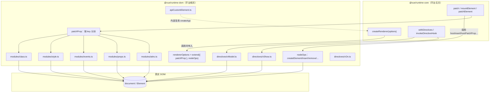
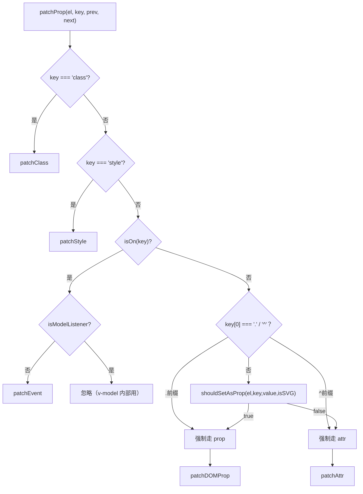
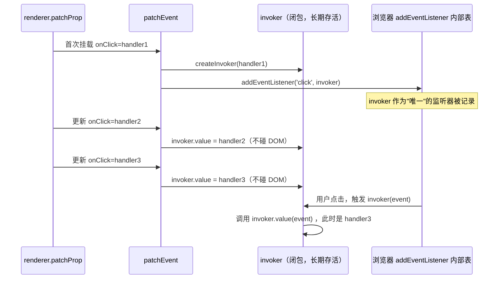
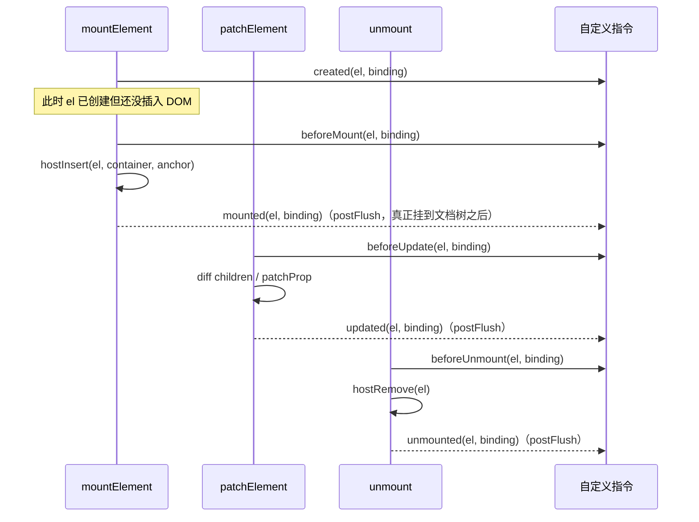

# 14. runtime-dom：平台层实现

> runtime-core 只定义「要做什么」（一组 `RendererOptions` 接口），runtime-dom 回答「在浏览器里具体怎么做」：怎么创建一个真实 DOM 节点、怎么把一个 prop 落到 attribute 还是 property、怎么把一个事件处理函数安全地接到 `addEventListener` 上。

## 本章导读

学完本章能回答：

- `createRenderer(rendererOptions)` 里的 `rendererOptions` 到底是什么形状？为什么只用 `reactivity` 的用户不会把 DOM 代码打包进去？
- 同一个 `h('div', { xxx: yyy })` 里的 `xxx`，什么时候落到 `el.xxx = yyy`（DOM property），什么时候落到 `el.setAttribute('xxx', yyy)`（attribute）？
- 为什么 `@click` 换一个处理函数不需要重新 `addEventListener`？`el._vei` 里到底缓存了什么？
- `v-model`、`v-show` 在运行时到底是什么——它们是编译期语法糖还是真的有「实现代码」在跑？
- `createApp(...).mount('#app')` 这一行，`runtime-dom` 到底在 `runtime-core` 的 `mount` 外面包了哪些和「DOM 容器」相关的逻辑？

前置章节：05（VNode / `createApp`）、06（组件实例与生命周期）、07（`patch` 与 diff）、09（props/emits/slots）。建议读完这几章、对 `RendererOptions` 这个接口有印象后再看本章。预计阅读时间 60～90 分钟。

涉及源码文件清单（均来自 `packages/runtime-dom/src` 与 `packages/runtime-core/src`，版本 3.5.44）：

| 文件 | 作用 | 行数量级 |
|---|---|---|
| `runtime-dom/src/index.ts` | 组装 `rendererOptions`、`ensureRenderer` 懒创建、`createApp`/`createSSRApp` 对容器的包装 | ~314 |
| `runtime-dom/src/nodeOps.ts` | 13 个最基础的宿主节点操作（create/insert/remove/...） | ~139 |
| `runtime-dom/src/patchProp.ts` | 按 key 把 prop 分派到 class/style/event/attr/prop 五类处理 | ~173 |
| `runtime-dom/src/modules/class.ts` | `patchClass`：`className` 赋值 + 与 Transition 临时类名的合并 | ~26 |
| `runtime-dom/src/modules/style.ts` | `patchStyle`：对象/字符串/数组/`!important`/CSS 变量/与 v-show 的联动 | ~165 |
| `runtime-dom/src/modules/events.ts` | `patchEvent`：invoker 缓存、修饰符解析、事件时间戳守卫 | ~163 |
| `runtime-dom/src/modules/props.ts` | `patchDOMProp`：DOM property 赋值（`value`/`<option>`/布尔值归一化） | ~111 |
| `runtime-dom/src/modules/attrs.ts` | `patchAttr`：`setAttribute`/`xlink:` 命名空间/布尔 attribute | ~95 |
| `runtime-core/src/directives.ts` | `withDirectives`/`invokeDirectiveHook`：自定义指令的运行时骨架 | ~200 |
| `runtime-dom/src/directives/vModel.ts` | `vModelText`/`vModelCheckbox`/`vModelRadio`/`vModelSelect`/`vModelDynamic` | ~456 |
| `runtime-dom/src/directives/vShow.ts` | `vShow`：`display` 的隐藏/恢复 | ~63 |
| `runtime-dom/src/directives/vOn.ts` | `withModifiers`/`withKeys`：事件修饰符的运行时 helper | ~163 |
| `runtime-dom/src/apiCustomElement.ts` | `defineCustomElement`/`VueElement`：Web Component 封装 | ~843 |

## 先跑起来

```bash
pnpm ex chapters/14-runtime-dom/examples/01-patchProp-dispatch.ts
pnpm ex chapters/14-runtime-dom/examples/02-event-invoker.ts
pnpm ex chapters/14-runtime-dom/examples/03-style-patch.ts
pnpm ex chapters/14-runtime-dom/examples/04-v-model-directives.ts
pnpm ex chapters/14-runtime-dom/examples/05-directive-hooks-order.ts
pnpm ex chapters/14-runtime-dom/examples/06-mount-flow.ts
```

`01` 的关键输出（`form`/`list`/`type` 几个「必须走 attribute」的特判）：

```
┌───────── 3. shouldSetAsProp 特判：form 属性必须走 attribute（只读 prop）
│  1. h("button", { form: "my-form" })
│      form         attribute="my-form"  property=null
┌──────────── 4. shouldSetAsProp 特判：<input list> 必须走 attribute
│  1. h("input", { list: "options-id" })
│      list         attribute="options-id"  property=null
```

`02` 的关键输出（多次更新 handler 不触发 `add/removeEventListener`，以及时间戳守卫拦截「过期」事件）：

```
│      这两次更新期间 addEventListener 调用次数 = 0 ；removeEventListener 调用次数 = 0
│      ✓ 两次更新均未重新 add/remove: { add: 0, remove: 0 }
...
│  1. 伪造一个 "挂载之前就已产生" 的事件：_vts 设为很早的时间戳
│      伪造 stale 事件后 clicked = 0
│      ✓ stale 事件被时间戳守卫拦截: 0
```

`06` 的关键输出（容器处理三件套：清空内容、`data-v-app`、`v-cloak` 移除）：

```
│  1. createApp(...).mount("#app")
│      el.innerHTML = <span>hello</span>
│      el.getAttribute("data-v-app") =
│      el.getAttribute("v-cloak") = null
│      ✓ data-v-app 被加上: true
│      ✓ v-cloak 被移除: false
```

一句话点出看到了什么：**同一套 `patch` 逻辑（来自 `runtime-core`）在不同宿主上产出完全不同的副作用，差异全部封装在 `rendererOptions` 这一组函数里**；`v-model`/`v-show` 不是编译器魔法，是实打实的 `ObjectDirective`；事件更新是「同一个 invoker 换内部 value」而不是「重新 addEventListener」。

## 整体图



分层的要点：`runtime-core` 永远只调用 `hostXxx`（`patch` 里实际调用的是从 `RendererOptions` 解构出来的 `hostInsert`/`hostPatchProp` 等别名），从不直接碰 `document`；`runtime-dom` 是**唯一**知道「浏览器」这件事的包。这正是 3.x 架构相对 2.x 最大的变化——2.x 的 `patch.js` 虽然也抽象了平台（`core/vdom/patch.js` 的 `createPatchFunction(backend)`），但很多「平台相关的判断」仍散落在 core 的代码里（比如组件钩子的判断），3.x 把这条线画得更干净。

## 源码精读

### 14.1 `ensureRenderer`：懒创建渲染器与 tree-shaking

```ts
// packages/runtime-dom/src/index.ts#L72-L93
const rendererOptions = /*@__PURE__*/ extend({ patchProp }, nodeOps)

// lazy create the renderer - this makes core renderer logic tree-shakable
// in case the user only imports reactivity utilities from Vue.
let renderer: Renderer<Element | ShadowRoot> | HydrationRenderer

let enabledHydration = false

function ensureRenderer() {
  return (
    renderer ||
    (renderer = createRenderer<Node, Element | ShadowRoot>(rendererOptions))
  )
}

function ensureHydrationRenderer() {
  renderer = enabledHydration
    ? renderer
    : createHydrationRenderer(rendererOptions)
  enabledHydration = true
  return renderer as HydrationRenderer
}
```

`render`/`createApp`/`hydrate` 导出的都不是真正的渲染器方法，而是「调用时才去 `ensureRenderer()`」的包装函数（见下面 `index.ts#L96-L105`）。如果用户的代码只 `import { reactive } from 'vue'`，never 调用 `createApp`，那么 `createRenderer(rendererOptions)` 这整条调用链（包括 `patch`/`mountComponent` 等几千行代码）永远不会被执行到，打包器的 tree-shaking 才有机会把它们删掉——这也是为什么 `rendererOptions` 本身要加 `/*@__PURE__*/` 标注。

`createHydrationRenderer` 是另一个渲染器（`hydrate` 用），和普通 `render` 渲染器是两份不同的闭包状态，`enabledHydration` 标记只是避免重复创建。SSR hydration 的细节留到第 15 章。

### 14.2 `createApp` 的容器包装

```ts
// packages/runtime-dom/src/index.ts#L104-L152
export const createApp = ((...args) => {
  const app = ensureRenderer().createApp(...args)

  if (__DEV__) {
    injectNativeTagCheck(app)
    injectCompilerOptionsCheck(app)
  }

  const { mount } = app
  app.mount = (containerOrSelector: Element | ShadowRoot | string): any => {
    const container = normalizeContainer(containerOrSelector)
    if (!container) return

    const component = app._component
    if (!isFunction(component) && !component.render && !component.template) {
      // __UNSAFE__
      // Reason: potential execution of JS expressions in in-DOM template.
      component.template = container.innerHTML
      // ...（2.x 兼容检查省略）
    }

    // clear content before mounting
    if (container.nodeType === 1) {
      container.textContent = ''
    }
    const proxy = mount(container, false, resolveRootNamespace(container))
    if (container instanceof Element) {
      container.removeAttribute('v-cloak')
      container.setAttribute('data-v-app', '')
    }
    return proxy
  }

  return app
}) as CreateAppFunction<Element>
```

`runtime-core` 的 `createAppAPI` 产出的 `app.mount` 只知道「给我一个 container，我把组件树 patch 进去」，完全不关心这个 container 是不是字符串、里面原来有没有内容。`runtime-dom` 的 `createApp` 对外暴露的是**包了一层**的 `mount`：

1. `normalizeContainer`：把字符串当选择器 `document.querySelector`，否则原样返回（见 14.6）。
2. **In-DOM Template**：如果组件既没有 `render` 也没有 `template`，就把 `container.innerHTML` 当作 `template`——这是 `new Vue({ el: '#app' })` 这种写法在 3.x 里的延续，只对**包含运行时编译器**的构建生效（`vue` 这个包默认就是，`vue/dist/vue.runtime.esm-bundler.js` 这种 runtime-only 构建不行）。
3. 挂载前 `container.textContent = ''`：清空原有内容（SSR 占位符、手写 HTML），避免真正 `mount` 时留下脏 DOM。
4. 挂载后移除 `v-cloak`、打上 `data-v-app`——前者是「组件编译完成前隐藏内容」的 CSS 钩子，后者给浏览器插件/测试工具一个「这里是 Vue app 根节点」的标记。

对比 `createSSRApp`（`index.ts#L154-L171`）：它的 `mount` 包装**没有**「清空容器」「挂 `data-v-app`」这些步骤，因为 SSR 场景下容器里本来就是服务端渲染好的真实内容，`hydrate` 要做的是复用它们而不是推倒重来。

### 14.3 `nodeOps`：13 个最基础的宿主操作

```ts
// packages/runtime-dom/src/nodeOps.ts#L44-L93（节选）
export const nodeOps: Omit<RendererOptions<Node, Element>, 'patchProp'> = {
  insert: (child, parent, anchor) => {
    parent.insertBefore(child, anchor || null)
  },
  remove: child => {
    const parent = child.parentNode
    if (parent) parent.removeChild(child)
  },
  createElement: (tag, namespace, is, props): Element => {
    const el =
      namespace === 'svg'
        ? doc.createElementNS(svgNS, tag)
        : namespace === 'mathml'
          ? doc.createElementNS(mathmlNS, tag)
          : is
            ? doc.createElement(tag, { is })
            : doc.createElement(tag)
    if (tag === 'select' && props && props.multiple != null) {
      ;(el as HTMLSelectElement).setAttribute('multiple', props.multiple)
    }
    return el
  },
  createText: text => doc.createTextNode(text),
  createComment: text => doc.createComment(text),
  setText: (node, text) => { node.nodeValue = text },
  setElementText: (el, text) => { el.textContent = text },
  parentNode: node => node.parentNode as Element | null,
  nextSibling: node => node.nextSibling,
  querySelector: selector => doc.querySelector(selector),
  setScopeId(el, id) { el.setAttribute(id, '') },
  insertStaticContent(content, parent, anchor, namespace, start, end) { /* 见下 */ },
}
```

几个值得注意的小细节：

- `createElement` 的第三个参数 `is` 对应 `<button is="my-button">` 这种**自定义内置元素**（customized built-in element），走 `doc.createElement(tag, { is })`；`<select multiple>` 单独处理是因为 `multiple` 既可以是布尔 attribute 也可以是空字符串，这里统一走 `setAttribute`。
- `namespace` 是 `patch` 传下来的 `'svg' | 'mathml' | undefined`，runtime-core 在 `patch` 里会根据父节点的 tag 自动推导并透传，用户几乎不需要手写（除非手写 `h('svg', ...)` 下面混了普通元素）。
- `insertStaticContent`（`#L99-L138`）是编译期**静态提升**（`cacheStatic`/`hoistStatic`）配合的产物：当编译器发现一段连续的静态 HTML（没有任何动态绑定）时，会生成一段字符串 + `_createStaticVNode`，运行时直接 `templateContainer.innerHTML = content` 解析成真实 DOM 一次性插入，而不是一个个 `createElement`/`setAttribute` 地还原。`start`/`end` 是「上一次已经克隆出来的节点」，命中缓存路径时直接 `cloneNode(true)`，比重新 `innerHTML` 解析更快。这是 Vue 2 完全没有的能力（2.x 的 `optimize` 只做「跳过 diff」，没有把静态节点序列化成字符串）。

`doc` 本身是模块加载时就固定下来的 `typeof document !== 'undefined' ? document : null`（`nodeOps.ts#L40`）——这意味着 `runtime-dom` 这个模块**必须在 `document` 全局变量已经存在的环境里被 import**，这也是为什么 `shared/dom.ts` 反复强调「先 `setupDOM()` 再 `await import('vue')`」：如果顺序反了，`doc` 会被固定成 `null`，后续所有 DOM 操作都会炸。

### 14.4 `patchProp`：一个 key 该落到哪个分支

```ts
// packages/runtime-dom/src/patchProp.ts#L25-L82
export const patchProp: DOMRendererOptions['patchProp'] = (
  el, key, prevValue, nextValue, namespace, parentComponent,
) => {
  const isSVG = namespace === 'svg'
  if (key === 'class') {
    patchClass(el, nextValue, isSVG)
  } else if (key === 'style') {
    patchStyle(el, prevValue, nextValue)
  } else if (isOn(key)) {
    if (!isModelListener(key)) {
      patchEvent(el, key, prevValue, nextValue, parentComponent)
    }
  } else if (
    key[0] === '.'
      ? ((key = key.slice(1)), true)
      : key[0] === '^'
        ? ((key = key.slice(1)), false)
        : shouldSetAsProp(el, key, nextValue, isSVG)
  ) {
    patchDOMProp(el, key, nextValue, parentComponent)
    if (!el.tagName.includes('-') && (key === 'value' || key === 'checked' || key === 'selected')) {
      patchAttr(el, key, nextValue, isSVG, parentComponent, key !== 'value')
    }
  } else {
    if (key === 'true-value') (el as any)._trueValue = nextValue
    else if (key === 'false-value') (el as any)._falseValue = nextValue
    patchAttr(el, key, nextValue, isSVG, parentComponent)
  }
}
```

决策顺序是固定的：`class`/`style` 永远走专门模块；`on` 开头（`isModelListener` 排除 `onUpdate:xxx`，那是 `v-model` 内部用的，不该注册成真实 DOM 事件）走事件；再往下才是本章的重头戏——`shouldSetAsProp` 判定，以及 `.`/`^` 两个强制前缀。

```ts
// packages/runtime-dom/src/patchProp.ts#L84-L160（节选）
function shouldSetAsProp(el: Element, key: string, value: unknown, isSVG: boolean) {
  if (isSVG) {
    if (key === 'innerHTML' || key === 'textContent') return true
    if (key in el && isNativeOn(key) && isFunction(value)) return true
    return false
  }
  if (key === 'spellcheck' || key === 'draggable' || key === 'translate' || key === 'autocorrect') {
    return false // 枚举属性，字符串 "false" 会被当成 DOM property 里的 truthy 值
  }
  if (key === 'sandbox' && el.tagName === 'IFRAME') return false
  if (key === 'form') return false              // <button form> 是只读 property
  if (key === 'list' && el.tagName === 'INPUT') return false   // <input list> 只读
  if (key === 'type' && el.tagName === 'TEXTAREA') return false
  if (key === 'width' || key === 'height') {
    const tag = el.tagName
    if (tag === 'IMG' || tag === 'VIDEO' || tag === 'CANVAS' || tag === 'SOURCE') return false
  }
  if (isNativeOn(key) && isString(value)) return false  // 字符串形式的 onclick="..."
  return key in el
}
```

最朴素的判断标准是 `key in el`——如果这个 key 在 DOM 对象的原型链上有对应的 getter/setter，就当 DOM property 设置（通常更快、类型更准确，比如 `el.value` 是字符串，`el.checked` 是布尔值）；否则退回到 `setAttribute`。但 DOM 规范里有一堆历史遗留的「名不副实」的属性：`form`/`list` 虽然 `key in el` 为 `true`，但它们是**只读**的（分别指向关联的 `<form>`/`<datalist>` 元素），只能靠 attribute 生效；`spellcheck`/`draggable` 等「看起来是布尔」实际上是**枚举字符串**属性（取值 `"true"|"false"`），如果当 DOM property 设置成字符串 `"false"`，会被 JS 的真值判断坑一道（非空字符串永远是 `truthy`）。`.`/`^` 两个前缀对应编译器生成的 `.prop`/`^attr` 修饰符（模板里写 `<div .foo="bar">` 或 `<div ^id="x">`），用户可以手动跳过这整套判定逻辑。



### 14.5 class / style 模块

`patchClass` 很短，但有一个容易被忽略的细节——和 `Transition` 的配合：

```ts
// packages/runtime-dom/src/modules/class.ts#L1-L26
import { type ElementWithTransition, vtcKey } from '../components/Transition'

export function patchClass(el: Element, value: string | null, isSVG: boolean): void {
  const transitionClasses = (el as ElementWithTransition)[vtcKey]
  if (transitionClasses) {
    value = (value ? [value, ...transitionClasses] : [...transitionClasses]).join(' ')
  }
  if (value == null) el.removeAttribute('class')
  else if (isSVG) el.setAttribute('class', value)
  else el.className = value
}
```

`vtcKey`（`_vtc`，定义在 `runtime-dom/src/components/Transition.ts`）是 `Transition` 组件在进场/离场过程中临时挂的一批类名（`xxx-enter-active` 之类）。如果这时候**恰好**有别的响应式数据改变了 `:class` 绑定，`patchClass` 必须把 `:class` 算出来的新值和这些「正在进行中的过渡类名」合并，而不是互相覆盖——这是第 10 章 `Transition` 和本章 `patchClass` 唯一的交叉点。

`patchStyle` 的核心逻辑：

```ts
// packages/runtime-dom/src/modules/style.ts#L14-L54（节选，对象分支）
export function patchStyle(el: Element, prev: Style, next: Style): void {
  const style = (el as HTMLElement).style
  const isCssString = isString(next)
  let hasControlledDisplay = false
  if (next && !isCssString) {
    if (prev) {
      // 旧 key 在新对象里消失 -> 清空
      for (const key in prev as Record<string, string>) {
        if ((next as any)[key] == null) setStyle(style, key, '')
      }
    }
    for (const key in next) {
      if (key === 'display') hasControlledDisplay = true
      const value = (next as any)[key]
      if (value != null) setStyle(style, key, value)
      else setStyle(style, key, '')
    }
  } else if (isCssString) {
    if (prev !== next) {
      style.cssText = next as string   // 字符串形式走 cssText 整体替换，更快
      hasControlledDisplay = displayRE.test(next as string)
    }
  } else if (prev) {
    el.removeAttribute('style')
  }
  // 与 v-show 联动（见下）
  if (vShowOriginalDisplay in el) {
    if (!isCssString || prev !== next) {
      ;(el as any)[vShowOriginalDisplay] = hasControlledDisplay ? style.display : ''
    }
    if ((el as VShowElement)[vShowHidden]) style.display = 'none'
  }
}
```

```ts
// packages/runtime-dom/src/modules/style.ts#L102-L122
if (name.startsWith('--')) {
  // 自定义属性必须用 setProperty，style['--x'] = val 在标准 CSSOM 里不生效
  if (importantRE.test(val)) {
    style.setProperty(name, val.replace(importantRE, ''), 'important')
  } else {
    style.setProperty(name, val)
  }
} else {
  const prefixed = autoPrefix(style, name)
  if (importantRE.test(val)) {
    style.setProperty(hyphenate(prefixed), val.replace(importantRE, ''), 'important')
  } else {
    style[prefixed as any] = val
  }
}
```

三个设计点：**对象形式下旧 key 消失要显式清空**（否则用户把 `color` 从绑定对象里删掉，DOM 上的旧颜色会一直留着）；**CSS 变量和 `!important` 都不能用 `style[name] = value` 这种简单赋值**，必须用 `setProperty`；**`autoPrefix`** 会在第一次发现某个属性名在当前 `style` 对象上不存在时，依次尝试 `Webkit`/`Moz`/`ms` 前缀并缓存结果（`prefixCache`），避免每次 `setStyle` 都要做一轮探测。

`vShowOriginalDisplay`/`vShowHidden` 这两个 `unique symbol`（来自 `vShow.ts`）是 `patchStyle` 和 `v-show` 握手的桥梁：只要元素身上有 `v-show`，`patchStyle` 每次运行完都会把「这次 style 更新算出来的 display 应该是什么」同步进 `vShowOriginalDisplay`，这样 `v-show` 重新显示时恢复的是**用户最新声明的 display**，而不是组件刚 mount 那一刻的旧值（见 `examples/03-style-patch.ts` 第 7/8 节的对比）。

### 14.6 事件系统：invoker 缓存与时间戳守卫

这是本章最值得精读的一段。先看整体结构：

```ts
// packages/runtime-dom/src/modules/events.ts#L34-L68
const veiKey: unique symbol = Symbol('_vei')

export function patchEvent(
  el: Element & { [veiKey]?: Record<string, Invoker | undefined> },
  rawName: string,
  prevValue: EventValue | null,
  nextValue: EventValue | unknown,
  instance: ComponentInternalInstance | null = null,
): void {
  // vei = vue event invokers
  const invokers = el[veiKey] || (el[veiKey] = {})
  const existingInvoker = invokers[rawName]
  if (nextValue && existingInvoker) {
    // patch：只换 value，不碰真实的 addEventListener
    existingInvoker.value = nextValue as EventValue
  } else {
    const [name, options] = parseName(rawName)
    if (nextValue) {
      // add：第一次挂载这个事件才会调用 addEventListener
      const invoker = (invokers[rawName] = createInvoker(nextValue as EventValue, instance))
      addEventListener(el, name, invoker, options)
    } else if (existingInvoker) {
      // remove：vnode 更新后这个事件消失了
      removeEventListener(el, name, existingInvoker, options)
      invokers[rawName] = undefined
    }
  }
}
```

`veiKey` 是一个**不导出**的 `Symbol('_vei')`（vue event invokers），挂在元素上的 `el[veiKey]` 是一个 `{ onClick: invoker, onMouseenter: invoker, ... }` 的字典，key 是**原始**的 prop 名（`onClickOnceCapture` 这种带修饰符后缀的也原样作 key，不是拆完的 `click`）。整个设计的核心是：**`invoker` 这个闭包函数本身一旦 `addEventListener` 上去，就不会被移除/替换，除非这个事件 key 彻底消失**。更新阶段只是把 `invoker.value` 换成新函数，`invoker` 对象的引用和它在浏览器内部事件监听器列表里的位置完全不变。



`createInvoker` 里还有一段专门处理「事件时间戳」的逻辑，解决的是 vuejs/vue#6566 这个历史遗留问题：

```ts
// packages/runtime-dom/src/modules/events.ts#L88-L152（节选）
let cachedNow: number = 0
const p = /*@__PURE__*/ Promise.resolve()
const getNow = () =>
  cachedNow || (p.then(() => (cachedNow = 0)), (cachedNow = Date.now()))

function createInvoker(initialValue: EventValue, instance: ComponentInternalInstance | null) {
  const invoker: Invoker = (e: Event & { _vts?: number }) => {
    // 内层元素的 click 在冒泡过程中，可能导致"本次 patch 刚挂上去"的父元素 handler
    // 被这一次冒泡误触发（浏览器在事件派发的间隙插入了微任务）。
    // 解法：挂载时记一个时间戳，事件第一次被处理时也记一个时间戳，
    // 只有"事件产生时间 > handler 挂载时间"才真正执行。
    if (!e._vts) {
      e._vts = Date.now()
    } else if (e._vts <= invoker.attached) {
      return
    }
    const value = invoker.value
    // ...（数组 handler 的 stopImmediatePropagation 劫持逻辑见下）
  }
  invoker.value = initialValue
  invoker.attached = getNow()
  return invoker
}
```

`getNow()` 做了一个很小的性能优化：同一个 JS 执行栈/微任务 tick 内，多次调用 `getNow()` 返回同一个缓存的 `cachedNow`，避免反复调用 `Date.now()`；`Promise.resolve().then(...)` 在下一个微任务把缓存清零。真正标记在事件对象上的是 `e._vts`（第一次被**任意一个** Vue invoker 处理时打上，不是挂载时打的），之后只要发现 `e._vts <= invoker.attached`（事件产生/首次处理的时间点早于等于这个 handler 挂载的时间点）就直接 `return`，不执行用户代码。`examples/02-event-invoker.ts` 第 2 节用一个手工伪造 `_vts` 的「过期事件」演示了这个守卫。

数组形式的 handler（`onClick: [fn1, fn2]`）支持提前终止：

```ts
// packages/runtime-dom/src/modules/events.ts#L117-L139
if (isArray(value)) {
  const originalStop = e.stopImmediatePropagation
  e.stopImmediatePropagation = () => {
    originalStop.call(e)
    ;(e as any)._stopped = true
  }
  const handlers = value.slice()
  for (let i = 0; i < handlers.length; i++) {
    if ((e as any)._stopped) break
    const handler = handlers[i]
    if (handler) callWithAsyncErrorHandling(handler, instance, ErrorCodes.NATIVE_EVENT_HANDLER, [e])
  }
} else {
  callWithAsyncErrorHandling(value, instance, ErrorCodes.NATIVE_EVENT_HANDLER, [e])
}
```

`e.stopImmediatePropagation` 被临时替换成一个「调用原方法 + 打 `_stopped` 标记」的版本，这样数组里排在后面的 handler 能感知到「前一个 handler 调用了 `stopImmediatePropagation`」并跳过自己，模拟出和原生多监听器一致的语义。

事件名里的修饰符解析（`Once`/`Capture`/`Passive`，对应模板里的 `@click.once.capture`）：

```ts
// packages/runtime-dom/src/modules/events.ts#L70-L86
const optionsModifierRE = /(Once|Passive|Capture)$/
const optionsModifierEventRE = /^on:?(?:Once|Passive|Capture)$/

function parseName(name: string): [string, EventListenerOptions | undefined] {
  let options: EventListenerOptions | undefined
  let m
  while ((m = name.match(optionsModifierRE)) && !optionsModifierEventRE.test(name)) {
    if (!options) options = {}
    name = name.slice(0, name.length - m[1].length)
    ;(options as any)[m[1].toLowerCase()] = true
  }
  const event = name[2] === ':' ? name.slice(3) : hyphenate(name.slice(2))
  return [event, options]
}
```

`parseName('onClickOnceCapture')` 会从右往左依次剥掉 `Capture`、`Once`，拼出 `{ capture: true, once: true }`，剩下的 `onClick` 再 `hyphenate` 成 `click`。`optionsModifierEventRE` 这个排除规则是防止用户真的有一个叫 `Once`/`Capture`/`Passive` 的自定义事件（`onFooOnce` 这种会被正常剥离，但如果事件名**恰好**就是 `onOnce`/`onCapture`/`onPassive`，不应该被当成修饰符处理，虽然这是一个几乎不会撞到的边界情况）。

### 14.7 指令系统：`withDirectives` / `invokeDirectiveHook`

自定义指令的运行时骨架定义在 `runtime-core`（和平台无关），`v-model`/`v-show` 只是 `runtime-dom` 提供的**内置**`ObjectDirective`：

```ts
// packages/runtime-core/src/directives.ts#L135-L168
export function withDirectives<T extends VNode>(vnode: T, directives: DirectiveArguments): T {
  if (currentRenderingInstance === null) {
    __DEV__ && warn(`withDirectives can only be used inside render functions.`)
    return vnode
  }
  const instance = getComponentPublicInstance(currentRenderingInstance)
  const bindings: DirectiveBinding[] = vnode.dirs || (vnode.dirs = [])
  for (let i = 0; i < directives.length; i++) {
    let [dir, value, arg, modifiers = EMPTY_OBJ] = directives[i]
    if (dir) {
      if (isFunction(dir)) {
        dir = { mounted: dir, updated: dir } as ObjectDirective   // 函数式指令的展开
      }
      if (dir.deep) traverse(value)
      bindings.push({ dir, instance, value, oldValue: void 0, arg, modifiers })
    }
  }
  return vnode
}
```

`withDirectives` 只能在**渲染期间**调用（`currentRenderingInstance` 非空），因为它要把 `DirectiveBinding` 挂到 `vnode.dirs` 上——这也是 `examples/03-style-patch.ts`/`05-directive-hooks-order.ts` 里必须把 `h()` 放进 `defineComponent({ render() {...} })` 而不能在普通函数里直接调用的原因。函数式指令（`v-my-dir="value"` 直接传一个函数）被展开成 `{ mounted: fn, updated: fn }`——只有这两个钩子，`created`/`beforeMount`/`beforeUpdate`/`unmounted` 等都不会触发。

真正调用钩子的地方在 `runtime-core/src/renderer.ts`：

```
renderer.ts#L711   invokeDirectiveHook(vnode, null, parentComponent, 'created')      // mountElement，patchProp 之前
renderer.ts#L745   invokeDirectiveHook(vnode, null, parentComponent, 'beforeMount')  // 插入 DOM 之前
renderer.ts#L766   invokeDirectiveHook(vnode, null, parentComponent, 'mounted')      // postFlush：插入 DOM 之后
renderer.ts#L872   invokeDirectiveHook(n2, n1, parentComponent, 'beforeUpdate')      // patchElement，diff children 之前
renderer.ts#L987   invokeDirectiveHook(n2, n1, parentComponent, 'updated')           // postFlush
renderer.ts#L2236  invokeDirectiveHook(vnode, null, parentComponent, 'beforeUnmount')
renderer.ts#L2295  invokeDirectiveHook(vnode, null, parentComponent, 'unmounted')    // postFlush
```



`mounted`/`updated`/`unmounted` 都标了「postFlush」——它们和组件的 `onMounted`/`onUpdated` 一样，是通过 `queuePostRenderEffect` 延迟到本轮 DOM 更新**全部**完成之后才批量调用的（见第 8 章调度器），这样指令钩子里读到的 `el` 保证已经在真实文档树里，兄弟节点、父节点的更新也都已经完成。`created`/`beforeMount`/`beforeUpdate`/`beforeUnmount` 则是同步调用，发生在对应阶段**之前**。

`invokeDirectiveHook` 本身很薄，核心是把 `(el, binding, vnode, prevVNode)` 四个参数传给钩子，并且临时 `pauseTracking()`——避免指令钩子里读响应式数据被意外收集成依赖：

```ts
// packages/runtime-core/src/directives.ts#L170-L199（节选）
export function invokeDirectiveHook(vnode, prevVNode, instance, name) {
  const bindings = vnode.dirs!
  const oldBindings = prevVNode && prevVNode.dirs!
  for (let i = 0; i < bindings.length; i++) {
    const binding = bindings[i]
    if (oldBindings) binding.oldValue = oldBindings[i].value
    let hook = binding.dir[name] as DirectiveHook | undefined
    if (hook) {
      pauseTracking()
      callWithAsyncErrorHandling(hook, instance, ErrorCodes.DIRECTIVE_HOOK, [vnode.el, binding, vnode, prevVNode])
      resetTracking()
    }
  }
}
```

### 14.8 `v-model`：运行时是几个 `ObjectDirective`，不是编译期魔法

```ts
// packages/runtime-dom/src/directives/vModel.ts#L61-L97（节选，vModelText）
export const vModelText: ModelDirective<HTMLInputElement | HTMLTextAreaElement, 'trim'|'number'|'lazy'> = {
  created(el, { modifiers: { lazy, trim, number } }, vnode) {
    el[assignKey] = getModelAssigner(vnode)
    const castToNumber = number || (vnode.props && vnode.props.type === 'number')
    addEventListener(el, lazy ? 'change' : 'input', e => {
      if ((e.target as any).composing) return
      el[assignKey](castValue(el.value, trim, castToNumber))
    })
    if (trim || castToNumber) {
      addEventListener(el, 'change', () => { el.value = castValue(el.value, trim, castToNumber) })
    }
    if (!lazy) {
      addEventListener(el, 'compositionstart', onCompositionStart)
      addEventListener(el, 'compositionend', onCompositionEnd)
      addEventListener(el, 'change', onCompositionEnd)
    }
  },
  mounted(el, { value }) { el.value = value == null ? '' : value },
  beforeUpdate(el, { value, oldValue, modifiers: { lazy, trim, number } }, vnode) {
    el[assignKey] = getModelAssigner(vnode)
    if ((el as any).composing) return
    // ...（避免在 focus 状态下用新值打断正在输入的内容，细节见源码）
  },
}
```

```ts
// packages/runtime-dom/src/directives/vModel.ts#L21-L26
const getModelAssigner = (vnode: VNode): AssignerFn => {
  const fn = vnode.props!['onUpdate:modelValue']
  return isArray(fn) ? value => invokeArrayFns(fn, value) : fn
}
```

`<input v-model="text">` 被编译成等价于：

```js
h('input', {
  modelValue: text.value,
  'onUpdate:modelValue': v => (text.value = v),
})
```

然后编译器额外生成 `withDirectives(vnode, [[vModelText, text.value]])`。`vModelText` 的 `created` 钩子负责「监听真实的 DOM 事件，算出新值，调用 `onUpdate:modelValue`」；`mounted`/`beforeUpdate` 负责「把响应式数据的新值同步回 DOM」。**双向绑定的两个方向，分别由指令钩子（DOM → 数据）和普通的 prop patch（数据 → DOM）完成，互不干扰**。`composing`（输入法组合输入状态）的处理是运行时细节里最容易被面试问到的一点：`compositionstart` 把 `target.composing` 置 `true`，真正的 `input` 监听器发现 `composing` 为真就直接跳过，等 `compositionend` 触发后才补发一次 `input` 事件完成同步——`examples/04-v-model-directives.ts` 第 4 节完整复现了这个时序。

`vModelCheckbox` 对数组/`Set`/`true-value`/`false-value` 的支持、`vModelSelect` 对 `multiple` 的支持，细节请直接看 `examples/04-v-model-directives.ts`，核心模式是一致的：**created 挂事件监听 + mounted/updated 回写 DOM**。

### 14.9 `v-show`：display 的隐藏与恢复

```ts
// packages/runtime-dom/src/directives/vShow.ts（全文，63 行）
export const vShowOriginalDisplay: unique symbol = Symbol('_vod')
export const vShowHidden: unique symbol = Symbol('_vsh')

export const vShow: ObjectDirective<VShowElement> & { name: 'show' } = {
  name: 'show',
  beforeMount(el, { value }, { transition }) {
    el[vShowOriginalDisplay] = el.style.display === 'none' ? '' : el.style.display
    if (transition && value) transition.beforeEnter(el)
    else setDisplay(el, value)
  },
  mounted(el, { value }, { transition }) {
    if (transition && value) transition.enter(el)
  },
  updated(el, { value, oldValue }, { transition }) {
    if (!value === !oldValue) return
    if (transition) {
      if (value) { transition.beforeEnter(el); setDisplay(el, true); transition.enter(el) }
      else transition.leave(el, () => setDisplay(el, false))
    } else {
      setDisplay(el, value)
    }
  },
  beforeUnmount(el, { value }) { setDisplay(el, value) },
}

function setDisplay(el: VShowElement, value: unknown): void {
  el.style.display = value ? el[vShowOriginalDisplay] : 'none'
  el[vShowHidden] = !value
}
```

`v-show` 和 `v-if` 的本质区别在运行时体现得很直接：`v-if` 走的是 `patch`/`unmount` 的完整生命周期（组件会被销毁重建），`v-show` 只是切换 `style.display`，元素/组件实例自始至终都在。`vShowOriginalDisplay` 记录的是「不含 v-show 影响的真实 display」——`beforeMount` 第一次计算一次，之后每次 `patchStyle` 运行都会刷新它（14.5 已经讲过这个联动），`v-show` 自身从不需要知道用户到底把 `display` 设成了 `flex` 还是 `grid`。第三个参数 `{ transition }` 来自 `vnode.transition`（`BaseTransition` 产出），如果 `<div v-show="x">` 同时被 `<Transition>` 包裹，`v-show` 会调用 `transition.beforeEnter`/`enter`/`leave` 而不是直接硬切 `display`，这是第 10 章要细讲的内容。

### 14.10 `defineCustomElement` 概览

```ts
// packages/runtime-dom/src/apiCustomElement.ts#L203-L211
export class VueElement extends BaseClass implements ComponentCustomElementInterface {
  _isVueCE = true
  _instance: ComponentInternalInstance | null = null
  _app: App | null = null
  _root: Element | ShadowRoot
  // ...
}
```

`defineCustomElement(options)` 返回的不是一个 Vue 组件，而是一个**原生 `HTMLElement` 的子类**（`VueElement`），可以直接 `customElements.define('my-el', MyEl)` 注册成标准 Web Component。关键链路：

- `connectedCallback`（`#L283`）：元素真正插入文档时触发，内部调 `_resolveProps` 根据组件声明的 `props` 给自己定义同名的 getter/setter（`#L473-L498`），并通过 `_setAttr`（`#L503-L511`，`attributeChangedCallback` 触发）把 HTML attribute 的变化反射成 prop（数字类型的 prop 会被 `toNumber` 转换）。
- `_setProp`（`#L524-L556`）：prop 变化时既触发内部重新渲染（`_update`），也会把值通过 `hyphenate(key)` 反射回 HTML attribute——所以 `el.someProp = 1` 和 `el.setAttribute('some-prop', '1')` 在大多数场景下是互通的。
- `_update`/`_createVNode`（`#L563-L584`）：内部用 `createApp(this._def)` 挂到 `this._root`（默认是 `shadowRoot`，3.5 支持 `shadowRoot: false` 挂到自身实现「无影子 DOM」的自定义元素）。
- `emit` 拦截（`#L605-L612`）：组件内部 `emit('my-event', payload)` 被 `VueElement` 接管，包装成 `new CustomEvent('my-event', { detail: [payload] })` 再 `dispatchEvent`，同时派发一份 `hyphenate` 过的事件名版本，这样原生 `addEventListener('my-event', ...)` 能直接收到 Vue 组件 `emit` 出来的事件。

细节非常多（样式注入、HMR、嵌套自定义元素的 provide/inject 继承、`useHost`/`useShadowRoot`），这里只给架构级概览；`playground/pages/14-custom-element.html` 用一个可以在真实浏览器里跑的例子演示 props 反射、事件转发与样式隔离。

## 与 Vue 2 对比

| 维度 | Vue 2.7 | Vue 3.5 | 为什么这么改 |
|---|---|---|---|
| 平台相关代码组织 | `platforms/web/runtime/modules/{attrs,klass,events,dom-props,style,transition}.ts`，每个模块导出 `create`/`update`/`destroy` 三个钩子，统一挂到 `patch.js` 内部的 `cbs` 数组上，`patch` 时依次调用所有模块的 `update` 钩子，由每个模块自己 diff `oldVnode.data` 和 `vnode.data` | `runtime-dom/src/patchProp.ts` 单入口，按 **key** 分派；每次 `patch` 只处理**变化的 key**（由 `patchFlag`/`vnode.props` 决定），不需要每个模块自己扫一遍全部 data | 2.x 的每个模块都要重新比较一遍 `oldVnode.data.staticClass`/`data.class` 等，有一部分重复遍历；3.x 把「比较」提前到了 `patch` 层（结合 `patchFlag`），`patchProp` 只负责「落到哪" |
| class 处理 | `modules/klass.ts` 的 `updateClass`，手动拼接 `staticClass` + `genClassForVnode`（递归组件/子组件 class 透传逻辑写在这里） | `patchClass`（本章 14.5），组件 class 透传在 `renderer.ts`/`componentRenderUtils.ts` 处理，`patchClass` 只管「写 DOM」 | 职责拆分更细：class 合并逻辑和「怎么写到 DOM 上」解耦 |
| 事件系统 | `platforms/web/runtime/modules/events.ts` 的 `updateDOMListeners`：同样有 `invoker`、`createFnInvoker`、`arguments.length` 判断数组多 handler，`invoker.fns` 存实际函数；**同源设计**，Vue 3 的 `createInvoker`/`invoker.value` 是对它的延续 | `createInvoker`/`invoker.value`，额外加上了 `attached`/`_vts` 时间戳守卫（14.6）；`parseName` 把修饰符做成通用的事件名解析而不是编译期特判 | 时间戳守卫是后加的 bugfix（#6566），本质设计两代一致：**用一层不变的 invoker 包住可变的 handler，避免重复 add/removeEventListener** |
| DOM property 判定 | `platforms/web/util/attrs.ts` 的 `mustUseProp(tag, type, attr)`：一个基于 `makeMap` 的白名单（`value`/`checked`/`selected`/`muted` 在特定标签上才算 prop） | `shouldSetAsProp`（14.4）：默认 `key in el` 的通用判定 + 若干黑名单特判（`form`/`list`/`type` 等强制 attr） | 2.x 是「白名单 + 少量特判」，覆盖面较窄；3.x 反过来用「探测 + 黑名单」，能自动适配更多新增的 DOM property，不需要每次 HTML 标准新增属性就手动维护白名单 |
| v-model | 本质是**模板编译期语法糖**：`src/platforms/web/compiler/directives/model.ts` 的 `genDefaultModel`/`genCheckboxModel`/`genRadioModel`/`genSelect` 直接在生成的 `render` 字符串里内联 `on:{"input":function($event){...}}`，没有运行时指令对象 | `vModelText`/`vModelCheckbox`/... 是**运行时** `ObjectDirective`（14.8），编译器只生成 `withDirectives(vnode, [[vModelText, ...]])` | 3.x 把逻辑从编译期挪到运行时：可以被手写渲染函数直接复用（不用模板也能用 `v-model` 的能力），逻辑集中、方便独立测试，但多了一层指令调用开销（通常可忽略） |
| v-show | `platforms/web/runtime/directives/show.ts`，同样是 `bind`/`update`/`unbind` 三个钩子 + `el.style.display` | `vShow.ts`（14.9），钩子名从 `bind`/`unbind` 改成 `beforeMount`/`beforeUnmount`，补充了 `mounted` 阶段处理 transition 的 `enter` | 钩子命名对齐新的组件生命周期命名；补上 `mounted` 阶段是为了正确处理「首次挂载即显示」时的 transition `appear` 行为 |
| 自定义元素 | 无内置支持（社区方案如 `vue-custom-element`） | `defineCustomElement`（14.10），官方一等公民 | Web Component 生态成熟后官方补齐能力，复用 `createApp`/`render` 整套渲染管线 |
| `node-ops.ts` | `platforms/web/runtime/node-ops.ts`，函数集合与 3.x `nodeOps.ts` 基本一一对应（`createElement`/`insertBefore`/`removeChild`...） | `nodeOps.ts`（14.3），多了 `insertStaticContent`（静态内容一次性 `innerHTML` 插入）、`setScopeId`（`<style scoped>` 支持）、SVG/MathML 命名空间参数 | 新增能力主要是编译优化（静态提升）和新标准（MathML）带来的，基础 API 形态几乎没变——这也说明"平台操作集合"这个抽象本身是稳定的 |

## 动手：实验

本章examples 已经覆盖了主干逻辑，建议在它们基础上做这些修改，观察差异（无需额外的 mini-vue 实现，运行时逻辑都在 `examples/*.ts` 里，改完直接 `pnpm ex` 重新跑）：

1. **验证 `_vts` 守卫的实际阈值**：把 `examples/02-event-invoker.ts` 第 2 节的 `staleEvent._vts = 1` 改成 `staleEvent._vts = Date.now() + 10000`（未来的时间戳），猜一下 `clicked` 会不会被拦截，再运行验证（提示：守卫只判断 `<=`，不关心「未来」还是「过去」）。
2. **去掉 `lazy` 修饰符，观察 `beforeUpdate` 的「避免打断输入」分支**：在 `examples/04-v-model-directives.ts` 里新建一个输入框，先 focus 它（happy-dom 可以 `input.focus()`），再同时更新 `ref` 的值和手动改 `el.value`，对比 `vModelText.beforeUpdate` 里 `rootNode.activeElement === el` 这个分支生效前后的区别。
3. **自定义一个 `v-focus` 指令**：只实现 `mounted(el) { el.focus() }`，挂到一个 `<input>` 上，用 `examples/05-directive-hooks-order.ts` 的打印方式验证它确实比 `mounted` 阶段的 `el.isConnected` 检查更早/更晚（对照表格里的调用顺序）。

## 常见疑问

**Q: 为什么改 `@click` 绑定的函数不需要重新 `addEventListener`，性能上具体省在哪？**
`addEventListener`/`removeEventListener` 本身在浏览器里不算贵，真正要避免的是**频繁换函数引用导致监听器顺序/去重语义变化**的心智负担，以及避免在高频更新场景下产生大量只增不减的 GC 压力。核心机制见 14.6 `patchEvent` 的 `existingInvoker.value = nextValue`。

**Q: `v-model` 不用 `withDirectives` 行不行，直接写 `modelValue`/`onUpdate:modelValue` 两个 prop？**
完全可以，`v-model` 本质就是这两个 prop 的语法糖；但只写这两个 prop，`<input>` 不会自动把 DOM 值同步出来——那正是 `vModelText.created` 里 `addEventListener` 做的事。手写渲染函数想要「双向绑定」，要么自己写 `onInput`，要么显式 `withDirectives(vnode, [[vModelText, value]])` 复用这部分逻辑。见 14.8。

**Q: `shouldSetAsProp` 返回 `false` 是不是意味着这个属性"不重要"？**
不是，纯粹是「这个 DOM property 名不副实（只读/枚举类型/历史遗留）」，必须用 `setAttribute` 才能生效。参见 14.4 的黑名单列表（`form`/`list`/`type` on textarea 等）。

**Q: `v-show` 和 `display: none` 直接写在 `:style` 里有什么区别？**
没有本质区别，`v-show` 本身就是在操作 `style.display`；区别在于 `v-show` 额外记录了 `vShowOriginalDisplay`，所以可以和用户自己的 `:style="{ display: ... }"` 共存而不互相打架（14.5/14.9 联动讲的就是这个）。

**Q: `veiKey`/`vShowOriginalDisplay` 这些 `Symbol` 为什么不直接用字符串 key？**
避免和用户自定义的属性/框架自身未来新增的属性发生命名冲突；用 `unique symbol` 在类型层面也更精确（TS 能保证不会被别的模块意外访问到）。代价是它们在模块外不可见——本章示例里凡是需要验证这些内部状态的地方，都改成了「行为验证」（比如用 monkeypatch `addEventListener` 统计调用次数），而不是直接读 `el[veiKey]`。

**Q: `patchProp` 每次都要做一遍 `shouldSetAsProp` 的字符串比较，会不会很慢？**
编译期生成的 `patchFlag`（第 7 章）会告诉 `patch` 哪些 prop 是「动态」的，只有动态 prop 才会反复走 `patchProp`；静态 prop 只在首次挂载时设置一次。真正高频调用 `patchProp` 的场景（比如一个频繁更新的 `:class`）, `shouldSetAsProp` 这类判断本身也就是几次字符串比较和 `in` 操作符，相对渲染整体开销可以忽略。

## 小结

- `runtime-dom` 的核心产出是一份 `rendererOptions`（`nodeOps` + `patchProp`），喂给平台无关的 `createRenderer`；`ensureRenderer` 的懒创建是 tree-shaking 的关键。
- `createApp` 在 `runtime-core` 的 `mount` 外面包了一层「容器处理」：选择器解析、In-DOM Template、清空内容、`data-v-app`/`v-cloak`。
- `patchProp` 按固定优先级分派：`class`/`style` 专用模块 → 事件 → `.`/`^` 强制前缀 → `shouldSetAsProp` 的「探测 + 黑名单」判定 → `patchDOMProp`/`patchAttr`。
- 事件系统用一个长期存活的 `invoker` 闭包包住用户 handler，更新只换 `invoker.value`，不重新 `addEventListener`；`_vts`/`attached` 时间戳守卫是修复「内层事件冒泡误触发新挂载 handler」的 bugfix。
- 自定义指令（`withDirectives`/`invokeDirectiveHook`）是平台无关的运行时骨架，`v-model`/`v-show` 只是 `runtime-dom` 内置的两个 `ObjectDirective`，没有任何编译期魔法。
- `v-model` 的双向绑定靠两条独立的路径打通：指令的 `created`/`mounted`/`beforeUpdate` 负责 DOM → 数据与数据 → DOM 两个方向，彼此不直接调用。
- `v-show` 与 `patchStyle` 通过两个 `unique symbol`（`vShowOriginalDisplay`/`vShowHidden`）握手，保证「用户自己声明的 display」不会被 `v-show` 覆盖丢失。
- `defineCustomElement` 复用整套 `createApp`/`render` 管线，把 Vue 组件包装成原生 `HTMLElement` 子类，props/attribute/emit 三个方向都有自动转换。
- Vue 2 的平台相关代码也做了抽象（`modules/*.ts` 的 create/update/destroy 钩子），但颗粒度和 3.x 的「单入口按 key 分派」不同；事件系统的 invoker 设计两代同源。

## 延伸阅读

- Vue 3 官方文档 - 自定义指令：https://cn.vuejs.org/guide/reusability/custom-directives.html
- Vue 3 官方文档 - 自定义元素：https://cn.vuejs.org/guide/extras/web-components.html
- RFC - Custom Elements Interop：https://github.com/vuejs/rfcs/blob/master/active-rfcs/0030-emits-option.md（emits 选项，CE 事件转发依赖它）
- vuejs/vue#6566（事件时间戳守卫的由来）：https://github.com/vuejs/vue/issues/6566
- vuejs/core 源码目录：https://github.com/vuejs/core/tree/main/packages/runtime-dom

## 思考题

1. 如果 `patchEvent` 不做 invoker 缓存，而是每次更新都 `removeEventListener` 旧的再 `addEventListener` 新的，会有什么实际的功能性问题（不只是性能）？（提示：考虑事件触发顺序与「移除再添加」对浏览器内部监听器队列位置的影响）

<details><summary>答案</summary>

至少两个问题：（1）如果页面上同一个元素还有*其他*代码（非 Vue 管理）也在监听同一个事件，`removeEventListener` + `addEventListener` 会改变 Vue 的监听器在浏览器内部队列里的**相对位置**（挪到最后），导致多个监听器的触发顺序被打乱；（2）在「事件正在冒泡/捕获过程中」如果监听器被移除再添加，部分浏览器实现中可能导致本次正在处理的事件触发行为不一致（这也是 invoker 时间戳守卫最初想避免的场景的另一种变体）。用不变的 invoker 只换 `value`，彻底规避了这两个问题。

</details>

2. `shouldSetAsProp` 对 SVG 元素的判断（`patchProp.ts#L90-L100`）和普通 HTML 元素完全不同、更保守（默认几乎都走 attribute）。结合 SVG 的 DOM property 覆盖面历史上一直比 HTML 元素窄这个事实，想一想为什么不能对 SVG 也用「`key in el` 就当 prop」这套通用规则？

<details><summary>答案</summary>

历史上很多 SVG 属性（比如 `viewBox`、`stroke-width` 这种带连字符的属性名）在 SVGElement 上并没有对应的、可写的同名 JS property（要么没有、要么是只读的几何接口对象），`key in el` 可能为 `false` 或者即使为 `true` 赋值也不生效/语义不对。与其维护一份不断变化的「SVG property 白名单」，不如反过来默认都走更可靠的 `setAttribute`，只对明确安全的 `innerHTML`/`textContent`/原生事件 property 开特例。

</details>

3. `vModelText` 的 `beforeUpdate` 钩子里有一段判断「`activeElement === el` 时跳过某些更新」的逻辑（本章只概览，细节在源码里）。如果去掉这个判断，用户正在往一个 `v-model` 绑定的输入框里打字、同时这个 `ref` 又被别的代码（比如一个定时器）持续赋值成同一个值，会发生什么可观察的现象？

<details><summary>答案</summary>

光标位置会被打断。即使赋的是「同一个值」，`el.value = newValue` 这个操作在大多数浏览器里也会把光标/选区重置到末尾（或者开头），用户体验上表现为"打字打到一半光标突然跳走"。这段判断的作用就是：检测到当前输入框正处于 focus 状态时，只有在真正"值不一致"且不违反 `lazy`/`trim` 语义的情况下才回写，减少不必要的 `el.value` 赋值。

</details>
