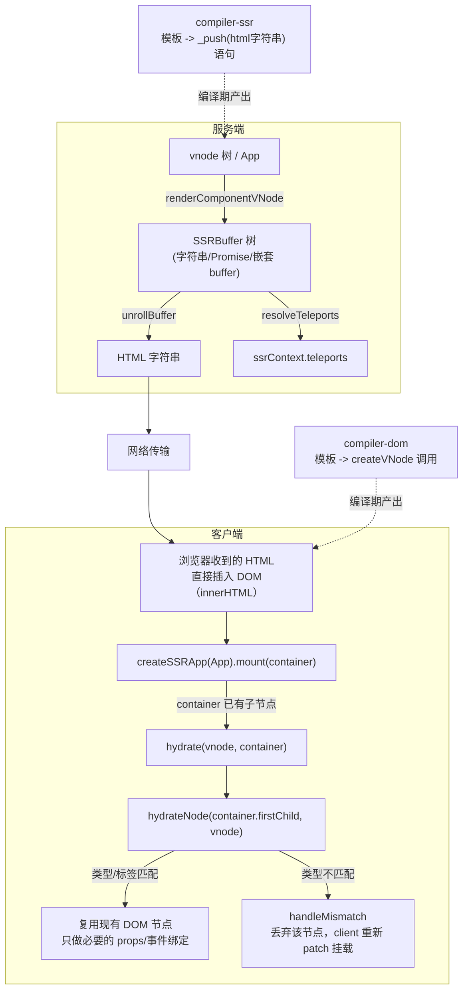
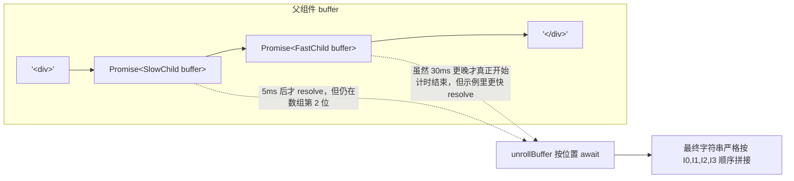
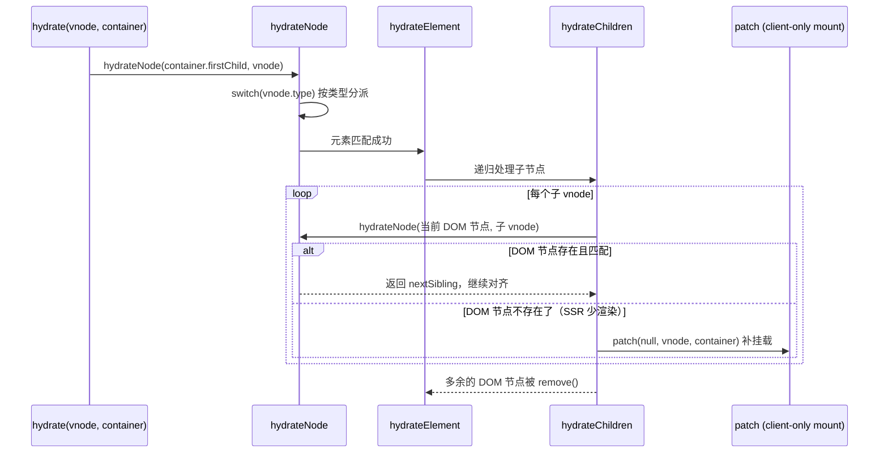

# 15. 服务端渲染与激活：SSR / Hydration

> 服务端把组件树渲染成 HTML 字符串尽快发给浏览器，浏览器收到后不重新创建 DOM，而是"认领"已有节点并接上响应式——这两件事分别叫 SSR 和 hydration，本章拆解它们各自的实现。

## 本章导读

学完本章能回答：

- `renderToString()` 是怎么把一棵 vnode 树变成字符串的？组件、Fragment、Teleport 各自怎么处理？
- 为什么要维护一棵"buffer 树"而不是直接拼字符串？异步组件为什么不会阻塞整个渲染？
- 同一个模板，`compiler-ssr` 和 `compiler-dom` 编译出来的代码有什么本质区别？为什么插槽函数要生成两份？
- `hydrate()` 怎么判断服务端 HTML 和客户端 vnode 对不对得上？对不上了怎么办？
- 3.5 的"懒水合"（lazy hydration）具体是怎么推迟组件激活时机的？

前置章节：第 5~7 章（vnode/渲染器/diff）、第 13 章（compiler-sfc，了解 compileTemplate 的 `ssr` 选项）。预计阅读时间：70~100 分钟。

涉及源码文件（3.5.44 实测行数）：

| 文件 | 作用 | 行数量级 |
|---|---|---|
| `server-renderer/src/renderToString.ts` | 入口 API、buffer 展开、Teleport 收尾 | 151 |
| `server-renderer/src/render.ts` | `createBuffer`/`renderComponentVNode`/`renderVNode` 等核心渲染逻辑 | 440 |
| `server-renderer/src/renderToStream.ts` | Node/Web 流式输出 | 221 |
| `server-renderer/src/helpers/ssrRenderAttrs.ts` | class/style/attr 字符串化 | 129 |
| `compiler-ssr/src/ssrCodegenTransform.ts` | 模板 AST → `_push()` 语句序列 | 251 |
| `compiler-ssr/src/transforms/ssrTransformElement.ts` | 元素的 SSR 属性/子节点编译 | 494 |
| `compiler-ssr/src/transforms/ssrTransformComponent.ts` | 组件 + 插槽的双分支编译 | 386 |
| `runtime-core/src/hydration.ts` | `createHydrationFunctions`，hydrate 全套逻辑 | 1104 |
| `runtime-core/src/hydrationStrategies.ts` | 3.5 懒水合的四种内置策略 | 149 |
| `runtime-core/src/apiAsyncComponent.ts` | `defineAsyncComponent`、`__asyncHydrate` | 286 |

## 先跑起来

```bash
pnpm ex chapters/15-ssr-hydration/examples/03-buffer-tree-and-async.ts
```

关键输出：

```
App.render()（同步，立刻返回）
SlowChild(30ms) setup() 开始
FastChild(5ms) setup() 开始
FastChild(5ms) setup() resolve（等了 5ms）
SlowChild(30ms) setup() resolve（等了 30ms）
总耗时 34ms（理论值接近 max(30,5)=30ms，如果是串行会接近 35ms）
html = <div><span>SlowChild(30ms)</span><span>FastChild(5ms)</span></div>
```

看到了什么：两个异步子组件的 `setup()` 几乎同时开始（不是排队执行），总耗时接近较慢那个的耗时而不是两者相加（证明并行），但最终字符串里 `SlowChild` 仍然排在 `FastChild` 前面——顺序由"它在 buffer 数组里的位置"决定，和"谁先 resolve"无关。这正是本章要讲的 buffer 树设计的核心价值。

再跑一个看 hydration 真实效果的例子：

```bash
pnpm ex chapters/15-ssr-hydration/examples/04-hydration-happy-dom.ts
```

```
p 节点引用未变: true
button 节点引用未变: true
点击后 p 的文本: count: 1
```

服务端渲染出的 DOM 节点原封不动地被复用，点击事件和响应式更新照常工作——这就是"激活"而不是"重新渲染"的含义。

## 整体图



服务端和客户端用的是**同一份组件源码**，但经过**两条不同的编译路径**：服务端用 `compiler-ssr` 编译出直接拼字符串的 `ssrRender`，客户端用 `compiler-dom` 编译出构建 vnode 树的 `render`。两条路径在运行时通过"同一份 HTML 文本"对接——这也是为什么 hydration 的核心工作是"比对"而不是"读取"：客户端完全不知道服务端是怎么生成这段 HTML 的，只能靠结构匹配去认领。

## 源码精读

### 2.1 renderToString：从 App 到字符串的调用链

```ts
// renderToString.ts#L70-L96
export async function renderToString(input: App | VNode, context: SSRContext = {}): Promise<string> {
  if (isVNode(input)) {
    return renderToString(createApp({ render: () => input }), context)
  }
  const vnode = createVNode(input._component, input._props)
  vnode.appContext = input._context
  input.provide(ssrContextKey, context)   // ssr 上下文通过 provide/inject 下发
  let buffer: SSRBuffer | undefined
  let result: string
  try {
    buffer = await renderComponentVNode(vnode)
    result = await unrollBuffer(buffer)
    await resolveTeleports(context)
  } catch (err) {
    cleanupFailedRender(buffer, context)
    throw err
  }
  stopWatchers(context)
  return result
}
```

三步走：`renderComponentVNode` 产出一棵可能包含 Promise 的 **buffer 树**；`unrollBuffer` 把它展开成最终字符串；`resolveTeleports` 把渲染过程中收集到的 Teleport 内容单独展开挂到 `context.teleports`。`input.provide(ssrContextKey, context)` 这一行解释了为什么组件里能用 `useSSRContext()` 拿到服务端渲染上下文——它就是走标准的 provide/inject。

对应示例：`examples/01-renderToString-basics.ts`。

### 2.2 buffer 树：为什么不直接拼字符串

`createBuffer()`（`render.ts#L69-L92`）是整章最关键的设计：

```ts
export type SSRBuffer = SSRBufferItem[] & { hasAsync?: boolean }
export type SSRBufferItem = string | SSRBuffer | Promise<SSRBuffer>

export function createBuffer() {
  let appendable = false
  const buffer: SSRBuffer = []
  return {
    getBuffer(): SSRBuffer { return buffer },
    push(item: SSRBufferItem): void {
      const isStringItem = isString(item)
      if (appendable && isStringItem) {
        buffer[buffer.length - 1] += item as string   // 相邻字符串直接合并，减少数组长度
        return
      }
      buffer.push(item)
      appendable = isStringItem
      if (isPromise(item) || (isArray(item) && item.hasAsync)) {
        buffer.hasAsync = true   // 标记"这棵 buffer 子树里有异步内容"
      }
    },
  }
}
```

每个组件渲染时都有自己的一个 buffer（通过 `push` 收集字符串片段、子组件的 buffer、或者子组件的 Promise）。`renderComponentVNode`（`render.ts#L94-L139`）对有 `async setup()` 的组件，**不等它完成**，直接把"渲染完成后的 Promise"塞进父组件的 buffer 对应位置，然后父组件的渲染继续往下走：

```ts
// render.ts#L107-L138（节选）
const hasAsyncSetup = isPromise(res)
if (hasAsyncSetup || prefetches) {
  p = Promise.resolve(res).then(() => /* 处理 serverPrefetch */)
    .then(() => renderComponentSubTree(instance, slotScopeId))
} else {
  return renderComponentSubTree(instance, slotScopeId)
}
return p   // 返回 Promise，父组件不会在这里阻塞等待
```

最终展开靠 `unrollBuffer`（`renderToString.ts#L14-L54`）的递归 `nestedUnrollBuffer`：按位置顺序处理，遇到字符串直接拼接，遇到 Promise 就 `await` 它再继续——**顺序永远由数组下标决定，和 Promise 谁先 resolve 无关**。示例 03 用两个耗时不同的异步组件验证了这一点：总耗时接近较慢的那个（证明并行 setup），但输出顺序仍是模板顺序。



流式输出（`renderToNodeStream`/`renderToWebStream`，`renderToStream.ts`）用同样的 buffer 树，区别只是"展开到字符串就立刻写流"而不是攒成一个大字符串再返回，这样父组件的静态内容可以在异步子组件 resolve 之前就发给浏览器，缩短首字节时间。

对应示例：`examples/03-buffer-tree-and-async.ts`。

### 2.3 renderVNode：按类型分派

```ts
// render.ts#L241-L297（节选）
export function renderVNode(push, vnode, parentComponent, slotScopeId) {
  switch (type) {
    case Text: push(escapeHtml(children)); break
    case Comment: push(children ? `<!--${escapeHtmlComment(children)}-->` : `<!---->`); break
    case Static: push(children); break
    case Fragment:
      push(`<!--[-->`)
      renderVNodeChildren(push, children, parentComponent, slotScopeId)
      push(`<!--]-->`)
      break
    default:
      if (shapeFlag & ShapeFlags.ELEMENT) renderElementVNode(...)
      else if (shapeFlag & ShapeFlags.COMPONENT) push(renderComponentVNode(...))
      else if (shapeFlag & ShapeFlags.TELEPORT) renderTeleportVNode(...)
      else if (shapeFlag & ShapeFlags.SUSPENSE) renderVNode(push, vnode.ssContent!, ...)
  }
}
```

`<!--[-->`...`<!--]-->` 这两个固定的注释锚点就是 **Fragment 边界标记**——hydration 阶段正是靠它们在没有任何其他信息的情况下，从一串拉平的 DOM 节点里重新找出"这里曾经是一个 Fragment"。`renderElementVNode`（`render.ts#L310-L385`）里属性字符串化全靠 `ssrRenderAttrs`（`helpers/ssrRenderAttrs.ts`）：class/style 走 `normalizeClass`/`normalizeStyle` 再 `escapeHtml`；布尔属性（`checked`/`disabled`）只在值为真时输出裸属性名；`isSSRSafeAttrName` 过滤掉不安全的属性名，防止 XSS。`innerHTML`/`textContent`/`<textarea>.value` 这几个特殊 prop 会整体替换子节点渲染逻辑（`render.ts#L359-L370`）。

对应示例：`examples/01-renderToString-basics.ts`。

### 2.4 compiler-ssr：模板编译成 `_push()` 语句序列

`ssrCodegenTransform`（`compiler-ssr/src/ssrCodegenTransform.ts#L38-L76`）是额外加的一道转换：把已经跑过核心 transform 的模板 AST，再转成一棵"由 `_push()` 调用和 if/for 语句组成的 JS AST"，而不是走 compiler-core 默认的 `createVNode` codegen：

```ts
export function ssrCodegenTransform(ast: RootNode, options: CompilerOptions): void {
  const context = createSSRTransformContext(ast, options)
  const isFragment = ast.children.length > 1 && ast.children.some(c => !isText(c))
  processChildren(ast, context, isFragment)
  ast.codegenNode = createBlockStatement(context.body)
  // ...
}
```

`SSRTransformContext` 的 `pushStringPart`/`pushStatement`（`#L86-L134`）做了一个很实用的优化：**相邻的静态字符串片段会自动合并进同一个模板字符串**，只有遇到非字符串内容（比如一个 if 语句、一个组件调用）才会"断开"，开启下一个 `_push(\`...\`)` 调用。这就是为什么示例 02 里能看到 `_push(\`<div${_ssrRenderAttrs(...)}>\`)` 这种混合了静态文本和动态表达式的单次调用——编译器已经把能合并的字符串尽量合并了。

真实对照（示例 02）：

```js
// 客户端（compiler-dom）
export function render(_ctx, _cache) {
  return (_openBlock(), _createElementBlock("div", _hoisted_1, [...]))
}

// SSR（compiler-ssr）
export function ssrRender(_ctx, _push, _parent, _attrs) {
  _push(`<div${_ssrRenderAttrs(_mergeProps({ class: "a" }, _attrs))}>`)
  // ... 中间是 if/组件调用语句，不是表达式
  _push(`</div>`)
}
```

v-if 在客户端是三元表达式 + `createCommentVNode` 占位；在 SSR 里直接是普通的 `if (_ctx.show) { _push(...) } else { _push(\`<!---->\`) }`（`compiler-ssr/src/transforms/ssrVIf.ts`）——这是因为 SSR codegen 本来就是一系列语句（`_push` 调用），不需要像 vnode 树那样必须是"一个表达式产出一个值"。

对应示例：`examples/02-ssr-vs-client-compile.ts`。

### 2.5 插槽的"两份身体"：为什么父子组件可能用不同的渲染协议

这是本章最值得细讲的设计。`ssrTransformComponent`（`compiler-ssr/src/transforms/ssrTransformComponent.ts#L85-L202`）编译一个组件标签时，**对它的插槽内容做了两遍 transform**：

```ts
// ssrTransformComponent.ts#L124-L135（第一遍：vnode 版本，用于兜底）
return function ssrPostTransformComponent() {
  if (clonedNode.children.length) {
    buildSlots(clonedNode, context, (props, vFor, children) => {
      vnodeBranches.push(createVNodeSlotBranch(props, vFor, children, context))
      return createFunctionExpression(undefined)
    })
  }
  // ...
  // 第二遍：SSR 版本
  const buildSSRSlotFn: SlotFnBuilder = (props, _vForExp, children, loc) => {
    const fn = createFunctionExpression([param0, `_push`, `_parent`, `_scopeId`], undefined, true, true, loc)
    wipEntries.push({ type: WIP_SLOT, fn, children, vnodeBranch: vnodeBranches[wipEntries.length] })
    return fn
  }
  const slots = node.children.length ? buildSlots(node, context, buildSSRSlotFn).slots : `null`
}
```

然后在 `ssrProcessComponent`（`#L204-L269`）里把两份结果拼进同一个函数体，用 **`_push` 参数是否存在**作为运行时判断依据：

```ts
// ssrTransformComponent.ts#L241-L250
fn.body = createIfStatement(
  createSimpleExpression(`_push`, false),
  processChildrenAsStatement(wipEntries[i], context, false, true),  // SSR 分支
  vnodeBranch,                                                       // vnode 回退分支
)
```

真实产物（示例 02）：

```js
footer: _withCtx((_, _push, _parent, _scopeId) => {
  if (_push) {
    _push(`foot ${_ssrInterpolate(_ctx.x)}`)
  } else {
    return [_createTextVNode("foot " + _toDisplayString(_ctx.x), 1 /* TEXT */)]
  }
}),
```

**为什么需要两份**：父组件编译的时候，没法保证子组件 `Comp` 一定是用 compiler-ssr 编译过的——`Comp` 可能是一个手写 `render()` 函数的组件，或者是第三方库提供的、只编译过客户端版本的组件。如果子组件没有 `ssrRender`，`server-renderer/src/render.ts#renderComponentSubTree` 会退回 `renderComponentRoot` + `renderVNode` 的 vnode 路径（`render.ts#L224-L230`），这条路径会用**普通的 `renderSlot()` 运行时 helper**调用插槽函数，而 `renderSlot()` 调用插槽函数时根本不会传 `_push` 参数——这时候插槽函数就会走到 `else` 分支，老老实实返回一个 vnode 数组。两份"身体"共享同一段模板源码，只是分别经过 vnode 版 nodeTransforms（`createVNodeSlotBranch`，复用 `clonedNode` 跑一遍 compiler-dom 同款的 transform 预设）和 SSR 版 nodeTransforms 编译。

对应示例：`examples/02-ssr-vs-client-compile.ts`。

### 2.6 hydrate：按类型逐节点比对

`createHydrationFunctions`（`hydration.ts#L92-L821`）返回 `[hydrate, hydrateNode]`。入口很简单：

```ts
// hydration.ts#L119-L135
const hydrate: RootHydrateFunction = (vnode, container) => {
  if (!container.hasChildNodes()) {
    warn(`Attempting to hydrate existing markup but container is empty. Performing full mount instead.`)
    patch(null, vnode, container)   // 容器是空的，直接退化成普通挂载
    flushPostFlushCbs()
    container._vnode = vnode
    return
  }
  hydrateNode(container.firstChild!, vnode, null, null, null)
  flushPostFlushCbs()
  container._vnode = vnode
}
```

`hydrateNode`（`#L137-L380`）是一个大 `switch (vnode.type)`，按 vnode 类型逐一比对 DOM 节点：

| vnode 类型 | 匹配条件 | 不匹配时 |
|---|---|---|
| `Text` | `node.nodeType === TEXT` | 走 `onMismatch`（有例外：空文本节点直接补插一个） |
| `Comment` | `node.nodeType === COMMENT` 且非 Fragment 起始注释 | 走 `onMismatch` |
| `Static` | `ELEMENT` 或 `TEXT` 类型；按 `staticCount` 跳过 n 个兄弟节点 | 走 `onMismatch` |
| `Fragment` | 当前节点是 `<!--[-->` 注释 | 走 `onMismatch` |
| 元素 | `ELEMENT` 且标签名（小写）一致 | 走 `onMismatch` |
| 组件 | 不比较 DOM，直接 `mountComponent(vnode, container, null, ...)`，组件内部再递归 hydrate 自己的子树 | — |
| Teleport/Suspense | 委托给各自的 `hydrate` 实现 | — |

元素节点的细节在 `hydrateElement`（`#L382-L589`）：子节点走 `hydrateChildren`（`#L591-L668`）逐个对齐，多出来的 DOM 节点直接 `remove`，不够的调用 `patch(null, vnode, container)` 挂载新节点补上；属性只对"必须在客户端生效"的几类强制 `patchProp`——`type === 'input'/'option'` 的 value-like 属性、`on*` 事件、`.prop` 修饰符、自定义元素、`dynamicProps` 命中的——其余属性**默认跳过不处理**（因为服务端已经渲染好了，没必要重复设置一遍）。



对应示例：`examples/04-hydration-happy-dom.ts`。

### 2.7 Mismatch 的分级处理：不是所有不一致都一样对待

这是容易被忽略但示例已经验证过的关键事实：**不同类型的 mismatch，Vue 的处理方式完全不同**。

```ts
// hydration.ts#L927-L946（propHasMismatch 对 class/style/attribute 的处理）
if (mismatchType != null && !isMismatchAllowed(el, mismatchType)) {
  warn(
    `Hydration ${MismatchTypeString[mismatchType]} mismatch on`, el,
    `\n  - rendered on server: ${format(actual)}` +
      `\n  - expected on client: ${format(expected)}` +
      `\n  Note: this mismatch is check-only. The DOM will not be rectified ` +
      `in production due to performance overhead.` +
      `\n  You should fix the source of the mismatch.`,
  )
  return true   // 只是返回"确实不一致"，调用方不会据此去 patchProp 覆盖
}
```

| mismatch 类型 | 会不会警告 | 会不会纠正 DOM |
|---|---|---|
| 文本内容（Text 节点 / TEXT_CHILDREN） | 会（除非 `data-allow-mismatch`） | **会**：`(node as Text).data = vnode.children` / `el.textContent = vnode.children` 无条件执行 |
| class / style / 其他 attribute | 会（除非 `data-allow-mismatch`） | **不会**：源码注释明说"check-only"，出于性能考虑不会在生产环境纠正 |
| 节点类型完全不对（tag/Text/Comment 互相对不上） | 会 | **会**：`handleMismatch` 整体 `remove` + `patch(null, vnode, container)` 重新挂载这个子树 |

`data-allow-mismatch`（3.5，`allowMismatchAttr`，`#L1026-L1103`）只影响"要不要 `warn()`"，**不影响纠正行为**——示例 04 的第 5 节用 `data-allow-mismatch="text"` 验证了警告确实消失了，但文本依然被改成客户端的值。这是因为 `isMismatchAllowed()` 只在 warn 之前被 check，纠正代码本身在调用链的另一处、无条件执行。

对应示例：`examples/04-hydration-happy-dom.ts`。

### 2.8 懒水合（Lazy Hydration，3.5）

`defineAsyncComponent({ hydrate: strategy })`（`apiAsyncComponent.ts#L123-L156`）给异步组件加了一层"什么时候真正做水合"的控制：

```ts
// apiAsyncComponent.ts#L125-L156
__asyncHydrate(el, instance, hydrate) {
  const performHydrate = () => { /* ...校验未被 patch 过/未被移除... */ hydrate() }
  const doHydrate = hydrateStrategy
    ? () => {
        const teardown = hydrateStrategy(performHydrate, cb => forEachElement(el, cb))
        if (teardown) (instance.bum || (instance.bum = [])).push(teardown)
      }
    : performHydrate
  if (resolvedComp) doHydrate()
  else load().then(() => !instance.isUnmounted && doHydrate())
}
```

四种内置策略（`hydrationStrategies.ts`）：

| 策略 | 触发时机 | 依赖的浏览器 API |
|---|---|---|
| `hydrateOnIdle(timeout?)` | 浏览器空闲时 | `requestIdleCallback`（降级到 `setTimeout`） |
| `hydrateOnVisible(options?)` | 元素进入视口 | `IntersectionObserver` |
| `hydrateOnMediaQuery(query)` | 媒体查询匹配 | `matchMedia` |
| `hydrateOnInteraction(events)` | 用户与元素交互 | `addEventListener` |

`hydrateOnInteraction`（`#L92-L121`）的实现有一个很讨巧的细节：

```ts
const doHydrate = (e: Event) => {
  if (!hasHydrated) {
    hasHydrated = true
    teardown()
    hydrate()
    // replay event
    e.target!.dispatchEvent(new (e.constructor as any)(e.type, e))
  }
}
```

用户第一次点击时，这次点击事件先被临时监听器截获用来**触发水合**，水合完成、真正的 Vue 事件系统接管之后，再把这个事件**重新 `dispatchEvent` 一遍**——所以用户不会感觉到"点了一下没反应，再点一下才生效"，水合和响应这次交互是一次完成的。示例 05 验证了：水合前 `clientSetupCalls = 0`，点击触发后变成 1，且组件的 `clicks` 计数器从点击瞬间就是 1（不是 0），证明事件确实被重放并处理了。

happy-dom 环境里 `hydrateOnVisible` 依赖的 `IntersectionObserver` 不可用，所以示例 05 选择了只依赖标准 DOM 事件 API 的 `hydrateOnInteraction` 做验证；`hydrateOnVisible`/`hydrateOnMediaQuery` 的策略函数体本身很短（分别是十几行），建议直接读源码，机制和 `hydrateOnInteraction` 是同一个模式："注册一个一次性的触发器 + 调用 `performHydrate`"。

对应示例：`examples/05-lazy-hydration.ts`。

## 与 Vue 2 对比

| 维度 | Vue 2 | Vue 3 | 为什么这么改 |
|---|---|---|---|
| SSR 渲染单元 | 基于 **vnode 的递归渲染**：`render.ts` 的 `renderNode`/`renderElement`/`renderComponent` 函数，用 `RenderContext.renderStates` 这个显式栈来模拟"可中断的递归"（因为 Node 的 callback/stream 模型下不能用真正的递归 await）| 基于**编译期生成的字符串拼接代码**（`compiler-ssr` 产出 `ssrRender`），没有 `ssrRender` 时才退化为 vnode 递归（`renderComponentRoot`/`renderVNode`），用原生 `async/await` + Promise 驱动而不是手写状态机 | Vue 3 的编译期字符串拼接比"遍历 vnode 现算现拼"快得多（少了创建/遍历 vnode 的开销），`async/await` 也比手写 `RenderContext` 状态机更容易维护；保留 vnode 回退路径是为了兼容非编译场景（手写 render、JSX、第三方组件） |
| 组件级缓存 | 有：`serverCacheKey`（`server-renderer/src/render.ts#renderComponentWithCache`），用户实现 `serverCacheKey(props)` 返回值相同就直接复用缓存的字符串 | 无对应机制 | 3.x 更依赖流式输出和异步并行渲染去摊薄耗时，而不是对渲染结果做字符串级缓存；组件缓存容易引入状态不一致的 bug，取舍上选择了更简单的模型 |
| 多根节点 / Fragment | **不支持**：Vue 2 组件必须有且只有一个根节点，SSR 输出天然是单一子树，不需要锚点标记 | 支持 Fragment，SSR 输出用 `<!--[-->`...`<!--]-->` 包裹，供 hydration 定位边界 | 3.0 支持多根组件是明确的 API 提升；代价是 SSR/hydration 都要多处理一种"虚拟边界"的情况 |
| 挂载标记 | 根元素打 `data-server-rendered="true"`（`src/shared/constants.ts` 的 `SSR_ATTR`），客户端 `patch()` 读到这个属性才进入 hydrate 分支，之后立刻 `removeAttribute` | 不在 DOM 上打标记，由调用方显式选 `createSSRApp(...).mount()`（内部 `mount(container, true, ...)` 的第二个参数 `isHydrate`）还是 `createApp(...).mount()` | 3.x 把"是否要 hydrate"做成显式 API 选择，而不是靠运行时嗅探一个 DOM 属性，少了一次 `hasAttribute`/`removeAttribute`，语义也更直接 |
| mismatch 处理粒度 | **全有全无**：`patch.ts#hydrate()`（`src/core/vdom/patch.ts#L681-L787`）任何一处 `assertNodeMatch` 失败，整个递归立刻返回 `false` 并逐层冒泡，最终在 `patch()`（`#L801-L843`）里整个组件树**放弃 hydration，完整重新走客户端渲染**，并打印"Bailing hydration and performing full client-side render"警告 | **按类型精细处理**：文本 mismatch 原地纠正；class/style/attribute 只警告不纠正；只有节点类型（tag/Text/Comment）对不上才局部 `handleMismatch` 重新挂载那一个子树，不影响其他兄弟节点 | 2.x 的"一处不对、全树重来"在大页面上代价很高（等于白做了一次 SSR）；3.x 把 mismatch 处理downgrade到尽量局部化，并且明确区分"必须纠正的"（会导致渲染结果错误的文本）和"纠正了也没收益的"（class/style 这类通常是外部脚本/浏览器扩展修改导致，强行纠正反而可能打架） |
| 属性 hydrate 策略 | `assertNodeMatch` 只比较标签名，完全不比较属性值是否一致；属性靠 `invokeCreateHooks` **无条件重新应用一遍**所有非 `attrs/class/staticClass/staticStyle/key` 的 data（`isRenderedModule` 白名单） | 默认**跳过**大多数属性的重新设置（相信服务端渲染是对的），只强制处理 `on*` 事件、`.prop`、`input`/`option` 的 value 类、`dynamicProps` 命中的；开发环境额外做 `propHasMismatch` 比对用于告警 | 3.x 假设 SSR 输出通常是对的，重新设置属性是纯粹的浪费；只在开发环境花代价去比对、告警，生产环境把这部分检查也可以通过 feature flag 关掉（`__FEATURE_PROD_HYDRATION_MISMATCH_DETAILS__`），达到"尽量少做事"的 hydration |
| 懒水合 | 无此概念 | 3.5 新增：`defineAsyncComponent({ hydrate })` + 四种内置策略 | 大页面上"首屏下方的大量组件"未必需要在页面加载时就激活，推迟水合直接减少主线程初始工作量，是面向 Core Web Vitals（尤其是 INP）的优化 |

## 动手：实验

本章没有独立的 `mini-vue` 实现——`compiler-ssr` 的 codegen 分支和 `hydration.ts` 的逐类型比对逻辑都依赖大量运行时细节（ShapeFlags、PatchFlags、Suspense/Teleport 内部状态），简化后容易失真。建议在现有示例上做这些实验：

1. **改 `examples/02`**：给模板加一个 ``，对比 SSR 产物里动态属性是怎么单独处理的（`ssrRenderDynamicAttr`），和静态属性直接字符串拼接有什么不同。
2. **改 `examples/03`**：把两个异步子组件的延迟都设为 0（同步 resolve 的 Promise），观察 `unrollBuffer` 是否还会体现出"buffer 树"的痕迹——提示：`Promise.resolve()` 包装的内容仍然要走一次 `.then()`，buffer 数组里仍然是 Promise 类型的 item，只是 resolve 得特别快。
3. **改 `examples/04`**：构造一个"服务端多渲染了一个子节点"的场景（SSR HTML 里比 vnode children 多一个 `<span>`），观察 `hydrateChildren` 是怎么把多余节点删掉的，并对照"少渲染一个子节点"的场景（会触发 `patch(null, vnode, container)` 补挂载）。

## 常见疑问

**Q: `renderToString` 返回的 Promise 什么时候才 resolve？是不是所有异步组件都 resolve 了才算完？**
A: 是的。`renderToString` 内部 `await unrollBuffer(buffer)`，而 `unrollBuffer` 会递归 `await` 所有在 buffer 树里的 Promise，所以返回值一定是"整棵树（包括所有异步组件）都渲染完毕"的最终 HTML。想要更早拿到部分内容，要用 `renderToNodeStream`/`renderToWebStream` 这类流式 API。

**Q: 为什么插槽函数要判断 `_push` 是否存在，而不是在编译期就知道子组件是不是 SSR 组件？**
A: 编译期（编译父组件模板时）确实不知道子组件最终会不会有 `ssrRender`——子组件可能来自另一个尚未编译、或手写 render 函数、或第三方库的模块，这些信息在"父组件模板编译"这个时间点拿不到，只能生成两份代码留到运行时用参数判断。

**Q: `data-allow-mismatch` 可以用在生产环境抑制所有警告吗？**
A: 它本身就是设计给需要"容忍某处渲染差异"的场景用的（比如用浏览器扩展注入内容的区域、依赖 `Date.now()` 等不稳定值的区域），生产构建默认不执行 mismatch 检测（除非显式开 `__FEATURE_PROD_HYDRATION_MISMATCH_DETAILS__`），所以这个属性主要在开发环境帮你消除"已知无害"的噪音警告。

**Q: lazy hydration 会不会导致用户交互"丢事件"？**
A: `hydrateOnInteraction` 明确处理了这一点：触发水合的那次事件会在水合完成后被重新 `dispatchEvent` 一遍，交由真正的 Vue 事件系统处理，用户感知不到延迟。其他三种策略（idle/visible/media query）不涉及"用户主动交互"，自然没有这个问题。

**Q: Vue 2 的"一处不对全树重来"是不是意味着 Vue 2 的 SSR 页面更容易"闪烁"？**
A: 如果真的触发了 mismatch，Vue 2 确实要重新渲染整个组件子树，用户能看到一次内容替换（更接近"闪烁"）；Vue 3 即使触发 `handleMismatch`，影响范围也通常局限在真正不匹配的那个子树，其余兄弟节点不受影响，实践中观感上差异明显。

## 小结

- SSR 的核心产物是一棵 **buffer 树**（字符串 / Promise / 嵌套 buffer），而不是直接拼好的字符串；这让异步子组件可以并行 setup、互不阻塞，最终展开时严格按位置顺序拼接，保证确定性输出。
- `compiler-ssr` 把模板编译成一串 `_push()` 语句，而不是 `createVNode` 调用；v-if/v-for 等指令在 SSR 下直接是普通 JS 控制流语句。
- 组件插槽在 SSR 编译下会生成两份代码体（SSR 字符串分支 + vnode 回退分支），运行时靠 `_push` 参数是否存在来选择，兼容"子组件不是 SSR 编译过的"情况。
- `hydrate()` 的本质是按 vnode 类型逐节点比对 DOM：匹配就复用节点、只打必要的补丁；不匹配按类型分级处理——文本原地纠正，class/style/attribute 只警告不纠正，节点类型不对才整体重新挂载。
- `data-allow-mismatch` 只影响警告是否打印，不影响纠正行为本身。
- 3.5 的懒水合把"组件激活"和"组件可见/渲染完成"解耦，四种策略（idle/visible/media-query/interaction）各自对接不同的浏览器 API，`hydrateOnInteraction` 会重放触发水合的那次事件，避免丢失用户输入。
- 与 Vue 2 相比，3.x 的 SSR/hydration 在性能敏感路径上几乎处处做了"更细粒度、更少无谓工作"的重新设计：编译期字符串拼接代替运行时 vnode 遍历、局部 mismatch 处理代替全树重来、按需属性校验代替无条件重新应用。

## 延伸阅读

- SSR 指南（官方文档）：https://cn.vuejs.org/guide/scaling-up/ssr.html
- Lazy Hydration RFC 讨论：https://github.com/vuejs/core/pull/11458
- `@vue/server-renderer` 源码目录：https://github.com/vuejs/core/tree/main/packages/server-renderer
- `@vue/compiler-ssr` 源码目录：https://github.com/vuejs/core/tree/main/packages/compiler-ssr
- Vue 2 的 `vue-server-renderer` 实现（对比用）：https://github.com/vuejs/vue/tree/main/packages/server-renderer

## 思考题

1. 如果一个组件既有 `async setup()` 又有 `serverPrefetch`（Options API），`renderComponentVNode` 是怎么安排两者的执行顺序的？

   <details><summary>答案</summary>

   看 `render.ts#L107-L124`：先 `await` `setupComponent` 的结果（`hasAsyncSetup` 为 true 时），再在 `.then()` 里判断并执行 `instance.sp`（`serverPrefetch` 钩子数组），全部 `Promise.all` 完才继续 `renderComponentSubTree`。也就是说顺序固定是：setup 完成 → serverPrefetch 全部完成 → 真正渲染子树。
   </details>

2. `ssrRenderAttrs` 对 `class`/`style` 的处理和普通属性为什么要分开两条路径？

   <details><summary>答案</summary>

   因为 `class`/`style` 在 Vue 里支持对象/数组等多种写法（`:class="['a', {b: true}]"`），需要先 `normalizeClass`/`normalizeStyle` 统一成字符串形式再转义输出；而且 `style` 还要处理 `ssrResetCssVars`——把 `:--` 前缀标记的 CSS 变量（来自 `ssrCssVars`）正确还原成 `--` 开头，这是普通属性不需要的逻辑。
   </details>

3. 为什么文本 mismatch 必须纠正，而 class/style mismatch 可以不纠正？这个设计选择背后权衡的是什么？

   <details><summary>答案</summary>

   文本内容通常直接反映组件的响应式状态（比如用户看到的数字、文字），不纠正会导致页面显示的内容是"假"的，用户体验上不可接受；而 class/style 的不一致更常见于浏览器扩展注入样式、某些依赖客户端环境的动态样式计算，强行用 `patchProp` 覆盖反而可能打断这些"合理的外部修改"，而且逐个比对 + 修复的开销在大量元素时不可忽视，所以权衡下选择"只警告，让开发者自己判断要不要修"。
   </details>
