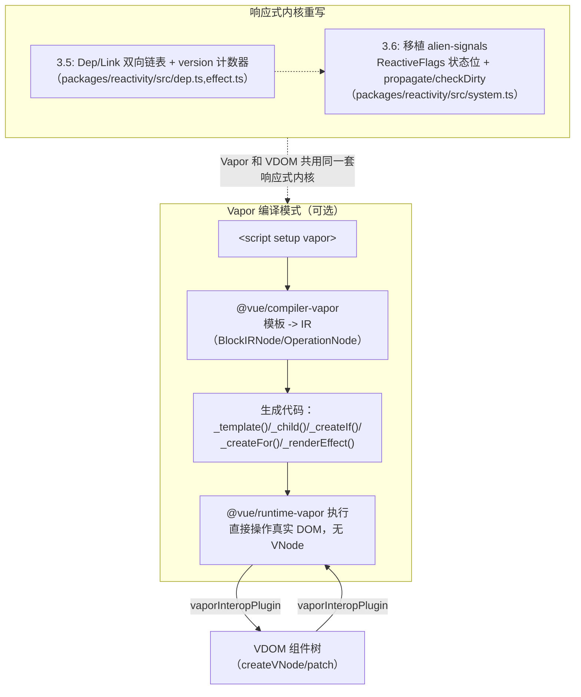
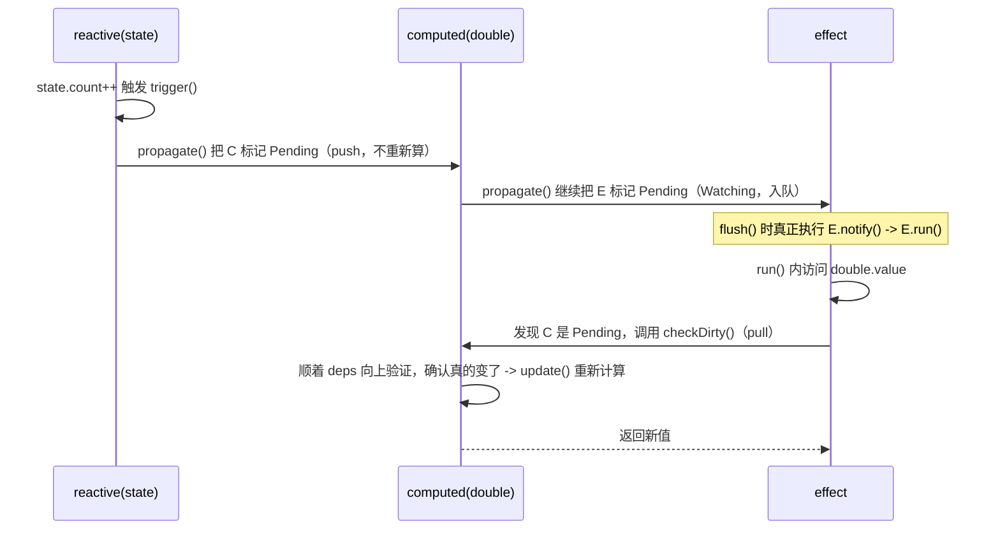
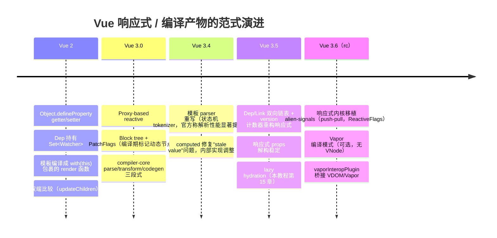

# 16. 3.6 前瞻：Vapor 模式与新响应式

> Vue 3.6（本章写作时为 `v3.6.0-rc.12`，2026-10）带来两件大事：响应式内核换成移植自 alien-signals 的实现，以及可选的 Vapor 编译模式——完全不经过 VNode，模板直接编译成 DOM 操作。本章只做前瞻性概览，正式版发布前细节可能调整，不确定的地方会明确标注。

**口径声明**：本章所有关于 3.6 的陈述，均以本地 shallow clone 的 `vuejs/core@v3.6.0-rc.12` 源码（`core-3.6` 分支）和示例的实际运行结果为准；涉及未来可能变化的实现细节，标注"待 3.6 正式版确认"。

## 本章导读

学完能回答：

- 3.6 的响应式系统和 3.5 相比，内部数据结构和算法换成了什么？用户能感知到行为差异吗？
- Vapor 模式编译出来的代码长什么样？和熟悉的 `createVNode`/`patch` 路径比，少了什么、多了什么？
- Vapor 组件和普通（VDOM）组件能不能混用？怎么混用？
- 哪些 Vue API 在 Vapor 组件里用不了？
- 从 Vue 2 到 3.6，响应式系统和编译产物经历了哪几次大的范式转变？

前置章节：第 2~4 章（响应式系统）、第 11~12 章（compiler-core）。预计阅读时间：50~70 分钟。

涉及源码（3.6.0-rc.12，位于 shallow clone 的 `core-3.6` 分支）：

| 文件 | 作用 | 行数量级 |
|---|---|---|
| `packages/reactivity/src/system.ts` | 移植自 alien-signals 的通用传播算法（push-pull） | 380 |
| `packages/reactivity/src/dep.ts` / `effect.ts` / `computed.ts` | 在 system.ts 之上包一层 Vue 专用的 API（track/trigger/ReactiveEffect/ComputedRefImpl） | 252/317/249 |
| `packages/compiler-vapor/src/ir/index.ts` | Vapor 的 IR 定义：`BlockIRNode`/`OperationNode`/`IRNodeTypes` | 363 |
| `packages/runtime-vapor/src/block.ts` | `Block` 类型定义、`insert`/`remove` 等块操作原语 | 628 |
| `packages/runtime-vapor/src/apiCreateIf.ts` / `apiCreateFor.ts` | v-if / v-for 的运行时实现 | 157/1046 |
| `packages/runtime-vapor/src/component.ts` | `VaporComponentInstance`、组件挂载 | 2231 |
| `packages/runtime-vapor/src/vdomInterop.ts` | `vaporInteropPlugin`，VDOM ↔ Vapor 互嵌 | 4902 |
| `packages/runtime-vapor/src/dom/template.ts` | `template()` helper：静态模板 clone / hydration 适配 | 148 |
| `CHANGELOG.md`（3.6.0-rc.1 release notes 部分） | 官方对 Vapor Mode / alien-signals 的说明 | — |

## 先跑起来

```bash
pnpm ex chapters/16-vapor-future/examples/03-vapor-runtime-in-node.ts
```

关键输出：

```
1. mount 后的真实 DOM（没有任何 VNode 参与）
<div><p>hello vapor</p><button id="btn">+1</button></div>
2. 点击按钮，观察 DOM 直接被 _renderEffect/_setText 更新
<div><p>hello vapor!</p><button id="btn">+1</button></div>
```

看到了什么：一个 `<script setup vapor>` 组件，点击按钮后文本从 `hello vapor` 变成 `hello vapor!`——这个更新背后完全没有 `createVNode`/`patch`，是编译产物里一个独立的 `_renderEffect` 直接调用 `_setText` 改了那一个文本节点。

## 整体图：3.6 两大变化



两件事相对独立：响应式重写对**所有**代码生效（无论是否使用 Vapor）；Vapor 模式是**按组件可选**的编译目标，默认的 VDOM 路径仍然是主流，两者可以通过 `vaporInteropPlugin` 互相嵌套。

## 源码精读

### 2.1 响应式内核：从 Dep/Link + version 到 alien-signals

3.5 的实现（`dep.ts`/`effect.ts`）核心是：每个 `Dep` 维护一个 `version` 号，每次响应式变更让全局 `globalVersion` 自增，`Link`（dep 和 effect 之间的一条连接）在被访问时把自己的 `version` 同步成当前的 `dep.version`；一个 effect 跑完之后，`version` 没被更新过的旧 link 会被认定为"这次没用到这个依赖"而清理掉。computed 靠"自己计算时的 globalVersion"和"现在的 globalVersion"做一个近似但高效的脏检查。

3.6 把这套机制换成移植自 [alien-signals](https://github.com/stackblitz/alien-signals) 的实现（`system.ts` 文件头直接写着"Ported from alien-signals"并给出上游 diff 链接）。核心数据结构变成一组用位域表示状态的标志位（`system.ts#L31-L39`）：

```ts
export const enum ReactiveFlags {
  None = 0,
  Mutable = 1 << 0,        // 这个节点本身可以是别人的依赖（如 computed）
  Watching = 1 << 1,       // 这个节点是"终端订阅者"（如 effect），需要真正重跑
  RecursedCheck = 1 << 2,
  Recursed = 1 << 3,
  Dirty = 1 << 4,          // 确定"脏"了，必须重新计算/重新跑
  Pending = 1 << 5,        // 依赖可能变了，但还没验证，需要时再查
}
```

**push 阶段**（`propagate()`，`system.ts#L162-L233`）：响应式数据变化时，顺着 `subs` 链表把所有下游标记为 `Pending`（如果是 `Watching` 的 effect，直接丢进 `notifyBuffer` 排队）；是 `Mutable` 的（比如 computed）只打标记，不立刻重新计算——计算本身留给"真正被读取的那一刻"。

**pull 阶段**（`checkDirty()`，`system.ts#L289-L354`）：某个订阅者被读取/要重跑之前，检查自己是不是 `Pending`，是的话顺着 `deps` 链一路向上验证，真的发现某个上游"确实变了"（递归调用 `computed.update()` 并比较新旧值）才标记 `Dirty`，否则清掉 `Pending`，省掉一次重新计算。



这个 `effect.dirty` getter（`effect.ts#L155-L169`）正是 push 和 pull 两条路径的交汇点：

```ts
get dirty(): boolean {
  const flags = this.flags
  if (flags & ReactiveFlags.Dirty) return true
  if (flags & ReactiveFlags.Pending) {
    if (checkDirty(this.deps!, this)) {
      this.flags = flags | ReactiveFlags.Dirty
      return true
    } else {
      this.flags = flags & ~ReactiveFlags.Pending
    }
  }
  return false
}
```

**公共行为没有变化，内部实现完全不同**——示例 02 实测验证了同一段 effect/computed 代码在 3.5 和 3.6 下 effect 触发次数、computed 缓存行为逐字节一致，但两个版本的 `ReactiveEffect` 实例自身的字段完全不同（3.5 有 `next`/`cleanup`/`scheduler`，3.6 有 `subs`/`subsTail`/`cleanups`/`cleanupsLength`，详见示例输出）。公共 API（`reactive`/`ref`/`computed`/`effect`/`watch` 等的签名和语义）不受影响。

官方 CHANGELOG（3.6.0-rc.1 release notes）原话："3.6 also includes a major refactor of `@vue/reactivity` based on alien-signals, which significantly improves the reactivity system's performance and memory usage."（PR [#12349](https://github.com/vuejs/core/issues/12349)）——具体的性能/内存数据待正式版发布时的官方 benchmark 为准，本仓库没有独立测过，不做引用。

对应示例：`examples/02-reactivity-3.5-vs-3.6.ts`。

### 2.2 Vapor 模式：模板直接编译成 DOM 操作

`<script setup vapor>`（或简写 `<script vapor>`，或给 `<template vapor>` 单独打标记）触发 `@vue/compiler-sfc` 走 Vapor 编译路径（`descriptor.vapor` 标记，实测 `parse()` 能正确识别）。同一段模板，Vapor 产物和 VDOM 产物的核心差异（示例 01 真实编译结果）：

```js
// Vapor（@vue/compiler-vapor）—— 没有 createVNode / openBlock / PatchFlags
const t2 = _template("<div class=list><p> </p><button>+1</button><!><ul>", 1)
export function render(_ctx) {
  const n11 = t2()                 // clone 一次性建好的静态 DOM 骨架
  const n0 = _child(n11)           // 像指针一样在真实 DOM 上定位
  const n1 = _next(n0)
  _on(n1, "click", e => inc(e))    // 直接 addEventListener
  _renderEffect(() => _setText(x0, _toDisplayString(msg)))  // 细粒度 effect
  const n2 = _createIf(() => (count > 0), () => {...}, null, flags)
  const n5 = _createFor(() => (items), (item) => {...}, (item) => item.id, flags)
  const n9 = _createAssetComponent("Child", { count: () => (count) })
  return n11
}
```

```js
// VDOM（@vue/compiler-dom）—— 每次 render() 都重新生成 vnode 树
export function render(_ctx, _cache) {
  return (_openBlock(), _createElementBlock("div", {...}, [
    _createElementVNode("p", null, _toDisplayString(_ctx.msg), 1 /* TEXT */),
    (_ctx.count > 0) ? (...) : _createCommentVNode("v-if", true),
    ...(_renderList/_createVNode 等)
  ]))
}
```

四个关键差异点：

1. **静态骨架**：`_template(html)`（`runtime-vapor/src/dom/template.ts#L41-L147`）第一次调用时用 `parseTemplate(html, ns)` 解析出一份真实 DOM 节点，之后每次调用走 `cloneTemplate()`（本质 `node.cloneNode(true)`，也处理 slot scopeId 戳记和 hydration 适配）。VDOM 侧 `hoistStatic` 只是把*创建 vnode 对象*的调用提到 render 函数外层，概念上仍然是"数据结构"，不是真实 DOM。
2. **定位方式**：`_child()`/`_next()` 这类 helper 在已经 clone 出来的真实 DOM 上用 `firstChild`/`nextSibling` 风格移动，编译期就把"运行时要修改哪个具体节点"的路径算好了，不需要虚拟树。
3. **响应式粒度**：`_renderEffect(() => _setText(x, ...))` 是一个独立的 `ReactiveEffect`，只在它真正依赖的响应式数据变化时重跑，直接执行该一个 DOM 操作；VDOM 侧粒度是"整个组件的 render()"，响应式数据变化触发整个 render 重新执行、生成新树再 diff。
4. **控制流原语**：`v-if`/`v-for` 变成 `_createIf`/`_createFor` 这两个运行时函数（`runtime-vapor/src/apiCreateIf.ts`/`apiCreateFor.ts`），它们自己管理分支切换、列表增删时的真实 DOM 操作（含 hydration 适配），把"差异计算"收编成了专门的运行时原语，而不是"生成新 vnode 树交给通用 diff 算法"。

IR 层（编译器内部表示，不直接暴露给用户）用 `BlockIRNode`（`compiler-vapor/src/ir/index.ts#L65-L73`）组织一棵模板对应的"操作序列"：

```ts
export interface BlockIRNode extends BaseIRNode {
  type: IRNodeTypes.BLOCK
  node: RootNode | TemplateChildNode
  dynamic: IRDynamicInfo     // 哪些位置是动态的
  tempId: number
  effect: IREffect[]         // 需要包进 renderEffect 的绑定
  operation: OperationNode[] // SET_PROP/SET_TEXT/SET_EVENT/INSERT_NODE/IF/FOR/... 等具体操作
  returns: number[]          // 这个 block 的根节点 id 列表
}
```

`generate` 阶段遍历 `operation` 数组逐条生成 `setProp`/`setText`/`createIf`/`createFor`/`delegateEvents` 等调用——这是"模板 → IR → 代码"这条编译流水线和 compiler-core 的 "模板 → AST → transform → codegen" 概念上对应，但产出目标完全不同（DOM 操作序列 vs vnode 构造表达式）。

事件处理默认走**委托**（document 级别单个监听器）：官方 release notes 明确说明 Vapor 把符合条件的事件委托到 `document`，每个元素只存自己的 handler，单一的 document 监听器沿事件路径查找匹配的 handler 调用；`stopPropagation()` 会让事件到不了 `document`，委托的 handler 就不会执行；`v-bind="{ onClick }"`、`v-on="{ click }"`、动态事件名 `@[event]` 这几种写法会绕过委托，直接挂在元素上。

对应示例：`examples/01-vapor-compile-output.ts`、`examples/03-vapor-runtime-in-node.ts`。

### 2.3 runtime-vapor 的 Block 概念与组件实例

```ts
// runtime-vapor/src/block.ts#L85-L90
export type Block =
  | Node
  | VaporFragment
  | DynamicFragment
  | VaporComponentInstance
  | Block[]
export type BlockFn = (...args: any[]) => Block
```

一个 Vapor "渲染结果"不是单一的 vnode 类型，而是这几种东西的联合：可能就是一个真实 DOM `Node`，可能是一个 `VaporFragment`（对应多根模板/v-for 产生的一组节点），可能是嵌套的 `Block[]`，也可能直接是另一个组件实例（组件可以互相嵌套返回）。`insert()`/`remove()`（`block.ts#L141-L368`）是操作这几种 Block 的统一入口，`v-if`/`v-for`/`<component>` 等运行时 helper 最终都通过它们把结果接到 DOM 树上。

`VaporComponentInstance`（`runtime-vapor/src/component.ts`，2231 行，是 runtime-vapor 里最大的文件）承担了和 `runtime-core/src/component.ts` 里 `ComponentInternalInstance` 类似的角色（props/attrs/slots/生命周期/依赖注入管理），但不维护 `subTree`（vnode 子树）这个概念，维护的是这个组件的根 `Block`。

### 2.4 VDOM ↔ Vapor 互嵌：`vaporInteropPlugin`

纯 Vapor 应用用 `createVaporApp()`，完全不拉入 VDOM 运行时：

```js
import { createVaporApp } from 'vue'
createVaporApp(App).mount('#app')
```

要在 VDOM 应用里用 Vapor 组件（或反过来），需要装互操作插件：

```js
import { createApp, vaporInteropPlugin } from 'vue'
createApp(App).use(vaporInteropPlugin).mount('#app')
```

`vaporInteropPlugin`（`runtime-vapor/src/vdomInterop.ts#L3150-L3167`）往 `app._context` 上挂了两套桥接实现：`app._context.vapor`（VDOM 渲染器如何挂载/卸载一个 Vapor 组件）和 `app._context.vdom`（Vapor 运行时如何挂载一个 VDOM 组件/渲染一个 VDOM 插槽，`mount`/`slot`/`mountVNode` 三个函数）。概念上：

- VDOM 树里遇到一个 Vapor 组件：用一个特殊的 vnode 包裹它，这个 vnode 的挂载逻辑委托给 `app._context.vapor` 去调用 Vapor 的挂载流程，把结果 Block（可能是任意 DOM 节点组合）作为这个 vnode 的 `el`；
- Vapor 树里遇到一个 VDOM 组件（纯 render 函数/JSX 组件，或者别的组件库）：用 `app._context.vdom.mount` 创建一个真正的 VDOM 组件实例挂载，把它的根 DOM 节点纳入 Vapor 的 Block 体系。

官方明确建议：**优先让一个应用里的 Vapor 区域和 VDOM 区域边界清晰、避免深度交替嵌套**——互操作目前覆盖标准的 props/events/slots 场景，但还没覆盖所有边界情况，尤其是用 VDOM 组件库时可能有生疏之处（原话见 CHANGELOG 3.6.0-rc.1 release notes "Enabling VDOM Interop" 一节）。

### 2.5 与 3.5 的关系、迁移、不可用 API

Vapor 是**完全可选、按组件启用**的，默认的 VDOM 路径没有变化，现有 3.5 代码不受影响。根据 CHANGELOG 里的 "Feature Compatibility" 清单（3.6.0-rc.1 release notes，实测与源码阅读印证），Vapor 组件里明确**不支持**：

- Options API（只支持 `<script setup>`/纯 `<template>`）
- `app.config.globalProperties`
- `getCurrentInstance()` 在 Vapor 组件里返回 `null`
- `@vue:xxx` 这类逐元素生命周期事件
- `v-memo`
- 组件模板 ref 拿到的不是完整的公共实例代理（没有 `$el`/`$props`/`$attrs`/`$slots`/`$refs` 这些属性）

此外两个容易踩的坑（CHANGELOG "Important Usage Considerations" 一节）：

- **自定义指令接口变了**：Vapor 的指令签名是 `(node, value?: () => any, ...)`，不是 VDOM 的 `{ mounted, updated, ... }` 对象形式；
- **`slots.default()` 不是无副作用的"预览"调用**：在 Vapor 里调用一次插槽函数就是真的执行渲染逻辑（可能创建 Block、注册 effect、在 hydration 期间认领 SSR DOM），不能像某些 VDOM 代码里那样"先调用看看有没有内容，再决定渲染什么"。

性能特征上，官方给出的定性描述是"和 Solid、Svelte 5 处于同一性能量级"（CHANGELOG 引用 [krausest/js-framework-benchmark](https://github.com/krausest/js-framework-benchmark) 第三方基准），这和 Vapor 的设计目标一致：编译期确定绑定关系、运行时无 VNode 创建和 diff 开销、`renderEffect` 级别的细粒度更新——这正是 Solid 系"signals + 编译期优化"思路的同类做法。具体数字请以 Vue 官方发布时的 benchmark 页面为准，本仓库未独立复测。

### 2.6 其他 3.6 变动（据源码仓库 CHANGELOG.md 核实，不确定的不写）

查看 `core-3.6` 分支的 `CHANGELOG.md`（截至 `v3.6.0-rc.12`，2026-10-16），最近几个 rc 版本的改动绝大多数集中在 **Vapor ↔ VDOM 互操作的边界情况**（Transition/TransitionGroup/KeepAlive 嵌套、hydration 时序、插槽转发等），以及少量 Vapor 编译器修复。这说明 rc 阶段的主要收尾工作就在"让 Vapor 组件和已有 VDOM 生态无缝共存"这件事上，而不是继续堆新特性。其余细节（如正式版是否会调整 IR 字段名、`createFor`/`createIf` 的 flags 编码）**待 3.6 正式版确认**，本章不做超出已读源码范围的猜测。

## 与 Vue 2 对比：响应式与编译产物的演进脉络



| 维度 | Vue 2 | Vue 3.6（rc） | 为什么这么改 |
|---|---|---|---|
| 响应式基础 | `Object.defineProperty` 遍历属性逐个劫持，`Dep` 持有 `Set<Watcher>`，新增属性默认不是响应式（需要 `Vue.set`） | `Proxy` 拦截整个对象（3.0 起），3.6 的依赖图用 `ReactiveNode`/`Link` 双向链表 + `ReactiveFlags` 状态位（`system.ts`），`propagate`/`checkDirty` 做 push-pull 式传播 | Proxy 从根本上解决了新增属性/数组索引赋值不触发更新的问题；3.6 的 push-pull 设计进一步减少了"响应式数据一变就把整条依赖链都重新算一遍"的无谓开销，只在真正需要值的时候才 pull |
| 模板编译产物 | `with(this) { return _c('div', [...]) }`，运行时靠 `with` 块做属性名查找，渲染函数每次都重新创建全部 vnode | VDOM 模式：`_openBlock()/_createElementBlock()` + PatchFlags，只 diff 动态部分；Vapor 模式：编译成 `_template()/_renderEffect()/_createIf()` 等直接操作 DOM 的调用，不产出 vnode | Vue 2 的 `with` 块无法在严格模式/ESM 下使用，且没有编译期动静态区分；3.x 一路朝"编译期做得越多、运行时做得越少"演进，Vapor 是这条路线的极致——把"差异计算"本身也从通用算法变成编译期确定的具体操作 |
| 组件更新粒度 | 一个组件一个 `Watcher`，状态变化整个组件重新 render，`updateChildren` 双端比较 diff 整棵子树 | VDOM：PatchFlags 告诉 diff 算法"只比这几个属性"；Vapor：`renderEffect` 细到"一个文本节点/一个属性"级别，状态变化直接执行对应 DOM 操作，不存在"重新渲染这个组件"的中间态 | 细粒度更新是编译期静态分析 + 运行时响应式系统配合的结果，Vue 2 时代模板编译没有做到这种程度的动静态分离 |
| 可选编译目标 | 只有一种编译产物（render 函数） | 同一份 `<script setup>` + `<template>`，可以编译成 VDOM 产物或 Vapor 产物，两者可以在同一个应用里用 `vaporInteropPlugin` 共存 | 渐进式迁移：不需要重写整个应用就能在性能敏感的局部启用 Vapor，这和 Vue 一贯的"渐进式框架"定位一致 |

## 常见疑问

**Q: 现在能在生产项目里用 Vapor 吗？**
A: 截至 `v3.6.0-rc.12`，官方说法是"Vapor Mode is feature-complete in Vue 3.6 RC"，建议场景是"现有应用里局部使用"或"全新的小型应用"，还没有到"无脑全面启用"的程度，互操作的边界情况仍在修（见 2.6 节）。是否用于生产请以你阅读本章时的 Vue 官方正式建议为准。

**Q: Vapor 组件里还能用 `ref`/`computed`/`watch` 吗？**
A: 能，这些是 `@vue/reactivity` 层的 API，和 Vapor/VDOM 的选择完全正交——两种模式共用同一套响应式内核（2.1 节）。

**Q: alien-signals 这套算法是 Vue 独创的吗？**
A: 不是，CHANGELOG 明确写的是"porting alien-signals"（移植），这是一个独立的第三方响应式库（<https://github.com/stackblitz/alien-signals>），Vue 3.6 把它的核心传播算法搬进了 `@vue/reactivity`，并包上一层 Vue 自己的 `track`/`trigger`/`ReactiveEffect`/`computed` API 外壳，对外的公共 API 没有变化。

**Q: 为什么 Vapor 的 `slots.default()` 不能先调用看看有没有内容？**
A: 因为调用插槽函数在 Vapor 里不是纯函数式的"预览"，它会真的创建 Block、挂注册 effect，甚至在 hydration 期间认领 SSR 输出的 DOM 节点——调用一次就是真的渲染了一次，不存在"没有副作用地看一眼"这种操作。

## 小结

- 3.6 的响应式重写（移植 alien-signals）和 Vapor 编译模式是两件独立的事：前者对所有代码生效且公共 API/行为不变，后者是按组件可选的编译目标。
- 响应式内核从"version 计数器 + 双向链表"换成"`ReactiveFlags` 状态位 + push-pull 传播（`propagate`/`checkDirty`）"，核心通用逻辑收进了 `system.ts`，`dep.ts`/`effect.ts`/`computed.ts` 变成在它之上的 Vue 专用外壳。
- Vapor 模式编译产物没有 `createVNode`/`openBlock`/PatchFlags，取而代之的是 `_template()`（clone 静态骨架）、`_child()/_next()`（指针式定位）、`_renderEffect()`（细粒度响应式绑定）、`_createIf()/_createFor()`（控制流运行时原语）。
- `Block` 类型（`Node | VaporFragment | DynamicFragment | VaporComponentInstance | Block[]`）取代了 VNode 作为 Vapor 的"渲染结果"抽象。
- `createVaporApp()` 跑纯 Vapor 应用（不拉入 VDOM 运行时）；`vaporInteropPlugin` 让 VDOM 和 Vapor 组件可以互相嵌套，官方建议尽量让两种模式的区域边界清晰。
- Vapor 组件不支持 Options API、`globalProperties`、`getCurrentInstance()`（返回 null）、`@vue:xxx` 事件、`v-memo`，模板 ref 也拿不到完整的公共实例代理。
- rc 阶段的改动大多集中在 Vapor ↔ VDOM 互操作的边界修复，说明这是发布前的主要收尾方向；具体性能数据、API 细节以正式版为准。

## 延伸阅读

- 3.6.0-rc.1 Release Notes（Vapor Mode 与 alien-signals 重构的官方说明）：<https://github.com/vuejs/core/releases/tag/v3.6.0-rc.1>
- alien-signals 仓库：<https://github.com/stackblitz/alien-signals>
- 响应式重构 PR：<https://github.com/vuejs/core/issues/12349>
- `@vue/compiler-vapor` 源码目录：<https://github.com/vuejs/core/tree/main/packages/compiler-vapor>
- `@vue/runtime-vapor` 源码目录：<https://github.com/vuejs/core/tree/main/packages/runtime-vapor>
- 第三方框架基准测试（CHANGELOG 引用的性能对比来源）：<https://github.com/krausest/js-framework-benchmark>
- 官方 Vapor 在线体验（无需本地搭建 vapor 版 vite 插件）：Vue 官方 Playground 支持切换到 Vapor 模式，访问 <https://play.vuejs.org/> 并在设置中开启。

关于本章 Playground：由于 `@vitejs/plugin-vue` 的 Vapor 支持仍在集成中，本仓库没有提供 `playground/pages/16-vapor.html`；如果想在浏览器里直接体验 Vapor，建议使用上面的官方 Playground 链接。

## 思考题

1. 3.6 的 `propagate()` 在 `ReactiveFlags.Mutable` 分支里会继续往下遍历 `sub.subs`（见 `system.ts#L204-L214`）。结合 computed 链式依赖（`a = computed(...)`, `b = computed(() => a.value)`）想一想：为什么这个遍历是必要的？

   <details><summary>答案</summary>

   因为 computed 既是别人的"订阅者"（依赖其他响应式源），又可能是别的 computed/effect 的"依赖源"（`Mutable` 标记的含义）。`a` 变化时只标记 `a` 的直接订阅者 `b` 还不够——如果有更下游的 `c = computed(() => b.value)` 或者某个 effect 订阅了 `b`，这些也需要被标记为 `Pending`，否则它们会错误地认为自己是干净的。`propagate` 对 `Mutable` 节点继续下钻正是为了让"脏"的状态能传递到整条链路的末端。
   </details>

2. 为什么 Vapor 里的自定义指令要换一套接口（函数形式而不是 `{ mounted, updated }` 对象），而不是复用 VDOM 的指令接口？

   <details><summary>答案</summary>

   VDOM 的指令生命周期钩子（`mounted`/`updated`/`beforeUnmount` 等）设计前提是"存在离散的 patch 周期"——每次 vnode 更新都是一个明确的时间点，指令可以在这些时间点插入逻辑。Vapor 没有这种离散的"更新周期"概念，状态变化是通过 `renderEffect` 直接、连续地作用到 DOM 上的，没有一个天然对应"updated"的时刻。函数式接口（`(node, value?: () => any) => ...`）更接近"自己订阅一个 getter，自己决定什么时候重新执行"的响应式风格，和 Vapor 整体的执行模型更贴合。
   </details>

3. 一个全部由 Vapor 组件组成的应用，理论上可以完全不引入 VDOM 运行时代码。如果这个应用里引入了一个只提供 VNode-based 组件的第三方 UI 库，会发生什么？需要做什么额外配置？

   <details><summary>答案</summary>

   需要安装 `vaporInteropPlugin`（即使应用是用 `createVaporApp()` 创建的）。装上之后会把 VDOM 运行时也一并引入，抵消一部分"不拉 VDOM 运行时"带来的包体积收益——这也是 CHANGELOG 里特别提醒"装了互操作插件会拉入 VDOM 运行时、抵消部分优势"的原因。如果对包体积特别敏感，更好的做法是找这个 UI 库的 Vapor 版本或改用原生实现，而不是直接跨模式互操作。
   </details>
